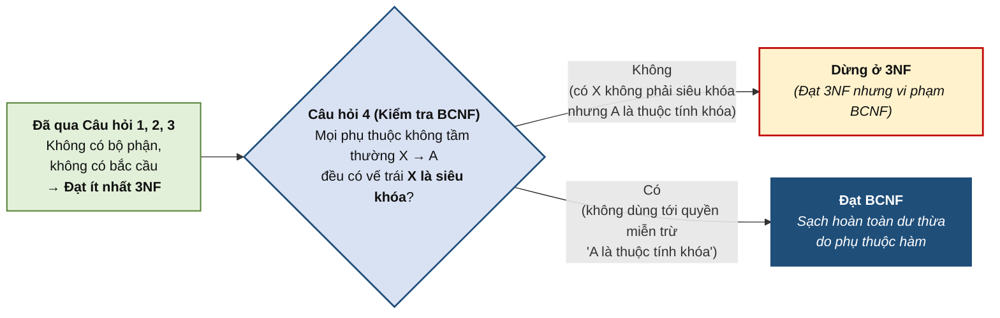
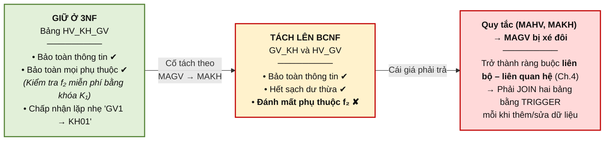
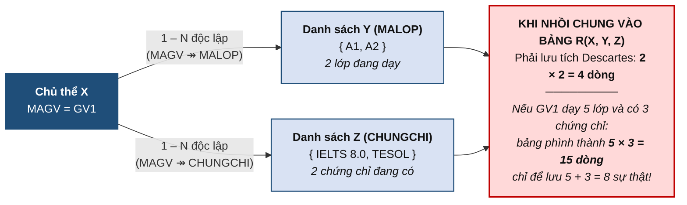

# 5.10. Dạng chuẩn mức cao và phi chuẩn hóa

*(0,5 tiết — xem lưu ý về thời lượng ở đầu chương)*

Với 95% các bài toán quản lý trong thực tế, chuẩn hóa dừng lại ở **3NF** *(mục 5.9)* là đã hoàn tất. Tuy nhiên, có ba câu hỏi nâng cao mà một người thiết kế cơ sở dữ liệu chuyên nghiệp cần biết câu trả lời:

1. **Khi nào một bảng đã đạt 3NF mà vẫn còn dư thừa dữ liệu?** Đó là lúc xuất hiện **Dạng chuẩn Boyce–Codd (BCNF)** — và vì sao đôi khi ta biết bảng chưa đạt BCNF nhưng vẫn **chủ động dừng ở 3NF**? *(mục 5.10.1)*.
2. **Khi nào một bảng không còn bất kỳ phụ thuộc hàm nào vi phạm (đã đạt cả BCNF) mà vẫn bị lặp dữ liệu theo cấp số nhân?** Đó là lúc xuất hiện **Phụ thuộc đa trị** và **Dạng chuẩn 4 (4NF)** *(mục 5.10.2–5.10.3)*.
3. **Khi nào ta đã chuẩn hóa xong xuôi về 3NF, rồi lại cố tình gộp bảng hoặc thêm cột dư thừa trở lại?** Đó là kỹ thuật **Phi chuẩn hóa** *(mục 5.10.4)*.

## 5.10.1. Dạng chuẩn Boyce–Codd (BCNF) và sự đánh đổi với 3NF

Hãy nhìn lại phát biểu chuẩn của **3NF** *(Định nghĩa 5.14b ở mục 5.7.4)*: một lược đồ đạt 3NF nếu với mọi phụ thuộc hàm không tầm thường `X → A`, **hoặc** *(1)* `X` là siêu khóa, **hoặc** *(2)* `A` là thuộc tính khóa.

Điều kiện *(2)* *("hoặc `A` là thuộc tính khóa")* giống như một "cửa hậu" khoan hồng của 3NF: nó cho phép một thuộc tính **không phải siêu khóa** `X` được quyền quyết định một thuộc tính nằm trong khóa `A`. Năm 1974, R. F. Boyce và E. F. Codd nhận ra rằng chính "cửa hậu" này đôi khi vẫn để lọt dư thừa, và đề xuất đóng hẳn cửa hậu ấy lại.

!!! note "Định nghĩa 5.18 (Dạng chuẩn Boyce–Codd — Boyce–Codd Normal Form, BCNF)"

    Lược đồ quan hệ `R` *(đã ở 1NF)* đạt **dạng chuẩn Boyce–Codd (BCNF)** khi và chỉ khi với **mọi phụ thuộc hàm không tầm thường `X → A`** *(tức `A ∉ X`)* suy ra được từ `F`, vế trái **`X` bắt buộc phải là một siêu khóa của `R`**.

Câu khẩu quyết ngắn nhất của BCNF: **"Trong một bảng BCNF, mọi vế trái của mọi mũi tên đều phải là siêu khóa — không có bất kỳ ngoại lệ nào."**

Vì mọi bảng thỏa mãn điều kiện *"X là siêu khóa"* thì đương nhiên thỏa mãn điều kiện *"X là siêu khóa HOẶC A là thuộc tính khóa"*, nên **mọi lược đồ đạt BCNF đều chắc chắn đạt 3NF** *(BCNF được xem là "dạng chuẩn 3,5")*.

**Bảng 5.31. Đối chiếu trực diện 3NF và BCNF**

| Tiêu chí so sánh | Dạng chuẩn 3 (**3NF**) | Dạng chuẩn Boyce–Codd (**BCNF**) |
|---|---|---|
| **Điều kiện với mọi `X → A` không tầm thường** | `X` là siêu khóa **HOẶC** `A` là thuộc tính khóa | **`X` bắt buộc là siêu khóa** *(bỏ vế "hoặc `A` là thuộc tính khóa")* |
| **Khi nào một bảng đạt 3NF mà vi phạm BCNF?** | Chỉ xảy ra khi tồn tại `X → A` mà **`X` không phải siêu khóa** nhưng **`A` lại là một thuộc tính khóa** *(thường gặp khi lược đồ có **nhiều khóa dự tuyển chồng lấn nhau**)* | |
| **Khi lược đồ chỉ có 1 khóa duy nhất** *(hoặc các khóa không giao nhau)* | **3NF và BCNF hoàn toàn trùng nhau** *(đạt 3NF là tự động đạt BCNF)* | |
| **Bảo toàn thông tin khi tách bảng** | **Luôn đạt được** | **Luôn đạt được** |
| **Bảo toàn phụ thuộc hàm khi tách bảng** | **Luôn đạt được 100%** *(Định lý 5.2)* | **KHÔNG phải lúc nào cũng đạt được!** *(Định lý 5.3 dưới đây)* |

Nếu muốn kiểm tra thêm BCNF sau khi một lược đồ đã đi tới nhánh phải **Đạt 3NF** của Cây quyết định ở Hình 5.8 *(mục 5.7.6)*, ta chỉ cần gắn thêm **đúng một câu hỏi thứ tư** vào sau nút 3NF như sơ đồ dưới đây:

**Hình 5.11. Mở rộng cây quyết định từ 3NF lên BCNF**



> *(Kiểm tra nhanh trên bốn bảng kết quả của Trung tâm ABC ở mục 5.9.5: `HOCVIEN`, `GIAOVIEN`, `LOP`, `GHIDANH` đều chỉ có **một khóa duy nhất**, và mọi vế trái của các phụ thuộc trong từng bảng đều chính là khóa của bảng đó ⟹ cả bốn bảng của chúng ta ở mục 5.9 **đều đã đạt luôn BCNF**!).*

Vậy khi nào một bảng **đạt 3NF nhưng không đạt BCNF**, và tại sao trong trường hợp đó người ta lại thường khuyên **dừng ở 3NF thay vì cố tách lên BCNF**? Câu trả lời nằm ở định lý và ví dụ thực tế ngay dưới đây.

!!! note "Định lý 5.3 (Sự đánh đổi khi tách về BCNF)"

    Với mọi lược đồ quan hệ `R`, luôn tồn tại phép tách về **BCNF** đảm bảo **bảo toàn thông tin**; tuy nhiên, **không phải lúc nào cũng tồn tại phép tách về BCNF bảo toàn được toàn bộ các phụ thuộc hàm** của `F`.

!!! example "Ví dụ 5.18 — Một bảng tại Trung tâm ABC đạt 3NF nhưng vi phạm BCNF, và cái giá phải trả nếu cố tách lên BCNF"

    Giả sử Trung tâm Anh ngữ ABC mở lớp dạy kèm chuyên đề với hai quy tắc nghiệp vụ:

    - Quy tắc 1 (`f₁`): *Mỗi giáo viên chỉ chuyên dạy **một** khóa học duy nhất* (`MAGV → MAKH`) — nhưng một khóa học có nhiều giáo viên cùng dạy.
    - Quy tắc 2 (`f₂`): *Mỗi học viên, khi đăng ký một khóa học, chỉ được xếp học với **một** giáo viên phụ trách* (`(MAHV, MAKH) → MAGV`).

    Ta lưu thông tin này trong bảng `HV_KH_GV(MAHV, MAKH, MAGV)` với tập phụ thuộc hàm `F = { f₁: MAGV → MAKH,  f₂: (MAHV, MAKH) → MAGV }`. Hãy phân tích bảng này qua Bảng 5.32.

**Bảng 5.32. Phân tích `HV_KH_GV(MAHV, MAKH, MAGV)` — đạt 3NF, vi phạm BCNF, và hậu quả khi tách lên BCNF**

*a) Dữ liệu trên bảng `HV_KH_GV` (Đạt 3NF nhưng vi phạm BCNF — sự thật "GV1 dạy KH01" bị chép lặp):*

| MAHV | MAKH | MAGV | Giải thích |
|---|---|---|---|
| HV01 | **KH01** | **GV1** | Học viên HV01 học khóa KH01 với cô GV1 |
| HV02 | **KH01** | **GV1** | Học viên HV02 cũng học với cô GV1 → sự thật **"GV1 dạy KH01" bị lặp lại lần 2** |
| HV03 | KH01 | GV3 | Học viên HV03 học khóa KH01 với thầy GV3 |
| HV01 | KH02 | GV2 | Học viên HV01 học khóa KH02 với cô GV2 |

*b) Chẩn đoán toán học trên `HV_KH_GV`:*

| Bước phân tích | Kết quả chi tiết |
|---|---|
| **1. Tìm tất cả khóa** | `TN = {MAHV}`, `TG = {MAKH, MAGV}`, `TĐ = ∅`.<br/>Tính bao đóng: `(MAHV, MAKH)⁺ = {MAHV, MAKH, MAGV}` *(nhờ `f₂`)* và `(MAHV, MAGV)⁺ = {MAHV, MAGV, MAKH}` *(nhờ `f₁`)*.<br/>⟹ Bảng có **2 khóa dự tuyển chồng lấn nhau ở `MAHV`**: **`K₁ = (MAHV, MAKH)`** và **`K₂ = (MAHV, MAGV)`**.<br/>⟹ **Cả 3 thuộc tính `{MAHV, MAKH, MAGV}` đều là thuộc tính khóa!** |
| **2. Kiểm tra 3NF và BCNF** | • Phụ thuộc `f₂: (MAHV, MAKH) → MAGV`: vế trái là khóa `K₁` ⟹ **Đạt cả 3NF lẫn BCNF**.<br/>• Phụ thuộc `f₁: MAGV → MAKH`: vế trái `MAGV` **không phải siêu khóa**, nhưng vế phải `MAKH` **là thuộc tính khóa** *(nằm trong `K₁`)* ⟹ **Thỏa 3NF, nhưng VI PHẠM BCNF!** |
| **3. Tách lên BCNF theo `f₁ (MAGV → MAKH)`** | Để khử vi phạm BCNF của `f₁`, ta tách `HV_KH_GV` theo `MAGV → MAKH` thành hai bảng:<br/>• **`GV_KH(MAGV, MAKH)`** *(khóa `MAGV` — đạt BCNF)*;<br/>• **`HV_GV(MAHV, MAGV)`** *(khóa `(MAHV, MAGV)` — đạt BCNF)*.<br/>Phép tách **bảo toàn thông tin** vì cột chung `MAGV` là khóa của `GV_KH`. |

*c) Hậu quả sau khi tách lên BCNF — Phụ thuộc `f₂: (MAHV, MAKH) → MAGV` bị xé đứt:*

| Bảng `GV_KH` *(Khóa `MAGV`)* | MAGV | MAKH | | Bảng `HV_GV` *(Khóa `(MAHV, MAGV)`)* | MAHV | MAGV |
|---|---|---|---|---|---|---|
| | **GV1** | **KH01** | | | **HV01** | **GV1** |
| | **GV3** | **KH01** | | | HV02 | GV1 |
| | GV2 | KH02 | | | HV03 | GV3 |
| | | | | *(Chèn thêm dòng mới)* | **HV01** | **GV3 *(cùng dạy KH01!)*** |

Hãy nhìn điều vừa xảy ra ở phần (c) của Bảng 5.32:

- Sau khi tách thành `GV_KH(MAGV, MAKH)` và `HV_GV(MAHV, MAGV)`, dư thừa `"GV1 dạy KH01"` đã biến mất.
- **Nhưng quy tắc nghiệp vụ `f₂: (MAHV, MAKH) → MAGV`** *(một học viên trong một khóa học chỉ được học với một giáo viên)* **không còn nằm trọn trong bảng nào nữa** (`MAHV` ở bảng `HV_GV`, còn `MAKH` ở bảng `GV_KH`)!
- Khi nhân viên nhập thêm dòng `(HV01, GV3)` vào bảng `HV_GV`, bản thân bảng `HV_GV` không thấy gì sai *(vì `(HV01, GV3)` không trùng khóa với `(HV01, GV1)`)*. Nhưng khi ghép hai bảng lại, hóa ra cả `GV1` lẫn `GV3` đều dạy khóa `KH01` — nghĩa là học viên `HV01` đang học khóa `KH01` với **hai giáo viên cùng lúc**, vi phạm quy tắc `f₂` mà không một khóa chính nào bắt được! Muốn ngăn chặn, lập trình viên buộc phải viết một `TRIGGER` kết hai bảng mỗi khi thêm dòng vào `HV_GV`.

**Hình 5.12. Sự đánh đổi giữa 3NF và BCNF khi có hai khóa chồng lấn — "Leo cao hơn chưa chắc tốt hơn"**



> **Kết luận thực hành.** Trong đa số dự án thực tế:
> 1. Nếu tách lên BCNF mà **không làm mất phụ thuộc hàm nào** *(như 4 bảng của Trung tâm ABC ở mục 5.9)*, ta đương nhiên nhận được cả BCNF.
> 2. Nếu rơi vào tình huống khóa chồng lấn như `HV_KH_GV` mà việc tách lên BCNF làm đứt phụ thuộc hàm, người thiết kế thường **chủ động dừng ở 3NF** *(giữ nguyên bảng `HV_KH_GV` với hai khóa `UNIQUE(MAHV, MAKH)` và `PRIMARY KEY(MAHV, MAGV)`)* để hệ quản trị kiểm tra ràng buộc tự động. Đó là minh chứng sống động cho nguyên tắc: **"Chuẩn cao hơn" không phải lúc nào cũng đồng nghĩa với "thiết kế tốt hơn"**.

## 5.10.2. Phụ thuộc đa trị (Multivalued Dependency)

Có một loại dư thừa kỳ lạ mà **ngay cả BCNF cũng không phát hiện được**, vì nó không sinh ra từ phụ thuộc hàm `X → Y` mà sinh ra từ việc **nhồi hai danh sách độc lập (hai mối quan hệ `1–N` độc lập) của cùng một thực thể vào chung một bảng**.

!!! example "Ví dụ 5.19"

    Phòng Nhân sự của Trung tâm ABC muốn lưu hai thông tin về giáo viên: *mỗi giáo viên dạy những lớp nào (`MALOP`)* và *có những chứng chỉ quốc tế nào (`CHUNGCHI`)*. Hai thông tin này **hoàn toàn độc lập với nhau**: chứng chỉ của cô Lê Hoa gắn với cá nhân cô, không liên quan gì tới việc học kỳ này cô dạy lớp `A1` hay `A2`.

    Nếu gom cả ba cột vào một bảng `GV_LOP_CC(MAGV, MALOP, CHUNGCHI)` *(đã ở 1NF vì mỗi ô chỉ ghi 1 lớp và 1 chứng chỉ)*, hãy xem dữ liệu buộc phải lưu như thế nào:

    | MAGV *(PK)* | MALOP *(PK)* | CHUNGCHI *(PK)* |
    |---|---|---|
    | GV1 | A1 | IELTS 8.0 |
    | GV1 | A1 | TESOL |
    | GV1 | A2 | IELTS 8.0 |
    | GV1 | A2 | TESOL |

    Cô `GV1` dạy **2 lớp** (`A1, A2`) và có **2 chứng chỉ** (`IELTS 8.0, TESOL`), nên bảng buộc phải ghi tổ hợp chéo **`2 × 2 = 4 dòng`**! Nếu cô dạy **5 lớp** và có **3 chứng chỉ**, bảng phải chứa **`5 × 3 = 15 dòng`**, trong khi lượng sự thật thực chất chỉ là `5 + 3 = 8` dòng thông tin.

    Điều đáng kinh ngạc: bảng `GV_LOP_CC` này **đã đạt BCNF**! Vì khóa duy nhất là cả bộ ba `(MAGV, MALOP, CHUNGCHI)` và trong bảng **không hề có bất kỳ phụ thuộc hàm không tầm thường nào** *(một giáo viên dạy nhiều lớp và có nhiều chứng chỉ)*, nên điều kiện BCNF thỏa mãn một cách hiển nhiên. Vậy mà dư thừa kiểu **"bùng nổ tích Descartes"** vẫn còn nguyên!

Để bắt được thủ phạm này, Ronald Fagin (1977) đưa ra khái niệm **phụ thuộc đa trị**.

!!! note "Định nghĩa 5.19 (Phụ thuộc đa trị — Multivalued Dependency, MVD)"

    Cho lược đồ quan hệ `R` và ba tập thuộc tính rời nhau `X`, `Y`, `Z` sao cho `Z = R − X − Y`. Ta nói `Y` **phụ thuộc đa trị** vào `X`, ký hiệu **`X ↠ Y`** *(đọc là "`X` xác định đa trị `Y`")*, nếu trong mọi thể hiện hợp lệ của `R`: với mọi cặp bộ `t₁`, `t₂` có cùng giá trị trên `X` (`t₁[X] = t₂[X]`), luôn phải tồn tại bộ `t₃` trong `R` sao cho `t₃[X] = t₁[X]`, `t₃[Y] = t₁[Y]` và `t₃[Z] = t₂[Z]`.

Bỏ qua công thức ký hiệu, ý nghĩa thực tế của **`X ↠ Y`** trên bảng `R(X, Y, Z)` cực kỳ dễ hiểu:

> **`X ↠ Y` nghĩa là: với mỗi giá trị của `X`, tập hợp các giá trị `Y` đi kèm với `X` hoàn toàn độc lập với tập hợp các giá trị `Z` đi kèm với `X`** *(vì độc lập nên khi ghép chung vào một bảng, mọi giá trị `Y` của `X` phải nhân chéo với mọi giá trị `Z` của `X`)*.

**Hình 5.13. Phụ thuộc đa trị `MAGV ↠ MALOP` và `MAGV ↠ CHUNGCHI` — hai nhánh `1–N` độc lập gây bùng nổ tích**



Ba tính chất cần nhớ về phụ thuộc đa trị:

1. **Tính đối xứng phần bù (luôn đi thành cặp):** Trong `R(X, Y, Z)`, nếu `X ↠ Y` thì bắt buộc cũng có **`X ↠ Z`** *(vì "`Y` độc lập với `Z` khi biết `X`" cũng chính là "`Z` độc lập với `Y` khi biết `X`")*. Người ta thường viết gộp là `X ↠ Y | Z`.
2. **Mọi phụ thuộc hàm đều là phụ thuộc đa trị:** Nếu `X → Y` thì `X ↠ Y` *(tập giá trị `Y` ứng với mỗi `X` khi ấy chỉ gồm đúng 1 phần tử)*.
3. **Phụ thuộc đa trị tầm thường:** `X ↠ Y` được gọi là *tầm thường* *(trivial)* nếu `Y ⊆ X` hoặc `X ∪ Y = R` *(tức phần còn lại `Z = ∅`, không có nhánh thứ hai để gây nhân chéo)*.

## 5.10.3. Dạng chuẩn 4 (4NF) và thuật toán tách

!!! note "Định nghĩa 5.20 (Dạng chuẩn 4 — Fourth Normal Form, 4NF)"

    Lược đồ quan hệ `R` đạt **dạng chuẩn 4 (4NF)** nếu với **mọi phụ thuộc đa trị không tầm thường `X ↠ Y`** thỏa mãn trên `R`, vế trái **`X` luôn là một siêu khóa của `R`**.
    *(Vì mọi phụ thuộc hàm `X → A` cũng là một phụ thuộc đa trị `X ↠ A`, nên một bảng đạt 4NF thì tự động đạt BCNF).*

**Thuật toán tách lược đồ vi phạm về 4NF:**

```
LẶP cho tới khi mọi bảng con đều đạt 4NF:
    TÌM một bảng R có phụ thuộc đa trị không tầm thường  X ↠ Y
        mà X KHÔNG phải là siêu khóa của R.
    NẾU tìm thấy:
        Đặt  Z = R − X − Y
        Tách R thành hai bảng độc lập:
             R₁(X ∪ Y)    và    R₂(X ∪ Z)
```

!!! note "Định lý 5.4 (Định lý Fagin về phép tách 4NF)"

    Phép tách lược đồ `R(X, Y, Z)` thành hai bảng `R₁(X ∪ Y)` và `R₂(X ∪ Z)` là **bảo toàn thông tin khi và chỉ khi** trong `R` thỏa mãn phụ thuộc đa trị **`X ↠ Y`** *(và `X ↠ Z`)*.

!!! example "Ví dụ 5.20 — Tách bảng `GV_LOP_CC` ở Ví dụ 5.19 về 4NF"

    - Trong `GV_LOP_CC(MAGV, MALOP, CHUNGCHI)`, ta có cặp phụ thuộc đa trị không tầm thường `MAGV ↠ MALOP` và `MAGV ↠ CHUNGCHI`, trong khi `MAGV` **không phải siêu khóa** *(khóa là cả 3 thuộc tính)*. Vậy bảng **vi phạm 4NF**.
    - Áp thuật toán tách với `X = {MAGV}`, `Y = {MALOP}`, `Z = {CHUNGCHI}`, ta tách thành **hai bảng độc lập đều đạt 4NF**:
      - **`GV_LOP(MAGV, MALOP)`** *(lưu giáo viên dạy lớp nào)*;
      - **`GV_CC(MAGV, CHUNGCHI)`** *(lưu giáo viên có chứng chỉ nào)*.

    | Bảng `GV_LOP` *(Đạt 4NF)* | MAGV *(PK)* | MALOP *(PK)* | | Bảng `GV_CC` *(Đạt 4NF)* | MAGV *(PK)* | CHUNGCHI *(PK)* |
    |---|---|---|---|---|---|---|
    | | GV1 | A1 | | | GV1 | IELTS 8.0 |
    | | GV1 | A2 | | | GV1 | TESOL |

    - **Hiệu quả:** Với giáo viên dạy 5 lớp và có 3 chứng chỉ, thay vì lưu `5 × 3 = 15 dòng` lặp chéo, hai bảng 4NF chỉ lưu đúng `5 + 3 = 8 dòng`. Quan trọng hơn: khi cô `GV1` thi thêm chứng chỉ thứ tư, ta chỉ cần `INSERT` **đúng 1 dòng** vào `GV_CC` *(thay vì phải chèn 5 dòng cho 5 lớp đang dạy)*.

Để khép lại phần lý thuyết các dạng chuẩn, bảng dưới đây tổng hợp toàn bộ hệ thống thang đo từ **1NF đến 4NF** trên cùng một mặt phẳng để người học dễ ôn tập.

**Bảng 5.33. Bảng tổng hợp toàn bộ thang đo các dạng chuẩn từ 1NF đến 4NF**

| Dạng chuẩn | Điều kiện cốt lõi | Loại dư thừa / Thủ phạm bị loại bỏ | Trong thực tế thường gặp khi nào? |
|:---:|---|---|---|
| **1NF** | Mọi ô đều chứa **giá trị nguyên tố (đơn trị)** | Thuộc tính đa trị, danh sách, nhóm cột lặp | Chuyển bảng tính Excel / biểu mẫu giấy sang bảng CSDL |
| **2NF** | Đạt 1NF + Không có thuộc tính không khóa **phụ thuộc bộ phận** vào khóa | `K₁ → A` với `K₁ ⊂ K` *(thuộc tính ăn theo một nửa khóa phức hợp)* | Bảng có khóa phức hợp `(A, B)` nhưng nhồi thêm tên của `A` hoặc tên của `B` |
| **3NF** | Đạt 2NF + Không có thuộc tính không khóa **phụ thuộc bắc cầu** vào khóa<br/>*(Mọi `X → A`: `X` là siêu khóa **hoặc** `A` là thuộc tính khóa)* | `K → Z → A` với `Z` ngoài khóa *(thực thể ẩn nằm ké trong bảng)* | Bảng lớp học nhồi thêm tên/trình độ giáo viên; bảng đơn hàng nhồi thêm tên/địa chỉ khách hàng |
| **BCNF** | Mọi phụ thuộc hàm không tầm thường `X → A` đều có **`X` là siêu khóa** | `X → A` mà `X` không phải siêu khóa nhưng `A` là thuộc tính khóa | Lược đồ có **nhiều khóa dự tuyển chồng lấn nhau** *(cân nhắc dừng ở 3NF nếu tách làm mất phụ thuộc)* |
| **4NF** | Đạt BCNF + Mọi phụ thuộc đa trị không tầm thường `X ↠ Y` đều có **`X` là siêu khóa** | **Phụ thuộc đa trị** `X ↠ Y | Z` *(bùng nổ tích Descartes `M × N` dòng)* | Nhồi hai danh sách `1–N` độc lập của cùng một chủ thể *(như Lớp dạy và Chứng chỉ)* vào chung một bảng |

*(Trên 4NF còn có **5NF — Project-Join Normal Form**, xử lý các ràng buộc kết nối phải tách thành 3 bảng trở lên mới không mất thông tin; trường hợp này rất hiếm trong thực tế và nằm ngoài phạm vi học phần).*

## 5.10.4. Phi chuẩn hóa (Denormalization)

Toàn bộ chương này hướng tới việc tách bảng để đạt chuẩn cao. Mục cuối cùng nói về kỹ thuật **cố ý đi ngược lại một cách có kiểm soát**.

!!! note "Định nghĩa 5.21 (Phi chuẩn hóa — Denormalization)"

    **Phi chuẩn hóa** là kỹ thuật mà người thiết kế — **sau khi đã chuẩn hóa lược đồ về 3NF/BCNF** — chủ động **đưa một phần dư thừa dữ liệu có kiểm soát trở lại** *(bằng cách thêm cột tính sẵn như `SISO`, `TONGTIEN` hoặc gộp bớt bảng)* nhằm giảm số phép kết (`JOIN`) và **tăng tốc độ đọc cho các truy vấn nặng**.

Lý do rất thực tế: chuẩn hóa tách dữ liệu ra nhiều bảng để bảo vệ các thao tác thêm/sửa/xóa (`INSERT/UPDATE/DELETE`), nhưng lại bắt các truy vấn đọc (`SELECT`) phải ghép bảng (`JOIN`) nhiều hơn. Với hệ thống báo cáo phân tích chạy trên hàng chục triệu dòng, chi phí ghép 5–6 bảng mỗi lần xem báo cáo có thể làm nghẽn toàn hệ thống.

**Bảng 5.34. Bốn điều kiện bắt buộc để quyết định phi chuẩn hóa là hợp lý**

| Điều kiện | Vì sao bắt buộc phải có? |
|---|---|
| **1. Tải công việc đọc áp đảo ghi** *(đọc rất nhiều, sửa rất ít)* | Giảm thiểu xác suất xảy ra dị thường cập nhật |
| **2. Ngữ cảnh là kho dữ liệu (Data Warehouse) hoặc bảng báo cáo** | Mục tiêu ưu tiên là tốc độ tổng hợp số liệu, không phải xử lý giao dịch thời gian thực |
| **3. Đã đo đạc thực nghiệm thấy phép `JOIN` là nút thắt cổ chai** | Chỉ phi chuẩn hóa khi có số liệu đo hiệu năng cụ thể, không làm theo cảm tính |
| **4. Có cơ chế tự động giữ cho dữ liệu dư thừa luôn đồng bộ** | Phải cài đặt `TRIGGER`, `GENERATED COLUMN`, `MATERIALIZED VIEW` hoặc tiến trình đồng bộ định kỳ để cột dư thừa không bao giờ lệch với dữ liệu gốc |

!!! warning "Chú ý — Ranh giới giữa 'phi chuẩn hóa chuyên nghiệp' và 'thiết kế cẩu thả chưa chuẩn hóa'"

    Hai việc này nhìn kết quả có vẻ giống nhau *(trong bảng đều có cột dư thừa)*, nhưng bản chất trái ngược nhau hoàn toàn:
    - **Thiết kế cẩu thả** là **không biết chuẩn hóa**, để mặc dữ liệu lặp từ đầu và không biết có những dị thường nào đang rình rập.
    - **Phi chuẩn hóa** chỉ được làm **sau khi đã thiết kế xong lược đồ 3NF**, chỉ mở lại đúng một vài điểm dư thừa đã tính toán kỹ chi phí – lợi ích, có tài liệu ghi rõ lý do và có `TRIGGER` khóa chặt tính nhất quán.

Đến đây, câu hỏi treo suốt từ **mục 2.2.5** của Chương 2 và **mục 4.7.5** của Chương 4 — *thuộc tính dẫn xuất `SISO` trong bảng `LOP` nên lưu hay tính lại?* — đã có câu trả lời trọn vẹn ở cả ba tầng kiến thức:

| Chương | Góc nhìn | Câu trả lời cho cột `SISO` (sĩ số lớp) |
|---|---|---|
| **Chương 2** | Mô hình ý niệm (ER) | *"Nguyên tắc gốc là **không lưu thành cột vật lý**, vì `SISO` đếm được từ `GHIDANH`; lưu lại sẽ sinh dư thừa."* |
| **Chương 4** | Ràng buộc toàn vẹn | *"Nếu lưu `SISO`, bảng tầm ảnh hưởng của ràng buộc R6 có tới **5/6 ô mang dấu (+)** — cờ đỏ thiết kế báo hiệu phải viết 5 trigger, nên bỏ cột `SISO` và thay bằng `VIEW`."* |
| **Chương 5** | Chuẩn hóa & Phi chuẩn hóa | *"Với hệ thống giao dịch hằng ngày (OLTP) ít dòng, bỏ `SISO` để giữ 3NF thuần khiết là đúng. Nhưng nếu bảng `GHIDANH` có hàng chục triệu dòng và màn hình tra cứu lớp học được mở hàng nghìn lần mỗi phút, việc giữ cột `SISO` trong `LOP` kèm `TRIGGER` tự động cộng/trừ khi ghi danh chính là một **quyết định phi chuẩn hóa hợp lý**."* |

---


---

[← Trang trước](5-9-quy-trinh-chuan-hoa-hoan-chinh.md) · [Trang sau →](5-11-khep-lai-hoc-phan.md)
