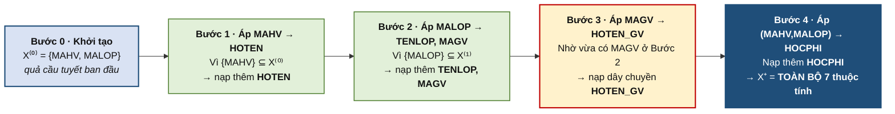
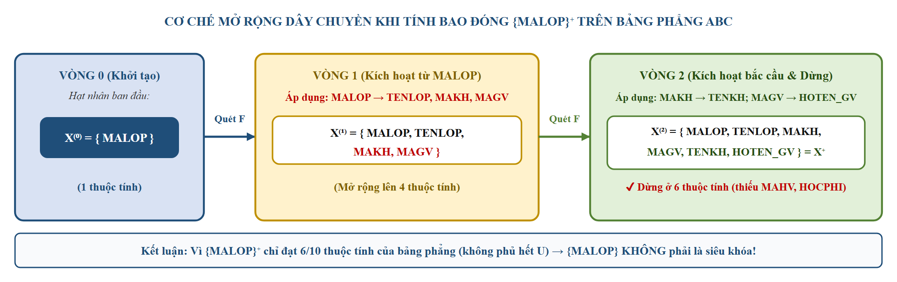

# 5.4. Bao đóng của tập thuộc tính

*(1,5 tiết)*

Ở mục 5.3.6, ta đã thấy hạn chế của việc suy diễn bằng tay theo hệ luật Armstrong: muốn chứng minh `X → Y` **đúng** thì chỉ cần nối được một chuỗi từ `X` sang `Y`, nhưng muốn khẳng định `X → Y` **không suy ra được** thì không thể nói *"vì tôi tìm mãi chưa ra cách nối"*. Ta cần một thủ tục máy móc, hữu hạn bước, gom **tất cả** những thuộc tính có thể suy ra từ `X` vào một chiếc túi duy nhất. Chiếc túi ấy được gọi là **bao đóng của tập thuộc tính `X`**, và đây là **công cụ trung tâm** của cả chương: tìm khóa *(mục 5.5)*, rút gọn phủ tối thiểu *(mục 5.6)*, xét dạng chuẩn *(mục 5.7)* và kiểm tra phép tách *(mục 5.8)* đều quy về phép tính này.

## 5.4.1. Ý tưởng trực giác và định nghĩa

Hãy hình dung mỗi thuộc tính là một căn phòng, và mỗi phụ thuộc hàm `A → B` là một cánh cửa một chiều: hễ đã có chìa khóa vào đủ các phòng trong `A`, ta mở được cửa để lấy thêm chìa khóa của các phòng trong `B`. Xuất phát từ chùm chìa khóa ban đầu `X`, ta mở hết mọi cánh cửa có thể mở, lấy chìa mới rồi lại đi mở tiếp các cửa khác cho tới khi không mở thêm được cánh cửa nào nữa. Tập hợp tất cả các phòng mở được khi dừng lại chính là `X⁺`.

!!! note "Định nghĩa 5.6 (Bao đóng của tập thuộc tính)"

    Cho lược đồ quan hệ `R` và tập phụ thuộc hàm `F`. **Bao đóng** của tập thuộc tính `X` đối với `F`, ký hiệu **`X⁺`** *(hoặc `X⁺_F` khi cần chỉ rõ tập phụ thuộc đang dùng)*, là **tập hợp tất cả các thuộc tính `A` của `R` sao cho phụ thuộc hàm `X → A` suy ra được từ `F` bằng hệ luật dẫn Armstrong**:

    `X⁺ = { A ∈ R  |  F ⊢ X → A }`

Từ định nghĩa và hệ luật Armstrong, ta rút ra ngay ba tính chất nền tảng của `X⁺`:

- **Tính phản xạ (luôn chứa điểm xuất phát):** `X ⊆ X⁺` *(do luật phản xạ `X → X`, mọi thuộc tính trong `X` đều có mặt trong `X⁺` ngay từ đầu)*.
- **Tính đơn điệu (thêm đầu vào thì kết quả không bao giờ nhỏ đi):** nếu `X ⊆ Y` thì `X⁺ ⊆ Y⁺`.
- **Tính đóng (lấy bao đóng hai lần không thêm được gì mới):** `(X⁺)⁺ = X⁺`.

## 5.4.2. Thuật toán tính bao đóng `X⁺` ("lăn quả cầu tuyết")

Để tính `X⁺` trên giấy cũng như trên máy tính, ta xuất phát từ tập kết quả ban đầu bằng chính `X`, rồi quét qua tập phụ thuộc hàm `F` nhiều vòng để nạp dần các thuộc tính mới.

```
THUẬT TOÁN TÍNH BAO ĐÓNG X⁺ (với tập phụ thuộc hàm F):
────────────────────────────────────────────────────────────────────
Đầu vào : Tập thuộc tính X và tập phụ thuộc hàm F trên lược đồ R.
Đầu ra  : Bao đóng X⁺.

BƯỚC 1 (Khởi tạo):
    Đặt  X⁽⁰⁾ ← X      (mọi thuộc tính trong X đều hiển nhiên biết trước)

BƯỚC 2 (Lặp mở rộng — "lăn quả cầu tuyết"):
    Lặp lại với k = 1, 2, ... cho tới khi không thêm được thuộc tính mới:
        Xét lần lượt từng phụ thuộc hàm  U → V  trong F:
            NẾU  U ⊆ X⁺ hiện tại   (vế trái đã nằm trọn trong túi)
            THÌ  X⁺ ← X⁺ ∪ V       (bỏ toàn bộ vế phải V vào túi)

BƯỚC 3 (Dừng và kết luận):
    Khi quét trọn một vòng qua toàn bộ F mà X⁺ không đổi (hoặc khi X⁺ = R),
    dừng thuật toán và trả về X⁺.
```

> **Vì sao thuật toán luôn dừng sau hữu hạn bước?** Mỗi lần cập nhật thật sự ở Bước 2 phải nạp thêm ít nhất một thuộc tính mới lấy từ tập thuộc tính hữu hạn của `R`. Nếu lược đồ `R` có `n` thuộc tính và `|X| = m`, quả cầu tuyết chỉ có thể nở thêm tối đa `n − m` lần trước khi chạm trần `R` hoặc không còn phụ thuộc nào kích hoạt được nữa.

**Hình 5.4. Thuật toán tính bao đóng `X⁺` — phép loại suy lăn quả cầu tuyết trên lược đồ Trung tâm ABC**



{width=85%}

*Ảnh minh họa: Cơ chế mở rộng dây chuyền khi tính bao đóng {MALOP}⁺ trên bảng phẳng Trung tâm Anh ngữ ABC — xuất phát từ hạt nhân ban đầu và nạp thêm thuộc tính qua từng vòng quét tập phụ thuộc hàm F — Nguồn: Tác giả tự vẽ.*

Để thấy rõ từng bước trong Hình 5.4 diễn ra như thế nào, bảng dưới đây ghi lại toàn bộ vết chạy thuật toán khi tính `(MAHV, MALOP)⁺` trên bảng phẳng `GHIDANH_PHANG(MAHV, HOTEN, MALOP, TENLOP, MAGV, HOTEN_GV, HOCPHI)` với tập phụ thuộc hàm nghiệp vụ `F = {f₁: MAHV → HOTEN; f₂: MALOP → TENLOP, MAGV; f₃: MAGV → HOTEN_GV; f₄: (MAHV, MALOP) → HOCPHI}`.

**Bảng 5.11. Bảng vết từng bước tính `(MAHV, MALOP)⁺` khớp với Hình 5.4**

| Bước | Phụ thuộc đang xét | Kiểm tra điều kiện `Vế trái ⊆ X⁺ hiện tại`? | Thuộc tính mới dính thêm | Tập `X⁺` sau bước này |
|:--:|---|---|---|---|
| **0** | *(Khởi tạo)* | — | — | `{MAHV, MALOP}` |
| **1** | `f₁: MAHV → HOTEN` | `{MAHV} ⊆ {MAHV, MALOP}` (**Đúng**) | `+ HOTEN` | `{MAHV, MALOP, HOTEN}` |
| **2** | `f₂: MALOP → TENLOP, MAGV` | `{MALOP} ⊆ X⁺` (**Đúng**) | `+ TENLOP, MAGV` | `{MAHV, MALOP, HOTEN, TENLOP, MAGV}` |
| **3** | `f₃: MAGV → HOTEN_GV` | `{MAGV} ⊆ X⁺` (**Đúng** — nhờ `MAGV` vừa nạp ở bước 2) | `+ HOTEN_GV` | `{MAHV, MALOP, HOTEN, TENLOP, MAGV, HOTEN_GV}` |
| **4** | `f₄: (MAHV, MALOP) → HOCPHI` | `{MAHV, MALOP} ⊆ X⁺` (**Đúng**) | `+ HOCPHI` | `{MAHV, MALOP, HOTEN, TENLOP, MAGV, HOTEN_GV, HOCPHI}` = **toàn bộ `R` → DỪNG** |

!!! warning "Chú ý — lỗi sai phổ biến nhất khi tính bao đóng bằng tay"

    Người mới học rất hay chỉ đọc lướt tập `F` **một lượt duy nhất từ trái sang phải** rồi kết luận. Cách làm ấy sẽ **sai ngay** khi một phụ thuộc hàm đứng đầu danh sách cần đến thuộc tính do phụ thuộc đứng cuối danh sách sinh ra! Ở Bảng 5.11, sở dĩ một vòng đã đủ là vì `f₂` *(sinh ra `MAGV`)* tình cờ được viết trước `f₃` *(dùng `MAGV` để sinh `HOTEN_GV`)*. Nếu đề bài viết `f₃` lên đầu danh sách, ở lượt quét thứ nhất ta chưa có `MAGV` nên phải tạm bỏ qua `f₃`, đợi lấy được `MAGV` rồi **quay lại quét vòng thứ hai** thì `f₃` mới kích hoạt.

Bảng dưới đây minh họa trực diện hiện tượng "phải quét vòng thứ hai" trên một tập `F` chỉ gồm hai phụ thuộc hàm viết ngược thứ tự.

**Bảng 5.12. Tính `A⁺` với `F = {B → C, A → B}` trên `R(A, B, C)` — quét một lượt thì sót, hai vòng mới đủ**

| Vòng quét | Phụ thuộc đang xét | Kiểm tra `Vế trái ⊆ X⁺`? | Hành động | `X⁺` sau bước |
|:--:|---|:--:|---|---|
| **Khởi tạo** | — | — | Đặt `X⁽⁰⁾ = {A}` | `{A}` |
| **Vòng 1** | `B → C` | `B ∉ {A}` (**Sai**) | Tạm bỏ qua vì chưa có `B` | `{A}` |
| **Vòng 1** | `A → B` | `A ∈ {A}` (**Đúng**) | Nạp thêm `B` *(túi `X⁺` vừa thay đổi!)* | `{A, B}` |
| **Vòng 2** | `B → C` | `B ∈ {A, B}` (**Đúng**) | Nhờ vòng 1 đã nạp `B`, nay mở được cửa sang `C` | `{A, B, C}` |
| **Vòng 2** | `A → B` | `A ∈ {A, B, C}` (**Đúng**) | `B` đã có sẵn trong túi → không thêm gì | `{A, B, C}` |
| **Vòng 3** | *(Quét kiểm tra)* | — | Không thuộc tính nào mới *(hoặc đã bằng `R`)* → **DỪNG** | **`{A, B, C}`** |

Nếu vội vàng dừng ngay cuối Vòng 1, ta sẽ kết luận sai `A⁺ = {A, B}`, từ đó trả lời sai rằng `A → C` không suy ra được và `A` không phải siêu khóa của `R(A, B, C)`. Quy tắc an toàn tuyệt đối là: **hễ trong vòng vừa qua có nạp thêm dù chỉ một thuộc tính mới (và `X⁺` chưa phủ hết `R`), bắt buộc phải quét lại từ đầu**.

## 5.4.3. Hai cách trình bày bài giải và các ví dụ tính từng bước

Trong bài kiểm tra và thi tự luận, tùy yêu cầu của câu hỏi mà người học có thể trình bày phép tính bao đóng theo **hai cách** đều được chấp nhận:

1. **Cách 1 — Trình bày dạng bảng theo vòng lặp** *(như Bảng 5.12)*: dùng khi đề bài yêu cầu *"Tính bao đóng `X⁺`, ghi rõ từng vòng lặp"*.
2. **Cách 2 — Trình bày dạng chuỗi mở rộng từng bước**: viết gọn trên vài dòng theo mẫu `X⁽⁰⁾ ⊂ X⁽¹⁾ ⊂ X⁽²⁾ …`, dưới mỗi mũi tên ghi rõ phụ thuộc hàm đã áp dụng. Cách này rất nhanh và tiện khi phải tính hàng loạt bao đóng trong bài toán tìm khóa *(mục 5.5)* hoặc tìm phủ tối thiểu *(mục 5.6)*.

Hai ví dụ và một bài tập mẫu dưới đây minh họa trọn vẹn cả hai cách trình bày cũng như ba kịch bản kết quả thường gặp: **nở ra toàn bộ lược đồ**, **nở một phần rồi dừng**, và **đứng yên ngay từ bước khởi tạo**.

!!! example "Ví dụ 5.6 — Bốn bao đóng trên cùng một lược đồ: nở hết, nở một phần và đứng yên"

    Cho lược đồ `R(A, B, C, D)` và tập phụ thuộc hàm `F = {f₁: A → B, f₂: B → C, f₃: CD → A}`. Hãy tính:

    a) `(AD)⁺` bằng bảng từng vòng lặp;
    b) `(BD)⁺`, `B⁺` và `C⁺` bằng cách viết chuỗi mở rộng từng bước.

    *Lời giải câu a — Tính `(AD)⁺` bằng bảng vòng lặp:*

    | Vòng | Phụ thuộc xét | Kiểm tra `Vế trái ⊆ X⁺`? | Thuộc tính mới | Tập `X⁺` sau bước |
    |:--:|---|:--:|:--:|---|
    | **0** | *(Khởi tạo)* | — | — | `{A, D}` |
    | **1** | `f₁: A → B` | `{A} ⊆ {A, D}` (**Có**) | `+ B` | `{A, B, D}` |
    | **1** | `f₂: B → C` | `{B} ⊆ {A, B, D}` (**Có**) | `+ C` | `{A, B, C, D}` |
    | **1** | `f₃: CD → A` | `{C, D} ⊆ {A, B, C, D}` (**Có**) | không thêm | `{A, B, C, D}` |
    | **2** | *(Quét kiểm tra)* | Đã bằng toàn bộ `R(A, B, C, D)` | — | **Dừng:** `(AD)⁺ = {A, B, C, D}` |

    *Lời giải câu b — Tính `(BD)⁺`, `B⁺` và `C⁺` bằng chuỗi mở rộng:*

    - **Tính `(BD)⁺` *(trường hợp phải qua 2 vòng vì `f₃` cần `C`, sau đó quay lại `f₁`)*:**
      - Khởi tạo: `X⁽⁰⁾ = {B, D}`
      - Áp `f₂ (B → C)` vì `{B} ⊆ {B, D}`: `X⁽¹⁾ = {B, C, D}`
      - Áp `f₃ (CD → A)` vì `{C, D} ⊆ {B, C, D}`: `X⁽²⁾ = {A, B, C, D} = R` *(dừng)*
      - Kết luận: **`(BD)⁺ = {A, B, C, D}`** *(nở ra toàn bộ lược đồ)*.

    - **Tính `B⁺` *(trường hợp nở một phần rồi dừng vì thiếu thuộc tính phối hợp)*:**
      - Khởi tạo: `X⁽⁰⁾ = {B}`
      - Áp `f₂ (B → C)` vì `{B} ⊆ {B}`: `X⁽¹⁾ = {B, C}`
      - Xét `f₁ (A → B)`: thiếu `A`; xét `f₃ (CD → A)`: có `C` nhưng **thiếu `D`** nên không kích hoạt được `f₃`!
      - Kết luận: **`B⁺ = {B, C}`** *(chỉ mở rộng được một phần)*.

    - **Tính `C⁺` *(trường hợp đứng yên ngay từ đầu)*:**
      - Khởi tạo: `X⁽⁰⁾ = {C}`
      - Xét cả ba phụ thuộc: `f₁` cần `A` *(không có)*, `f₂` cần `B` *(không có)*, `f₃` cần cả cặp `CD` *(thiếu `D`)* → không áp dụng được bất kỳ phụ thuộc nào ngay từ vòng 1.
      - Kết luận: **`C⁺ = {C}`** *(bằng đúng tập khởi tạo)*.

---

### Bài tập mẫu 5.6 — Tính bao đóng trên lược đồ 6 thuộc tính, 8 phụ thuộc hàm (chuẩn bị cho bài thực hành)

**Đề bài.** Cho lược đồ quan hệ `R(A, B, C, D, E, G)` và tập gồm 8 phụ thuộc hàm:

`F = { f₁: AB → C,  f₂: C → A,  f₃: BC → D,  f₄: ACD → B,  f₅: D → EG,  f₆: BE → C,  f₇: CG → BD,  f₈: CE → AG }`

a) Tính bao đóng `(BD)⁺` và cho biết `BD` có phải siêu khóa của `R` không.
b) Tính bao đóng `(CG)⁺` và `(CE)⁺`.
c) Từ kết quả câu (a) và (b), không cần áp luật Armstrong, hãy trả lời ngay: `BD → A`, `CG → E` và `CE → D` có suy ra được từ `F` không?

**Lời giải chi tiết.**

*Câu a) Tính `(BD)⁺`:*

| Vòng | Bước | Phụ thuộc áp dụng | Giải thích điều kiện kích hoạt | Tập kết quả `X⁺` |
|:--:|:--:|---|---|---|
| **0** | Khởi tạo | — | — | `{B, D}` |
| **1** | 1 | `f₅: D → EG` | Vì `{D} ⊆ {B, D}`, nạp thêm `E, G` | `{B, D, E, G}` |
| **1** | 2 | `f₆: BE → C` | Vì `{B, E} ⊆ {B, D, E, G}`, nạp thêm `C` | `{B, C, D, E, G}` |
| **1** | 3 | `f₈: CE → AG` *(hoặc `f₂: C → A`)* | Vì `{C, E} ⊆ {B, C, D, E, G}`, nạp thêm `A` | `{A, B, C, D, E, G}` |
| **Dừng** | — | — | Đã thu được đủ cả 6 thuộc tính của `R` | **`(BD)⁺ = {A, B, C, D, E, G} = R`** |

Vì `(BD)⁺ = R`, tập **`BD` là một siêu khóa** của lược đồ `R`.

*Câu b) Tính `(CG)⁺` và `(CE)⁺` theo dạng chuỗi mở rộng:*

- **Tính `(CG)⁺`:**
  - Khởi tạo: `X⁽⁰⁾ = {C, G}`
  - Áp `f₂ (C → A)` vì `{C} ⊆ X⁽⁰⁾` ⟹ `X⁽¹⁾ = {A, C, G}`
  - Áp `f₇ (CG → BD)` vì `{C, G} ⊆ X⁽¹⁾` ⟹ `X⁽²⁾ = {A, B, C, D, G}`
  - Áp `f₅ (D → EG)` vì `{D} ⊆ X⁽²⁾` ⟹ `X⁽³⁾ = {A, B, C, D, E, G} = R` *(dừng)*.
  - Vậy **`(CG)⁺ = {A, B, C, D, E, G} = R`** *(suy ra `CG` cũng là một siêu khóa)*.

- **Tính `(CE)⁺`:**
  - Khởi tạo: `X⁽⁰⁾ = {C, E}`
  - Áp `f₈ (CE → AG)` vì `{C, E} ⊆ X⁽⁰⁾` ⟹ `X⁽¹⁾ = {A, C, E, G}`
  - Áp `f₇ (CG → BD)` vì `{C, G} ⊆ X⁽¹⁾` ⟹ `X⁽²⁾ = {A, B, C, D, E, G} = R` *(dừng)*.
  - Vậy **`(CE)⁺ = {A, B, C, D, E, G} = R`** *(suy ra `CE` cũng là một siêu khóa)*.

*Câu c) Kết luận nhanh về ba phụ thuộc hàm:*

- `BD → A`: vì `A ∈ (BD)⁺` nên **suy ra được**.
- `CG → E`: vì `E ∈ (CG)⁺` nên **suy ra được**.
- `CE → D`: vì `D ∈ (CE)⁺` nên **suy ra được**.

---

## 5.4.4. Ba công dụng thực hành của bao đóng `X⁺`

Tại sao bao đóng `X⁺` lại được gọi là "chiếc chìa khóa vạn năng" của Chương 5? Vì ba bài toán cốt lõi nhất của lý thuyết chuẩn hóa đều quy về việc tính bao đóng rồi thực hiện một phép so sánh tập hợp đơn giản.

**Công dụng 1 — Kiểm tra một phụ thuộc hàm `X → Y` có suy ra được từ `F` không:**

> Phụ thuộc hàm `X → Y` suy ra được từ `F` *(tức `X → Y ∈ F⁺`)* **khi và chỉ khi** **`Y ⊆ X⁺`**.

Thay vì phải mò mẫm ghép các luật Armstrong như ở mục 5.3, ta chỉ cần tính `X⁺` một lần: nếu toàn bộ `Y` nằm trong `X⁺` thì trả lời **Có**; nếu thiếu dù chỉ một thuộc tính của `Y` thì trả lời dứt khoát **Không** *(và tập các thuộc tính nằm trong `X⁺` đối lập với phần còn lại của `R` cũng chỉ ngay cách dựng bảng phản ví dụ 2 dòng như ở Bài tập mẫu 5.4: cho hai dòng giống hệt nhau trên `X⁺` và khác nhau trên các thuộc tính ngoài `X⁺`)*.

**Công dụng 2 — Kiểm tra một tập thuộc tính `X` có phải là siêu khóa / khóa dự tuyển không:**

> - `X` là **siêu khóa** *(superkey)* của `R` **khi và chỉ khi** **`X⁺ = R`** *(bao đóng phủ kín toàn bộ thuộc tính của lược đồ)*.
> - `X` là **khóa dự tuyển** *(candidate key)* của `R` khi và chỉ khi **`X⁺ = R`** và với mọi thuộc tính `A ∈ X`, **`(X − {A})⁺ ≠ R`** *(bỏ bất kỳ thuộc tính nào ra khỏi `X` thì bao đóng không còn phủ hết `R`)*.

Công dụng này là nền tảng trực tiếp của thuật toán tìm khóa ở mục 5.5 ngay sau đây.

**Công dụng 3 — Kiểm tra hai tập phụ thuộc hàm `F` và `G` có tương đương không (`F ≡ G`):**

> Tập `F` **phủ** tập `G` *(mọi phụ thuộc trong `G` đều suy ra được từ `F`)* khi và chỉ khi với mỗi phụ thuộc `X → Y` trong `G`, ta tính **`X⁺_F`** *(bao đóng của `X` tính trên `F`)* đều thấy **`Y ⊆ X⁺_F`**. Hai tập `F` và `G` **tương đương** (`F ≡ G`) khi `F` phủ `G` và `G` phủ `F`.

Công dụng thứ ba này chính là cơ sở để kiểm tra xem sau khi rút gọn tập phụ thuộc hàm ở mục 5.6 *(Phủ tối thiểu)*, tập mới có còn giữ nguyên toàn bộ sức mạnh suy diễn của tập ban đầu hay không.

**Bảng 5.13. Tóm tắt ba câu hỏi lớn quy về phép tính bao đóng — minh họa trên `R(A, B, C, D)`, `F = {A → B, B → C, CD → A}`**

| Bài toán cần trả lời | Quy về điều kiện bao đóng | Phép tính bao đóng thực hiện | Đối chiếu kết quả | Kết luận dứt khoát |
|---|---|---|---|---|
| **1. Kiểm tra suy diễn:**<br/>`B → A` có suy ra được từ `F`? | Kiểm tra `A ∈ B⁺`? | `B⁺ = {B, C}` | `A ∉ {B, C}` | **Không** suy ra được |
| **1b. Kiểm tra suy diễn:**<br/>`AC → D` có suy ra được từ `F`? | Kiểm tra `D ∈ (AC)⁺`? | `(AC)⁺ = {A, B, C}` | `D ∉ {A, B, C}` | **Không** suy ra được |
| **2. Kiểm tra siêu khóa & khóa:**<br/>`BD` có phải là khóa của `R`? | Kiểm tra `(BD)⁺ = R` và `B⁺ ≠ R, D⁺ ≠ R`? | `(BD)⁺ = {A, B, C, D} = R`;<br/>`B⁺ = {B, C} ≠ R`; `D⁺ = {D} ≠ R` | Phủ hết `R` và không bỏ bớt được `B` hay `D` | **Có** — `BD` là khóa dự tuyển |
| **3. Kiểm tra tương đương:**<br/>Thêm `AD → C` vào `F` có tạo ra tập mới khác `F` không? | Kiểm tra `C ∈ (AD)⁺_F`? | `(AD)⁺_F = {A, B, C, D}` | `C ∈ (AD)⁺_F` *(phụ thuộc mới đã nằm sẵn trong `F⁺`)* | Hai tập **tương đương** (`AD → C` là phụ thuộc thừa) |

## 5.4.5. Phân biệt rạch ròi `X⁺` và `F⁺`

Khi mới học Chương 5, rất nhiều sinh viên nhìn ký hiệu dấu cộng ở trên cao (`⁺`) rồi đánh đồng `X⁺` với `F⁺`. Thực chất, chúng cùng mang tên *"bao đóng"* *(closure — tức đóng kín lại sau khi đã gom hết những gì suy ra được)* nhưng áp dụng cho **hai đối tượng hoàn toàn khác nhau**.

!!! note "Định nghĩa 5.7 (Bao đóng của tập phụ thuộc hàm `F⁺`)"

    Cho tập phụ thuộc hàm `F` trên lược đồ `R`. **Bao đóng của `F`**, ký hiệu **`F⁺`**, là **tập hợp tất cả các phụ thuộc hàm `X → Y`** có thể suy ra được từ `F` bằng hệ luật dẫn Armstrong *(kể cả các phụ thuộc tầm thường do luật phản xạ sinh ra)*.

**Bảng 5.14. Đối chiếu trực diện `X⁺` và `F⁺`**

| Tiêu chí so sánh | Bao đóng của tập thuộc tính **`X⁺`** | Bao đóng của tập phụ thuộc hàm **`F⁺`** |
|---|---|---|
| **Đầu vào** | Một **tập thuộc tính** `X` *(kèm tập `F` làm công cụ)* | Một **tập phụ thuộc hàm** `F` |
| **Bản chất các phần tử bên trong** | Là **tập các chữ cái (thuộc tính)**<br/>Ví dụ: `{A, B, C}` | Là **tập các mũi tên (phụ thuộc hàm)**<br/>Ví dụ: `{A → B, B → C, A → C, A → BC, …}` |
| **Kích thước tối đa (trên lược đồ `n` thuộc tính)** | **Rất nhỏ:** tối đa **`n` thuộc tính** *(luôn là tập con của `R`)* | **Khổng lồ (tăng theo hàm mũ):** có thể lên tới **`2ⁿ × 2ⁿ = 4ⁿ` mũi tên** |
| **Độ phức tạp tính toán** | **Tính rất nhanh (đa thức):** chỉ vài vòng quét qua `F` trên giấy | **Không khả thi trong thực tế:** chỉ với `n = 10` thuộc tính đã có thể tới hàng trăm nghìn phụ thuộc |
| **Vai trò trong học phần** | **Công cụ thực hành trực tiếp** ở mọi bài tập từ mục 5.4 đến 5.9 | **Khái niệm lý thuyết** để định nghĩa tính tương đương (`F ≡ G ⟺ F⁺ = G⁺`) |

Để thấy tận mắt sự chênh lệch giữa hai con số ấy, hãy nhìn vào một lược đồ nhỏ nhất có thể — chỉ gồm **3 thuộc tính**:

!!! example "Ví dụ 5.7 — Đếm thử `A⁺` và `F⁺` trên lược đồ chỉ có 3 thuộc tính"

    Cho `R(A, B, C)` và `F = {A → B, B → C}`.

    - **Nếu tính bao đóng thuộc tính `A⁺`:** Khởi tạo `{A}` → nhờ `A → B` thêm `B` → nhờ `B → C` thêm `C` → dừng. Kết quả **`A⁺ = {A, B, C}` chỉ gồm đúng 3 chữ cái**, tính xong trong 5 giây.
    - **Nếu cố liệt kê bao đóng tập phụ thuộc `F⁺`:**
      - Từ vế trái `A` *(vì `A⁺ = {A, B, C}` có `2³ − 1 = 7` tập con khác rỗng)*, luật tách và luật hợp sinh ra **7 phụ thuộc**: `A → A`, `A → B`, `A → C`, `A → AB`, `A → AC`, `A → BC`, `A → ABC`.
      - Từ vế trái `AB`, `AC`, `ABC` *(bao đóng cũng bằng `{A, B, C}`)*, mỗi vế trái lại sinh ra **7 phụ thuộc** nữa → thêm `3 × 7 = 21` phụ thuộc!
      - Từ vế trái `B` và `BC` *(bao đóng bằng `{B, C}`, có `2² − 1 = 3` tập con)*, mỗi vế trái sinh ra **3 phụ thuộc** (`B → B`, `B → C`, `B → BC` và `BC → B`, `BC → C`, `BC → BC`) → thêm `2 × 3 = 6` phụ thuộc.
      - Từ vế trái `C` *(bao đóng bằng `{C}`)* sinh ra **1 phụ thuộc tầm thường** `C → C`.
      - **Tổng cộng:** Chỉ với 3 thuộc tính và 2 mũi tên ban đầu, tập **`F⁺` đã phình lên thành `7 + 21 + 6 + 1 = 35` phụ thuộc hàm**! Nếu lược đồ có 7 thuộc tính như `GHIDANH_PHANG`, `F⁺` chứa hàng nghìn mũi tên và không ai có thể liệt kê bằng tay.

Câu khẩu quyết ngắn nhất để không bao giờ nhầm: **`X⁺` là một túi đựng các chữ cái; `F⁺` là một kho chứa các mũi tên — và nhờ có túi `X⁺`, ta không bao giờ phải mở kho `F⁺` ra đếm.**

!!! question "Tự kiểm tra 5.4"

    *(tự trả lời trước, rồi mở đáp án bên dưới)*

    1. Với `R(A, B, C, D)` và `F = {A → B, B → C, CD → A}` của Ví dụ 5.6, tính `(CD)⁺` và `C⁺`, ghi rõ từng vòng.
    2. `C → B` có suy ra được từ `F` không? Trả lời bằng một bao đóng.
    3. Một bạn tính `F⁺` để trả lời câu 2. Bạn ấy có sai không? Vì sao giáo trình khuyên dùng `X⁺`?

??? success "Đáp án tự kiểm tra 5.4"

    *(1)* `(CD)⁺`: khởi tạo `{C, D}` → `CD → A` thêm `A` → `A → B` thêm `B` → `B → C` không đổi → vòng 2 không đổi → `{A, B, C, D}`. `C⁺`: `A → B` không áp *(A ∉)*, `B → C` không áp, `CD → A` không áp *(thiếu D)* → `{C}`. *(2)* `C → B` suy ra được khi và chỉ khi `B ∈ C⁺ = {C}` → **không**. *(3)* Không sai về lý thuyết nhưng **không khả thi**: `F⁺` cỡ hàm mũ; câu hỏi chỉ cần một bao đóng `C⁺` gồm một thuộc tính.

---


---

[← Trang trước](5-3-he-luat-dan-armstrong.md) · [Trang sau →](5-5-thuat-toan-tim-khoa.md)
