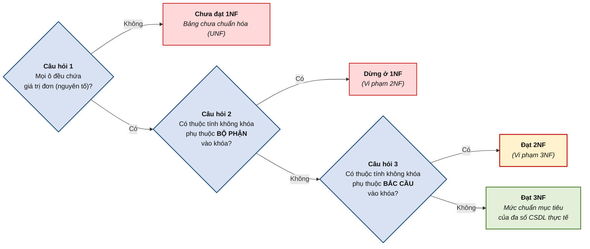

# 5.7. Các dạng chuẩn 1NF, 2NF, 3NF

*(1,5 tiết)*

Từ mục 5.2 đến mục 5.6, ta đã chuẩn bị đầy đủ bộ công cụ toán học: nhận diện ba loại phụ thuộc hàm *(đầy đủ, bộ phận, bắc cầu)*, tính bao đóng `X⁺`, tìm tất cả các khóa dự tuyển và rút gọn tập phụ thuộc hàm. Từ mục 5.7 này trở đi, ta đưa các công cụ ấy vào nhiệm vụ chính của chương: **đo chất lượng của một lược đồ quan hệ và sửa các thiết kế chưa tốt**.

Để người học dễ theo dõi mà không bị rối giữa định nghĩa dạng chuẩn, lý thuyết phép tách và các trường hợp nâng cao, bốn mục 5.7–5.10 được thiết kế theo trình tự bốn bước tuần tự:

- **Mục 5.7 (Thang đo chuẩn 1NF → 2NF → 3NF):** Định nghĩa từng dạng chuẩn kèm **bảng dữ liệu Trước → Sau** và quy trình chẩn đoán một lược đồ đang dừng ở nấc nào.
- **Mục 5.8 (Quy tắc tách bảng an toàn):** Khi một bảng vi phạm 2NF hoặc 3NF, ta sửa bằng cách **tách bảng** — vậy tách như thế nào để không sinh ra dữ liệu bịa *(bộ giả)* và không làm đứt các quy tắc nghiệp vụ?
- **Mục 5.9 (Quy trình chuẩn hóa hoàn chỉnh 5 bước):** Ráp nối toàn bộ công cụ từ 5.2 đến 5.8 để chuẩn hóa trọn vẹn một bảng phẳng thực tế về 3NF.
- **Mục 5.10 (Trên 3NF và khi nào đi ngược lại):** Giới thiệu các mức chuẩn cao hơn *(BCNF, 4NF)* và kỹ thuật *phi chuẩn hóa* khi ưu tiên tốc độ truy vấn.

## 5.7.1. Thuộc tính khóa và thuộc tính không khóa

Trước khi phát biểu các dạng chuẩn, cần phân biệt thật rõ hai loại thuộc tính trên một lược đồ quan hệ sau khi đã tìm được **tất cả các khóa dự tuyển** *(mục 5.5.3)*.

!!! note "Định nghĩa 5.11 (Thuộc tính khóa và thuộc tính không khóa)"

    Cho lược đồ quan hệ `R` đã xác định được tập tất cả các khóa dự tuyển:

    - Một thuộc tính được gọi là **thuộc tính khóa** *(prime attribute — hay thuộc tính nguyên tố)* nếu nó tham gia vào **ít nhất một** khóa dự tuyển của `R` *(tức nằm trong hợp của tất cả các khóa dự tuyển)*.
    - Một thuộc tính được gọi là **thuộc tính không khóa** *(non-prime attribute)* nếu nó **không nằm trong bất kỳ khóa dự tuyển nào** của `R`.

Chữ *"ít nhất một"* trong Định nghĩa 5.11 giải thích vì sao ở mục 5.5.3 ta bắt buộc phải tìm **tất cả** các khóa dự tuyển chứ không dừng lại sau khi tìm được một khóa: nếu lược đồ có hai khóa mà ta bỏ sót khóa thứ hai, các thuộc tính nằm trong khóa thứ hai sẽ bị xếp nhầm thành *thuộc tính không khóa*, dẫn tới kết luận sai hoàn toàn khi xét 2NF và 3NF.

!!! example "Ví dụ 5.10 — Phân biệt thuộc tính khóa và không khóa trên hai lược đồ"

    1. Xét lược đồ `GHIDANH_1NF(MAHV, MALOP, HOTEN, TENLOP, HOCPHI)` với `F = {MAHV → HOTEN, MALOP → TENLOP, (MAHV, MALOP) → HOCPHI}`:
       - Khóa dự tuyển duy nhất: `K = (MAHV, MALOP)`.
       - **Thuộc tính khóa:** `MAHV`, `MALOP`.
       - **Thuộc tính không khóa:** `HOTEN`, `TENLOP`, `HOCPHI`.
    2. Xét lược đồ `LOP_CA_PHONG(MALOP, CAHOC, PHONG, SISO_LOP)` với các quy tắc: mỗi lớp có một sĩ số (`MALOP → SISO_LOP`); mỗi lớp trong một ca học ở một phòng (`(MALOP, CAHOC) → PHONG`); tại một ca học mỗi phòng chỉ xếp cho một lớp (`(PHONG, CAHOC) → MALOP`):
       - Tập nguồn `TN = {CAHOC}`, tập trung gian `TG = {MALOP, PHONG}`, tập đích `TĐ = {SISO_LOP}`.
       - Lược đồ có **hai khóa dự tuyển**: `K₁ = (MALOP, CAHOC)` và `K₂ = (PHONG, CAHOC)`.
       - **Thuộc tính khóa** *(hợp của `K₁` và `K₂`)*: `MALOP`, `CAHOC`, `PHONG` *(dù `PHONG` không nằm trong `K₁`, nó nằm trong `K₂` nên vẫn là thuộc tính khóa!)*.
       - **Thuộc tính không khóa:** chỉ có `SISO_LOP`.

**Bảng 5.16. Tổng hợp cách phân loại thuộc tính khóa và không khóa của Ví dụ 5.10**

| Lược đồ | Tất cả các khóa dự tuyển | Tập thuộc tính khóa *(hợp các khóa)* | Tập thuộc tính không khóa *(phần còn lại)* | Lưu ý khi xét dạng chuẩn |
|---|---|---|---|---|
| `GHIDANH_1NF` | `K = (MAHV, MALOP)` *(1 khóa)* | `{MAHV, MALOP}` | `{HOTEN, TENLOP, HOCPHI}` | Cần kiểm tra cả 3 thuộc tính không khóa |
| `LOP_CA_PHONG` | `K₁ = (MALOP, CAHOC)`<br/>`K₂ = (PHONG, CAHOC)` *(2 khóa)* | `{MALOP, CAHOC, PHONG}` | `{SISO_LOP}` | Chỉ phải kiểm tra `SISO_LOP`; nếu quên tìm `K₂` sẽ tưởng nhầm `PHONG` là thuộc tính không khóa |
| `R(A, B, C, D)` *(Ví dụ 5.8)* | `AD`, `BD`, `CD` *(3 khóa)* | `{A, B, C, D}` *(toàn bộ `R`)* | `∅` *(không có)* | Không có thuộc tính không khóa → **tự động đạt 3NF** |

## 5.7.2. Dạng chuẩn 1 (1NF) — Loại bỏ thuộc tính đa trị và nhóm lặp

!!! note "Định nghĩa 5.12 (Dạng chuẩn 1 — First Normal Form, 1NF)"

    Một lược đồ quan hệ `R` đạt **dạng chuẩn 1 (1NF)** nếu **mọi giá trị trong mọi ô của bảng đều là giá trị nguyên tố (đơn trị)** — không chứa tập hợp nhiều giá trị *(multivalued attribute)*, không chứa danh sách phân cách bằng dấu phẩy, và không chứa bảng con hay nhóm cột lặp lại *(repeating group)*.

Đây chính là **Đặc trưng 4** ở mục 3.1.3 của Chương 3, và cũng là nguyên tắc đã dùng ở mục 2.2.4 của Chương 2 khi bác bỏ cách nhồi nhiều số điện thoại vào một ô. **Đến đây nó được gọi đúng tên chính thức là 1NF.**

!!! warning "Chú ý"

    Trong mô hình cơ sở dữ liệu quan hệ, 1NF **không phải một đích đến cao xa** mà là **điều kiện nhập môn bắt buộc để một bảng được công nhận là một quan hệ**. Một bảng chưa đạt 1NF được gọi là *bảng chưa chuẩn hóa* *(unnormalized table — UNF)*; mọi thuật toán tính bao đóng, tìm khóa và xét 2NF/3NF đều chỉ áp dụng **sau khi** bảng đã được đưa về 1NF.

Hãy xem một bảng vi phạm 1NF trông như thế nào trên thực tế và hai cách chuẩn hóa nó về 1NF.

!!! example "Ví dụ 5.11 — Vi phạm 1NF trên bảng đăng ký của Trung tâm Anh ngữ ABC và cách đưa về 1NF"

    Khi mới lập danh sách trên bảng tính, nhân viên văn phòng lưu thông tin học viên cùng các lớp mà học viên đó đăng ký vào chung một dòng như nửa trên của Bảng 5.17: học viên `HV01` *(Trần An)* học hai lớp `A1 (Anh cơ bản 1)` và `A2 (Anh giao tiếp)`, nên ô `CAC_LOP_DK` nhồi cả hai mã lớp `"A1, A2"`, còn ô `CAC_TENLOP` nhồi `"Anh cơ bản 1, Anh giao tiếp"`.

    Cách lưu này gây ra ba hậu quả tức thì: ① không thể đặt `CAC_LOP_DK` làm khóa ngoại tham chiếu sang bảng `LOP(MALOP)`; ② muốn tìm những ai học lớp `A1` phải cắt chuỗi văn bản thay vì so sánh bằng; ③ khi `HV01` hủy lớp `A2`, chương trình phải tách chuỗi để xóa một nửa ô. Để đưa về 1NF, ta **trải phẳng (tách dòng)** sao cho mỗi ô chỉ chứa đúng một giá trị đơn và xác định khóa chính `(MAHV, MALOP)` như nửa dưới của Bảng 5.17.

**Bảng 5.17. Minh họa Dạng chuẩn 1 (1NF) — Trước và Sau khi khử ô đa giá trị**

*a) TRƯỚC (Chưa đạt 1NF — ô `CAC_LOP_DK` và `CAC_TENLOP` chứa danh sách nhiều giá trị):*

| MAHV | HOTEN | NGAYSINH | CAC_LOP_DK *(đa trị — vi phạm 1NF)* | CAC_TENLOP *(đa trị — vi phạm 1NF)* |
|---|---|---|---|---|
| HV01 | Trần An | 2005-04-12 | **A1, A2** | **Anh cơ bản 1, Anh giao tiếp** |
| HV02 | Lê Bình | 2004-09-30 | **A1, A3** | **Anh cơ bản 1, Anh nâng cao** |
| HV03 | Phạm Cường | 2006-01-15 | A1 | Anh cơ bản 1 |

*b) SAU (Đã đạt 1NF — mỗi ô chỉ chứa một giá trị nguyên tố; khóa chính là cặp `(MAHV, MALOP)`):*

| MAHV *(PK)* | MALOP *(PK)* | HOTEN | NGAYSINH | TENLOP |
|---|---|---|---|---|
| **HV01** | **A1** | Trần An | 2005-04-12 | Anh cơ bản 1 |
| **HV01** | **A2** | Trần An | 2005-04-12 | Anh giao tiếp |
| **HV02** | **A1** | Lê Bình | 2004-09-30 | Anh cơ bản 1 |
| **HV02** | **A3** | Lê Bình | 2004-09-30 | Anh nâng cao |
| HV03 | A1 | Phạm Cường | 2006-01-15 | Anh cơ bản 1 |

> **Nhận xét nối sang 2NF.** Bảng (b) ở Bảng 5.17 đã đạt **1NF** vì mọi ô đều đơn trị. Nhưng hãy nhìn kỹ bảng (b): vừa trải phẳng xong, họ tên `"Trần An"`, ngày sinh `"2005-04-12"` và tên lớp `"Anh cơ bản 1"` lập tức bị **chép lặp ở nhiều dòng**! Vì sao? Vì khóa chính lúc này là cặp `(MAHV, MALOP)`, trong khi `HOTEN`, `NGAYSINH` chỉ phụ thuộc vào `MAHV` và `TENLOP` chỉ phụ thuộc vào `MALOP`. Đó chính là **phụ thuộc bộ phận**, và là lý do ta phải tiến lên **Dạng chuẩn 2 (2NF)**.

## 5.7.3. Dạng chuẩn 2 (2NF) — Loại bỏ phụ thuộc bộ phận vào khóa

!!! note "Định nghĩa 5.13 (Dạng chuẩn 2 — Second Normal Form, 2NF)"

    Một lược đồ quan hệ `R` đạt **dạng chuẩn 2 (2NF)** nếu nó đã đạt **1NF** và **mọi thuộc tính không khóa của `R` đều phụ thuộc hàm đầy đủ vào mọi khóa dự tuyển** — nói cách khác, **không có bất kỳ thuộc tính không khóa nào phụ thuộc bộ phận vào một phần thực sự của khóa dự tuyển**.

Vì *phụ thuộc bộ phận* (`X' → A` với `X' ⊂ K` và `A` là thuộc tính không khóa) chỉ có thể xảy ra khi khóa `K` có từ **hai thuộc tính trở lên**, ta có ngay một hệ quả cực kỳ tiện lợi khi làm bài tập:

!!! note "Hệ quả 5.1 (Dấu hiệu đạt 2NF tức thì)"

    Nếu một lược đồ quan hệ `R` đã đạt 1NF và **mọi khóa dự tuyển của `R` đều là khóa đơn** *(chỉ gồm đúng 1 thuộc tính)*, thì `R` **chắc chắn đạt 2NF** mà không cần kiểm tra thêm bất kỳ phụ thuộc hàm nào.

**Quy tắc sửa khi một bảng vi phạm 2NF:**

- Giả sử bảng `R` có khóa phức hợp `K` và xuất hiện phụ thuộc bộ phận `K₁ → Y` *(với `K₁ ⊂ K` là một phần của khóa và `Y` là tập các thuộc tính không khóa chỉ phụ thuộc vào `K₁`)*.
- Ta **tách `Y` ra khỏi `R`** để lập một bảng mới `R₁(K₁ ∪ Y)` có khóa chính là `K₁`; bảng gốc còn lại `R₂(R − Y)` vẫn giữ nguyên khóa `K` *(và `K₁` trong `R₂` trở thành khóa ngoại tham chiếu sang `R₁`)*.

!!! example "Ví dụ 5.12 — Từ bảng chỉ đạt 1NF tách lên 2NF trên dữ liệu Trung tâm ABC"

    Xét bảng `GHIDANH_1NF(MAHV, MALOP, HOTEN, NGAYSINH, TENLOP, HOCPHI)` có khóa dự tuyển duy nhất là `K = (MAHV, MALOP)` và tập phụ thuộc hàm:

    - `f₁: (MAHV, MALOP) → HOCPHI` *(phụ thuộc **đầy đủ** vào toàn bộ khóa `K`)*
    - `f₂: MAHV → HOTEN, NGAYSINH` *(phụ thuộc **bộ phận** vào nửa khóa `MAHV`)*
    - `f₃: MALOP → TENLOP` *(phụ thuộc **bộ phận** vào nửa khóa `MALOP`)*

    **Chẩn đoán:** Bảng đạt **1NF**, nhưng **vi phạm 2NF** vì ba thuộc tính không khóa `HOTEN`, `NGAYSINH`, `TENLOP` chỉ phụ thuộc vào một phần của khóa `(MAHV, MALOP)`.

    **Cách tách lên 2NF:**
    1. Tách theo `f₂ (MAHV → HOTEN, NGAYSINH)` ra bảng **`HOCVIEN(MAHV, HOTEN, NGAYSINH)`** với khóa chính `MAHV`.
    2. Tách theo `f₃ (MALOP → TENLOP)` ra bảng **`LOP_2NF(MALOP, TENLOP)`** với khóa chính `MALOP`.
    3. Phần còn lại giữ nguyên khóa phức hợp và các thuộc tính phụ thuộc đầy đủ: **`GHIDANH(MAHV, MALOP, HOCPHI)`**.

**Bảng 5.18. Minh họa Dạng chuẩn 2 (2NF) — Trước và Sau khi khử phụ thuộc bộ phận**

*a) TRƯỚC (Bảng `GHIDANH_1NF` — chỉ đạt 1NF, vi phạm 2NF do `HOTEN, NGAYSINH` bám vào `MAHV` và `TENLOP` bám vào `MALOP`):*

| MAHV *(PK)* | MALOP *(PK)* | HOTEN *(bộ phận vào MAHV)* | NGAYSINH *(bộ phận vào MAHV)* | TENLOP *(bộ phận vào MALOP)* | HOCPHI *(đầy đủ)* |
|---|---|---|---|---|---|
| HV01 | A1 | **Trần An** | **2005-04-12** | **Anh cơ bản 1** | 2.000.000 |
| HV01 | A2 | **Trần An** | **2005-04-12** | Anh giao tiếp | 2.500.000 |
| HV02 | A1 | Lê Bình | 2004-09-30 | **Anh cơ bản 1** | 1.800.000 |
| HV03 | A1 | Phạm Cường | 2006-01-15 | **Anh cơ bản 1** | 2.000.000 |

*b) SAU (Tách thành 3 bảng đều đạt 2NF — mỗi sự thật về học viên và lớp chỉ còn lưu đúng 1 lần):*

| Bảng `HOCVIEN` *(Khóa đơn `MAHV` → đạt 2NF)* | | | | Bảng `LOP_2NF` *(Khóa đơn `MALOP` → đạt 2NF)* | | | Bảng `GHIDANH` *(Khóa `(MAHV, MALOP)` → đạt 2NF)* | | |
|---|---|---|---|---|---|---|---|---|---|
| **MAHV** | **HOTEN** | **NGAYSINH** | | **MALOP** | **TENLOP** | | **MAHV↗** | **MALOP↗** | **HOCPHI** |
| HV01 | Trần An | 2005-04-12 | | A1 | Anh cơ bản 1 | | HV01 | A1 | 2.000.000 |
| HV02 | Lê Bình | 2004-09-30 | | A2 | Anh giao tiếp | | HV01 | A2 | 2.500.000 |
| HV03 | Phạm Cường | 2006-01-15 | | | | | HV02 | A1 | 1.800.000 |
| | | | | | | | HV03 | A1 | 2.000.000 |

Nhìn vào phần (b) của Bảng 5.18:

- Mọi dị thường do phụ thuộc bộ phận đã biến mất: muốn đổi ngày sinh của `HV01` chỉ sửa đúng 1 dòng trong `HOCVIEN`; lớp `A2` dù có xóa hết học viên ghi danh trong `GHIDANH` thì tên lớp `"Anh giao tiếp"` vẫn còn nguyên trong `LOP_2NF`.
- Nhưng nếu trong bảng lớp học còn lưu thêm thông tin giáo viên phụ trách (`MAGV, HOTEN_GV, TRINHDO_GV`), thì dù bảng lớp có khóa đơn `MALOP` *(tự động đạt 2NF)*, dư thừa vẫn xuất hiện dưới một hình thái khác — dẫn ta tới **Dạng chuẩn 3 (3NF)**.

## 5.7.4. Dạng chuẩn 3 (3NF) — Loại bỏ phụ thuộc bắc cầu

!!! note "Định nghĩa 5.14 (Dạng chuẩn 3 — Third Normal Form, 3NF)"

    Một lược đồ quan hệ `R` đạt **dạng chuẩn 3 (3NF)** nếu nó đã đạt **2NF** và **không có bất kỳ thuộc tính không khóa nào phụ thuộc bắc cầu vào khóa dự tuyển** *(tức không tồn tại chuỗi `K → Z → A` trong đó `K` là khóa, `Z` không phải siêu khóa và không phải tập con của khóa, còn `A` là thuộc tính không khóa)*.

Khi làm bài tập trên các lược đồ tổng quát `R(A, B, C, …)`, việc dò tìm từng cặp phụ thuộc bộ phận rồi từng chuỗi bắc cầu có thể mất thời gian. Các nhà toán học đã chứng minh được một **định nghĩa tương đương của 3NF** gộp cả điều kiện không bộ phận lẫn không bắc cầu vào **một phép kiểm tra duy nhất trên từng phụ thuộc hàm**:

!!! note "Định nghĩa 5.14b (Phát biểu chuẩn của 3NF theo từng phụ thuộc hàm)"

    Lược đồ quan hệ `R` *(đã ở 1NF)* đạt **dạng chuẩn 3 (3NF)** khi và chỉ khi với **mọi phụ thuộc hàm không tầm thường `X → A`** *(với `A` là một thuộc tính đơn, `A ∉ X`)* suy ra được từ `F`, **ít nhất một trong hai điều kiện sau được thỏa mãn**:

    1. **`X` là một siêu khóa** của `R`; **HOẶC**
    2. **`A` là một thuộc tính khóa** *(tức `A` nằm trong ít nhất một khóa dự tuyển của `R`)*.

Vì sao hai cách phát biểu hoàn toàn tương đương? Hãy xét một phụ thuộc không tầm thường `X → A` vi phạm cả hai điều kiện trên *(nghĩa là **`X` không phải siêu khóa** VÀ **`A` là thuộc tính không khóa`)*:

- **Trường hợp 1:** Nếu `X` là một tập con thực sự của một khóa `K` (`X ⊂ K`), thì `X → A` chính là một **phụ thuộc bộ phận** *(vi phạm 2NF, nên đương nhiên vi phạm 3NF)*.
- **Trường hợp 2:** Nếu `X` không phải tập con của khóa nào *(mà vì `K` là khóa nên luôn có `K → X`)*, ta lập tức có chuỗi `K → X → A` với `X` không phải siêu khóa và `A` không khóa — chính là một **phụ thuộc bắc cầu** *(vi phạm 3NF)*!

Phát biểu 5.14b cũng giải thích ngay nhận xét ở cuối Ví dụ 5.8: nếu **mọi thuộc tính của `R` đều là thuộc tính khóa**, thì điều kiện (2) *"`A` là thuộc tính khóa"* luôn đúng với mọi mũi tên, nên lược đồ **tự động đạt 3NF**.

**Quy tắc sửa khi một bảng đạt 2NF nhưng vi phạm 3NF:**

- Giả sử bảng `R` có khóa `K` và có chuỗi phụ thuộc bắc cầu `K → Z → Y` *(tức phụ thuộc `Z → Y` vi phạm 3NF vì `Z` không phải siêu khóa và `Y` không khóa)*.
- Ta **cắt đứt chặng thứ hai** bằng cách tách `Y` ra lập bảng riêng `R₁(Z ∪ Y)` với khóa chính là `Z`; bảng gốc còn lại `R₂(R − Y)` giữ khóa `K` và giữ lại cột `Z` làm khóa ngoại tham chiếu sang `R₁`.

!!! example "Ví dụ 5.13 — Từ bảng chỉ đạt 2NF tách lên 3NF trên dữ liệu Trung tâm ABC"

    Xét bảng mở rộng của lớp học `LOP_MORONG(MALOP, TENLOP, MAGV, HOTEN_GV, TRINHDO_GV)` với tập phụ thuộc hàm:

    - `f₁: MALOP → TENLOP, MAGV` *(mỗi lớp có một tên lớp và do một giáo viên phụ trách)*
    - `f₂: MAGV → HOTEN_GV, TRINHDO_GV` *(mỗi giáo viên có một họ tên và một trình độ chuyên môn)*

    **Chẩn đoán:**
    - Khóa dự tuyển duy nhất của bảng là **`K = MALOP`** *(khóa đơn, chỉ gồm 1 thuộc tính)*.
    - Vì khóa là khóa đơn, theo Hệ quả 5.1 bảng **đạt 2NF** *(không thể có phụ thuộc bộ phận)*.
    - Nhưng xét `f₂: MAGV → HOTEN_GV, TRINHDO_GV`: vế trái `MAGV` **không phải siêu khóa** *(một giáo viên dạy nhiều lớp)*, còn vế phải `HOTEN_GV`, `TRINHDO_GV` **không phải thuộc tính khóa**. Vậy `MALOP → MAGV → HOTEN_GV, TRINHDO_GV` là **phụ thuộc bắc cầu** — bảng **vi phạm 3NF** *(chỉ đạt tối đa 2NF)*.

    **Cách tách lên 3NF:** Tách theo phụ thuộc vi phạm `f₂` thành hai bảng:
    - **`LOP(MALOP, TENLOP, MAGV)`** với khóa chính `MALOP` *(và `MAGV` là khóa ngoại)*.
    - **`GIAOVIEN(MAGV, HOTEN_GV, TRINHDO_GV)`** với khóa chính `MAGV`.

**Bảng 5.19. Minh họa Dạng chuẩn 3 (3NF) — Trước và Sau khi khử phụ thuộc bắc cầu**

*a) TRƯỚC (Bảng `LOP_MORONG` — đạt 2NF vì khóa đơn `MALOP`, nhưng vi phạm 3NF do `MALOP → MAGV → HOTEN_GV, TRINHDO_GV`):*

| MALOP *(PK)* | TENLOP | MAGV *(trung gian Z)* | HOTEN_GV *(bắc cầu)* | TRINHDO_GV *(bắc cầu)* |
|---|---|---|---|---|
| A1 | Anh cơ bản 1 | **GV1** | **Lê Hoa** | **Thạc sĩ** |
| A3 | Anh nâng cao | **GV1** | **Lê Hoa** | **Thạc sĩ** |
| A4 | Luyện thi IELTS | **GV1** | **Lê Hoa** | **Thạc sĩ** |
| A2 | Anh giao tiếp | GV2 | Trần Mai | Cử nhân |

*b) SAU (Tách thành 2 bảng đều đạt 3NF — còn cho phép lưu thêm giáo viên mới `GV3` chưa nhận lớp):*

| Bảng `LOP` *(Khóa `MALOP` → đạt 3NF)* | | | | Bảng `GIAOVIEN` *(Khóa `MAGV` → đạt 3NF)* | | |
|---|---|---|---|---|---|---|
| **MALOP** | **TENLOP** | **MAGV↗** | | **MAGV** | **HOTEN_GV** | **TRINHDO_GV** |
| A1 | Anh cơ bản 1 | GV1 | | **GV1** | **Lê Hoa** | **Thạc sĩ** |
| A3 | Anh nâng cao | GV1 | | GV2 | Trần Mai | Cử nhân |
| A4 | Luyện thi IELTS | GV1 | | *GV3* | *Phạm Nam* | *Cử nhân (chưa phân lớp)* |
| A2 | Anh giao tiếp | GV2 | | | | |

Nhìn vào phần (b) của Bảng 5.19, cả ba dị thường của Chương 1 đã được giải quyết tận gốc:

1. **Hết dị thường sửa:** Cô Lê Hoa (`GV1`) dạy 3 lớp nhưng tên `"Lê Hoa"` và trình độ `"Thạc sĩ"` chỉ còn lưu ở **1 dòng duy nhất** trong `GIAOVIEN`.
2. **Hết dị thường xóa:** Nếu lớp `A2` kết thúc và bị xóa khỏi bảng `LOP`, hồ sơ của cô Trần Mai (`GV2`) trong `GIAOVIEN` vẫn còn nguyên vẹn.
3. **Hết dị thường thêm:** Trung tâm mới tuyển thầy Phạm Nam (`GV3`, Cử nhân), chưa phân công dạy lớp nào, vẫn thêm ngay được vào bảng `GIAOVIEN` mà không cần chờ mở lớp.

## 5.7.5. Quy trình 4 bước xác định dạng chuẩn cao nhất trong bài tập

Trong đề thi, một dạng bài rất phổ biến là: *"Cho lược đồ `R` và tập phụ thuộc hàm `F` (đã ở 1NF). Hãy xác định dạng chuẩn cao nhất (1NF, 2NF hay 3NF) mà `R` đạt được và giải thích vì sao."*

Nhờ Định nghĩa 5.13 và 5.14b, ta có một quy trình **4 bước máy móc** không bao giờ nhầm lẫn:

```
QUY TRÌNH 4 BƯỚC XÁC ĐỊNH DẠNG CHUẨN CAO NHẤT (1NF / 2NF / 3NF):
────────────────────────────────────────────────────────────────────
BƯỚC 1. Đưa F về dạng vế phải chỉ gồm 1 thuộc tính (dùng luật tách: X → AB thành X → A, X → B)
        và bỏ các phụ thuộc tầm thường (A ∈ X).
BƯỚC 2. Tìm TẤT CẢ các khóa dự tuyển của R (bằng thuật toán TN–TG ở mục 5.5).
BƯỚC 3. Liệt kê rõ hai tập:
        • Tập thuộc tính khóa (Prime)     = các thuộc tính có mặt trong ít nhất 1 khóa.
        • Tập thuộc tính không khóa       = các thuộc tính còn lại.
BƯỚC 4. Lập bảng kiểm tra từng phụ thuộc X → A theo HAI CÂU HỎI:
        • Câu hỏi 1: X có phải là SIÊU KHÓA không? (tức X chứa một khóa dự tuyển?)
        • Câu hỏi 2: A có phải là THUỘC TÍNH KHÓA không?
        → Nếu một phụ thuộc có ít nhất một chữ "CÓ" ở Câu 1 hoặc Câu 2: phụ thuộc ấy ĐẠT 3NF.
        → Nếu cả Câu 1 và Câu 2 đều "KHÔNG": phụ thuộc ấy VI PHẠM 3NF! Khi đó hỏi thêm:
              – X có phải là TẬP CON THỰC SỰ của một khóa dự tuyển không?
                • Nếu CÓ  ⟹ Phụ thuộc BỘ PHẬN  (vi phạm cả 2NF và 3NF).
                • Nếu KHÔNG ⟹ Phụ thuộc BẮC CẦU (đạt 2NF nhưng vi phạm 3NF).
```

Sau khi kiểm tra hết các phụ thuộc hàm ở Bước 4, ta kết luận dạng chuẩn cao nhất của toàn lược đồ `R` theo nguyên tắc **"chiếc thùng gỗ ghép"** *(mức của cả bảng bị quyết định bởi phụ thuộc yếu nhất)*:

- Nếu **có ít nhất một phụ thuộc bộ phận** ⟹ `R` **chỉ đạt 1NF** *(vi phạm 2NF)*.
- Nếu **không có phụ thuộc bộ phận**, nhưng **có ít nhất một phụ thuộc bắc cầu** ⟹ `R` **đạt cao nhất là 2NF** *(vi phạm 3NF)*.
- Nếu **mọi phụ thuộc đều đạt** *(không bộ phận, không bắc cầu)* ⟹ `R` **đạt 3NF**.

!!! example "Ví dụ 5.14 — So sánh ba lược đồ ký hiệu dừng ở ba mức 1NF, 2NF và 3NF"

    Áp dụng quy trình 4 bước cho ba lược đồ sau *(đều có 4 thuộc tính `A, B, C, D` và đã đạt 1NF)*:

    - **Lược đồ `R₁(A, B, C, D)`** với `F₁ = {AB → C, B → D}`.
      - Phân nhóm: `TN = {A, B}`, `TG = ∅`, `TĐ = {C, D}`. Vì `(AB)⁺ = {A, B, C, D} = R₁`, khóa duy nhất là **`K = AB`**.
      - Thuộc tính khóa: `{A, B}`; thuộc tính không khóa: `{C, D}`.
      - Kiểm tra `B → D`: vế trái `B` không phải siêu khóa, vế phải `D` không phải thuộc tính khóa, và `B ⊂ AB` *(một phần của khóa)* ⟹ `B → D` là **phụ thuộc bộ phận** ⟹ **`R₁` chỉ đạt 1NF**.

    - **Lược đồ `R₂(A, B, C, D)`** với `F₂ = {A → B, B → C, A → D}`.
      - Phân nhóm: `TN = {A}`, `TG = {B}`, `TĐ = {C, D}`. Vì `A⁺ = {A, B, C, D} = R₂`, khóa duy nhất là **`K = A`** *(khóa đơn)*.
      - Thuộc tính khóa: `{A}`; thuộc tính không khóa: `{B, C, D}`.
      - Vì khóa đơn nên `R₂` **chắc chắn đạt 2NF**. Kiểm tra `B → C`: vế trái `B` không phải siêu khóa, vế phải `C` không phải thuộc tính khóa, và `B ⊄ A` *(ngoài khóa)* ⟹ `A → B → C` là **phụ thuộc bắc cầu** ⟹ **`R₂` đạt cao nhất là 2NF**.

    - **Lược đồ `R₃(A, B, C, D)`** với `F₃ = {AB → C, AB → D, C → A}`.
      - Phân nhóm: `TN = {B}`, `TG = {A, C}`, `TĐ = {D}`. Duyệt tập con của `TG`: `B⁺ = {B}` *(loại)*; `(AB)⁺ = {A, B, C, D} = R₃` *(khóa `K₁ = AB`)*; `(BC)⁺ = {B, C, A, D} = R₃` *(khóa `K₂ = BC`)*. Vậy `R₃` có **hai khóa dự tuyển: `AB` và `BC`**.
      - Thuộc tính khóa: **`{A, B, C}`**; thuộc tính không khóa: **`{D}`**.
      - Kiểm tra `AB → C` và `AB → D`: vế trái `AB` là khóa *(đạt)*. Kiểm tra `C → A`: vế trái `C` không phải siêu khóa, **nhưng vế phải `A` là thuộc tính khóa** *(nằm trong khóa `AB`)* ⟹ thỏa điều kiện (2) của Định nghĩa 5.14b ⟹ **`R₃` đạt 3NF**!

**Bảng 5.20. Bảng chẩn đoán bằng "hai câu hỏi" cho ba lược đồ của Ví dụ 5.14**

| Lược đồ & Khóa | Thuộc tính khóa / Không khóa | Phụ thuộc `X → A` | Câu 1: `X` là siêu khóa? | Câu 2: `A` là thuộc tính khóa? | Nếu cả hai "Không": `X` là phần thực sự của khóa? | Đánh giá từng phụ thuộc | **Dạng chuẩn cao nhất của lược đồ** |
|---|---|---|:--:|:--:|:--:|---|---|
| **`R₁`**<br/>Khóa: `AB` | Khóa: `{A, B}`<br/>Không khóa: `{C, D}` | `AB → C`<br/>`B → D` | **Có**<br/>Không | —<br/>Không | —<br/>**Có** (`B ⊂ AB`) | Đạt 3NF<br/>**Vi phạm 2NF** *(bộ phận)* | **Chỉ đạt 1NF** |
| **`R₂`**<br/>Khóa: `A` | Khóa: `{A}`<br/>Không khóa: `{B, C, D}` | `A → B`<br/>`A → D`<br/>`B → C` | **Có**<br/>**Có**<br/>Không | —<br/>—<br/>Không | —<br/>—<br/>**Không** (`B` ngoài khóa) | Đạt 3NF<br/>Đạt 3NF<br/>**Vi phạm 3NF** *(bắc cầu)* | **Đạt 2NF** |
| **`R₃`**<br/>Khóa: `AB`, `BC` | Khóa: `{A, B, C}`<br/>Không khóa: `{D}` | `AB → C`<br/>`AB → D`<br/>`C → A` | **Có**<br/>**Có**<br/>Không | —<br/>—<br/>**Có** (`A ∈ AB`) | —<br/>—<br/>— | Đạt 3NF<br/>Đạt 3NF<br/>Đạt 3NF *(nhờ vế phải là thuộc tính khóa)* | **Đạt 3NF** |

## 5.7.6. Câu thần chú, cây quyết định và bảng vàng 1NF–3NF

Có một câu châm ngôn tiếng Anh rất nổi tiếng của William Kent (1983) tóm tắt trọn vẹn tinh thần của cả ba dạng chuẩn 1NF, 2NF, 3NF:

> *"Every non-key attribute must provide a fact about **the key**, **the whole key**, and **nothing but the key**."*
> *(Mọi thuộc tính không khóa phải phụ thuộc vào **khóa**, vào **toàn bộ khóa**, và **chỉ phụ thuộc vào khóa mà thôi**.)*

- **"The key" (1NF):** Bảng phải có khóa chính rõ ràng và mỗi ô chỉ chứa một giá trị đơn.
- **"The whole key" (2NF):** Thuộc tính không khóa phải phụ thuộc vào **toàn bộ khóa** *(không phụ thuộc bộ phận vào một mảnh của khóa phức hợp)*.
- **"Nothing but the key" (3NF):** Thuộc tính không khóa phải phụ thuộc trực tiếp vào khóa, **không đi vòng qua bất kỳ thuộc tính không khóa nào khác** *(không phụ thuộc bắc cầu)*.

**Hình 5.8. Cây quyết định xác định dạng chuẩn trong phạm vi 1NF – 2NF – 3NF**



> *(Lưu ý: Các dạng chuẩn cao hơn 3NF như **BCNF** và **4NF** sẽ được định nghĩa và mở rộng tiếp từ nhánh phải của cây này tại mục 5.10).*

Bảng dưới đây — tạm gọi là **"bảng vàng" của chuẩn hóa 1NF–3NF** — nối thẳng Chương 5 về Chương 1 và trả lời câu hỏi *"mỗi bước chuẩn hóa tiêu diệt tận gốc loại dị thường nào"*.

**Bảng 5.21. Bảng vàng tổng hợp ba dạng chuẩn 1NF, 2NF, 3NF — điều kiện, thủ phạm bị diệt và cách sửa**

| Dạng chuẩn | Điều kiện cần đạt thêm | Thủ phạm bị tiêu diệt | Dị thường dữ liệu bị loại bỏ | Quy tắc tách bảng để sửa khi vi phạm |
|:---:|---|---|---|---|
| **1NF** | Mọi ô chỉ chứa **một giá trị đơn** *(nguyên tố)*; không có nhóm cột lặp | Ô đa giá trị, danh sách ngăn cách bằng dấu phẩy | Không tra cứu / kết bảng chuẩn được; không đặt khóa ngoại được | Trải phẳng mỗi giá trị thành 1 dòng *(hoặc tách thuộc tính đa trị ra bảng riêng kèm khóa chính của bảng gốc)* |
| **2NF** | Đạt 1NF + mọi thuộc tính không khóa phụ thuộc **đầy đủ** vào khóa | **Phụ thuộc bộ phận** `K₁ → Y` *(với `K₁ ⊂ K`)* | Dị thường **sửa, thêm, xóa** đối với thông tin chỉ gắn với một nửa khóa *(như tên học viên, tên lớp trong bảng ghi danh)* | Tách `R₁(K₁ ∪ Y)` làm bảng riêng có khóa chính `K₁`; bảng còn lại `R₂(R − Y)` giữ khóa `K` |
| **3NF** | Đạt 2NF + không có thuộc tính không khóa phụ thuộc **bắc cầu** vào khóa | **Phụ thuộc bắc cầu** `K → Z → Y` *(với `Z` không phải siêu khóa)* | Dị thường **sửa, thêm, xóa** đối với thực thể ẩn `Z` nằm ké trong bảng `K` *(như thông tin giáo viên nằm ké trong bảng lớp)* | Tách `R₁(Z ∪ Y)` làm bảng riêng có khóa chính `Z`; bảng còn lại `R₂(R − Y)` giữ cột `Z` làm khóa ngoại |

!!! warning "Chú ý"

    Ở Chương 1 người học **nhìn thấy** ba dị thường bằng mắt nhưng **không gọi tên được căn nguyên toán học**. Bảng 5.21 chỉ đích danh: dị thường không phải hiện tượng ngẫu nhiên mà là **hệ quả trực tiếp** của phụ thuộc bộ phận và phụ thuộc bắc cầu. Đó là khác biệt giữa *thấy triệu chứng* và *chẩn đoán đúng bệnh*.

!!! question "Tự kiểm tra 5.6–5.7"

    *(tự trả lời trước, rồi mở đáp án bên dưới)*

    1. `F = {A → B, B → C, A → C}` — phụ thuộc nào thừa? Chứng minh bằng bao đóng.
    2. `LOP(MALOP, TENLOP, MAGV, HOTEN_GV)` với khóa `MALOP` và `F` như Bảng 5.5: đạt dạng chuẩn cao nhất nào? Chỉ đích danh thủ phạm.
    3. `GHIDANH_MORONG(MAHV, MALOP, HOTEN, HOCPHI)` với khóa `(MAHV, MALOP)`: đạt dạng chuẩn nào? Nêu cách sửa.

??? success "Đáp án tự kiểm tra 5.6–5.7"

    *(1)* `A → C` thừa: tạm bỏ nó, `A⁺ = {A, B, C}` *(nhờ `A → B` rồi `B → C`)* vẫn chứa `C`. *(2)* Đạt **2NF** *(khóa đơn nên không có bộ phận)* nhưng **vi phạm 3NF**: thủ phạm `MALOP → MAGV → HOTEN_GV`, `MAGV` không phải khóa. Dạng chuẩn cao nhất: 2NF. *(3)* Chỉ đạt **1NF**: `MAHV → HOTEN` là phụ thuộc **bộ phận**. Sửa: tách `HOCVIEN(MAHV, HOTEN)` ra, còn lại `GHIDANH(MAHV, MALOP, HOCPHI)` đạt 3NF.

---


---

[← Trang trước](5-6-phu-toi-thieu.md) · [Trang sau →](5-8-phep-tach-luoc-do.md)
