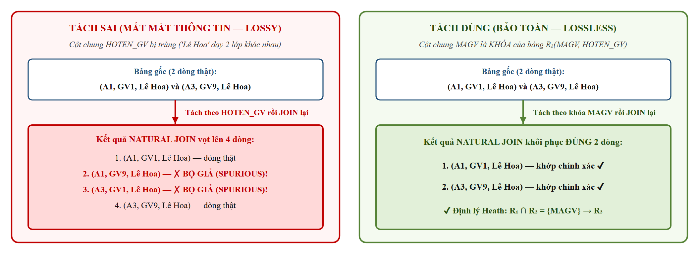

# 5.8. Phép tách lược đồ

*(1,5 tiết)*

{width=85%}

*Ảnh minh họa: Đối chiếu phép tách mất mát thông tin (sinh thêm các bộ giả khi kết tự nhiên trở lại) và phép tách bảo toàn thông tin theo Định lý Heath — Nguồn: Tác giả tự vẽ.*

Ở mục 5.7, mỗi khi phát hiện một bảng vi phạm 2NF *(có phụ thuộc bộ phận)* hoặc vi phạm 3NF *(có phụ thuộc bắc cầu)*, phương thuốc điều trị luôn là **tách bảng** — cắt các thuộc tính gây bệnh ra lập một bảng con mới. Nhưng một câu hỏi sống còn lập tức đặt ra: **Có phải cứ chia các cột của một bảng thành hai bảng nhỏ có giao nhau là xong không?**

Câu trả lời là **Không**. Nếu tách tùy tiện mà không tuân theo quy tắc toán học, việc tách bảng có thể gây ra hai tai họa còn nặng nề hơn cả dữ liệu dư thừa:

1. **Làm hỏng dữ liệu khi ghép lại** *(sinh ra các dòng dữ liệu bịa — gọi là **bộ giả**)*; hoặc
2. **Làm đứt gãy quy tắc nghiệp vụ** *(một phụ thuộc hàm bị xé đôi sang hai bảng, khiến hệ quản trị không thể tự kiểm tra được nữa)*.

Mục 5.8 này trang bị hai tiêu chuẩn toán học để kiểm định mọi phép tách: **bảo toàn thông tin** *(mục 5.8.2)* và **bảo toàn phụ thuộc hàm** *(mục 5.8.3)*, trước khi ta bước vào quy trình chuẩn hóa tổng hợp ở mục 5.9.

## 5.8.1. Tách sai và hiện tượng bộ giả

Hãy xem điều gì xảy ra trên dữ liệu thực tế khi ta tách bảng theo một cột không phải là khóa.

!!! example "Ví dụ 5.15"

    Cho quan hệ `R(MAHV, MALOP, MAGV)` ghi nhận *học viên nào học lớp nào và lớp ấy do giáo viên nào dạy*, với phụ thuộc hàm nghiệp vụ `F = {MALOP → MAGV}` *(mỗi lớp do một giáo viên phụ trách; một giáo viên có thể dạy nhiều lớp)*. Giả sử cô Lê Hoa *(GV1)* dạy hai lớp `A1` và `A3`; cô Trần Mai *(GV2)* dạy lớp `A2`.

    Một người thiết kế thấy cột `MAGV` có giá trị lặp lại nên quyết định tách `R` thành hai bảng `R1(MAHV, MAGV)` và `R2(MALOP, MAGV)` — tức lấy cột **`MAGV`** làm cầu nối chung. Hãy xem kết quả khi chiếu dữ liệu xuống `R1`, `R2` rồi kết tự nhiên (`R1 ⋈ R2`) trở lại ở Bảng 5.22.

**Bảng 5.22. Tách sai `R` theo `MAGV` — không mất dòng nào, nhưng ghép lại sinh ra hai bộ giả**

| `R` *(bảng gốc — 3 dòng sự thật)* | MAHV | MALOP | MAGV |
|---|---|---|---|
| Dòng 1 | HV01 | A1 | GV1 |
| Dòng 2 | HV02 | A3 | GV1 |
| Dòng 3 | HV02 | A2 | GV2 |

| `R1(MAHV, MAGV)` *(chiếu R lên MAHV, MAGV)* | MAHV | MAGV | | `R2(MALOP, MAGV)` *(chiếu R lên MALOP, MAGV)* | MALOP | MAGV |
|---|---|---|---|---|---|---|
| | HV01 | GV1 | | | A1 | GV1 |
| | HV02 | GV1 | | | A3 | GV1 |
| | HV02 | GV2 | | | A2 | GV2 |

| `R1 ⋈ R2` *(ghép lại theo cột chung `MAGV`)* | MAHV | MALOP | MAGV | Đối chiếu với bảng gốc `R` |
|---|---|---|---|---|
| 1 | HV01 | A1 | GV1 | Có trong `R` *(dòng thật)* |
| 2 | **HV01** | **A3** | **GV1** | **KHÔNG CÓ trong `R` — BỘ GIẢ (dữ liệu bịa!)** |
| 3 | **HV02** | **A1** | **GV1** | **KHÔNG CÓ trong `R` — BỘ GIẢ (dữ liệu bịa!)** |
| 4 | HV02 | A3 | GV1 | Có trong `R` *(dòng thật)* |
| 5 | HV02 | A2 | GV2 | Có trong `R` *(dòng thật)* |

Nhìn riêng từng bảng con `R1` và `R2`, không hề mất dòng nào. Nhưng ngay khi dùng phép kết tự nhiên `R1 ⋈ R2` theo cột chung `MAGV` để trả lời câu hỏi *"Học viên nào đang học lớp nào?"*, giá trị `GV1` ở hai bên bắt chéo với nhau (`2 học viên × 2 lớp = 4 tổ hợp`), đẻ thêm hai dòng **`(HV01, A3, GV1)`** và **`(HV02, A1, GV1)`** chưa từng tồn tại trong thực tế! Lý do: biết `HV01` học với cô `GV1`, và biết cô `GV1` dạy cả lớp `A1` lẫn lớp `A3`, hệ thống **không còn cách nào nhớ được** `HV01` học lớp nào trong hai lớp ấy của cô `GV1`.

!!! note "Định nghĩa 5.15 (Bộ giả — Spurious Tuple)"

    Khi tách quan hệ `R` thành các quan hệ con `R₁, R₂, …`, những bộ dữ liệu **xuất hiện trong kết quả kết tự nhiên `R₁ ⋈ R₂ ⋈ …` nhưng không hề tồn tại trong quan hệ gốc `R`** được gọi là **bộ giả** *(spurious tuples)*. Phép tách sinh ra bộ giả được gọi là **phép tách mất thông tin** *(lossy decomposition)*.

**Hình 5.9. Nghịch lý bộ giả — không mất dòng nào mà vẫn mất sự thật**

!!! warning "Chú ý — vì sao bộ giả còn nguy hiểm hơn cả việc mất dữ liệu?"

    Nếu một thao tác lỗi làm mất dòng dữ liệu, người dùng thấy thiếu sẽ đi tìm lại từ chứng từ gốc. Ngược lại, bộ giả làm bảng kết quả **đầy đặn hơn**, mọi mã số và tên gọi đều có thật trong hệ thống nên trông hoàn toàn hợp lệ — không ai biết dòng nào là thật, dòng nào là do phép kết tự bịa ra. Đây chính là kiểu **lỗi im lặng** nguy hiểm nhất trong thiết kế cơ sở dữ liệu.

## 5.8.2. Điều kiện bảo toàn thông tin (Lossless-Join Decomposition)

Làm thế nào để biết chắc một phép tách sẽ **không bao giờ** sinh ra bộ giả trên bất kỳ bộ dữ liệu nào, mà không cần phải ngồi thử từng dòng dữ liệu?

!!! note "Định nghĩa 5.16 (Phép tách bảo toàn thông tin)"

    Phép tách lược đồ `R` thành hai lược đồ con `R₁` và `R₂` *(với `R₁ ∪ R₂ = R`)* được gọi là **bảo toàn thông tin** *(lossless-join decomposition — hay kết nối không mất mát)* đối với tập phụ thuộc hàm `F` nếu với **mọi thể hiện hợp lệ `r` của `R` thỏa mãn `F`**, khi chiếu `r` xuống `R₁`, `R₂` rồi kết tự nhiên lại, ta luôn thu được **đúng nguyên vẹn `r`**:

    `π_R₁(r)  ⋈  π_R₂(r)  =  r`

Định lý dưới đây quy việc kiểm tra Định nghĩa 5.16 về **đúng một phép tính bao đóng** của tập thuộc tính chung `R₁ ∩ R₂`:

!!! note "Định lý 5.1 (Điều kiện cần và đủ để phép tách đôi bảo toàn thông tin)"

    Phép tách lược đồ `R` thành hai lược đồ con `R₁` và `R₂` là **bảo toàn thông tin** đối với tập phụ thuộc hàm `F` **khi và chỉ khi** tập thuộc tính chung **`(R₁ ∩ R₂)` là siêu khóa của ít nhất một trong hai lược đồ con `R₁` hoặc `R₂`**.

    Viết bằng ký hiệu bao đóng *(dùng để trình bày trong bài thi)*:

    **`R₁ ⊆ (R₁ ∩ R₂)⁺`**   **hoặc**   **`R₂ ⊆ (R₁ ∩ R₂)⁺`**
    *(tức là `(R₁ ∩ R₂) → R₁` thuộc `F⁺`, hoặc `(R₁ ∩ R₂) → R₂` thuộc `F⁺`)*.

Hãy dùng Định lý 5.1 để kiểm tra lại phép tách sai ở Ví dụ 5.15 và đối chiếu với phép tách đúng trên cùng quan hệ `R(MAHV, MALOP, MAGV)` với `F = {MALOP → MAGV}`:

- **Kiểm tra lại phép tách sai `R₁(MAHV, MAGV)` và `R₂(MALOP, MAGV)` của Ví dụ 5.15:**
  - Tập thuộc tính chung: `R₁ ∩ R₂ = {MAGV}`.
  - Tính bao đóng trên `F`: `(MAGV)⁺ = {MAGV}` *(không mở rộng thêm được gì vì trong `F` chỉ có `MALOP → MAGV`)*.
  - Đối chiếu: `R₁ = {MAHV, MAGV} ⊄ {MAGV}` và `R₂ = {MALOP, MAGV} ⊄ {MAGV}`.
  - Cả hai điều kiện đều **sai** ⟹ phép tách **không bảo toàn thông tin** *(chắc chắn sinh bộ giả như Bảng 5.22)*.

!!! example "Ví dụ 5.16 — Tách đúng `R(MAHV, MALOP, MAGV)` theo cột chung `MALOP`"

    Vẫn với `R(MAHV, MALOP, MAGV)` và `F = {MALOP → MAGV}`, nay ta tách thành `R₁(MAHV, MALOP)` và `R₂(MALOP, MAGV)`.

    - Tập thuộc tính chung: `R₁ ∩ R₂ = {MALOP}`.
    - Tính bao đóng trên `F`: nhờ `MALOP → MAGV`, ta có **`(MALOP)⁺ = {MALOP, MAGV} = R₂`**.
    - Vậy `R₁ ∩ R₂` chính là **siêu khóa (và là khóa) của `R₂`**. Theo Định lý 5.1, phép tách **bảo toàn thông tin tuyệt đối**. Bảng 5.23 kiểm chứng điều đó trên đúng 3 dòng dữ liệu của Ví dụ 5.15.

**Bảng 5.23. Tách đúng `R` theo `MALOP` — ghép lại thu được đúng 3 dòng gốc, không có bộ giả**

| `R₁(MAHV, MALOP)` | MAHV | MALOP | | `R₂(MALOP, MAGV)` *(khóa `MALOP`)* | MALOP *(PK)* | MAGV |
|---|---|---|---|---|---|---|
| | HV01 | A1 | | | A1 | GV1 |
| | HV02 | A3 | | | A3 | GV1 |
| | HV02 | A2 | | | A2 | GV2 |

| `R₁ ⋈ R₂` *(ghép theo cột chung `MALOP`)* | MAHV | MALOP | MAGV | Đối chiếu với bảng gốc `R` |
|---|---|---|---|---|
| 1 | HV01 | A1 | GV1 | Có trong `R` *(khớp duy nhất dòng A1 của `R₂`)* |
| 2 | HV02 | A3 | GV1 | Có trong `R` *(khớp duy nhất dòng A3 của `R₂`)* |
| 3 | HV02 | A2 | GV2 | Có trong `R` *(khớp duy nhất dòng A2 của `R₂`)* |

Vì `MALOP` là khóa của `R₂`, mỗi mã lớp trong `R₁` chỉ bắt cặp với **đúng một dòng duy nhất** bên `R₂` — không có chỗ nào để phép kết nhân chéo đẻ ra dòng thừa.

---

### Bài tập mẫu 5.7 — Kiểm tra tính bảo toàn thông tin của các phép tách bằng bao đóng `(R₁ ∩ R₂)⁺`

**Đề bài.** Cho lược đồ quan hệ `R(A, B, C, D, E)` và tập phụ thuộc hàm `F = {A → BC, CD → E, B → D, E → A}`. Không cần lập bảng dữ liệu, hãy dùng Định lý 5.1 để kiểm tra xem mỗi phép tách đôi dưới đây có bảo toàn thông tin hay không:

a) Phép tách `ρ₁ = { R₁(A, B, C),  R₂(A, D, E) }`.
b) Phép tách `ρ₂ = { R₁(A, B, C),  R₂(C, D, E) }`.
c) Phép tách `ρ₃ = { R₁(A, B, D),  R₂(B, C, D, E) }`.

**Lời giải chi tiết.**

Với mỗi phép tách `{R₁, R₂}`, ta thực hiện đúng 3 bước: ① tìm giao `X = R₁ ∩ R₂`; ② tính bao đóng `X⁺` trên `F`; ③ kiểm tra xem `R₁ ⊆ X⁺` hay `R₂ ⊆ X⁺` có xảy ra không.

| Phép tách | Bước 1: Tìm thuộc tính chung `R₁ ∩ R₂` | Bước 2: Tính bao đóng `(R₁ ∩ R₂)⁺` theo `F` | Bước 3: Kiểm tra `R₁ ⊆ (R₁ ∩ R₂)⁺` hoặc `R₂ ⊆ (R₁ ∩ R₂)⁺` | Kết luận |
|---|---|---|---|---|
| **a) `ρ₁`** `R₁(A,B,C)` `R₂(A,D,E)` | `R₁ ∩ R₂ = {A}` | Khởi tạo `{A}` → áp `A → BC` được `{A, B, C}` → áp `B → D` được `{A, B, C, D}` → áp `CD → E` được `{A, B, C, D, E}` | `(A)⁺ = {A, B, C, D, E}` chứa cả `R₁` lẫn `R₂` *(cầu nối `A` là siêu khóa của cả hai bảng con)* | **Bảo toàn thông tin** |
| **b) `ρ₂`** `R₁(A,B,C)` `R₂(C,D,E)` | `R₁ ∩ R₂ = {C}` | Khởi tạo `{C}` → không có phụ thuộc nào trong `F` có vế trái chỉ gồm `C` ⟹ `(C)⁺ = {C}` | `R₁ = {A,B,C} ⊄ {C}` và `R₂ = {C,D,E} ⊄ {C}` *(cầu nối `C` không xác định được bảng nào)* | **KHÔNG bảo toàn** *(sinh bộ giả)* |
| **c) `ρ₃`** `R₁(A,B,D)` `R₂(B,C,D,E)` | `R₁ ∩ R₂ = {B, D}` | Khởi tạo `{B, D}` → không có phụ thuộc nào trong `F` có vế trái nằm trong `{B, D}` *(ngoài `B → D` đã có sẵn `D`)* ⟹ `(BD)⁺ = {B, D}` | `R₁ = {A,B,D} ⊄ {B,D}` và `R₂ = {B,C,D,E} ⊄ {B,D}` | **KHÔNG bảo toàn** *(sinh bộ giả)* |

> **Mở rộng — Khi tách một lược đồ thành 3 bảng con trở lên thì kiểm tra thế nào?**
>
> - **Cách 1 *(thực tế và phổ biến nhất khi chuẩn hóa)*:** Trong quy trình chuẩn hóa, ta luôn tách **nhị phân từng bước một** *(từ `R` tách thành `R₁` và `R'`, sau đó lại tách `R'` thành `R₂` và `R₃`…)*. Nếu ở mỗi bước tách đôi, ta đều dùng Định lý 5.1 chứng minh bước đó bảo toàn thông tin, thì kết quả cuối cùng gồm `k` bảng con **tự động bảo toàn thông tin**!
> - **Cách 2 *(thuật toán bảng Chase — dùng khi đề cho sẵn `k` bảng con mà không rõ thứ tự tách)*:** Lập một bảng gồm `n` cột *(ứng với `n` thuộc tính của `R`)* và `k` dòng *(ứng với `R₁, …, Rₖ`)*. Tại dòng `i`, cột `j`: điền ký hiệu **`aⱼ`** nếu thuộc tính `j` thuộc `Rᵢ`, ngược lại điền **`bᵢⱼ`**. Sau đó áp lần lượt các phụ thuộc `X → Y ∈ F`: nếu hai dòng có các ký hiệu giống hệt nhau trên toàn bộ các cột `X`, ta đồng nhất các ký hiệu của chúng trên các cột `Y` *(ưu tiên đổi `b` thành `a`)*. Nếu sau khi áp các phụ thuộc trong `F` mà xuất hiện **một dòng gồm toàn ký hiệu `a₁, a₂, …, aₙ`**, thì phép tách bảo toàn thông tin.

---

## 5.8.3. Điều kiện bảo toàn phụ thuộc hàm (Dependency Preservation)

Không sinh bộ giả mới là điều kiện thứ nhất của một phép tách tốt. Điều kiện thứ hai đòi hỏi: **sau khi tách bảng, không một quy tắc nghiệp vụ nào bị đánh rơi vào khoảng trống giữa các bảng con**.

!!! note "Định nghĩa 5.17 (Bảo toàn phụ thuộc hàm)"

    Cho lược đồ `R` với tập phụ thuộc hàm `F` được tách thành các lược đồ con `R₁, R₂, …, Rₖ`. Gọi `Fᵢ` là **hình chiếu của `F` lên `Rᵢ`** — tức tập mọi phụ thuộc hàm `X → Y ∈ F⁺` mà cả `X` lẫn `Y` đều nằm trọn trong bảng con `Rᵢ` (`X ∪ Y ⊆ Rᵢ`). Phép tách được gọi là **bảo toàn phụ thuộc hàm** *(dependency-preserving)* nếu hợp của các phụ thuộc cục bộ trên từng bảng con vẫn suy ra lại được toàn bộ `F`:

    `(F₁ ∪ F₂ ∪ … ∪ Fₖ)⁺  =  F⁺`

Cách kiểm tra nhanh trong thực hành: Với mỗi phụ thuộc hàm `X → Y` trong `F`:

1. Nếu tồn tại một bảng con `Rᵢ` chứa trọn cả `X` lẫn `Y` (`X ∪ Y ⊆ Rᵢ`), thì phụ thuộc `X → Y` được **kiểm tra trực tiếp ngay trong bảng `Rᵢ`** *(chắc chắn được bảo toàn)*.
2. Nếu `X → Y` không nằm trọn trong một bảng con nào, ta tính bao đóng của `X` nhưng **chỉ được dùng các phụ thuộc nằm trọn trong từng bảng con `Rᵢ`**. Nếu kết quả vẫn chứa `Y` thì `X → Y` được bảo toàn gián tiếp *(nhờ tính bắc cầu qua các bảng)*; ngược lại thì phụ thuộc `X → Y` **bị mất**!

Vì sao mất bảo toàn phụ thuộc hàm lại tai hại trong thực tế? Hãy liên hệ ngay với **Chương 4 (Ràng buộc toàn vẹn)**:

- Khi một phụ thuộc `X → Y` nằm trọn trong một bảng con `Rᵢ` *(và `X` là khóa của `Rᵢ`)*, hệ quản trị kiểm tra nó **miễn phí và tức thì** thông qua ràng buộc khóa chính `PRIMARY KEY (X)` hoặc `UNIQUE (X)`.
- Ngược lại, nếu `X` nằm ở bảng này còn `Y` nằm ở bảng kia mà không có cầu nối bắc cầu, thì mỗi lần `INSERT` hoặc `UPDATE` một dòng, hệ quản trị phải **kết (JOIN) hai bảng lại** mới biết dữ liệu mới có vi phạm `X → Y` hay không — tức biến một ràng buộc nội bộ đơn giản thành **ràng buộc liên bộ – liên quan hệ** *(loại phức tạp nhất trong Bảng 4.6 của Chương 4, bắt buộc phải viết `TRIGGER` tốn kém)*.

!!! example "Ví dụ 5.17 — Một phép tách bảo toàn thông tin nhưng làm đứt phụ thuộc hàm `MAGV → HOTEN_GV`"

    Xét bảng `LOP(MALOP, MAGV, HOTEN_GV)` với `F = {f₁: MALOP → MAGV, f₂: MAGV → HOTEN_GV}` *(suy ra `MALOP → HOTEN_GV`)*.

    Giả sử một người tách `LOP` thành hai bảng: **`LOP_GV(MALOP, MAGV)`** và **`LOP_TEN(MALOP, HOTEN_GV)`**.

    - **Kiểm tra bảo toàn thông tin:** Thuộc tính chung là `MALOP`. Vì `MALOP` là khóa của cả hai bảng con, theo Định lý 5.1 phép tách này **bảo toàn thông tin** *(ghép lại không sinh bộ giả)*.
    - **Kiểm tra bảo toàn phụ thuộc hàm:** Phụ thuộc `f₁: MALOP → MAGV` nằm trọn trong `LOP_GV`. Nhưng phụ thuộc **`f₂: MAGV → HOTEN_GV` không nằm trọn trong bảng nào** (`MAGV` ở bảng một, `HOTEN_GV` ở bảng hai), và từ `MAGV` cũng không suy ra được `MALOP` để bắc cầu sang bảng kia (`(MAGV)⁺` chỉ bằng `{MAGV}`). Vậy **phụ thuộc `MAGV → HOTEN_GV` đã bị đánh mất!** Bảng 5.24 cho thấy hậu quả ngay trên dữ liệu.

**Bảng 5.24. Phép tách bảo toàn thông tin nhưng đánh mất phụ thuộc hàm `MAGV → HOTEN_GV`**

| Bảng `LOP_GV` *(Khóa `MALOP`)* | MALOP | MAGV | | Bảng `LOP_TEN` *(Khóa `MALOP`)* | MALOP | HOTEN_GV |
|---|---|---|---|---|---|---|
| Dòng 1 | A1 | **GV1** | | Dòng 1 | A1 | **Lê Hoa** |
| Dòng 2 | A3 | **GV1** | | Dòng 2 | A3 | **Lê Thị Hoa *(lệch tên!)*** |
| Dòng 3 | A2 | GV2 | | Dòng 3 | A2 | Trần Mai |

| Phụ thuộc hàm trong `F` | Nằm trọn trong bảng con nào? | Hệ quản trị kiểm tra được không? |
|---|---|---|
| `MALOP → MAGV` | Nằm trọn trong `LOP_GV` *(khóa chính `MALOP`)* | **Có** — kiểm tra tự động bằng `PRIMARY KEY` |
| `MAGV → HOTEN_GV` | **Không nằm trong bảng nào** *(bị xé đôi sang 2 bảng)* | **Không!** Nhìn riêng `LOP_GV` hợp lệ, nhìn riêng `LOP_TEN` cũng hợp lệ; phải `JOIN` hai bảng mới phát hiện cùng `GV1` mà mang hai tên `"Lê Hoa"` và `"Lê Thị Hoa"` |

## 5.8.4. Quy tắc vàng khi tách bảng và Định lý tồn tại phép tách 3NF

Từ Định lý 5.1 *(bảo toàn thông tin)* và Định nghĩa 5.17 *(bảo toàn phụ thuộc hàm)*, ta đúc kết được **quy tắc vàng thực hành** giải thích vì sao cách tách khử 2NF và 3NF ở mục 5.7 luôn an toàn:

!!! tip "Quy tắc vàng — Luôn tách theo một phụ thuộc hàm `X → Y` có thật trong `F`:"

    Khi trong bảng `R` có một phụ thuộc hàm `X → Y` vi phạm dạng chuẩn *(bộ phận hoặc bắc cầu)*, nếu ta tách `R` thành:
    - Bảng mới **`R₁(X ∪ Y)`** *(chứa trọn cả vế trái `X` lẫn vế phải `Y`, nhận `X` làm khóa chính)*, và
    - Bảng còn lại **`R₂(R − Y)`** *(bỏ phần vế phải `Y` đã tách, nhưng **giữ nguyên `X`** làm cầu nối khóa ngoại)*,

    thì:
    1. Tập thuộc tính chung là `R₁ ∩ R₂ = X`. Vì `X → Y` nên `X⁺` chứa toàn bộ `X ∪ Y = R₁`, tức `X` là siêu khóa của `R₁` ⟹ **Định lý 5.1 tự động thỏa mãn (luôn bảo toàn thông tin)**!
    2. Bản thân phụ thuộc `X → Y` nằm trọn trong bảng mới `R₁(X ∪ Y)` ⟹ **phụ thuộc `X → Y` được bảo toàn trọn vẹn ngay thành khóa chính của `R₁`**!

Hơn thế nữa, lý thuyết cơ sở dữ liệu chứng minh được một định lý nền tảng bảo đảm rằng với mức chuẩn **3NF**, người thiết kế **không bao giờ phải hy sinh bất kỳ tiêu chí nào** trong bốn tiêu chí của Định nghĩa 5.1:

!!! note "Định lý 5.2 (Định lý bảo toàn trọn vẹn của 3NF)"

    Với **mọi** lược đồ quan hệ `R` và **mọi** tập phụ thuộc hàm `F`, **luôn luôn tồn tại một phép tách `R` thành các lược đồ con đạt dạng chuẩn 3 (3NF)** sao cho thỏa mãn **đồng thời cả hai tính chất**:

    1. **Bảo toàn thông tin** *(không bao giờ sinh bộ giả khi kết nối lại)*; **VÀ**
    2. **Bảo toàn toàn bộ phụ thuộc hàm** *(mọi quy tắc nghiệp vụ trong `F` đều kiểm tra được trên từng bảng con)*.

Định lý 5.2 chính là lý do vững chắc khiến **3NF trở thành đích đến tiêu chuẩn của quy trình chuẩn hóa trong thực tế** mà ta sẽ thực hiện trọn vẹn ở mục 5.9 ngay sau đây. *(Câu hỏi "Điều gì xảy ra nếu ta đòi hỏi một dạng chuẩn còn nghiêm ngặt hơn cả 3NF?" sẽ được giải đáp trọn vẹn ở mục 5.10.1).*

!!! question "Tự kiểm tra 5.8"

    *(tự trả lời trước, rồi mở đáp án bên dưới)*

    1. Tách `GHIDANH(MAHV, MALOP, HOCPHI)` thành `(MAHV, HOCPHI)` và `(MALOP, HOCPHI)`. Có bảo toàn thông tin không? Vì sao?
    2. Tách `LOP(MALOP, TENLOP, MAGV, HOTEN_GV)` thành `(MALOP, TENLOP, MAGV)` và `(MAGV, HOTEN_GV)`. Kiểm tra cả hai điều kiện bảo toàn.
    3. Vì sao "tách theo một phụ thuộc hàm có trong `F`" thì điều kiện bảo toàn thông tin tự động thỏa mãn?

??? success "Đáp án tự kiểm tra 5.8"

    *(1)* **Không**. Thuộc tính chung `HOCPHI` không phải khóa của bảng con nào *(nhiều học viên cùng mức phí, nhiều lớp cùng mức phí)*; hai học viên cùng đóng 2.000.000 cho hai lớp khác nhau sẽ ghép ra bộ giả. *(2)* Thuộc tính chung `MAGV` là khóa của `(MAGV, HOTEN_GV)` → **bảo toàn thông tin**; `MALOP → TENLOP, MAGV` nằm trọn trong bảng một, `MAGV → HOTEN_GV` nằm trọn trong bảng hai → **bảo toàn phụ thuộc hàm**. Đây chính là phép tách ở mục 5.9.5. *(3)* Tách `R` theo `X → Y` thành `R1(X ∪ Y)` và `R2(R − Y)` thì thuộc tính chung là `X`, mà `X → Y` nghĩa là `X` xác định mọi thuộc tính của `R1` → `X` là siêu khóa của `R1` → Định lý 5.1 thỏa.

---

---

[← Trang trước](5-7-cac-dang-chuan-1nf-2nf-3nf.md) · [Trang sau →](5-9-quy-trinh-chuan-hoa-hoan-chinh.md)
