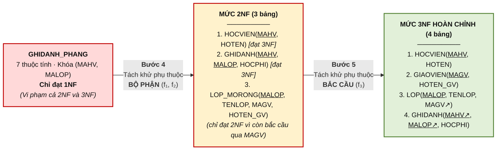

# 5.9. Quy trình chuẩn hóa hoàn chỉnh

*(1,0 tiết)*

Đến đây, toàn bộ các mảnh ghép lý thuyết đã sẵn sàng: ta đã có công cụ nhận diện phụ thuộc hàm *(mục 5.2–5.3)*, tính bao đóng và tìm khóa *(mục 5.4–5.5)*, rút gọn phủ tối thiểu *(mục 5.6)*, thang đo 1NF–2NF–3NF *(mục 5.7)* và quy tắc tách bảng bảo toàn thông tin lẫn phụ thuộc hàm *(mục 5.8)*.

Mục 5.9 này kết nối tất cả các mảnh ghép ấy thành một **quy trình chuẩn hóa 5 bước hoàn chỉnh**, rồi áp dụng trực tiếp vào **chính bảng phẳng của Trung tâm Anh ngữ ABC ở Chương 1** và thêm một bài tập mẫu tổng hợp trên nghiệp vụ đơn hàng.

**Bảng 5.25. Tổng quan quy trình 5 bước chuẩn hóa một bảng phẳng về 3NF**

| Bước | Tên bước | Công cụ sử dụng (Mục) | Đầu ra cần đạt được |
|:--:|---|---|---|
| **Bước 1** | **Đưa về 1NF & Lập tập phụ thuộc hàm `F`** | Mục 5.2, 5.6, 5.7.2 | Bảng đã khử ô đa trị (đạt 1NF); tập `F` rút từ quy tắc nghiệp vụ (đã tối giản nếu có phần tử thừa) |
| **Bước 2** | **Tìm tất cả các khóa dự tuyển** | Thuật toán `TN – TG – TĐ` & bao đóng `X⁺` (Mục 5.4, 5.5) | Danh sách tất cả các khóa dự tuyển; phân định rõ tập **thuộc tính khóa** và **thuộc tính không khóa** |
| **Bước 3** | **Chẩn đoán dạng chuẩn hiện tại** | Bảng "hai câu hỏi" (Mục 5.7.5) | Chỉ đích danh từng phụ thuộc **bộ phận** *(vi phạm 2NF)* và **bắc cầu** *(vi phạm 3NF)* |
| **Bước 4** | **Tách khử phụ thuộc bộ phận → đạt 2NF** | Quy tắc tách `R₁(K₁ ∪ Y)` và `R₂(R − Y)` (Mục 5.7.3, 5.8.4) | Tập các bảng con đều đạt ít nhất **2NF** |
| **Bước 5** | **Tách khử phụ thuộc bắc cầu → đạt 3NF & Kiểm chứng** | Quy tắc tách `R₁(Z ∪ Y)` và Định lý 5.1 (Mục 5.7.4, 5.8.2–5.8.3) | Tập các bảng con đều đạt **3NF**, kèm bảng kiểm chứng **bảo toàn thông tin** và **bảo toàn phụ thuộc hàm** |

## 5.9.1. Bài toán xuất phát — Bảng phẳng của Trung tâm Anh ngữ ABC

Xuất phát từ bảng phẳng lưu trữ toàn bộ thông tin ghi danh của Trung tâm Anh ngữ ABC đã làm quen từ Chương 1:

`GHIDANH_PHANG(MAHV, HOTEN, MALOP, TENLOP, MAGV, HOTEN_GV, HOCPHI)`

| MAHV | HOTEN | MALOP | TENLOP | MAGV | HOTEN_GV | HOCPHI |
|---|---|---|---|---|---|---|
| HV01 | Trần An | A1 | Anh cơ bản 1 | GV1 | Lê Hoa | 2.000.000 |
| HV01 | Trần An | A2 | Anh giao tiếp | GV2 | Trần Mai | 2.500.000 |
| HV02 | Lê Bình | A1 | Anh cơ bản 1 | GV1 | Lê Hoa | 2.000.000 |

## 5.9.2. Bước 1 — Kiểm tra 1NF và xác định tập phụ thuộc hàm `F`

- **Kiểm tra 1NF:** Mọi ô trong `GHIDANH_PHANG` đều chỉ chứa một giá trị nguyên tố duy nhất ⟹ bảng **đã đạt 1NF**.
- **Xác định tập phụ thuộc hàm `F` từ quy tắc nghiệp vụ:**

**Bảng 5.26. Tập phụ thuộc hàm `F` của `GHIDANH_PHANG` — rút từ quy tắc nghiệp vụ**

| Ký hiệu | Phụ thuộc hàm | Khi tách đơn vế phải | Quy tắc nghiệp vụ tương ứng tại Trung tâm ABC |
|:--:|---|---|---|
| `f₁` | `MAHV → HOTEN` | `MAHV → HOTEN` | Mỗi mã học viên xác định duy nhất **một** họ tên học viên |
| `f₂` | `MALOP → TENLOP, MAGV` | `MALOP → TENLOP`<br/>`MALOP → MAGV` | Mỗi mã lớp xác định duy nhất **một** tên lớp và do **một** giáo viên phụ trách |
| `f₃` | `MAGV → HOTEN_GV` | `MAGV → HOTEN_GV` | Mỗi mã giáo viên xác định duy nhất **một** họ tên giáo viên |
| `f₄` | `(MAHV, MALOP) → HOCPHI` | `(MAHV, MALOP) → HOCPHI` | Mỗi **lượt ghi danh** của một học viên vào một lớp có **một** mức học phí |

*(Tập `F` này đã là phủ tối thiểu vì không có thuộc tính thừa ở vế trái và không có phụ thuộc nào suy ra được từ các phụ thuộc còn lại).*

## 5.9.3. Bước 2 — Tìm tất cả các khóa dự tuyển và phân loại thuộc tính

Áp dụng thuật toán `TN – TG – TĐ` ở mục 5.5 *(đúng như đã phân nhóm ở Bảng 5.15)*:

- **Tập nguồn `TN` *(chỉ ở vế trái)*:** `{MAHV, MALOP}` — bắt buộc phải có mặt trong mọi khóa.
- **Tập trung gian `TG` *(ở cả hai vế)*:** `{MAGV}`.
- **Tập đích `TĐ` *(chỉ ở vế phải)*:** `{HOTEN, TENLOP, HOTEN_GV, HOCPHI}` — không bao giờ nằm trong khóa.

Áp lối tắt ở mục 5.5.2, ta tính bao đóng của tập nguồn `(TN)⁺ = (MAHV, MALOP)⁺` *(đã chạy chi tiết ở Bảng 5.11)*:

- Khởi tạo: `{MAHV, MALOP}`
- Áp `f₁ (MAHV → HOTEN)`: `{MAHV, MALOP, HOTEN}`
- Áp `f₂ (MALOP → TENLOP, MAGV)`: `{MAHV, MALOP, HOTEN, TENLOP, MAGV}`
- Áp `f₃ (MAGV → HOTEN_GV)`: `{MAHV, MALOP, HOTEN, TENLOP, MAGV, HOTEN_GV}`
- Áp `f₄ ((MAHV, MALOP) → HOCPHI)`: `{MAHV, MALOP, HOTEN, TENLOP, MAGV, HOTEN_GV, HOCPHI}` = **toàn bộ 7 thuộc tính của `GHIDANH_PHANG`**.

Vì `(TN)⁺` đã phủ kín toàn bộ lược đồ ngay mà không cần ghép thêm bất kỳ tập con nào của `TG`, ta kết luận:

- **Khóa dự tuyển duy nhất:** **`K = (MAHV, MALOP)`** *(khóa phức hợp gồm 2 thuộc tính)*.
- **Tập thuộc tính khóa:** `{MAHV, MALOP}`.
- **Tập thuộc tính không khóa:** `{HOTEN, TENLOP, MAGV, HOTEN_GV, HOCPHI}`.

!!! warning "Chú ý"

    Đây là khoảnh khắc **trực giác và toán học gặp nhau**. Ở mục 2.6.4 của Chương 2, ta đã đoán ra thực thể kết hợp `GHIDANH` bằng *phép thử tờ phiếu* — mỗi lượt học viên đăng ký một lớp, trung tâm in một tờ phiếu thu học phí. Nay thuật toán `TN–TG` **tính ra** đúng khóa `(MAHV, MALOP)`, tức đúng định danh của "tờ phiếu" ấy!

## 5.9.4. Bước 3 — Chẩn đoán dạng chuẩn bằng bảng "hai câu hỏi"

Áp dụng quy trình Bước 4 ở mục 5.7.5, ta đi qua từng phụ thuộc hàm của `GHIDANH_PHANG` và đặt hai câu hỏi chuẩn đoán.

**Bảng 5.27. Chẩn đoán từng phụ thuộc hàm của `GHIDANH_PHANG` với khóa duy nhất `K = (MAHV, MALOP)`**

| Phụ thuộc `X → A` | Câu 1: `X` là siêu khóa? | Câu 2: `A` là thuộc tính khóa? | Nếu cả hai "Không": `X` là **một phần** của khóa `K`? | Kết luận cho từng phụ thuộc |
|---|:--:|:--:|:--:|---|
| `MAHV → HOTEN` | Không | Không | **Có** (`MAHV ⊂ K`) | **Phụ thuộc bộ phận** → **Vi phạm 2NF** |
| `MALOP → TENLOP` | Không | Không | **Có** (`MALOP ⊂ K`) | **Phụ thuộc bộ phận** → **Vi phạm 2NF** |
| `MALOP → MAGV` | Không | Không | **Có** (`MALOP ⊂ K`) | **Phụ thuộc bộ phận** → **Vi phạm 2NF** |
| `MAGV → HOTEN_GV` | Không | Không | **Không** (`MAGV` ngoài khóa) | **Phụ thuộc bắc cầu** (`MALOP → MAGV → HOTEN_GV`) → **Vi phạm 3NF** |
| `(MAHV, MALOP) → HOCPHI` | **Có** (`X = K`) | — | — | **Phụ thuộc đầy đủ vào khóa** → **Đạt 3NF** |

**Bảng 5.28. Tổng hợp kết quả chẩn đoán dạng chuẩn của `GHIDANH_PHANG`**

| Dạng chuẩn | Trạng thái | Bằng chứng cụ thể từ Bảng 5.27 |
|:---:|:---:|---|
| **1NF** | **Đạt** | Mọi ô trong bảng đều chứa giá trị đơn |
| **2NF** | **Vi phạm** | Có 3 phụ thuộc **bộ phận** vào nửa khóa: `MAHV → HOTEN` và `MALOP → TENLOP, MAGV` |
| **3NF** | **Vi phạm** | Chưa đạt 2NF; đồng thời chứa chuỗi phụ thuộc **bắc cầu** `MALOP → MAGV → HOTEN_GV` |

**Kết luận Bước 3:** Bảng phẳng `GHIDANH_PHANG` hiện **chỉ đạt 1NF**.

## 5.9.5. Bước 4 và Bước 5 — Tách tuần tự lên 2NF rồi 3NF

Theo đúng Quy tắc vàng ở mục 5.8.4, ta lần lượt tách các thuộc tính vi phạm theo đúng phụ thuộc hàm của chúng:

1. **Bước 4 — Khử các phụ thuộc bộ phận để đưa toàn bộ lược đồ lên 2NF:**
   - Tách theo `f₁ (MAHV → HOTEN)` ra bảng **`HOCVIEN(MAHV, HOTEN)`** với khóa chính `MAHV`.
   - Tách theo `f₂ (MALOP → TENLOP, MAGV)` *(và kéo theo `HOTEN_GV` đang phụ thuộc vào `MAGV`)* ra bảng **`LOP_MORONG(MALOP, TENLOP, MAGV, HOTEN_GV)`** với khóa chính `MALOP`.
   - Phần còn lại của bảng gốc giữ khóa phức hợp `(MAHV, MALOP)` và thuộc tính phụ thuộc đầy đủ `HOCPHI`: **`GHIDANH(MAHV, MALOP, HOCPHI)`**.
   - *Kiểm tra sau Bước 4:* Cả ba bảng `HOCVIEN`, `LOP_MORONG`, `GHIDANH` đều **đã đạt 2NF**. Trong đó `HOCVIEN` và `GHIDANH` cũng đã đạt luôn **3NF**; riêng bảng `LOP_MORONG(MALOP, TENLOP, MAGV, HOTEN_GV)` mới đạt 2NF vì vẫn còn phụ thuộc bắc cầu `MALOP → MAGV → HOTEN_GV`.

2. **Bước 5 — Khử phụ thuộc bắc cầu trong `LOP_MORONG` để đưa toàn bộ lược đồ lên 3NF:**
   - Tách `LOP_MORONG` theo phụ thuộc `f₃ (MAGV → HOTEN_GV)` thành hai bảng:
     - **`GIAOVIEN(MAGV, HOTEN_GV)`** với khóa chính `MAGV`;
     - **`LOP(MALOP, TENLOP, MAGV)`** với khóa chính `MALOP` và khóa ngoại `MAGV` tham chiếu `GIAOVIEN`.

**Hình 5.10. Sơ đồ quy trình chuẩn hóa từng bước từ bảng phẳng `GHIDANH_PHANG` về 4 bảng đạt 3NF**



**Kết quả lược đồ cơ sở dữ liệu cuối cùng (đạt 3NF):**

```
HOCVIEN  (MAHV, HOTEN)
GIAOVIEN (MAGV, HOTEN_GV)
LOP      (MALOP, TENLOP, MAGV↗GIAOVIEN)
GHIDANH  (MAHV↗HOCVIEN, MALOP↗LOP, HOCPHI)
```

Đổ đúng ba dòng dữ liệu của bảng phẳng ở mục 5.9.1 vào bốn bảng vừa tách, ta nhìn thấy ngay kết quả trên mặt dữ liệu: **mỗi sự thật chỉ còn lưu ở đúng một nơi duy nhất**.

**Bảng 5.29. Ba dòng của `GHIDANH_PHANG` sau khi chuẩn hóa về 3NF — bốn bảng, không còn bất kỳ giá trị nào bị chép lặp**

| `HOCVIEN` | MAHV *(PK)* | HOTEN | | `GIAOVIEN` | MAGV *(PK)* | HOTEN_GV |
|---|---|---|---|---|---|---|
| | HV01 | Trần An | | | GV1 | Lê Hoa |
| | HV02 | Lê Bình | | | GV2 | Trần Mai |

| `LOP` | MALOP *(PK)* | TENLOP | MAGV↗ | | `GHIDANH` | MAHV↗ *(PK)* | MALOP↗ *(PK)* | HOCPHI |
|---|---|---|---|---|---|---|---|---|
| | A1 | Anh cơ bản 1 | GV1 | | | HV01 | A1 | 2.000.000 |
| | A2 | Anh giao tiếp | GV2 | | | HV01 | A2 | 2.500.000 |
| | | | | | | HV02 | A1 | 2.000.000 |

Những giá trị từng phải chép lặp hai lần trong bảng phẳng — `"Trần An"`, `"Lê Hoa"`, `"Anh cơ bản 1"` — nay xuất hiện **đúng một lần**. Và bốn bảng này trùng khớp 100% với ba bảng mà Chương 1 đã tách bằng trực giác cộng thêm bảng `GHIDANH` mà Chương 2 tìm ra bằng phép thử tờ phiếu!

## 5.9.6. Kiểm chứng tính bảo toàn thông tin và bảo toàn phụ thuộc hàm

Để bài giải chuẩn hóa đạt điểm tuyệt đối, bước cuối cùng là kiểm chứng rằng cả 3 nhát cắt của chúng ta đều thỏa mãn Định lý 5.1 *(bảo toàn thông tin)* và Định nghĩa 5.17 *(bảo toàn phụ thuộc hàm)*.

**Bảng 5.30. Kiểm chứng cả ba phép tách trong quy trình chuẩn hóa `GHIDANH_PHANG`**

| Nhát cắt (Phép tách đôi) | Thuộc tính chung `R₁ ∩ R₂` | Kiểm tra Định lý 5.1 *(Siêu khóa của bảng con)* | Phụ thuộc hàm được giữ trong bảng mới | Kết luận |
|---|---|---|---|---|
| **1.** Tách `HOCVIEN(MAHV, HOTEN)` khỏi `GHIDANH_PHANG` | `{MAHV}` | `(MAHV)⁺` chứa `{MAHV, HOTEN}` ⟹ `MAHV` là **khóa của `HOCVIEN`** | `f₁: MAHV → HOTEN` | **Bảo toàn thông tin & phụ thuộc** |
| **2.** Tách `LOP_MORONG(MALOP, TENLOP, MAGV, HOTEN_GV)` khỏi phần còn lại `GHIDANH(MAHV, MALOP, HOCPHI)` | `{MALOP}` | `(MALOP)⁺` chứa toàn bộ `LOP_MORONG` ⟹ `MALOP` là **khóa của `LOP_MORONG`** | `f₂: MALOP → TENLOP, MAGV` *(và `f₄` ở lại `GHIDANH`)* | **Bảo toàn thông tin & phụ thuộc** |
| **3.** Tách `GIAOVIEN(MAGV, HOTEN_GV)` khỏi `LOP_MORONG` để còn `LOP(MALOP, TENLOP, MAGV)` | `{MAGV}` | `(MAGV)⁺` chứa `{MAGV, HOTEN_GV}` ⟹ `MAGV` là **khóa của `GIAOVIEN`** | `f₃: MAGV → HOTEN_GV` | **Bảo toàn thông tin & phụ thuộc** |

Cả ba phép tách liên tiếp đều bảo toàn thông tin ⟹ khi kết tự nhiên `HOCVIEN ⋈ GHIDANH ⋈ LOP ⋈ GIAOVIEN` ta thu lại đúng bảng phẳng ban đầu, **không bao giờ sinh bộ giả**. Đồng thời cả 4 phụ thuộc `f₁, f₂, f₃, f₄` đều nằm trọn trong 4 bảng con và trở thành các ràng buộc khóa chính `PRIMARY KEY` của 4 bảng ấy!

---

## 5.9.7. Bài tập mẫu tổng hợp — Chuẩn hóa trọn vẹn bảng phẳng Đơn hàng

Để người học tự tin giải bài tập lớn và câu hỏi tự luận cuối kỳ *(như Bài B3 ở cuối chương)*, bài tập mẫu dưới đây trình bày trọn vẹn 5 bước chuẩn hóa cho một bài toán kinh điển khác: **Hóa đơn / Đơn đặt hàng bán lẻ**.

### Bài tập mẫu 5.8 — Chuẩn hóa bảng phẳng `DONHANG_PHANG` từ 1NF về 3NF

**Đề bài.** Một cửa hàng văn phòng phẩm đang quản lý chi tiết bán hàng trên một bảng phẳng `DONHANG_PHANG` *(đã ở 1NF)* gồm 8 thuộc tính:

`DONHANG_PHANG(MADH, NGAYDAT, MAKH, TENKH, MASP, TENSP, DONGIA, SOLUONG)`

với các quy tắc nghiệp vụ:
- Mỗi mã đơn hàng (`MADH`) có một ngày đặt (`NGAYDAT`) và thuộc về một khách hàng (`MAKH`).
- Mỗi mã khách hàng (`MAKH`) có một tên khách hàng (`TENKH`).
- Mỗi mã sản phẩm (`MASP`) có một tên sản phẩm (`TENSP`) và một đơn giá niêm yết (`DONGIA`).
- Trong một đơn hàng, mỗi sản phẩm xuất hiện tối đa một dòng với một số lượng đặt (`SOLUONG`).

Hãy thực hiện trọn vẹn quy trình 5 bước để chuẩn hóa `DONHANG_PHANG` về **3NF**.

**Lời giải chi tiết theo 5 bước.**

- **Bước 1 — Lập tập phụ thuộc hàm `F`:**
  - `f₁: MADH → NGAYDAT, MAKH` *(biết đơn hàng thì biết ngày đặt và mã khách hàng)*
  - `f₂: MAKH → TENKH` *(biết mã khách hàng thì biết tên khách hàng)*
  - `f₃: MASP → TENSP, DONGIA` *(biết mã sản phẩm thì biết tên sản phẩm và đơn giá)*
  - `f₄: (MADH, MASP) → SOLUONG` *(biết đơn hàng và sản phẩm thì biết số lượng mua)*

- **Bước 2 — Tìm tất cả các khóa dự tuyển:**
  - Phân nhóm thuộc tính:
    - Chỉ xuất hiện ở vế trái: **`TN = {MADH, MASP}`**.
    - Xuất hiện ở cả hai vế: **`TG = {MAKH}`**.
    - Chỉ xuất hiện ở vế phải: **`TĐ = {NGAYDAT, TENKH, TENSP, DONGIA, SOLUONG}`**.
  - Tính bao đóng của tập nguồn `(TN)⁺ = (MADH, MASP)⁺`:
    `{MADH, MASP}` → *(nhờ `f₁`)* `{MADH, MASP, NGAYDAT, MAKH}` → *(nhờ `f₂`)* `{…, TENKH}` → *(nhờ `f₃`)* `{…, TENSP, DONGIA}` → *(nhờ `f₄`)* `{…, SOLUONG}` = **toàn bộ 8 thuộc tính**.
  - Vậy lược đồ có **khóa dự tuyển duy nhất là `K = (MADH, MASP)`**.
  - **Thuộc tính khóa:** `{MADH, MASP}`; **thuộc tính không khóa:** `{NGAYDAT, MAKH, TENKH, TENSP, DONGIA, SOLUONG}`.

- **Bước 3 — Chẩn đoán dạng chuẩn hiện tại:**
  - **Vi phạm 2NF *(phụ thuộc bộ phận)*:**
    - `MADH → NGAYDAT, MAKH` *(vế trái `MADH` chỉ là một nửa của khóa `(MADH, MASP)`)*.
    - `MASP → TENSP, DONGIA` *(vế trái `MASP` chỉ là nửa kia của khóa `(MADH, MASP)`)*.
  - **Vi phạm 3NF *(phụ thuộc bắc cầu)*:**
    - `MADH → MAKH → TENKH` *(thuộc tính không khóa `TENKH` phụ thuộc vào `MAKH` ngoài khóa)*.
  - Kết luận: `DONHANG_PHANG` hiện **chỉ đạt 1NF**.

- **Bước 4 — Tách khử phụ thuộc bộ phận để lên 2NF:**
  - Tách theo `MASP → TENSP, DONGIA` ra bảng **`SANPHAM(MASP, TENSP, DONGIA)`** *(khóa chính `MASP` — đạt 3NF)*.
  - Tách theo `MADH → NGAYDAT, MAKH` *(kèm `TENKH` đi theo `MAKH`)* ra bảng **`DONHANG_2NF(MADH, NGAYDAT, MAKH, TENKH)`** *(khóa chính `MADH` — đạt 2NF, nhưng còn bắc cầu `MADH → MAKH → TENKH`)*.
  - Phần còn lại giữ khóa phức hợp `(MADH, MASP)` và thuộc tính phụ thuộc đầy đủ `SOLUONG`: **`CT_DONHANG(MADH, MASP, SOLUONG)`** *(khóa chính `(MADH, MASP)` — đạt 3NF)*.

- **Bước 5 — Tách khử phụ thuộc bắc cầu để lên 3NF và kiểm chứng:**
  - Tách `DONHANG_2NF` theo `MAKH → TENKH` thành hai bảng:
    - **`KHACHHANG(MAKH, TENKH)`** *(khóa chính `MAKH` — đạt 3NF)*.
    - **`DONHANG(MADH, NGAYDAT, MAKH↗)`** *(khóa chính `MADH`, khóa ngoại `MAKH` — đạt 3NF)*.
  - **Bốn bảng kết quả đạt 3NF:**
    1. `KHACHHANG(MAKH, TENKH)` — giữ `f₂`
    2. `SANPHAM(MASP, TENSP, DONGIA)` — giữ `f₃`
    3. `DONHANG(MADH, NGAYDAT, MAKH↗KHACHHANG)` — giữ `f₁`
    4. `CT_DONHANG(MADH↗DONHANG, MASP↗SANPHAM, SOLUONG)` — giữ `f₄`
  - **Kiểm chứng:** Cả 3 phép tách đều thực hiện theo các phụ thuộc hàm `f₃`, `f₁`, `f₂` có vế trái (`MASP`, `MADH`, `MAKH`) là khóa của bảng mới tách ra ⟹ **bảo toàn thông tin** theo Định lý 5.1; đồng thời cả 4 phụ thuộc `f₁, f₂, f₃, f₄` đều nằm trọn trong 4 bảng con ⟹ **bảo toàn phụ thuộc hàm**.

---


---

[← Trang trước](5-8-phep-tach-luoc-do.md) · [Trang sau →](5-10-dang-chuan-muc-cao-va-phi-chuan-hoa.md)
