# CHƯƠNG 5. LÝ THUYẾT THIẾT KẾ CƠ SỞ DỮ LIỆU QUAN HỆ (CHUẨN HÓA)

> **Ghi chú biên soạn (v7 — bản giáo trình, chỉnh sửa toàn diện theo góp ý: chuẩn hóa màu chữ Mermaid, viết lại mục 5.4 Bao đóng, bổ sung ví dụ & bảng dữ liệu cho 1NF/2NF/3NF ở mục 5.7, gỡ BCNF khỏi mục 5.7–5.8 và tái cấu trúc mạch 5.7–5.10).** Bản này giữ nguyên hệ thống mục **5.1–5.11 khớp với Mục 8 của đề cương chi tiết** *(12 tiết · CLO2, CLO3)*, văn phong giáo trình và toàn bộ phần mở rộng mục **5.3. Hệ luật dẫn Armstrong** của bản v6. Năm điểm nâng cấp chính so với v6: ① **Toàn bộ sơ đồ Mermaid** được gắn màu chữ đậm tương phản cao (`color:#111111` trên nền sáng, `color:#ffffff` trên nền xanh đậm `#1F4E79`) và tô màu đầy đủ mọi nút để đọc rõ trên cả giao diện tối (dark mode) lẫn bản in Word; ② **Mục 5.4. Bao đóng của tập thuộc tính** được biên soạn lại mạch lạc từ trực giác, thuật toán lăn quả cầu tuyết kèm bảng vết từng bước khớp Hình 5.4, hai cách trình bày bài thi *(dạng bảng và dạng chuỗi rút gọn)*, hệ thống ví dụ và bài tập mẫu có lời giải *(gồm bài 6 thuộc tính · 8 phụ thuộc hàm)*, ba ứng dụng thực hành của `X⁺`, và ví dụ liệt kê trực diện phân biệt `X⁺` với `F⁺`; ③ **Mục 5.7. Các dạng chuẩn 1NF, 2NF, 3NF** bổ sung đầy đủ **ví dụ và bảng dữ liệu Trước → Sau** cho từng dạng chuẩn (`1NF`, `2NF`, `3NF`) cùng bảng quy trình 4 bước và 3 bài mẫu chẩn đoán dạng chuẩn cao nhất; ④ **Loại bỏ hoàn toàn việc nhắc sớm BCNF** ở cây quyết định Hình 5.8 và bảng vàng Bảng 5.21 trong mục 5.7 *(chỉ xét trọn vẹn `1NF → 2NF → 3NF`)*; ⑤ **Tái cấu trúc logic cụm mục 5.7 – 5.8 – 5.9 – 5.10** theo trình tự một chiều, không nhảy cóc: **5.7** *(định nghĩa & ví dụ 1NF, 2NF, 3NF)* → **5.8** *(tiêu chuẩn phép tách đúng: bộ giả, bảo toàn thông tin, bảo toàn phụ thuộc hàm)* → **5.9** *(quy trình 5 bước chuẩn hóa trọn vẹn bảng phẳng về 3NF + bài tập mẫu tổng hợp)* → **5.10** *(định nghĩa BCNF, bài toán đánh đổi 3NF vs. BCNF trên `HV_KH_GV`, phụ thuộc đa trị, 4NF và phi chuẩn hóa)*. Tài liệu tham khảo: [1] Tô Văn Nam (2005); [2] Vũ Đức Thi (1997); [3] Coronel & Morris, *Database Systems*, Ch.6.
>
> ⏱️ **Lưu ý về thời lượng.** Đề cương dành **0,5 tiết** cho mục 5.10, nhưng mục này nay chứa **BCNF**, **4NF đầy đủ kèm thuật toán tách**, và **phi chuẩn hóa**. Nếu lớp không kịp, khuyến nghị giảng trên lớp phần **5.10.1 (BCNF)** và **5.10.4 (phi chuẩn hóa)**, chuyển **5.10.2–5.10.3 (phụ thuộc đa trị và 4NF)** sang **tự học có hướng dẫn** — hai tiểu mục ấy đã được viết đủ chi tiết để người học tự đọc.

---

## MỤC TIÊU CHƯƠNG

Sau khi học xong chương này, người học có thể:

1. **Phát biểu** định nghĩa **đo được** của một cơ sở dữ liệu "tốt" và **xác định** vị trí của chuẩn hóa trong quy trình thiết kế *(CLO2)*.
2. **Phân biệt** ba loại phụ thuộc hàm — đầy đủ, bộ phận, bắc cầu — và **chỉ ra** chúng trên một lược đồ cụ thể *(CLO2, CLO3)*.
3. **Vận dụng hệ luật dẫn Armstrong** để suy ra các phụ thuộc hàm mới *(CLO3)*.
4. ⭐ **Tính được bao đóng `X⁺`** của một tập thuộc tính và **phân biệt** nó với `F⁺` *(CLO3)*.
5. ⭐ **Tìm được tất cả khóa** của một lược đồ quan hệ bằng thuật toán TN–TG *(CLO3)*.
6. **Tìm được phủ tối thiểu** của một tập phụ thuộc hàm theo thuật toán ba bước *(CLO3)*.
7. **Xác định** dạng chuẩn cao nhất mà một lược đồ đạt được, có **chứng minh** *(CLO3)*.
8. **Thực hiện phép tách** lược đồ và **chứng minh** phép tách bảo toàn thông tin; **giải thích** hiện tượng **bộ giả** khi tách sai *(CLO3)*.
9. **Chuẩn hóa trọn vẹn** một lược đồ từ bảng phẳng về 3NF, có lập luận đầy đủ ở mỗi bước *(CLO3)*.
10. **Trình bày** BCNF, phụ thuộc đa trị và 4NF; **giải thích** khi nào **phi chuẩn hóa** là hợp lý *(CLO2)*.

---

## DẪN NHẬP

Bảng 4.26 ở cuối Chương 4 kết thúc bằng một dòng đáng suy nghĩ. Bốn chương đã đi qua, thiết kế cơ sở dữ liệu của Trung tâm Anh ngữ ABC đã tốt lên rất nhiều — nhưng ở cột cuối cùng, câu hỏi *"chứng minh được không?"* nhận bốn lần trả lời **"không"**.

Ở Chương 1 ta tách bảng vì *"thấy giá trị lặp lại"*. Ở Chương 2 ta tách thực thể vì *"thấy quan hệ nhiều–nhiều"*. Ở Chương 3 ta đặt khóa ngoại vì *"quy tắc ánh xạ bảo thế"*. Ở Chương 4 ta bỏ cột `SISO` vì *"bảng tầm ảnh hưởng có 5 trên 6 ô cộng"*. Mọi lần đều **đúng** — nhưng mọi lần đều dựa vào **kinh nghiệm và trực giác**, không phải chứng minh.

Điều đó có hai hệ quả. Thứ nhất, khi hai người thiết kế bất đồng, **không có trọng tài** — cảm tính chọi cảm tính. Thứ hai, và nghiêm trọng hơn: trực giác **không mở rộng được**. Với bảy bảng thì nhìn ra, với bốn mươi bảng thì không.

Chương 5 cung cấp thứ còn thiếu: một **công cụ toán học** để chứng minh một thiết kế là tốt hay chưa tốt. Công cụ ấy gồm hai phần. Phần thứ nhất là **phụ thuộc hàm** — người học đã gặp ở mục 3.2.2 nhưng khi đó chỉ dùng để định nghĩa khóa; ở đây nó trở thành công cụ phân tích chính. Phần thứ hai là hệ thống **các dạng chuẩn** — một thang đo cho biết lược đồ đang ở mức nào và còn thiếu gì.

Chương này khó hơn bốn chương trước, và cái khó nằm ở tính trừu tượng. Bốn chương đầu luôn có thứ để nhìn: bảng dữ liệu, sơ đồ ER, lược đồ quan hệ. Chương 5 làm việc chủ yếu với **ký hiệu**. Vì vậy giáo trình sắp xếp theo trình tự **công cụ trước, ứng dụng sau**: các mục 5.2 đến 5.6 xây dựng công cụ toán học, các mục 5.7 đến 5.9 dùng chúng để chuẩn hóa. Người học nên chấp nhận rằng bốn mục đầu tiên có vẻ chưa dùng vào việc gì — chúng là móng, và móng thì không nhìn thấy được khi nhà đã xây xong.

Chương kết thúc bằng khoảnh khắc mà cả học phần hướng tới. Khi chuẩn hóa lại **chính bảng phẳng của Chương 1** bằng toán học, kết quả sẽ ra **đúng những bảng mà bốn chương qua ta đã đoán được**. Trực giác đã đoán đúng, bản vẽ đã làm rõ, và toán học **chứng minh**. Đó chính là bước trưởng thành từ *"tôi nghĩ thế này đúng"* sang *"tôi chứng minh được thế này đúng"*.

---

## 5.1. Thế nào là một cơ sở dữ liệu "tốt"

*(0,5 tiết)*

### 5.1.1. Bốn chương và một điểm chung

**Bảng 5.1. Bốn chương — căn cứ ra quyết định**

| Chương | Căn cứ khi quyết định tách bảng | Chứng minh được? |
|---|---|:--:|
| Chương 1 | *"Thấy giá trị lặp lại thì tách"* | Không |
| Chương 2 | *"Thấy quan hệ nhiều–nhiều thì tách"* | Không |
| Chương 3 | *"Quy tắc ánh xạ bảo thế"* | Không |
| Chương 4 | *"Thấy ràng buộc khó thì sửa thiết kế"* | Không |
| **Chương 5** | **Phụ thuộc hàm và dạng chuẩn** | **Có** |

Mọi thứ bốn chương qua đều hội tụ về chương này.

**Hình 5.1. Bốn chương hội tụ về Chương 5**

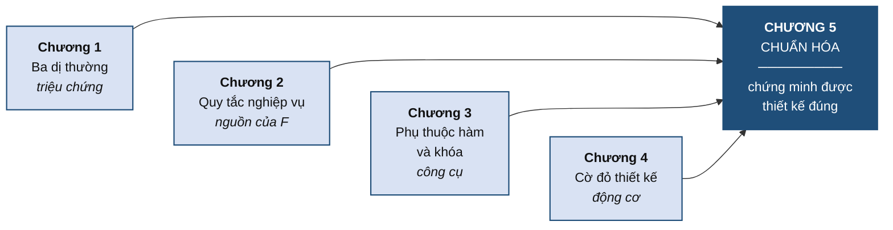

### 5.1.2. Định nghĩa "tốt" đo được

Từ *"tốt"* trong câu *"thiết kế cơ sở dữ liệu tốt"* xưa nay vẫn mơ hồ. Chương này thay nó bằng một định nghĩa **kiểm tra được**.

> **Định nghĩa 5.1.** Một lược đồ cơ sở dữ liệu được gọi là **tốt** nếu nó thỏa mãn **bốn tiêu chí**:
>
> 1. **Không dư thừa** — mỗi sự thật được lưu ở **đúng một chỗ**.
> 2. **Không có dị thường** thêm, sửa, xóa.
> 3. **Bảo toàn thông tin** — tách ra rồi ghép lại phải được **đúng dữ liệu ban đầu**.
> 4. **Bảo toàn phụ thuộc hàm** — mọi quy tắc nghiệp vụ vẫn kiểm tra được **không cần ghép bảng**.

**Bảng 5.2. Bốn tiêu chí — công cụ kiểm tra tương ứng**

| Tiêu chí | Kiểm bằng cách nào | Học ở mục |
|---|---|---|
| Không dư thừa | Xét **dạng chuẩn** đạt được | 5.7, 5.10 |
| Không dị thường | Hệ quả của tiêu chí 1 — xem *bảng vàng* | 5.7.6 |
| Bảo toàn thông tin | Điều kiện **lossless join** | 5.8.2 |
| Bảo toàn phụ thuộc hàm | Đối chiếu tập `F` với các bảng con | 5.8.3 |

Điểm quan trọng: bốn tiêu chí này **không phải lúc nào cũng đạt được cùng lúc**. Mục 5.8.4 sẽ chứng minh rằng ở mức **3NF** ta luôn đạt được trọn vẹn cả bốn tiêu chí; còn mục 5.10.1 sẽ chỉ ra vì sao khi đòi hỏi mức chuẩn cao hơn nữa thì đôi khi phải **đánh đổi** giữa tiêu chí 1 và tiêu chí 4.

### 5.1.3. Vị trí của chuẩn hóa trong quy trình thiết kế

Chuẩn hóa **không thay thế** thiết kế ER; nó bổ sung. Có hai cách dùng, và cả hai đều hợp lệ.

**Cách thứ nhất — kiểm tra lại.** Thiết kế ER trước *(Chương 2)*, ánh xạ sang quan hệ *(Chương 3)*, rồi **dùng chuẩn hóa để kiểm tra** kết quả. Nếu lược đồ đã đạt 3NF thì thiết kế ER đã tốt; nếu chưa, đó là dấu hiệu mô hình ER còn thiếu sót. Đây là cách dùng phổ biến nhất trong dự án thực tế.

**Cách thứ hai — chuẩn hóa từ đầu.** Xuất phát từ một bảng phẳng có sẵn *(chẳng hạn tệp Excel của khách hàng)* và chuẩn hóa dần lên. Cách này dùng khi cải tạo hệ thống cũ, và cũng chính là cách mục 5.9 sẽ minh họa.

> **Chú ý.** Người học đôi khi hiểu nhầm rằng *"chuẩn hóa là để tiết kiệm dung lượng"*. Không phải. Dung lượng chỉ là hệ quả phụ, và ngày nay rất rẻ. **Mục đích thật sự của chuẩn hóa là loại bỏ dị thường** — tức bảo đảm dữ liệu **đúng**, không mâu thuẫn. Đây chính là chuỗi nhân quả đã nêu ở mục 1.3.3: dư thừa dẫn tới không nhất quán, không nhất quán dẫn tới quyết định sai.

---

## 5.2. Ba loại phụ thuộc hàm

*(1,0 tiết)*

### 5.2.1. Nhắc lại và mở rộng

Mục 3.2.2 đã định nghĩa phụ thuộc hàm `X → Y`: *biết `X` thì biết chắc `Y`*. Ở Chương 3 khái niệm này chỉ dùng để định nghĩa khóa. Từ đây nó trở thành **công cụ phân tích chính**.

Cần nhắc lại một cảnh báo đã nêu ở Chương 3, vì nó là nguồn sai lầm phổ biến nhất của cả chương này:

> **Chú ý.** Tập phụ thuộc hàm `F` đến từ **quy tắc nghiệp vụ**, **không phải** từ việc nhìn dữ liệu mẫu. Nếu bảng hiện có 3 dòng và tình cờ không ai trùng tên, ta **không được** kết luận `HOTEN → MAHV`. Câu hỏi đúng luôn là: *"nghiệp vụ có cho phép hai học viên trùng tên không?"* Toàn bộ chương này đứng trên `F`; `F` sai thì mọi kết quả sau đó đều sai.

**Bảng 5.3. Ba loại phụ thuộc hàm**

| Loại | Định nghĩa ngắn | Có hại không |
|---|---|---|
| **Đầy đủ** *(full)* | `X → Y` mà **không tập con thực sự nào** của `X` xác định được `Y` | Không — đây là dạng mong muốn |
| **Bộ phận** *(partial)* | `Y` phụ thuộc vào **một phần** của khóa phức hợp | **Có** — vi phạm 2NF |
| **Bắc cầu** *(transitive)* | `K → Z → Y`, trong đó `Z` **không phải khóa** | **Có** — vi phạm 3NF |

Hai loại sau là **hai thủ phạm** gây ra dị thường, và toàn bộ việc chuẩn hóa lên 3NF chính là **diệt lần lượt hai thủ phạm này**.

### 5.2.2. Phụ thuộc hàm đầy đủ

> **Định nghĩa 5.2.** Phụ thuộc hàm `X → Y` là **đầy đủ** nếu với mọi tập con thực sự `X' ⊂ X`, ta **không có** `X' → Y`.

> **Ví dụ 5.1.** Trong bảng `GHIDANH(MAHV, MALOP, HOCPHI)` với khóa `(MAHV, MALOP)`:
>
> - `(MAHV, MALOP) → HOCPHI` là **đầy đủ**: biết riêng học viên không đủ suy ra học phí *(mỗi học viên đóng nhiều mức cho nhiều lớp)*, biết riêng lớp cũng không đủ *(mỗi lớp thu nhiều mức tùy ưu đãi)*.

### 5.2.3. Phụ thuộc bộ phận

> **Định nghĩa 5.3.** Phụ thuộc hàm `X → Y` là **bộ phận** nếu tồn tại tập con thực sự `X' ⊂ X` sao cho `X' → Y`. Nói cách khác: `Y` chỉ cần **một phần** của `X` là đã xác định được.

Loại này chỉ xuất hiện khi khóa là **khóa phức hợp** — vì phải có "phần" thì mới có "một phần".

**Hình 5.2. Phụ thuộc bộ phận — phép loại suy ổ khóa hai chìa**

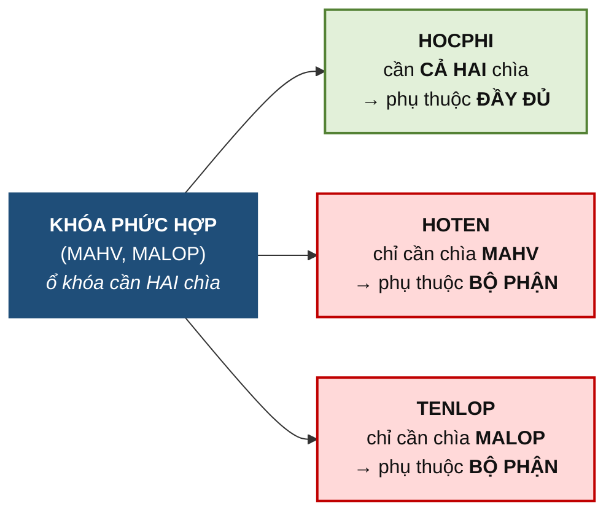

Vì sao phụ thuộc bộ phận gây hại? Vì nó **buộc dữ liệu phải lặp lại**. Nếu `HOTEN` chỉ phụ thuộc vào `MAHV` nhưng lại nằm trong bảng có khóa `(MAHV, MALOP)`, thì học viên ghi danh bao nhiêu lớp, tên của người đó **lặp lại bấy nhiêu lần** — đúng gốc rễ dư thừa của mục 1.3. Bảng dưới đây cho thấy điều đó trên bốn dòng dữ liệu.

**Bảng 5.4. Phụ thuộc bộ phận nhìn trên dữ liệu — `GHIDANH_MORONG` với khóa `(MAHV, MALOP)`**

| MAHV | MALOP | HOTEN | HOCPHI |
|---|---|---|---|
| HV01 | A1 | **Trần An** | 2.000.000 |
| HV01 | A2 | **Trần An** | 2.500.000 |
| HV01 | A3 | **Trần An** | 2.200.000 |
| HV02 | A1 | Lê Bình | 1.800.000 |

| Thuộc tính | Phụ thuộc vào | Loại | Hệ quả trên bảng |
|---|---|---|---|
| `HOTEN` | chỉ `MAHV` — **nửa khóa** | **Bộ phận** | HV01 ghi danh ba lớp → "Trần An" chép **ba lần**; sửa một dòng thành "Trần Văn An" là mâu thuẫn ngay |
| `HOCPHI` | cả `(MAHV, MALOP)` | Đầy đủ | Mỗi dòng một giá trị riêng, không lặp |

Che cột `MALOP` đi, cột `HOTEN` vẫn đọc được từ `MAHV` — đó là dấu hiệu nhận biết phụ thuộc bộ phận nhanh nhất khi nhìn dữ liệu.

### 5.2.4. Phụ thuộc bắc cầu

> **Định nghĩa 5.4.** Phụ thuộc hàm là **bắc cầu** nếu tồn tại chuỗi `K → Z → Y`, trong đó `K` là khóa, `Z` **không phải khóa và không phải tập con của khóa**, còn `Y` là thuộc tính không khóa.

**Hình 5.3. Phụ thuộc bắc cầu — phải đi hai chặng**

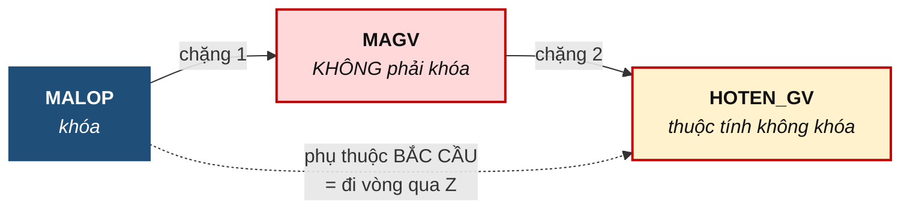

Vì sao bắc cầu gây hại? Cũng vì lặp lại, nhưng theo cơ chế khác. Nếu `HOTEN_GV` nằm trong bảng `LOP`, thì một giáo viên phụ trách bao nhiêu lớp, tên của người ấy **lặp lại bấy nhiêu lần**. Đây chính xác là tình huống cô Lê Hoa lặp ba lần ở Bảng 1.5 của Chương 1 — nay đã có tên gọi.

**Bảng 5.5. Phụ thuộc bắc cầu nhìn trên dữ liệu — `LOP` với khóa `MALOP`**

| MALOP | TENLOP | MAGV | HOTEN_GV |
|---|---|---|---|
| A1 | Anh cơ bản 1 | GV1 | **Lê Hoa** |
| A3 | Anh nâng cao | GV1 | **Lê Hoa** |
| A4 | Luyện thi IELTS | GV1 | **Lê Hoa** |
| A2 | Anh giao tiếp | GV2 | Trần Mai |

| Chặng | Phụ thuộc | Đọc |
|:--:|---|---|
| 1 | `MALOP → MAGV` | biết lớp thì biết mã giáo viên |
| 2 | `MAGV → HOTEN_GV` | biết mã giáo viên thì biết tên |
| 1 + 2 | `MALOP → HOTEN_GV` *(đi vòng)* | tên giáo viên "bám" vào lớp qua trung gian `MAGV` — nên cô Lê Hoa dạy ba lớp thì tên chép ba lần |

Hai dị thường lộ ra ngay: **sửa** tên ở dòng A1 thành "Lê Thị Hoa" thì hai dòng còn lại lệch; **xóa** lớp A2 thì mất luôn việc trung tâm có cô Trần Mai. Cả hai đều biến mất khi tách `GIAOVIEN(MAGV, HOTEN_GV)` ra riêng — tức cắt đứt chặng 2 khỏi bảng `LOP`.

> **Chú ý — điều kiện `Z` không phải khóa là bắt buộc.** Nếu `Z` cũng là một khóa dự tuyển thì chuỗi `K → Z → Y` **không phải** phụ thuộc bắc cầu có hại, vì lúc ấy `Z` xác định duy nhất mỗi dòng nên không gây lặp. Bỏ sót điều kiện này dẫn tới việc tách bảng không cần thiết.

> **Tự kiểm tra 5.2.** *(đáp án ở cuối chương)*
>
> 1. Thêm cột `TENLOP` vào bảng ở Bảng 5.4. Cột này phụ thuộc vào gì, thuộc loại nào, và giá trị nào sẽ bị chép lặp?
> 2. Bảng `HOCVIEN(MAHV, CCCD, HOTEN)` có `MAHV → CCCD` và `CCCD → HOTEN`. Chuỗi này có phải phụ thuộc bắc cầu **có hại** không?
> 3. Bảng `GHIDANH_MORONG` hiện có bốn dòng và không có hai dòng nào trùng `HOCPHI`. Có được kết luận `HOCPHI → MAHV` không?

---

## 5.3. Hệ luật dẫn Armstrong

*(1,0 tiết)*

Tập `F` mà người thiết kế thu thập được từ nghiệp vụ thường chỉ là **một phần** các phụ thuộc hàm thật sự tồn tại. Nhiều phụ thuộc khác **suy ra được** từ `F`. Hệ luật Armstrong *(1974)* cho biết cách suy diễn chính xác mà không cần nhìn lại dữ liệu.

### 5.3.1. Ba luật gốc

> **Định nghĩa 5.5 (Hệ tiên đề Armstrong).** Cho `X`, `Y`, `Z` là các tập thuộc tính của quan hệ `R` *(ký hiệu `XZ` viết tắt cho `X ∪ Z`)*:
>
> - **Luật phản xạ** *(reflexivity)*: nếu `Y ⊆ X` thì `X → Y`.
> - **Luật tăng trưởng** *(augmentation)*: nếu `X → Y` thì `XZ → YZ`.
> - **Luật bắc cầu** *(transitivity)*: nếu `X → Y` và `Y → Z` thì `X → Z`.

Ba luật này là **đúng đắn** *(sound — mọi phụ thuộc suy ra được đều đúng trên mọi thể hiện thỏa `F`)* và **đầy đủ** *(complete — mọi phụ thuộc đúng theo `F` đều suy ra được bằng hữu hạn bước)* — đó là kết quả do W. W. Armstrong chứng minh năm 1974, và cũng là lý do chỉ cần ba luật này là đủ cho toàn bộ lý thuyết chuẩn hóa.

Trong ba luật, hai luật đầu thoạt nhìn có vẻ ít tác dụng:

- **Luật phản xạ** nói rằng *biết `(MAHV, MALOP)` thì biết `MAHV`* — hiển nhiên. Nhưng chính nhờ nó sinh ra các **phụ thuộc tầm thường** *(trivial)* kiểu `YZ → Y`, ta mới có "cầu nối" để rút bớt thuộc tính ở vế phải.
- **Luật tăng trưởng** cho phép *đắp thêm cùng một tập thuộc tính `Z` vào cả hai vế*. Khi có `A → B` mà phụ thuộc kế tiếp lại đòi vế trái là `BC` *(như `BC → D`)*, hai đầu chưa khớp nhau để bắc cầu ngay; nhờ tăng trưởng `A → B` với `C` thành `AC → BC`, cầu nối lập tức hình thành.

### 5.3.2. Ba luật dẫn xuất và chứng minh từ ba luật gốc

Từ ba luật gốc, ta chứng minh được ba luật dẫn xuất giúp rút ngắn đáng kể các bước biến đổi khi làm bài.

**Bảng 5.6. Ba luật gốc và ba luật dẫn xuất**

| Ký hiệu | Luật | Phát biểu | Loại |
|:--:|---|---|---|
| **IR1** | **Phản xạ** *(reflexivity)* | `Y ⊆ X` ⟹ `X → Y` | Gốc |
| **IR2** | **Tăng trưởng** *(augmentation)* | `X → Y` ⟹ `XZ → YZ` | Gốc |
| **IR3** | **Bắc cầu** *(transitivity)* | `X → Y`, `Y → Z` ⟹ `X → Z` | Gốc |
| **IR4** | **Hợp** *(union)* | `X → Y`, `X → Z` ⟹ `X → YZ` | Dẫn xuất |
| **IR5** | **Tách** *(decomposition)* | `X → YZ` ⟹ `X → Y` và `X → Z` | Dẫn xuất |
| **IR6** | **Bắc cầu giả** *(pseudotransitivity)* | `X → Y`, `WY → Z` ⟹ `WX → Z` | Dẫn xuất |

Vì sao gọi IR4, IR5, IR6 là luật **dẫn xuất**? Vì không cần thêm tiên đề mới nào — cả ba đều được suy ra thuần túy từ IR1, IR2, IR3. Bảng dưới đây trình bày trọn vẹn ba chứng minh ấy; người học nên đọc kỹ vì đây chính là **ba bài mẫu chuẩn mực nhất** về cách phối hợp phản xạ, tăng trưởng và bắc cầu.

**Bảng 5.7. Chứng minh ba luật dẫn xuất từ ba luật gốc của Armstrong**

| Luật cần chứng minh | Bước | Phụ thuộc suy ra | Căn cứ *(chỉ dùng IR1, IR2, IR3)* | Ý tưởng của bước |
|---|:--:|---|---|---|
| **Luật hợp (IR4)**<br/>Cho `X → Y` và `X → Z`,<br/>chứng minh `X → YZ` | 1<br/>2<br/>3<br/>4<br/>5 | `X → Y`<br/>`X → XY`<br/>`X → Z`<br/>`XY → YZ`<br/>`X → YZ` | giả thiết<br/>tăng trưởng (1) với `X` *(vì `XX = X`)*<br/>giả thiết<br/>tăng trưởng (3) với `Y`<br/>bắc cầu (2) và (4) | —<br/>tạo trung gian `XY`<br/>—<br/>đưa `XY` sang `YZ`<br/>nối `X → XY → YZ` |
| **Luật tách (IR5)**<br/>Cho `X → YZ`,<br/>chứng minh `X → Y` và `X → Z` | 1<br/>2<br/>3<br/>4<br/>5 | `X → YZ`<br/>`YZ → Y`<br/>`X → Y`<br/>`YZ → Z`<br/>`X → Z` | giả thiết<br/>phản xạ *(vì `Y ⊆ YZ`)*<br/>bắc cầu (1) và (2)<br/>phản xạ *(vì `Z ⊆ YZ`)*<br/>bắc cầu (1) và (4) | —<br/>dùng phản xạ để giữ lại `Y`<br/>nối `X → YZ → Y`<br/>dùng phản xạ để giữ lại `Z`<br/>nối `X → YZ → Z` |
| **Luật bắc cầu giả (IR6)**<br/>Cho `X → Y` và `WY → Z`,<br/>chứng minh `WX → Z` | 1<br/>2<br/>3<br/>4 | `X → Y`<br/>`WX → WY`<br/>`WY → Z`<br/>`WX → Z` | giả thiết<br/>tăng trưởng (1) với `W`<br/>giả thiết<br/>bắc cầu (2) và (3) | —<br/>bù `W` vào hai vế để khớp `WY`<br/>—<br/>nối `WX → WY → Z` |

Nhìn vào Bảng 5.7, vai trò của hai luật gốc đầu tiên hiện ra rất rõ: ở **luật tách**, nếu không có bước phản xạ `YZ → Y` thì không có cách nào "gọt" bớt `Z` khỏi vế phải; ở **luật hợp** và **luật bắc cầu giả**, nếu không có bước tăng trưởng để tạo tập trung gian `XY` hay `WX → WY` thì hai giả thiết đứng rời nhau, không nối thành chuỗi bắc cầu được.

Hai luật **hợp** và **tách** đi thành một cặp ngược chiều nhau: chúng cho phép **gộp** hoặc **tách** vế phải tùy tiện. Nhờ đó ta luôn viết lại được mọi tập `F` về dạng chuẩn **mỗi phụ thuộc chỉ có đúng một thuộc tính ở vế phải** — điều kiện đầu tiên của phủ tối thiểu ở mục 5.6.

Sáu luật viết bằng `X`, `Y`, `Z` trông khô khan, nhưng thay bằng các thuộc tính của Trung tâm Anh ngữ ABC thì luật nào cũng chỉ là một câu nói hiển nhiên trong nghiệp vụ.

**Bảng 5.8. Sáu luật, mỗi luật một ví dụ tại ABC**

| Luật | Ví dụ | Đọc thành lời |
|---|---|---|
| Phản xạ | `(MAHV, MALOP) → MAHV` | biết cả cặp thì đương nhiên biết mã học viên |
| Tăng trưởng | `MAGV → HOTEN_GV` ⟹ `(MAGV, MALOP) → (HOTEN_GV, MALOP)` | thêm cùng một thứ vào hai vế, phụ thuộc vẫn đúng |
| Bắc cầu | `MALOP → MAGV`, `MAGV → HOTEN_GV` ⟹ `MALOP → HOTEN_GV` | biết lớp thì biết giáo viên, biết giáo viên thì biết tên — vậy biết lớp là biết tên |
| Hợp | `MALOP → TENLOP`, `MALOP → MAGV` ⟹ `MALOP → (TENLOP, MAGV)` | hai điều cùng suy từ lớp thì gộp lại vẫn suy từ lớp |
| Tách | `MALOP → (TENLOP, MAGV)` ⟹ `MALOP → TENLOP` và `MALOP → MAGV` | suy được cả cụm thì suy được từng phần |
| Bắc cầu giả | `MALOP → MAGV`, `(NGAY, MAGV) → PHONG` ⟹ `(NGAY, MALOP) → PHONG` | nếu mỗi giáo viên mỗi ngày dạy ở một phòng, thì biết lớp và ngày là biết phòng |

Dòng **bắc cầu** đáng chú ý nhất: hai phụ thuộc đầu vào đều "vô hại", nhưng kết quả `MALOP → HOTEN_GV` chính là phụ thuộc bắc cầu ở Bảng 5.5 — luật Armstrong làm lộ ra thủ phạm mà mắt thường dễ bỏ qua.

### 5.3.3. Bốn ví dụ suy diễn từ cơ bản đến nâng cao

Khi đứng trước bài toán *"Cho tập `F`, hãy chứng minh `X → Y` bằng hệ luật Armstrong"*, người mới học thường lúng túng không biết áp luật nào trước. Bí quyết nằm ở **tư duy hai đầu**: nhìn **vế trái `X`** xem từ `X` đang có những mũi tên nào đi ra, đồng thời nhìn **vế phải `Y`** xem trong `F` có những mũi tên nào bắn trúng `Y`, rồi tìm cách bắc cầu giữa hai đầu ấy. Bốn ví dụ dưới đây minh họa bốn tình huống điển hình nhất.

> **Ví dụ 5.2 — Ghép vế phải bằng Bắc cầu và Hợp.** Cho `F = {A → B, B → C}`. Chứng minh `A → BC`.
>
> *Hướng suy nghĩ:* Đích cần chứng minh có vế phải gồm hai thuộc tính `B` và `C`. Ta tìm cách suy ra từng thuộc tính từ `A` (`A → B` đã có sẵn; `A → C` suy qua trung gian `B`), rồi dùng **luật hợp** gộp chúng lại.
>
> | Bước | Suy luận | Luật dùng | Giải thích |
> |:--:|---|---|---|
> | 1 | `A → B` | giả thiết | đã có phần thứ nhất của vế phải (`B`) |
> | 2 | `B → C` | giả thiết | cầu nối từ `B` sang `C` |
> | 3 | `A → C` | bắc cầu (1, 2) | nối `A → B → C` để có phần thứ hai (`C`) |
> | 4 | `A → BC` | hợp (1, 3) | gộp hai vế phải `B` và `C` có cùng vế trái `A` |

> **Ví dụ 5.3 — Tách vế phải để làm bàn đạp bắc cầu.** Cho `R(A, B, C, D, E)` và `F = {A → BC, B → D, CD → E}`. Chứng minh `A → E`.
>
> *Hướng suy nghĩ (lần ngược từ đích):* Trong `F`, chỉ có `CD → E` sinh ra được `E`. Vậy muốn có `A → E`, ta cần chứng minh `A → CD`. Muốn có `A → CD`, ta cần `A → C` và `A → D`. Nhìn lại giả thiết `A → BC`: dùng **luật tách** sẽ lấy ra được `A → B` và `A → C`; từ `A → B` kết hợp với `B → D` sẽ cho `A → D`. Mạch suy diễn đã thông suốt.
>
> | Bước | Suy luận | Luật dùng | Vì sao thực hiện bước này |
> |:--:|---|---|---|
> | 1 | `A → BC` | giả thiết | xuất phát từ vế trái `A` |
> | 2 | `A → B` | tách (1) | tách riêng `B` để chuẩn bị nối với `B → D` |
> | 3 | `A → C` | tách (1) | tách riêng `C` để lát nữa ghép thành `CD` |
> | 4 | `B → D` | giả thiết | đưa phụ thuộc chứa `D` vào |
> | 5 | `A → D` | bắc cầu (2, 4) | nối `A → B → D` |
> | 6 | `A → CD` | hợp (3, 5) | gộp `C` và `D` để khớp đúng vế trái của `CD → E` |
> | 7 | `CD → E` | giả thiết | đưa phụ thuộc đích vào |
> | 8 | `A → E` | bắc cầu (6, 7) | nối `A → CD → E`, hoàn tất chứng minh |

> **Ví dụ 5.4 — Khi vế trái thiếu thuộc tính: so sánh Bắc cầu giả và Tăng trưởng.** Cho `R(A, B, C, D)` và `F = {A → B, BC → D}`. Chứng minh `AC → D` bằng **hai cách**: *(a)* dùng sáu luật; *(b)* chỉ dùng ba luật gốc.
>
> *Hướng suy nghĩ:* Từ `A` ta suy được `B`, nhưng phụ thuộc thứ hai lại đòi cả cụm `BC` mới suy ra `D`. Vế trái đang thiếu `C` — đây chính là dấu hiệu dùng **luật bắc cầu giả** (hoặc **luật tăng trưởng** với `C` nếu chỉ được dùng ba luật gốc).
>
> | Cách (a) — Dùng sáu luật *(nhanh gọn)* | | | | Cách (b) — Chỉ dùng ba luật gốc *(khi đề bắt buộc)* | | |
> |:--:|---|---|:--:|:--:|---|---|
> | **Bước** | **Suy luận** | **Luật dùng** | | **Bước** | **Suy luận** | **Luật dùng** |
> | 1 | `A → B` | giả thiết | | 1 | `A → B` | giả thiết |
> | 2 | `BC → D` | giả thiết | | 2 | `AC → BC` | tăng trưởng (1) với `C` |
> | 3 | `AC → D` | bắc cầu giả (1, 2) với `W = C` | | 3 | `BC → D` | giả thiết |
> | | | | | 4 | `AC → D` | bắc cầu (2, 3) |
>
> *Kinh nghiệm làm bài:* Mọi chỗ dùng **bắc cầu giả** đều có thể thay bằng một bước **tăng trưởng** cộng một bước **bắc cầu**. Tương tự, mọi chỗ dùng **luật tách** đều thay được bằng **phản xạ** cộng **bắc cầu**. Nhớ quy tắc quy đổi này, người học không bao giờ sợ câu hỏi yêu cầu *"chỉ dùng ba tiên đề gốc"*.

> **Ví dụ 5.5 — Suy diễn trên bài toán nghiệp vụ Trung tâm Anh ngữ ABC.** Phòng Đào tạo của Trung tâm ABC quản lý lịch học theo ba quy tắc nghiệp vụ sau trên quan hệ `LICHHOC(MALOP, MAGV, MAKH, CAHOC, PHONG, DAYNHA)`:
>
> - `f₁: MALOP → MAGV, MAKH` *(mỗi lớp do một giáo viên phụ trách và thuộc một khóa học)*
> - `f₂: (MAGV, CAHOC) → PHONG` *(trong một ca học, mỗi giáo viên chỉ dạy tại một phòng)*
> - `f₃: PHONG → DAYNHA` *(mỗi phòng học nằm ở một dãy nhà cố định)*
>
> Hãy dùng hệ luật Armstrong để chứng minh `(MALOP, CAHOC) → DAYNHA` và giải thích ý nghĩa nghiệp vụ của kết quả.
>
> | Bước | Suy luận | Luật dùng | Diễn giải theo nghiệp vụ |
> |:--:|---|---|---|
> | 1 | `MALOP → MAGV, MAKH` | giả thiết `f₁` | biết mã lớp thì biết giáo viên và khóa học |
> | 2 | `MALOP → MAGV` | tách (1) | giữ lại thông tin giáo viên phụ trách lớp |
> | 3 | `(MAGV, CAHOC) → PHONG` | giả thiết `f₂` | biết giáo viên và ca học thì biết phòng học |
> | 4 | `(MALOP, CAHOC) → PHONG` | bắc cầu giả (2, 3) với `W = CAHOC` | suy ra: biết lớp và ca học thì xác định được phòng học |
> | 5 | `PHONG → DAYNHA` | giả thiết `f₃` | biết phòng học thì biết dãy nhà |
> | 6 | `(MALOP, CAHOC) → DAYNHA` | bắc cầu (4, 5) | kết luận: biết lớp và ca học thì biết chắc lớp học ở dãy nhà nào |
>
> *Ý nghĩa thiết kế:* Dù quy tắc ban đầu không hề nhắc tới mối liên hệ giữa lớp học và dãy nhà, hệ luật Armstrong chỉ ra rằng `DAYNHA` phụ thuộc bắc cầu vào `(MALOP, CAHOC)` qua trung gian `PHONG`. Nếu lưu `DAYNHA` trực tiếp trong bảng lịch học theo ca, mỗi lần phòng P201 được lặp lại ở nhiều ca học thì tên dãy nhà sẽ bị chép lặp bấy nhiêu lần.

### 5.3.4. Ba ngụy biện thường gặp khi áp luật Armstrong

Khi làm bài tập suy diễn, người học rất hay "tự chế" ra những quy tắc trông có vẻ hợp lý trên mặt chữ nhưng **hoàn toàn sai về mặt toán học**. Có ba ngụy biện phổ biến nhất cần gạch đỏ ngay từ đầu.

**Bảng 5.9. Ba ngụy biện thường gặp khi suy diễn bằng luật Armstrong**

| Ngụy biện *(luật SAI)* | Vì sao người học hay nhầm | Quy tắc ĐÚNG tương ứng | Cách nhớ để không bao giờ sai |
|---|---|---|---|
| **1. Tách vế trái (SAI)**<br/>`XY → Z` ⟹ `X → Z` và `Y → Z` | Nhầm với **luật tách (IR5)** `X → YZ ⟹ X → Y, X → Z` | Chỉ được **tách vế phải**, tuyệt đối **không được tách vế trái**. Ngược lại, vế trái chỉ có thể **mở rộng thêm** (`X → Z ⟹ XY → Z`, do tăng trưởng với `Y` rồi tách) | Ổ khóa hai chìa `(X, Y)` mới mở được két `Z` — cầm một chìa `X` không mở được! |
| **2. Đảo chiều (SAI)**<br/>`X → Y` ⟹ `Y → X` | Nhầm mũi tên phụ thuộc hàm `→` với dấu bằng `=` trong đại số | Phụ thuộc hàm **có chiều** *(mục 3.2.2)*. `X → Y` và `Y → X` là hai khẳng định độc lập; chỉ khi cả hai cùng được nghiệp vụ cho phép mới có hai chiều | Biết mã lớp biết giáo viên (`MALOP → MAGV`), nhưng biết giáo viên GV1 không suy ra được lớp nào vì cô dạy ba lớp |
| **3. Khử hai vế (SAI)**<br/>`XZ → YZ` ⟹ `X → Y` | Làm ngược **luật tăng trưởng (IR2)**, tưởng "rút gọn" được `Z` ở hai bên như phương trình số học | Tăng trưởng chỉ đi **một chiều**: từ `X → Y` thêm `Z` vào hai vế thành `XZ → YZ`, **không có chiều bớt `Z` đi** | Có thêm `Z` giúp xác định được `Y` không có nghĩa bỏ `Z` đi một mình `X` vẫn xác định được `Y` |

Để thấy rõ vì sao ba ngụy biện trên đều sai, không gì thuyết phục hơn nhìn thẳng vào bảng dữ liệu thực tế của Trung tâm ABC. Bảng dưới đây dùng chính bốn dòng dữ liệu quen thuộc của `GHIDANH_MORONG` để bác bỏ cả ba.

**Bảng 5.10. Dữ liệu `GHIDANH_MORONG` bác bỏ cả ba ngụy biện suy diễn**

| MAHV | MALOP | HOTEN | MAGV | HOCPHI |
|---|---|---|---|---|
| **HV01** | **A1** | Trần An | **GV1** | **2.000.000** |
| **HV01** | **A2** | Trần An | GV2 | **2.500.000** |
| HV02 | **A3** | Lê Bình | **GV1** | 2.200.000 |
| HV03 | A1 | **Trần An** | GV1 | 2.000.000 |

| Ngụy biện bị kiểm nghiệm | Giả thiết ĐÚNG trên bảng | Kết luận SAI nếu áp ngụy biện | Dòng dữ liệu vạch trần chỗ sai *(phản ví dụ)* |
|---|---|---|---|
| **Tách vế trái** | `(MAHV, MALOP) → HOCPHI` *(mỗi cặp học viên – lớp có một mức học phí)* | Tưởng suy ra được `MAHV → HOCPHI` | Hai dòng đầu có cùng **`MAHV = HV01`** nhưng `HOCPHI` lại là **`2.000.000`** *(lớp A1)* và **`2.500.000`** *(lớp A2)* — một mình `MAHV` không xác định được học phí |
| **Đảo chiều** | `MAHV → HOTEN` và `MALOP → MAGV` | Tưởng suy ra được `HOTEN → MAHV` hoặc `MAGV → MALOP` | Dòng 1 và dòng 4 cùng **`HOTEN = Trần An`** nhưng là hai học viên `HV01` và `HV03`; dòng 1 và dòng 3 cùng **`MAGV = GV1`** nhưng dạy hai lớp **`A1`** và **`A3`** |
| **Khử hai vế** | `(MAHV, MALOP) → (MAGV, MALOP)` *(suy từ `MALOP → MAGV` bằng luật tăng trưởng với `MAHV`, rồi hợp)* | Tưởng bỏ `MALOP` ở hai vế thì được `MAHV → MAGV` | Dòng 1 và dòng 2 có cùng **`MAHV = HV01`** nhưng học với hai giáo viên khác nhau là **`GV1`** và **`GV2`** — bỏ `MALOP` đi là mất ngay sự thật |

> **Chú ý — quy tắc mở rộng vế trái (luật tích lũy vế trái).** Tuy **không được bớt** thuộc tính ở vế trái (`XY → Z` không suy ra `X → Z`), ta lại **luôn được phép thêm** thuộc tính bất kỳ vào vế trái:
>
> Nếu `X → Z` thì `XY → Z` *(với mọi tập thuộc tính `Y`)*.
>
> *Chứng minh trong hai bước:* Từ `X → Z`, áp luật tăng trưởng với `Y` được `XY → YZ`; áp tiếp luật tách cho vế phải `YZ` được `XY → Z`. Quy tắc này rất dễ hiểu: nếu một chìa `X` đã mở được ổ khóa `Z`, thì cầm chùm chìa `XY` *(có sẵn chìa `X` trong đó)* đương nhiên vẫn mở được `Z`.

### 5.3.5. Bài tập mẫu có lời giải từng bước

Năm bài tập dưới đây bao quát các dạng câu hỏi thường gặp nhất về hệ luật dẫn Armstrong trong bài kiểm tra và đề thi kết thúc học phần: từ suy diễn cơ bản, rút gọn thuộc tính thừa, chứng minh chỉ bằng ba luật gốc, phát hiện lỗi ngụy biện, cho tới vận dụng trên bài toán nghiệp vụ. Người học nên tự giải ra nháp trước khi đọc bảng lời giải.

---

#### Bài tập mẫu 5.1 — Suy diễn nhiều chặng và rút gọn thuộc tính thừa ở vế trái

**Đề bài.** Cho lược đồ quan hệ `R(A, B, C, D, E)` và tập phụ thuộc hàm `F = {A → B, AB → C, C → D, BD → E}`. Bằng hệ luật dẫn Armstrong, hãy chứng minh:

a) `A → C`
b) `A → E`

**Phân tích hướng giải.**

- Ở câu (a), giả thiết cho `AB → C` *(cần cả `A` và `B` mới suy ra `C`)*, nhưng đồng thời lại cho `A → B` *(bản thân `A` đã suy ra `B`)*. Vậy thực chất chỉ cần một mình `A` là đủ suy ra `C`. Để nối `A → B` vào `AB → C`, ta dùng **luật bắc cầu giả** với `W = A` *(vì `AA = A`)*, hoặc tăng trưởng `A → B` với `A` thành `A → AB` rồi bắc cầu.
- Ở câu (b), muốn có `A → E` thì nhìn vào `BD → E`: ta cần chứng minh `A → BD`, tức cần `A → B` *(đã có)* và `A → D`. Mà `A → D` nối được từ kết quả câu (a) `A → C` và giả thiết `C → D`.

**Lời giải chi tiết.**

*Câu a) Chứng minh `A → C`:*

| Bước | Suy luận | Luật dùng | Ghi chú |
|:--:|---|---|---|
| 1 | `A → B` | giả thiết | xuất phát từ `A` |
| 2 | `A → AB` | tăng trưởng (1) với `A` *(hoặc hợp `A → A` và `A → B`)* | vì `A ∪ A = A`, ghép thêm `A` vào vế phải để khớp `AB` |
| 3 | `AB → C` | giả thiết | phụ thuộc có vế trái `AB` |
| 4 | `A → C` | bắc cầu (2, 3) | nối `A → AB → C` *(hoặc áp thẳng bắc cầu giả cho 1 và 3 với `W = A`)* |

*Câu b) Chứng minh `A → E`:*

| Bước | Suy luận | Luật dùng | Ghi chú |
|:--:|---|---|---|
| 5 | `C → D` | giả thiết | cầu nối từ `C` sang `D` |
| 6 | `A → D` | bắc cầu (4, 5) | nối kết quả câu (a) `A → C` với `C → D` |
| 7 | `A → BD` | hợp (1, 6) | gộp `A → B` và `A → D` để tạo đúng vế trái `BD` |
| 8 | `BD → E` | giả thiết | đưa phụ thuộc đích vào |
| 9 | `A → E` | bắc cầu (7, 8) | nối `A → BD → E`, hoàn tất chứng minh |

> **Nhận xét nối sang mục 5.6.** Câu (a) cho thấy một ý rất quan trọng: khi trong `F` có `A → B`, thì thuộc tính `B` ở vế trái của `AB → C` là **thuộc tính thừa** — ta có thể thay `AB → C` bằng `A → C` gọn hơn mà không làm thay đổi những gì suy ra được. Đây chính là bản chất của **Bước 2 (loại thuộc tính thừa ở vế trái)** trong thuật toán tìm phủ tối thiểu ở mục 5.6.3.

---

#### Bài tập mẫu 5.2 — Chứng minh bằng sáu luật so với chỉ dùng ba luật gốc

**Đề bài.** Cho lược đồ `R(A, B, C, D, E, F)` và tập phụ thuộc hàm `F = {AB → C, BC → AD, D → E, CF → B}`.

a) Chứng minh `AB → D` bằng **hai cách**: *(Cách 1)* được dùng cả sáu luật; *(Cách 2)* **chỉ được dùng ba luật gốc** *(phản xạ, tăng trưởng, bắc cầu)*.
b) Chứng minh `AB → E` và `ACF → D`.

**Phân tích hướng giải.**

- Ở câu (a), từ `AB → C` và `BC → AD`, ta thấy `C` ở vế phải của phụ thuộc đầu nằm trong vế trái `BC` của phụ thuộc sau (thiếu `B`, mà `B` đã có sẵn trong `AB`). Khi dùng sáu luật, ta áp **bắc cầu giả** rồi **tách** vế phải `AD` lấy `D`. Khi chỉ được dùng ba luật gốc, ta thay bắc cầu giả bằng **tăng trưởng** với `B` (`AB → C ⟹ ABB → BC`, mà `ABB = AB`), và thay luật tách bằng **phản xạ** (`AD → D`) cộng **bắc cầu**.
- Ở câu (b), `AB → E` suy ngay từ `AB → D` và `D → E`. Còn với `ACF → D`: trong `ACF` có `CF`, mà `CF → B` cho phép suy ra `B`; ghép với `A` sẵn có sẽ quay về bài toán của `AB → D`!

**Lời giải chi tiết.**

*Câu a) Chứng minh `AB → D` bằng hai cách:*

| Bước | **Cách 1 — Dùng cả sáu luật** | Luật dùng | | Bước | **Cách 2 — Chỉ dùng ba luật gốc (IR1, IR2, IR3)** | Luật dùng |
|:--:|---|---|:--:|:--:|---|---|
| 1 | `AB → C` | giả thiết | | 1 | `AB → C` | giả thiết |
| 2 | `BC → AD` | giả thiết | | 2 | `AB → BC` | tăng trưởng (1) với `B` *(vì `ABB = AB`)* |
| 3 | `AB → AD` | bắc cầu giả (1, 2) với `W = B` *(vì `BB = B`)* | | 3 | `BC → AD` | giả thiết |
| 4 | `AB → D` | tách (3) | | 4 | `AB → AD` | bắc cầu (2, 3) |
| | | | | 5 | `AD → D` | phản xạ *(vì `D ⊆ AD`)* |
| | | | | 6 | `AB → D` | bắc cầu (4, 5) |

*Câu b) Chứng minh `AB → E` và `ACF → D`:*

| Bước | Suy luận | Luật dùng | Giải thích |
|:--:|---|---|---|
| 1 | `AB → D` | chứng minh ở câu (a) | điểm xuất phát cho nhánh thứ nhất |
| 2 | `D → E` | giả thiết | — |
| 3 | `AB → E` | bắc cầu (1, 2) | **xong ý thứ nhất** (`AB → E`) |
| 4 | `CF → B` | giả thiết | bắt đầu nhánh thứ hai để chứng minh `ACF → D` |
| 5 | `ACF → D` | bắc cầu giả (4, 1) với `W = A` | thay `B` trong vế trái của `AB → D` *(bước 1)* bằng `CF` → được `ACF → D` **(xong ý thứ hai)** |

---

#### Bài tập mẫu 5.3 — Suy diễn trên tập phụ thuộc có chu trình và gộp nhiều nhánh

**Đề bài.** Cho lược đồ `R(A, B, C, D, E, H)` và tập phụ thuộc hàm `F = {A → B, BC → D, D → E, E → A, AH → C}`. Hãy chứng minh bằng hệ luật Armstrong:

a) `D → B`
b) `CE → D`
c) `EH → D`

**Phân tích hướng giải.**

Nhìn vào `F`, ta phát hiện một chuỗi đi vòng: `D → E → A → B`, rồi `B` ghép với `C` lại quay về `D` (`BC → D`).

- Câu (a) đi dọc theo chuỗi đơn: `D → E → A → B` (hai lần bắc cầu).
- Câu (b) có vế trái `CE`: từ `E` đi qua `A` sẽ lấy được `B` (`E → A → B`), ghép với `C` sẵn có ở vế trái sẽ đủ bộ `BC` để kích hoạt `BC → D`.
- Câu (c) có vế trái `EH`: từ `E → A` và `AH → C`, áp bắc cầu giả được `EH → C`. Khi đã có cả `EH → C` và `E → B`, ta gộp lại để đi vào `BC → D` (hoặc nối vào kết quả `CE → D` của câu b)!

**Lời giải chi tiết.**

| Phần | Bước | Suy luận | Luật dùng | Giải thích |
|---|:--:|---|---|---|
| **Câu a)**<br/>`D → B` | 1<br/>2<br/>3<br/>4<br/>5 | `D → E`<br/>`E → A`<br/>`D → A`<br/>`A → B`<br/>`D → B` | giả thiết<br/>giả thiết<br/>bắc cầu (1, 2)<br/>giả thiết<br/>bắc cầu (3, 4) | —<br/>—<br/>nối `D → E → A`<br/>—<br/>nối `D → A → B` **(xong câu a)** |
| **Câu b)**<br/>`CE → D` | 6<br/>7<br/>8<br/>9 | `E → B`<br/>`BC → D`<br/>`CE → D`<br/>— | bắc cầu (2, 4)<br/>giả thiết<br/>bắc cầu giả (6, 7) với `W = C`<br/>— | nối `E → A → B`<br/>cần `BC` ở vế trái<br/>thay `B` trong `BC` bằng `E` → `CE → D` **(xong câu b)**<br/>— |
| **Câu c)**<br/>`EH → D` | 10<br/>11<br/>12 | `AH → C`<br/>`EH → C`<br/>`EH → D` | giả thiết<br/>bắc cầu giả (2, 10) với `W = H`<br/>bắc cầu giả (11, 8) với `W = E` | —<br/>từ `E → A` và `AH → C` suy ra `EH → C`<br/>từ `EH → C` và `CE → D` *(bước 8)* suy ra `EEH → D`, tức `EH → D` **(xong câu c)** |

---

#### Bài tập mẫu 5.4 — Bắt lỗi lời giải sai và dựng bảng dữ liệu phản ví dụ

**Đề bài.** Cho lược đồ `R(A, B, C, D)` và tập phụ thuộc hàm `F = {AB → C, C → D, D → B}`.

a) Chứng minh `AB → D`.
b) Một bạn sinh viên khẳng định rằng từ `F` cũng suy ra được `A → D` và trình bày lời giải 4 bước sau:
   - Bước 1: `AB → C` *(giả thiết)*
   - Bước 2: `A → C` *(áp luật tách cho bước 1)*
   - Bước 3: `C → D` *(giả thiết)*
   - Bước 4: `A → D` *(áp luật bắc cầu cho bước 2 và bước 3)*

   Hỏi: Lời giải của bạn ấy **sai ở bước nào** và mắc ngụy biện gì? Hãy dựng một bảng dữ liệu gồm **2 dòng** cho `R(A, B, C, D)` sao cho thỏa mãn cả ba phụ thuộc trong `F` nhưng vi phạm `A → D` *(để chứng minh rằng không thể nào suy ra `A → D` từ `F`)*.

**Lời giải chi tiết.**

*Câu a) Chứng minh `AB → D`:*

| Bước | Suy luận | Luật dùng |
|:--:|---|---|
| 1 | `AB → C` | giả thiết |
| 2 | `C → D` | giả thiết |
| 3 | `AB → D` | bắc cầu (1, 2) |

*Câu b) Chỉ ra lỗi sai và lập bảng phản ví dụ:*

- **Chỗ sai:** Lời giải sai ngay ở **Bước 2** (`AB → C ⟹ A → C`). Bạn sinh viên đã mắc **ngụy biện tách vế trái** *(mục 5.3.4)*: luật tách của Armstrong chỉ cho phép tách **vế phải** (`X → YZ ⟹ X → Y`), không bao giờ cho phép bỏ bớt thuộc tính `B` khỏi vế trái `AB`.
- **Dựng bảng phản ví dụ 2 dòng:** Muốn bác bỏ `A → D`, ta cần hai dòng có **cùng giá trị `A`** nhưng **khác giá trị `D`**, đồng thời vẫn tuân thủ nghiêm ngặt `AB → C`, `C → D` và `D → B` *(nghĩa là nếu hai dòng khác `D` thì chúng phải khác `B` và khác `C`)*.

| Dòng | A | B | C | D | Kiểm tra tập `F = {AB → C, C → D, D → B}` |
|:--:|:--:|:--:|:--:|:--:|---|
| 1 | **`a₁`** | `b₁` | `c₁` | **`d₁`** | Hai dòng có cặp `(A, B)` khác nhau (`(a₁, b₁) ≠ (a₁, b₂)`), giá trị `C` khác nhau (`c₁ ≠ c₂`), giá trị `D` khác nhau (`d₁ ≠ d₂`) → **không có bất kỳ hai dòng nào trùng vế trái**, nên cả ba phụ thuộc `AB → C`, `C → D`, `D → B` đều **thỏa mãn tuyệt đối** |
| 2 | **`a₁`** | `b₂` | `c₂` | **`d₂`** | Tuy nhiên, hai dòng có **cùng `A = a₁`** mà lại nhận **hai giá trị `D` khác nhau (`d₁ ≠ d₂`)** → phụ thuộc **`A → D` bị vi phạm** |

Bảng 2 dòng trên là bằng chứng không thể chối cãi: tồn tại một thể hiện hợp lệ của `R` thỏa mãn toàn bộ `F` nhưng không thỏa `A → D`. Do hệ luật Armstrong là đúng đắn, không một chuỗi suy diễn hợp lệ nào có thể dẫn tới `A → D`.

---

#### Bài tập mẫu 5.5 — Bài toán nghiệp vụ thực tế: Phân công giảng dạy và phòng học

**Đề bài.** Một trường đại học quản lý lịch giảng dạy bằng lược đồ `LICHDAY(MALOP, MAMH, TENMH, SOTC, MAGV, CAHOC, PHONG)` với tập phụ thuộc hàm `F` rút từ bốn quy tắc nghiệp vụ:

- `f₁: MAMH → TENMH, SOTC` *(mỗi mã môn học có một tên môn và một số tín chỉ)*
- `f₂: MALOP → MAMH, MAGV` *(mỗi lớp học phần thuộc một môn học và do một giảng viên phụ trách)*
- `f₃: (MAGV, CAHOC) → PHONG` *(tại một ca học, một giảng viên chỉ dạy ở một phòng)*
- `f₄: (PHONG, CAHOC) → MALOP` *(tại một ca học, một phòng chỉ bố trí cho một lớp học phần)*

Dùng hệ luật dẫn Armstrong để chứng minh các phụ thuộc hàm sau và nêu ý nghĩa nghiệp vụ của từng kết quả:

a) `MALOP → TENMH, SOTC`
b) `(MALOP, CAHOC) → PHONG`
c) `(PHONG, CAHOC) → MAGV`

**Lời giải chi tiết.**

| Câu | Bước | Suy luận | Luật dùng | Ý nghĩa nghiệp vụ |
|---|:--:|---|---|---|
| **a)** | 1<br/>2<br/>3<br/>4 | `MALOP → MAMH, MAGV`<br/>`MALOP → MAMH`<br/>`MAMH → TENMH, SOTC`<br/>`MALOP → TENMH, SOTC` | giả thiết `f₂`<br/>tách (1)<br/>giả thiết `f₁`<br/>bắc cầu (2, 3) | Biết mã lớp học phần thì biết môn học của lớp đó, suy ra biết luôn tên môn và số tín chỉ *(đây là phụ thuộc bắc cầu qua `MAMH`, báo hiệu phải tách bảng `MONHOC`)* |
| **b)** | 5<br/>6<br/>7 | `MALOP → MAGV`<br/>`(MAGV, CAHOC) → PHONG`<br/>`(MALOP, CAHOC) → PHONG` | tách (1)<br/>giả thiết `f₃`<br/>bắc cầu giả (5, 6) với `W = CAHOC` | Biết lớp học phần thì biết giảng viên dạy lớp đó; kết hợp với ca học sẽ xác định duy nhất phòng học của lớp trong ca ấy |
| **c)** | 8<br/>9 | `(PHONG, CAHOC) → MALOP`<br/>`(PHONG, CAHOC) → MAGV` | giả thiết `f₄`<br/>bắc cầu (8, 5) | Tại một phòng trong một ca học chỉ có một lớp học phần, mà mỗi lớp do một giảng viên dạy, nên nhìn vào phòng và ca học là biết ngay giảng viên nào đang đứng lớp |

---

### 5.3.6. Vì sao cần hệ luật này — và khi nào chuyển sang bao đóng

Có hai lý do thực dụng khiến người thiết kế phải nắm vững hệ luật Armstrong.

Thứ nhất, nó cho phép **phát hiện các phụ thuộc bắc cầu và dư thừa ẩn**. Nhìn vào `F = {MALOP → MAGV, MAGV → HOTEN_GV}` hay `{MALOP → MAMH, MAMH → TENMH}` ở Bài tập mẫu 5.5, từng phụ thuộc riêng lẻ trông hoàn toàn tự nhiên, nhưng luật bắc cầu chỉ ra `MALOP → HOTEN_GV` và `MALOP → TENMH` — chính là các vi phạm 3NF. Không có hệ luật này, người thiết kế phải dò tìm bằng mắt, tức lại quay về trực giác.

Thứ hai, hệ luật Armstrong là **nền tảng toán học của thuật toán bao đóng** ở mục 5.4 ngay sau đây. Khi làm năm bài tập mẫu ở trên, người học có thể nhận thấy:

- Để chứng minh một phụ thuộc **suy ra được** (`X → Y`), ta nối từng bước bằng luật Armstrong rất tường minh.
- Nhưng nếu đề hỏi *"Cho `F`, phụ thuộc `A → D` có suy ra được không?"* (như câu b Bài tập mẫu 5.4), việc tìm mãi không ra cách nối chưa phải là chứng minh — biết đâu có cách nối mà ta chưa nghĩ ra? Muốn trả lời dứt khoát cả câu hỏi *"có"* lẫn câu hỏi *"không"* một cách tự động, ta cần gom toàn bộ những gì `X` suy ra được bằng luật Armstrong vào một tập hợp duy nhất. Tập hợp ấy chính là **bao đóng `X⁺`** ở mục 5.4.

> **Tự kiểm tra 5.3.** *(đáp án ở cuối chương)*
>
> 1. Cho `F = {A → B, BC → D, D → E}`. Để chứng minh `AC → E`, một bạn lập bảng suy diễn: *(1)* `A → B` (giả thiết); *(2)* `AC → BC` (…); *(3)* `BC → D` (giả thiết); *(4)* `AC → D` (…); *(5)* `D → E` (giả thiết); *(6)* `AC → E` (…). Hãy điền tên luật gốc Armstrong đã dùng ở các bước (2), (4), (6), và cho biết có thể gộp bước (1)–(4) bằng một luật dẫn xuất nào.
> 2. Cho `R(A, B, C, D, E)` và `F = {A → BC, CD → E, B → D}`. Hãy lập bảng suy diễn từng bước bằng hệ luật Armstrong để chứng minh `A → E`.
> 3. Vì sao từ `X → YZ` ta tách được `X → Y` và `X → Z`, nhưng từ `XY → Z` lại **không bao giờ** tách được `X → Z`? Giải thích bằng cả luật Armstrong lẫn ví dụ thực tế trên bảng `GHIDANH(MAHV, MALOP, HOCPHI)`.

---

## 5.4. Bao đóng của tập thuộc tính

*(1,5 tiết)*

Ở mục 5.3.6, ta đã thấy hạn chế của việc suy diễn bằng tay theo hệ luật Armstrong: muốn chứng minh `X → Y` **đúng** thì chỉ cần nối được một chuỗi từ `X` sang `Y`, nhưng muốn khẳng định `X → Y` **không suy ra được** thì không thể nói *"vì tôi tìm mãi chưa ra cách nối"*. Ta cần một thủ tục máy móc, hữu hạn bước, gom **tất cả** những thuộc tính có thể suy ra từ `X` vào một chiếc túi duy nhất. Chiếc túi ấy được gọi là **bao đóng của tập thuộc tính `X`**, và đây là **công cụ trung tâm** của cả chương: tìm khóa *(mục 5.5)*, rút gọn phủ tối thiểu *(mục 5.6)*, xét dạng chuẩn *(mục 5.7)* và kiểm tra phép tách *(mục 5.8)* đều quy về phép tính này.

### 5.4.1. Ý tưởng trực giác và định nghĩa

Hãy hình dung mỗi thuộc tính là một căn phòng, và mỗi phụ thuộc hàm `A → B` là một cánh cửa một chiều: hễ đã có chìa khóa vào đủ các phòng trong `A`, ta mở được cửa để lấy thêm chìa khóa của các phòng trong `B`. Xuất phát từ chùm chìa khóa ban đầu `X`, ta mở hết mọi cánh cửa có thể mở, lấy chìa mới rồi lại đi mở tiếp các cửa khác cho tới khi không mở thêm được cánh cửa nào nữa. Tập hợp tất cả các phòng mở được khi dừng lại chính là `X⁺`.

> **Định nghĩa 5.6 (Bao đóng của tập thuộc tính).** Cho lược đồ quan hệ `R` và tập phụ thuộc hàm `F`. **Bao đóng** của tập thuộc tính `X` đối với `F`, ký hiệu **`X⁺`** *(hoặc `X⁺_F` khi cần chỉ rõ tập phụ thuộc đang dùng)*, là **tập hợp tất cả các thuộc tính `A` của `R` sao cho phụ thuộc hàm `X → A` suy ra được từ `F` bằng hệ luật dẫn Armstrong**:
>
> `X⁺ = { A ∈ R  |  F ⊢ X → A }`

Từ định nghĩa và hệ luật Armstrong, ta rút ra ngay ba tính chất nền tảng của `X⁺`:

- **Tính phản xạ (luôn chứa điểm xuất phát):** `X ⊆ X⁺` *(do luật phản xạ `X → X`, mọi thuộc tính trong `X` đều có mặt trong `X⁺` ngay từ đầu)*.
- **Tính đơn điệu (thêm đầu vào thì kết quả không bao giờ nhỏ đi):** nếu `X ⊆ Y` thì `X⁺ ⊆ Y⁺`.
- **Tính đóng (lấy bao đóng hai lần không thêm được gì mới):** `(X⁺)⁺ = X⁺`.

### 5.4.2. Thuật toán tính bao đóng `X⁺` ("lăn quả cầu tuyết")

Để tính `X⁺` trên giấy cũng như trên máy tính, ta xuất phát từ tập kết quả ban đầu bằng chính `X`, rồi quét qua tập phụ thuộc hàm `F` nhiều vòng để nạp dần các thuộc tính mới.

```
THUẬT TOÁN TÍNH BAO ĐÓNG X⁺ (với tập phụ thuộc hàm F):
────────────────────────────────────────────────────────────────────
Đầu vào : Tập thuộc tính X và tập phụ thuộc hàm F trên lược đồ R.
Đầu ra  : Bao đóng X⁺.

BƯỚC 1 (Khởi tạo):
    Đặt  X⁽⁰⁾ ← X      (mọi thuộc tính trong X đều hiển nhiên biết trước)

BƯỚC 2 (Lặp mở rộng — "lăn quả cầu tuyết"):
    Lặp lại với k = 1, 2, ... cho tới khi không thêm được thuộc tính mới:
        Xét lần lượt từng phụ thuộc hàm  U → V  trong F:
            NẾU  U ⊆ X⁺ hiện tại   (vế trái đã nằm trọn trong túi)
            THÌ  X⁺ ← X⁺ ∪ V       (bỏ toàn bộ vế phải V vào túi)

BƯỚC 3 (Dừng và kết luận):
    Khi quét trọn một vòng qua toàn bộ F mà X⁺ không đổi (hoặc khi X⁺ = R),
    dừng thuật toán và trả về X⁺.
```

> **Vì sao thuật toán luôn dừng sau hữu hạn bước?** Mỗi lần cập nhật thật sự ở Bước 2 phải nạp thêm ít nhất một thuộc tính mới lấy từ tập thuộc tính hữu hạn của `R`. Nếu lược đồ `R` có `n` thuộc tính và `|X| = m`, quả cầu tuyết chỉ có thể nở thêm tối đa `n − m` lần trước khi chạm trần `R` hoặc không còn phụ thuộc nào kích hoạt được nữa.

**Hình 5.4. Thuật toán tính bao đóng `X⁺` — phép loại suy lăn quả cầu tuyết trên lược đồ Trung tâm ABC**

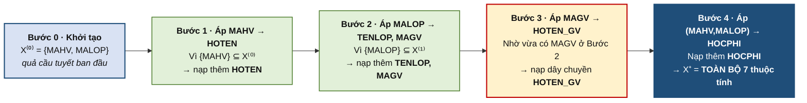

{width=85%}

*Ảnh minh họa: Cơ chế mở rộng dây chuyền khi tính bao đóng {MALOP}⁺ trên bảng phẳng Trung tâm Anh ngữ ABC — xuất phát từ hạt nhân ban đầu và nạp thêm thuộc tính qua từng vòng quét tập phụ thuộc hàm F — Nguồn: Tác giả tự vẽ.*

Để thấy rõ từng bước trong Hình 5.4 diễn ra như thế nào, bảng dưới đây ghi lại toàn bộ vết chạy thuật toán khi tính `(MAHV, MALOP)⁺` trên bảng phẳng `GHIDANH_PHANG(MAHV, HOTEN, MALOP, TENLOP, MAGV, HOTEN_GV, HOCPHI)` với tập phụ thuộc hàm nghiệp vụ `F = {f₁: MAHV → HOTEN; f₂: MALOP → TENLOP, MAGV; f₃: MAGV → HOTEN_GV; f₄: (MAHV, MALOP) → HOCPHI}`.

**Bảng 5.11. Bảng vết từng bước tính `(MAHV, MALOP)⁺` khớp với Hình 5.4**

| Bước | Phụ thuộc đang xét | Kiểm tra điều kiện `Vế trái ⊆ X⁺ hiện tại`? | Thuộc tính mới dính thêm | Tập `X⁺` sau bước này |
|:--:|---|---|---|---|
| **0** | *(Khởi tạo)* | — | — | `{MAHV, MALOP}` |
| **1** | `f₁: MAHV → HOTEN` | `{MAHV} ⊆ {MAHV, MALOP}` (**Đúng**) | `+ HOTEN` | `{MAHV, MALOP, HOTEN}` |
| **2** | `f₂: MALOP → TENLOP, MAGV` | `{MALOP} ⊆ X⁺` (**Đúng**) | `+ TENLOP, MAGV` | `{MAHV, MALOP, HOTEN, TENLOP, MAGV}` |
| **3** | `f₃: MAGV → HOTEN_GV` | `{MAGV} ⊆ X⁺` (**Đúng** — nhờ `MAGV` vừa nạp ở bước 2) | `+ HOTEN_GV` | `{MAHV, MALOP, HOTEN, TENLOP, MAGV, HOTEN_GV}` |
| **4** | `f₄: (MAHV, MALOP) → HOCPHI` | `{MAHV, MALOP} ⊆ X⁺` (**Đúng**) | `+ HOCPHI` | `{MAHV, MALOP, HOTEN, TENLOP, MAGV, HOTEN_GV, HOCPHI}` = **toàn bộ `R` → DỪNG** |

> **Chú ý — lỗi sai phổ biến nhất khi tính bao đóng bằng tay.** Người mới học rất hay chỉ đọc lướt tập `F` **một lượt duy nhất từ trái sang phải** rồi kết luận. Cách làm ấy sẽ **sai ngay** khi một phụ thuộc hàm đứng đầu danh sách cần đến thuộc tính do phụ thuộc đứng cuối danh sách sinh ra! Ở Bảng 5.11, sở dĩ một vòng đã đủ là vì `f₂` *(sinh ra `MAGV`)* tình cờ được viết trước `f₃` *(dùng `MAGV` để sinh `HOTEN_GV`)*. Nếu đề bài viết `f₃` lên đầu danh sách, ở lượt quét thứ nhất ta chưa có `MAGV` nên phải tạm bỏ qua `f₃`, đợi lấy được `MAGV` rồi **quay lại quét vòng thứ hai** thì `f₃` mới kích hoạt.

Bảng dưới đây minh họa trực diện hiện tượng "phải quét vòng thứ hai" trên một tập `F` chỉ gồm hai phụ thuộc hàm viết ngược thứ tự.

**Bảng 5.12. Tính `A⁺` với `F = {B → C, A → B}` trên `R(A, B, C)` — quét một lượt thì sót, hai vòng mới đủ**

| Vòng quét | Phụ thuộc đang xét | Kiểm tra `Vế trái ⊆ X⁺`? | Hành động | `X⁺` sau bước |
|:--:|---|:--:|---|---|
| **Khởi tạo** | — | — | Đặt `X⁽⁰⁾ = {A}` | `{A}` |
| **Vòng 1** | `B → C` | `B ∉ {A}` (**Sai**) | Tạm bỏ qua vì chưa có `B` | `{A}` |
| **Vòng 1** | `A → B` | `A ∈ {A}` (**Đúng**) | Nạp thêm `B` *(túi `X⁺` vừa thay đổi!)* | `{A, B}` |
| **Vòng 2** | `B → C` | `B ∈ {A, B}` (**Đúng**) | Nhờ vòng 1 đã nạp `B`, nay mở được cửa sang `C` | `{A, B, C}` |
| **Vòng 2** | `A → B` | `A ∈ {A, B, C}` (**Đúng**) | `B` đã có sẵn trong túi → không thêm gì | `{A, B, C}` |
| **Vòng 3** | *(Quét kiểm tra)* | — | Không thuộc tính nào mới *(hoặc đã bằng `R`)* → **DỪNG** | **`{A, B, C}`** |

Nếu vội vàng dừng ngay cuối Vòng 1, ta sẽ kết luận sai `A⁺ = {A, B}`, từ đó trả lời sai rằng `A → C` không suy ra được và `A` không phải siêu khóa của `R(A, B, C)`. Quy tắc an toàn tuyệt đối là: **hễ trong vòng vừa qua có nạp thêm dù chỉ một thuộc tính mới (và `X⁺` chưa phủ hết `R`), bắt buộc phải quét lại từ đầu**.

### 5.4.3. Hai cách trình bày bài giải và các ví dụ tính từng bước

Trong bài kiểm tra và thi tự luận, tùy yêu cầu của câu hỏi mà người học có thể trình bày phép tính bao đóng theo **hai cách** đều được chấp nhận:

1. **Cách 1 — Trình bày dạng bảng theo vòng lặp** *(như Bảng 5.12)*: dùng khi đề bài yêu cầu *"Tính bao đóng `X⁺`, ghi rõ từng vòng lặp"*.
2. **Cách 2 — Trình bày dạng chuỗi mở rộng từng bước**: viết gọn trên vài dòng theo mẫu `X⁽⁰⁾ ⊂ X⁽¹⁾ ⊂ X⁽²⁾ …`, dưới mỗi mũi tên ghi rõ phụ thuộc hàm đã áp dụng. Cách này rất nhanh và tiện khi phải tính hàng loạt bao đóng trong bài toán tìm khóa *(mục 5.5)* hoặc tìm phủ tối thiểu *(mục 5.6)*.

Hai ví dụ và một bài tập mẫu dưới đây minh họa trọn vẹn cả hai cách trình bày cũng như ba kịch bản kết quả thường gặp: **nở ra toàn bộ lược đồ**, **nở một phần rồi dừng**, và **đứng yên ngay từ bước khởi tạo**.

> **Ví dụ 5.6 — Bốn bao đóng trên cùng một lược đồ: nở hết, nở một phần và đứng yên.** Cho lược đồ `R(A, B, C, D)` và tập phụ thuộc hàm `F = {f₁: A → B, f₂: B → C, f₃: CD → A}`. Hãy tính:
>
> a) `(AD)⁺` bằng bảng từng vòng lặp;
> b) `(BD)⁺`, `B⁺` và `C⁺` bằng cách viết chuỗi mở rộng từng bước.
>
> *Lời giải câu a — Tính `(AD)⁺` bằng bảng vòng lặp:*
>
> | Vòng | Phụ thuộc xét | Kiểm tra `Vế trái ⊆ X⁺`? | Thuộc tính mới | Tập `X⁺` sau bước |
> |:--:|---|:--:|:--:|---|
> | **0** | *(Khởi tạo)* | — | — | `{A, D}` |
> | **1** | `f₁: A → B` | `{A} ⊆ {A, D}` (**Có**) | `+ B` | `{A, B, D}` |
> | **1** | `f₂: B → C` | `{B} ⊆ {A, B, D}` (**Có**) | `+ C` | `{A, B, C, D}` |
> | **1** | `f₃: CD → A` | `{C, D} ⊆ {A, B, C, D}` (**Có**) | không thêm | `{A, B, C, D}` |
> | **2** | *(Quét kiểm tra)* | Đã bằng toàn bộ `R(A, B, C, D)` | — | **Dừng:** `(AD)⁺ = {A, B, C, D}` |
>
> *Lời giải câu b — Tính `(BD)⁺`, `B⁺` và `C⁺` bằng chuỗi mở rộng:*
>
> - **Tính `(BD)⁺` *(trường hợp phải qua 2 vòng vì `f₃` cần `C`, sau đó quay lại `f₁`)*:**
>   - Khởi tạo: `X⁽⁰⁾ = {B, D}`
>   - Áp `f₂ (B → C)` vì `{B} ⊆ {B, D}`: `X⁽¹⁾ = {B, C, D}`
>   - Áp `f₃ (CD → A)` vì `{C, D} ⊆ {B, C, D}`: `X⁽²⁾ = {A, B, C, D} = R` *(dừng)*
>   - Kết luận: **`(BD)⁺ = {A, B, C, D}`** *(nở ra toàn bộ lược đồ)*.
>
> - **Tính `B⁺` *(trường hợp nở một phần rồi dừng vì thiếu thuộc tính phối hợp)*:**
>   - Khởi tạo: `X⁽⁰⁾ = {B}`
>   - Áp `f₂ (B → C)` vì `{B} ⊆ {B}`: `X⁽¹⁾ = {B, C}`
>   - Xét `f₁ (A → B)`: thiếu `A`; xét `f₃ (CD → A)`: có `C` nhưng **thiếu `D`** nên không kích hoạt được `f₃`!
>   - Kết luận: **`B⁺ = {B, C}`** *(chỉ mở rộng được một phần)*.
>
> - **Tính `C⁺` *(trường hợp đứng yên ngay từ đầu)*:**
>   - Khởi tạo: `X⁽⁰⁾ = {C}`
>   - Xét cả ba phụ thuộc: `f₁` cần `A` *(không có)*, `f₂` cần `B` *(không có)*, `f₃` cần cả cặp `CD` *(thiếu `D`)* → không áp dụng được bất kỳ phụ thuộc nào ngay từ vòng 1.
>   - Kết luận: **`C⁺ = {C}`** *(bằng đúng tập khởi tạo)*.

---

#### Bài tập mẫu 5.6 — Tính bao đóng trên lược đồ 6 thuộc tính, 8 phụ thuộc hàm (chuẩn bị cho bài thực hành)

**Đề bài.** Cho lược đồ quan hệ `R(A, B, C, D, E, G)` và tập gồm 8 phụ thuộc hàm:

`F = { f₁: AB → C,  f₂: C → A,  f₃: BC → D,  f₄: ACD → B,  f₅: D → EG,  f₆: BE → C,  f₇: CG → BD,  f₈: CE → AG }`

a) Tính bao đóng `(BD)⁺` và cho biết `BD` có phải siêu khóa của `R` không.
b) Tính bao đóng `(CG)⁺` và `(CE)⁺`.
c) Từ kết quả câu (a) và (b), không cần áp luật Armstrong, hãy trả lời ngay: `BD → A`, `CG → E` và `CE → D` có suy ra được từ `F` không?

**Lời giải chi tiết.**

*Câu a) Tính `(BD)⁺`:*

| Vòng | Bước | Phụ thuộc áp dụng | Giải thích điều kiện kích hoạt | Tập kết quả `X⁺` |
|:--:|:--:|---|---|---|
| **0** | Khởi tạo | — | — | `{B, D}` |
| **1** | 1 | `f₅: D → EG` | Vì `{D} ⊆ {B, D}`, nạp thêm `E, G` | `{B, D, E, G}` |
| **1** | 2 | `f₆: BE → C` | Vì `{B, E} ⊆ {B, D, E, G}`, nạp thêm `C` | `{B, C, D, E, G}` |
| **1** | 3 | `f₈: CE → AG` *(hoặc `f₂: C → A`)* | Vì `{C, E} ⊆ {B, C, D, E, G}`, nạp thêm `A` | `{A, B, C, D, E, G}` |
| **Dừng** | — | — | Đã thu được đủ cả 6 thuộc tính của `R` | **`(BD)⁺ = {A, B, C, D, E, G} = R`** |

Vì `(BD)⁺ = R`, tập **`BD` là một siêu khóa** của lược đồ `R`.

*Câu b) Tính `(CG)⁺` và `(CE)⁺` theo dạng chuỗi mở rộng:*

- **Tính `(CG)⁺`:**
  - Khởi tạo: `X⁽⁰⁾ = {C, G}`
  - Áp `f₂ (C → A)` vì `{C} ⊆ X⁽⁰⁾` ⟹ `X⁽¹⁾ = {A, C, G}`
  - Áp `f₇ (CG → BD)` vì `{C, G} ⊆ X⁽¹⁾` ⟹ `X⁽²⁾ = {A, B, C, D, G}`
  - Áp `f₅ (D → EG)` vì `{D} ⊆ X⁽²⁾` ⟹ `X⁽³⁾ = {A, B, C, D, E, G} = R` *(dừng)*.
  - Vậy **`(CG)⁺ = {A, B, C, D, E, G} = R`** *(suy ra `CG` cũng là một siêu khóa)*.

- **Tính `(CE)⁺`:**
  - Khởi tạo: `X⁽⁰⁾ = {C, E}`
  - Áp `f₈ (CE → AG)` vì `{C, E} ⊆ X⁽⁰⁾` ⟹ `X⁽¹⁾ = {A, C, E, G}`
  - Áp `f₇ (CG → BD)` vì `{C, G} ⊆ X⁽¹⁾` ⟹ `X⁽²⁾ = {A, B, C, D, E, G} = R` *(dừng)*.
  - Vậy **`(CE)⁺ = {A, B, C, D, E, G} = R`** *(suy ra `CE` cũng là một siêu khóa)*.

*Câu c) Kết luận nhanh về ba phụ thuộc hàm:*

- `BD → A`: vì `A ∈ (BD)⁺` nên **suy ra được**.
- `CG → E`: vì `E ∈ (CG)⁺` nên **suy ra được**.
- `CE → D`: vì `D ∈ (CE)⁺` nên **suy ra được**.

---

### 5.4.4. Ba công dụng thực hành của bao đóng `X⁺`

Tại sao bao đóng `X⁺` lại được gọi là "chiếc chìa khóa vạn năng" của Chương 5? Vì ba bài toán cốt lõi nhất của lý thuyết chuẩn hóa đều quy về việc tính bao đóng rồi thực hiện một phép so sánh tập hợp đơn giản.

**Công dụng 1 — Kiểm tra một phụ thuộc hàm `X → Y` có suy ra được từ `F` không:**

> Phụ thuộc hàm `X → Y` suy ra được từ `F` *(tức `X → Y ∈ F⁺`)* **khi và chỉ khi** **`Y ⊆ X⁺`**.

Thay vì phải mò mẫm ghép các luật Armstrong như ở mục 5.3, ta chỉ cần tính `X⁺` một lần: nếu toàn bộ `Y` nằm trong `X⁺` thì trả lời **Có**; nếu thiếu dù chỉ một thuộc tính của `Y` thì trả lời dứt khoát **Không** *(và tập các thuộc tính nằm trong `X⁺` đối lập với phần còn lại của `R` cũng chỉ ngay cách dựng bảng phản ví dụ 2 dòng như ở Bài tập mẫu 5.4: cho hai dòng giống hệt nhau trên `X⁺` và khác nhau trên các thuộc tính ngoài `X⁺`)*.

**Công dụng 2 — Kiểm tra một tập thuộc tính `X` có phải là siêu khóa / khóa dự tuyển không:**

> - `X` là **siêu khóa** *(superkey)* của `R` **khi và chỉ khi** **`X⁺ = R`** *(bao đóng phủ kín toàn bộ thuộc tính của lược đồ)*.
> - `X` là **khóa dự tuyển** *(candidate key)* của `R` khi và chỉ khi **`X⁺ = R`** và với mọi thuộc tính `A ∈ X`, **`(X − {A})⁺ ≠ R`** *(bỏ bất kỳ thuộc tính nào ra khỏi `X` thì bao đóng không còn phủ hết `R`)*.

Công dụng này là nền tảng trực tiếp của thuật toán tìm khóa ở mục 5.5 ngay sau đây.

**Công dụng 3 — Kiểm tra hai tập phụ thuộc hàm `F` và `G` có tương đương không (`F ≡ G`):**

> Tập `F` **phủ** tập `G` *(mọi phụ thuộc trong `G` đều suy ra được từ `F`)* khi và chỉ khi với mỗi phụ thuộc `X → Y` trong `G`, ta tính **`X⁺_F`** *(bao đóng của `X` tính trên `F`)* đều thấy **`Y ⊆ X⁺_F`**. Hai tập `F` và `G` **tương đương** (`F ≡ G`) khi `F` phủ `G` và `G` phủ `F`.

Công dụng thứ ba này chính là cơ sở để kiểm tra xem sau khi rút gọn tập phụ thuộc hàm ở mục 5.6 *(Phủ tối thiểu)*, tập mới có còn giữ nguyên toàn bộ sức mạnh suy diễn của tập ban đầu hay không.

**Bảng 5.13. Tóm tắt ba câu hỏi lớn quy về phép tính bao đóng — minh họa trên `R(A, B, C, D)`, `F = {A → B, B → C, CD → A}`**

| Bài toán cần trả lời | Quy về điều kiện bao đóng | Phép tính bao đóng thực hiện | Đối chiếu kết quả | Kết luận dứt khoát |
|---|---|---|---|---|
| **1. Kiểm tra suy diễn:**<br/>`B → A` có suy ra được từ `F`? | Kiểm tra `A ∈ B⁺`? | `B⁺ = {B, C}` | `A ∉ {B, C}` | **Không** suy ra được |
| **1b. Kiểm tra suy diễn:**<br/>`AC → D` có suy ra được từ `F`? | Kiểm tra `D ∈ (AC)⁺`? | `(AC)⁺ = {A, B, C}` | `D ∉ {A, B, C}` | **Không** suy ra được |
| **2. Kiểm tra siêu khóa & khóa:**<br/>`BD` có phải là khóa của `R`? | Kiểm tra `(BD)⁺ = R` và `B⁺ ≠ R, D⁺ ≠ R`? | `(BD)⁺ = {A, B, C, D} = R`;<br/>`B⁺ = {B, C} ≠ R`; `D⁺ = {D} ≠ R` | Phủ hết `R` và không bỏ bớt được `B` hay `D` | **Có** — `BD` là khóa dự tuyển |
| **3. Kiểm tra tương đương:**<br/>Thêm `AD → C` vào `F` có tạo ra tập mới khác `F` không? | Kiểm tra `C ∈ (AD)⁺_F`? | `(AD)⁺_F = {A, B, C, D}` | `C ∈ (AD)⁺_F` *(phụ thuộc mới đã nằm sẵn trong `F⁺`)* | Hai tập **tương đương** (`AD → C` là phụ thuộc thừa) |

### 5.4.5. Phân biệt rạch ròi `X⁺` và `F⁺`

Khi mới học Chương 5, rất nhiều sinh viên nhìn ký hiệu dấu cộng ở trên cao (`⁺`) rồi đánh đồng `X⁺` với `F⁺`. Thực chất, chúng cùng mang tên *"bao đóng"* *(closure — tức đóng kín lại sau khi đã gom hết những gì suy ra được)* nhưng áp dụng cho **hai đối tượng hoàn toàn khác nhau**.

> **Định nghĩa 5.7 (Bao đóng của tập phụ thuộc hàm `F⁺`).** Cho tập phụ thuộc hàm `F` trên lược đồ `R`. **Bao đóng của `F`**, ký hiệu **`F⁺`**, là **tập hợp tất cả các phụ thuộc hàm `X → Y`** có thể suy ra được từ `F` bằng hệ luật dẫn Armstrong *(kể cả các phụ thuộc tầm thường do luật phản xạ sinh ra)*.

**Bảng 5.14. Đối chiếu trực diện `X⁺` và `F⁺`**

| Tiêu chí so sánh | Bao đóng của tập thuộc tính **`X⁺`** | Bao đóng của tập phụ thuộc hàm **`F⁺`** |
|---|---|---|
| **Đầu vào** | Một **tập thuộc tính** `X` *(kèm tập `F` làm công cụ)* | Một **tập phụ thuộc hàm** `F` |
| **Bản chất các phần tử bên trong** | Là **tập các chữ cái (thuộc tính)**<br/>Ví dụ: `{A, B, C}` | Là **tập các mũi tên (phụ thuộc hàm)**<br/>Ví dụ: `{A → B, B → C, A → C, A → BC, …}` |
| **Kích thước tối đa (trên lược đồ `n` thuộc tính)** | **Rất nhỏ:** tối đa **`n` thuộc tính** *(luôn là tập con của `R`)* | **Khổng lồ (tăng theo hàm mũ):** có thể lên tới **`2ⁿ × 2ⁿ = 4ⁿ` mũi tên** |
| **Độ phức tạp tính toán** | **Tính rất nhanh (đa thức):** chỉ vài vòng quét qua `F` trên giấy | **Không khả thi trong thực tế:** chỉ với `n = 10` thuộc tính đã có thể tới hàng trăm nghìn phụ thuộc |
| **Vai trò trong học phần** | **Công cụ thực hành trực tiếp** ở mọi bài tập từ mục 5.4 đến 5.9 | **Khái niệm lý thuyết** để định nghĩa tính tương đương (`F ≡ G ⟺ F⁺ = G⁺`) |

Để thấy tận mắt sự chênh lệch giữa hai con số ấy, hãy nhìn vào một lược đồ nhỏ nhất có thể — chỉ gồm **3 thuộc tính**:

> **Ví dụ 5.7 — Đếm thử `A⁺` và `F⁺` trên lược đồ chỉ có 3 thuộc tính.** Cho `R(A, B, C)` và `F = {A → B, B → C}`.
>
> - **Nếu tính bao đóng thuộc tính `A⁺`:** Khởi tạo `{A}` → nhờ `A → B` thêm `B` → nhờ `B → C` thêm `C` → dừng. Kết quả **`A⁺ = {A, B, C}` chỉ gồm đúng 3 chữ cái**, tính xong trong 5 giây.
> - **Nếu cố liệt kê bao đóng tập phụ thuộc `F⁺`:**
>   - Từ vế trái `A` *(vì `A⁺ = {A, B, C}` có `2³ − 1 = 7` tập con khác rỗng)*, luật tách và luật hợp sinh ra **7 phụ thuộc**: `A → A`, `A → B`, `A → C`, `A → AB`, `A → AC`, `A → BC`, `A → ABC`.
>   - Từ vế trái `AB`, `AC`, `ABC` *(bao đóng cũng bằng `{A, B, C}`)*, mỗi vế trái lại sinh ra **7 phụ thuộc** nữa → thêm `3 × 7 = 21` phụ thuộc!
>   - Từ vế trái `B` và `BC` *(bao đóng bằng `{B, C}`, có `2² − 1 = 3` tập con)*, mỗi vế trái sinh ra **3 phụ thuộc** (`B → B`, `B → C`, `B → BC` và `BC → B`, `BC → C`, `BC → BC`) → thêm `2 × 3 = 6` phụ thuộc.
>   - Từ vế trái `C` *(bao đóng bằng `{C}`)* sinh ra **1 phụ thuộc tầm thường** `C → C`.
>   - **Tổng cộng:** Chỉ với 3 thuộc tính và 2 mũi tên ban đầu, tập **`F⁺` đã phình lên thành `7 + 21 + 6 + 1 = 35` phụ thuộc hàm**! Nếu lược đồ có 7 thuộc tính như `GHIDANH_PHANG`, `F⁺` chứa hàng nghìn mũi tên và không ai có thể liệt kê bằng tay.

Câu khẩu quyết ngắn nhất để không bao giờ nhầm: **`X⁺` là một túi đựng các chữ cái; `F⁺` là một kho chứa các mũi tên — và nhờ có túi `X⁺`, ta không bao giờ phải mở kho `F⁺` ra đếm.**

> **Tự kiểm tra 5.4.** *(đáp án ở cuối chương)*
>
> 1. Với `R(A, B, C, D)` và `F = {A → B, B → C, CD → A}` của Ví dụ 5.6, tính `(CD)⁺` và `C⁺`, ghi rõ từng vòng.
> 2. `C → B` có suy ra được từ `F` không? Trả lời bằng một bao đóng.
> 3. Một bạn tính `F⁺` để trả lời câu 2. Bạn ấy có sai không? Vì sao giáo trình khuyên dùng `X⁺`?

---

## 5.5. Thuật toán tìm khóa

*(2,0 tiết)*

### 5.5.1. Ba nhóm thuộc tính

Ý tưởng nền tảng: **không phải thuộc tính nào cũng có cơ hội nằm trong khóa như nhau**. Phân loại trước thì phạm vi tìm kiếm thu hẹp rất nhiều.

> **Định nghĩa 5.8.** Với lược đồ `R` và tập phụ thuộc hàm `F`, chia các thuộc tính thành ba nhóm:
>
> - **Tập nguồn `TN`**: các thuộc tính **chỉ xuất hiện ở vế trái**, hoặc **không xuất hiện** ở cả hai vế.
> - **Tập trung gian `TG`**: các thuộc tính xuất hiện ở **cả hai vế**.
> - **Tập đích `TĐ`**: các thuộc tính **chỉ xuất hiện ở vế phải**.

**Hình 5.5. Ba nhóm thuộc tính — và vì sao phân nhóm**


Lý do đằng sau ba nhóm rất trực quan. Thuộc tính thuộc **`TN`** không nằm ở vế phải của bất kỳ phụ thuộc nào, nên **không có cách nào suy ra nó** — muốn suy ra toàn bộ lược đồ thì buộc phải có nó ngay từ đầu. Ngược lại, thuộc tính thuộc **`TĐ`** luôn suy ra được từ thứ khác, nên đưa nó vào khóa chỉ làm khóa thừa, vi phạm tính tối thiểu. Chỉ nhóm **`TG`** là còn phải thử.

Thử phân nhóm ngay trên bảng phẳng của Trung tâm ABC — bảy thuộc tính và bốn phụ thuộc hàm rút từ nghiệp vụ *(tập `F` này sẽ được lập chính thức ở Bảng 5.26)*: `MAHV → HOTEN`, `MALOP → TENLOP, MAGV`, `MAGV → HOTEN_GV`, `(MAHV, MALOP) → HOCPHI`.

**Bảng 5.15. Phân nhóm bảy thuộc tính của `GHIDANH_PHANG` — gạch vế trái, gạch vế phải**

| Thuộc tính | Có ở vế trái? | Có ở vế phải? | Nhóm | Vì sao |
|:--:|:--:|:--:|:--:|---|
| `MAHV` | có | không | **TN** | không suy ra được từ đâu → chắc chắn trong khóa |
| `MALOP` | có | không | **TN** | như trên |
| `MAGV` | có | có | **TG** | suy ra được từ `MALOP`, nhưng cũng suy ra thứ khác → phải thử |
| `HOTEN` | không | có | **TĐ** | luôn suy ra được từ `MAHV` |
| `TENLOP` | không | có | **TĐ** | luôn suy ra được từ `MALOP` |
| `HOTEN_GV` | không | có | **TĐ** | luôn suy ra được từ `MAGV` |
| `HOCPHI` | không | có | **TĐ** | luôn suy ra được từ cặp khóa |

Bảy thuộc tính rút xuống còn **hai bắt buộc và một phải thử** — phạm vi tìm khóa từ `2⁷ = 128` tập con giảm còn `2¹ = 2` tập con của `TG`.

### 5.5.2. Thuật toán tìm một khóa

Với nhiều bài toán, chỉ cần **một** khóa là đủ để chuẩn hóa. Khi ấy có một lối tắt:

```
BƯỚC 1.  Xác định TN và TG
BƯỚC 2.  Tính (TN)⁺
             NẾU (TN)⁺ = toàn bộ thuộc tính  THÌ  TN chính là khóa duy nhất — DỪNG
BƯỚC 3.  Ngược lại, lần lượt ghép thêm từng tập con của TG (từ nhỏ tới lớn)
             cho tới khi tìm được siêu khóa tối thiểu
```

Bước 2 là **mẹo tiết kiệm thời gian** đáng nhớ: rất nhiều lược đồ thực tế có `(TN)⁺` phủ hết ngay, và khi đó bài toán kết thúc sau một phép tính bao đóng duy nhất.

### 5.5.3. Thuật toán tìm tất cả khóa

Nhưng một lược đồ **có thể có nhiều khóa**, và điều này quan trọng vì việc xét 2NF, 3NF phụ thuộc vào khái niệm *thuộc tính khóa* — tức thuộc tính nằm trong **bất kỳ** khóa nào. Bỏ sót một khóa có thể dẫn tới kết luận sai về dạng chuẩn.

```
BƯỚC 1.  Xác định TN và TG
BƯỚC 2.  Sinh mọi tập con Xᵢ của TG          (có 2^|TG| tập con)
BƯỚC 3.  Với mỗi Xᵢ, tính (TN ∪ Xᵢ)⁺
             NẾU (TN ∪ Xᵢ)⁺ = toàn bộ thuộc tính
                 THÌ  TN ∪ Xᵢ  là một SIÊU KHÓA
BƯỚC 4.  Trong các siêu khóa tìm được, LOẠI những siêu khóa
             chứa một siêu khóa khác  →  còn lại là TẤT CẢ các khóa
```

Bước 4 chính là bước bảo đảm **tính tối thiểu** đã học ở mục 2.3.1 và 3.2.3.

### 5.5.4. Mẹo rút gọn

Khi `TG` lớn, số tập con `2^|TG|` tăng rất nhanh — `|TG| = 10` đã cho hơn một nghìn tập con. Có một mẹo cắt giảm đáng kể khối lượng tính.

> **Mẹo.** Duyệt các tập con của `TG` theo **kích thước tăng dần**. Nếu `TN ∪ Xᵢ` đã là siêu khóa, thì **mọi tập cha** của `Xᵢ` cũng là siêu khóa nhưng **chắc chắn không tối thiểu** — nên **loại luôn, không cần tính bao đóng** cho chúng.

Mẹo này dựa trên một nhận xét đơn giản: bao đóng có tính **đơn điệu** — thêm thuộc tính vào `X` thì `X⁺` chỉ có thể lớn lên chứ không nhỏ đi. Vì vậy khi đã tìm được một siêu khóa nhỏ, mọi thứ chứa nó đều thừa.

### 5.5.5. Ví dụ đầy đủ — tìm tất cả khóa

> **Ví dụ 5.8.** Cho `R(A, B, C, D)` và `F = {A → B, B → C, CD → A}`. Tìm **tất cả** khóa.
>
> **Bước 1 — phân nhóm.** Vế trái xuất hiện: `A`, `B`, `C`, `D`. Vế phải xuất hiện: `B`, `C`, `A`.
>
> | Thuộc tính | Vế trái | Vế phải | Nhóm |
> |:--:|:--:|:--:|:--:|
> | `A` | có | có | **TG** |
> | `B` | có | có | **TG** |
> | `C` | có | có | **TG** |
> | `D` | có | không | **TN** |
>
> Vậy `TN = {D}`, `TG = {A, B, C}`, `TĐ = ∅`.
>
> **Bước 2–3 — duyệt `2³ = 8` tập con của `TG`**, theo kích thước tăng dần:
>
> | # | `Xᵢ` | `TN ∪ Xᵢ` | `(TN ∪ Xᵢ)⁺` | Siêu khóa? |
> |:--:|---|---|---|:--:|
> | 1 | `∅` | `D` | `{D}` | Không |
> | 2 | `{A}` | `AD` | `{A,B,C,D}` | **Có** |
> | 3 | `{B}` | `BD` | `{B,C,A,D}` | **Có** |
> | 4 | `{C}` | `CD` | `{C,D,A,B}` | **Có** |
> | 5 | `{A,B}` | `ABD` | — | *chứa `AD`* → **loại** |
> | 6 | `{A,C}` | `ACD` | — | *chứa `AD`* → **loại** |
> | 7 | `{B,C}` | `BCD` | — | *chứa `BD`* → **loại** |
> | 8 | `{A,B,C}` | `ABCD` | — | *chứa `AD`* → **loại** |
>
> Bốn dòng cuối được loại **không cần tính bao đóng**, nhờ mẹo ở mục 5.5.4.
>
> **Bước 4 — kết luận.** Ba siêu khóa `AD`, `BD`, `CD` đều **tối thiểu** *(không cái nào chứa cái nào)*.
>
> **Lược đồ có ba khóa: `AD`, `BD`, `CD`.**
>
> Hệ quả: thuộc tính khóa là `A`, `B`, `C`, `D` — **tất cả**. Khi mọi thuộc tính đều là thuộc tính khóa, lược đồ **tự động đạt 3NF** *(xem mục 5.7.4)*.

Tám tập con của `TG` xếp thành bốn tầng theo kích thước. Vẽ ra, mẹo rút gọn trở nên hiển nhiên: một khi tầng 1 đã cho siêu khóa, **mọi thứ nằm phía trên nó** đều bị loại mà không cần tính.

**Hình 5.6. Lưới tám tập con của `TG = {A, B, C}` — ba siêu khóa ở tầng 1 chặn toàn bộ các tầng trên**

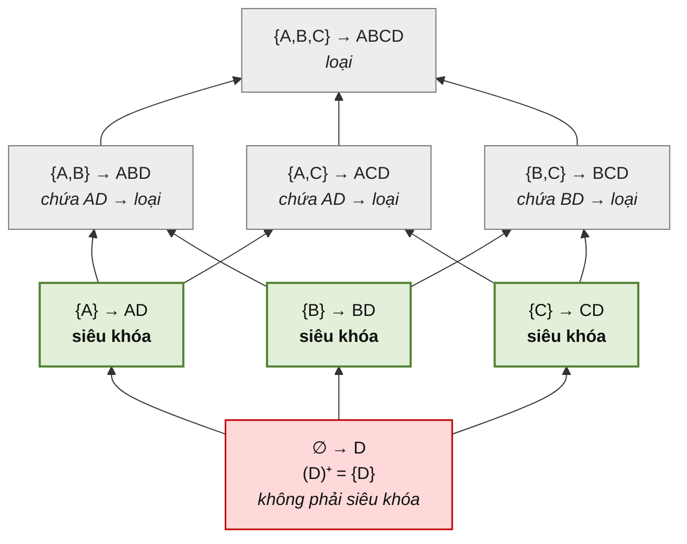

Chỉ **bốn** bao đóng phải tính *(tầng 0 và tầng 1)* thay vì tám; với `TG` lớn hơn, phần tiết kiệm còn lớn hơn nhiều.

> **Tự kiểm tra 5.5.** *(đáp án ở cuối chương)*
>
> 1. Cho `R(A, B, C, D, E)` và `F = {A → B, BC → D, D → E}`. Lập bảng phân nhóm `TN`, `TG`, `TĐ`.
> 2. Tính `(TN)⁺`. Có kết luận được khóa ngay chưa? Lược đồ có mấy khóa?
> 3. Vì sao không cần thử bất kỳ tập con nào có chứa `E`?

---

## 5.6. Phủ tối thiểu

*(1,5 tiết)*

### 5.6.1. Vì sao cần phủ tối thiểu

Tập `F` thu thập được từ nghiệp vụ thường **thừa**: có phụ thuộc suy ra được từ các phụ thuộc khác, có vế trái chứa thuộc tính không cần thiết. Làm việc trên một `F` thừa thì tốn công và dễ sai.

> **Định nghĩa 5.9.** **Phủ tối thiểu** *(minimal cover)* của `F` là một tập phụ thuộc hàm `F_min` **tương đương** với `F` *(tức `F⁺ = F_min⁺`)* và **không thể rút gọn thêm được nữa**.

### 5.6.2. Ba điều kiện

> **Định nghĩa 5.10.** `F_min` là phủ tối thiểu nếu thỏa mãn **đồng thời ba điều kiện**:
>
> 1. **Vế phải chỉ có một thuộc tính** — mọi phụ thuộc có dạng `X → A` với `A` là một thuộc tính đơn.
> 2. **Không thừa thuộc tính ở vế trái** — không bỏ được thuộc tính nào khỏi `X` mà tập vẫn tương đương.
> 3. **Không thừa phụ thuộc** — không bỏ được phụ thuộc nào mà tập vẫn tương đương.

### 5.6.3. Thuật toán ba bước

**Hình 5.7. Thuật toán tìm phủ tối thiểu — phải làm đúng thứ tự**

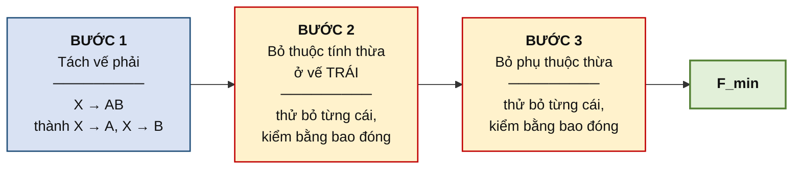

> **Chú ý — thứ tự ba bước là bắt buộc.** Phải bỏ thuộc tính thừa ở **vế trái trước**, rồi mới bỏ phụ thuộc thừa. Làm ngược lại có thể cho kết quả **không tối thiểu**, vì một phụ thuộc trông có vẻ cần thiết khi vế trái còn thừa, nhưng sau khi rút gọn vế trái thì lại hóa thừa.

**Cách kiểm tra ở Bước 2** — muốn biết thuộc tính `B` trong `XB → A` có thừa không: tính `X⁺` *(bỏ `B` đi)*. Nếu `A ∈ X⁺` *(hoặc `B ∈ X⁺`)* thì `B` **thừa**, bỏ được.

**Cách kiểm tra ở Bước 3** — muốn biết phụ thuộc `X → A` có thừa không: tạm bỏ nó khỏi `F`, rồi tính `X⁺` trên tập còn lại. Nếu `A` vẫn thuộc `X⁺` thì phụ thuộc ấy **thừa**.

### 5.6.4. Ví dụ đầy đủ

> **Ví dụ 5.9.** Cho `F = {A → BC, B → C, AB → D}`. Tìm phủ tối thiểu.
>
> **Bước 1 — tách vế phải:**
>
> `F₁ = {A → B, A → C, B → C, AB → D}`
>
> **Bước 2 — bỏ thuộc tính thừa ở vế trái.** Chỉ `AB → D` có vế trái nhiều hơn một thuộc tính.
>
> | Thử bỏ | Phụ thuộc còn lại | Tính bao đóng của vế trái mới *(trên `F₁`, tạm không dùng `AB → D`)* | Kết luận |
> |---|---|---|---|
> | `B` | `A → D` | `A⁺ = {A, B, C}` — **có chứa `B`** | `A` một mình đã suy ra `B`, nên `B` **thừa** → thay `AB → D` bằng `A → D` |
> | `A` | `B → D` | `B⁺ = {B, C}` — không chứa `A` | `A` **không thừa** *(và sau khi bỏ `B`, vế trái chỉ còn một thuộc tính nên dừng)* |
>
> `F₂ = {A → B, A → C, B → C, A → D}`
>
> **Bước 3 — bỏ phụ thuộc thừa.**
>
> | Thử bỏ | Tính bao đóng trên tập còn lại | Kết luận |
> |---|---|---|
> | `A → B` | `A⁺ = {A, C, D}` — thiếu `B` | **Giữ** |
> | `A → C` | `A⁺ = {A, B, C, D}` *(nhờ `A→B` rồi `B→C`)* — có `C` | **BỎ** |
> | `B → C` | `B⁺ = {B}` — thiếu `C` | **Giữ** |
> | `A → D` | `A⁺ = {A, B, C}` — thiếu `D` | **Giữ** |
>
> **Kết quả:** `F_min = {A → B, B → C, A → D}`
>
> Từ bốn phụ thuộc ban đầu rút còn ba, và vế trái đã gọn nhất có thể.

---

## 5.7. Các dạng chuẩn 1NF, 2NF, 3NF

*(1,5 tiết)*

Từ mục 5.2 đến mục 5.6, ta đã chuẩn bị đầy đủ bộ công cụ toán học: nhận diện ba loại phụ thuộc hàm *(đầy đủ, bộ phận, bắc cầu)*, tính bao đóng `X⁺`, tìm tất cả các khóa dự tuyển và rút gọn tập phụ thuộc hàm. Từ mục 5.7 này trở đi, ta đưa các công cụ ấy vào nhiệm vụ chính của chương: **đo chất lượng của một lược đồ quan hệ và sửa các thiết kế chưa tốt**.

Để người học dễ theo dõi mà không bị rối giữa định nghĩa dạng chuẩn, lý thuyết phép tách và các trường hợp nâng cao, bốn mục 5.7–5.10 được thiết kế theo trình tự bốn bước tuần tự:

- **Mục 5.7 (Thang đo chuẩn 1NF → 2NF → 3NF):** Định nghĩa từng dạng chuẩn kèm **bảng dữ liệu Trước → Sau** và quy trình chẩn đoán một lược đồ đang dừng ở nấc nào.
- **Mục 5.8 (Quy tắc tách bảng an toàn):** Khi một bảng vi phạm 2NF hoặc 3NF, ta sửa bằng cách **tách bảng** — vậy tách như thế nào để không sinh ra dữ liệu bịa *(bộ giả)* và không làm đứt các quy tắc nghiệp vụ?
- **Mục 5.9 (Quy trình chuẩn hóa hoàn chỉnh 5 bước):** Ráp nối toàn bộ công cụ từ 5.2 đến 5.8 để chuẩn hóa trọn vẹn một bảng phẳng thực tế về 3NF.
- **Mục 5.10 (Trên 3NF và khi nào đi ngược lại):** Giới thiệu các mức chuẩn cao hơn *(BCNF, 4NF)* và kỹ thuật *phi chuẩn hóa* khi ưu tiên tốc độ truy vấn.

### 5.7.1. Thuộc tính khóa và thuộc tính không khóa

Trước khi phát biểu các dạng chuẩn, cần phân biệt thật rõ hai loại thuộc tính trên một lược đồ quan hệ sau khi đã tìm được **tất cả các khóa dự tuyển** *(mục 5.5.3)*.

> **Định nghĩa 5.11 (Thuộc tính khóa và thuộc tính không khóa).** Cho lược đồ quan hệ `R` đã xác định được tập tất cả các khóa dự tuyển:
>
> - Một thuộc tính được gọi là **thuộc tính khóa** *(prime attribute — hay thuộc tính nguyên tố)* nếu nó tham gia vào **ít nhất một** khóa dự tuyển của `R` *(tức nằm trong hợp của tất cả các khóa dự tuyển)*.
> - Một thuộc tính được gọi là **thuộc tính không khóa** *(non-prime attribute)* nếu nó **không nằm trong bất kỳ khóa dự tuyển nào** của `R`.

Chữ *"ít nhất một"* trong Định nghĩa 5.11 giải thích vì sao ở mục 5.5.3 ta bắt buộc phải tìm **tất cả** các khóa dự tuyển chứ không dừng lại sau khi tìm được một khóa: nếu lược đồ có hai khóa mà ta bỏ sót khóa thứ hai, các thuộc tính nằm trong khóa thứ hai sẽ bị xếp nhầm thành *thuộc tính không khóa*, dẫn tới kết luận sai hoàn toàn khi xét 2NF và 3NF.

> **Ví dụ 5.10 — Phân biệt thuộc tính khóa và không khóa trên hai lược đồ.**
>
> 1. Xét lược đồ `GHIDANH_1NF(MAHV, MALOP, HOTEN, TENLOP, HOCPHI)` với `F = {MAHV → HOTEN, MALOP → TENLOP, (MAHV, MALOP) → HOCPHI}`:
>    - Khóa dự tuyển duy nhất: `K = (MAHV, MALOP)`.
>    - **Thuộc tính khóa:** `MAHV`, `MALOP`.
>    - **Thuộc tính không khóa:** `HOTEN`, `TENLOP`, `HOCPHI`.
> 2. Xét lược đồ `LOP_CA_PHONG(MALOP, CAHOC, PHONG, SISO_LOP)` với các quy tắc: mỗi lớp có một sĩ số (`MALOP → SISO_LOP`); mỗi lớp trong một ca học ở một phòng (`(MALOP, CAHOC) → PHONG`); tại một ca học mỗi phòng chỉ xếp cho một lớp (`(PHONG, CAHOC) → MALOP`):
>    - Tập nguồn `TN = {CAHOC}`, tập trung gian `TG = {MALOP, PHONG}`, tập đích `TĐ = {SISO_LOP}`.
>    - Lược đồ có **hai khóa dự tuyển**: `K₁ = (MALOP, CAHOC)` và `K₂ = (PHONG, CAHOC)`.
>    - **Thuộc tính khóa** *(hợp của `K₁` và `K₂`)*: `MALOP`, `CAHOC`, `PHONG` *(dù `PHONG` không nằm trong `K₁`, nó nằm trong `K₂` nên vẫn là thuộc tính khóa!)*.
>    - **Thuộc tính không khóa:** chỉ có `SISO_LOP`.

**Bảng 5.16. Tổng hợp cách phân loại thuộc tính khóa và không khóa của Ví dụ 5.10**

| Lược đồ | Tất cả các khóa dự tuyển | Tập thuộc tính khóa *(hợp các khóa)* | Tập thuộc tính không khóa *(phần còn lại)* | Lưu ý khi xét dạng chuẩn |
|---|---|---|---|---|
| `GHIDANH_1NF` | `K = (MAHV, MALOP)` *(1 khóa)* | `{MAHV, MALOP}` | `{HOTEN, TENLOP, HOCPHI}` | Cần kiểm tra cả 3 thuộc tính không khóa |
| `LOP_CA_PHONG` | `K₁ = (MALOP, CAHOC)`<br/>`K₂ = (PHONG, CAHOC)` *(2 khóa)* | `{MALOP, CAHOC, PHONG}` | `{SISO_LOP}` | Chỉ phải kiểm tra `SISO_LOP`; nếu quên tìm `K₂` sẽ tưởng nhầm `PHONG` là thuộc tính không khóa |
| `R(A, B, C, D)` *(Ví dụ 5.8)* | `AD`, `BD`, `CD` *(3 khóa)* | `{A, B, C, D}` *(toàn bộ `R`)* | `∅` *(không có)* | Không có thuộc tính không khóa → **tự động đạt 3NF** |

### 5.7.2. Dạng chuẩn 1 (1NF) — Loại bỏ thuộc tính đa trị và nhóm lặp

> **Định nghĩa 5.12 (Dạng chuẩn 1 — First Normal Form, 1NF).** Một lược đồ quan hệ `R` đạt **dạng chuẩn 1 (1NF)** nếu **mọi giá trị trong mọi ô của bảng đều là giá trị nguyên tố (đơn trị)** — không chứa tập hợp nhiều giá trị *(multivalued attribute)*, không chứa danh sách phân cách bằng dấu phẩy, và không chứa bảng con hay nhóm cột lặp lại *(repeating group)*.

Đây chính là **Đặc trưng 4** ở mục 3.1.3 của Chương 3, và cũng là nguyên tắc đã dùng ở mục 2.2.4 của Chương 2 khi bác bỏ cách nhồi nhiều số điện thoại vào một ô. **Đến đây nó được gọi đúng tên chính thức là 1NF.**

> **Chú ý.** Trong mô hình cơ sở dữ liệu quan hệ, 1NF **không phải một đích đến cao xa** mà là **điều kiện nhập môn bắt buộc để một bảng được công nhận là một quan hệ**. Một bảng chưa đạt 1NF được gọi là *bảng chưa chuẩn hóa* *(unnormalized table — UNF)*; mọi thuật toán tính bao đóng, tìm khóa và xét 2NF/3NF đều chỉ áp dụng **sau khi** bảng đã được đưa về 1NF.

Hãy xem một bảng vi phạm 1NF trông như thế nào trên thực tế và hai cách chuẩn hóa nó về 1NF.

> **Ví dụ 5.11 — Vi phạm 1NF trên bảng đăng ký của Trung tâm Anh ngữ ABC và cách đưa về 1NF.** Khi mới lập danh sách trên bảng tính, nhân viên văn phòng lưu thông tin học viên cùng các lớp mà học viên đó đăng ký vào chung một dòng như nửa trên của Bảng 5.17: học viên `HV01` *(Trần An)* học hai lớp `A1 (Anh cơ bản 1)` và `A2 (Anh giao tiếp)`, nên ô `CAC_LOP_DK` nhồi cả hai mã lớp `"A1, A2"`, còn ô `CAC_TENLOP` nhồi `"Anh cơ bản 1, Anh giao tiếp"`.
>
> Cách lưu này gây ra ba hậu quả tức thì: ① không thể đặt `CAC_LOP_DK` làm khóa ngoại tham chiếu sang bảng `LOP(MALOP)`; ② muốn tìm những ai học lớp `A1` phải cắt chuỗi văn bản thay vì so sánh bằng; ③ khi `HV01` hủy lớp `A2`, chương trình phải tách chuỗi để xóa một nửa ô. Để đưa về 1NF, ta **trải phẳng (tách dòng)** sao cho mỗi ô chỉ chứa đúng một giá trị đơn và xác định khóa chính `(MAHV, MALOP)` như nửa dưới của Bảng 5.17.

**Bảng 5.17. Minh họa Dạng chuẩn 1 (1NF) — Trước và Sau khi khử ô đa giá trị**

*a) TRƯỚC (Chưa đạt 1NF — ô `CAC_LOP_DK` và `CAC_TENLOP` chứa danh sách nhiều giá trị):*

| MAHV | HOTEN | NGAYSINH | CAC_LOP_DK *(đa trị — vi phạm 1NF)* | CAC_TENLOP *(đa trị — vi phạm 1NF)* |
|---|---|---|---|---|
| HV01 | Trần An | 2005-04-12 | **A1, A2** | **Anh cơ bản 1, Anh giao tiếp** |
| HV02 | Lê Bình | 2004-09-30 | **A1, A3** | **Anh cơ bản 1, Anh nâng cao** |
| HV03 | Phạm Cường | 2006-01-15 | A1 | Anh cơ bản 1 |

*b) SAU (Đã đạt 1NF — mỗi ô chỉ chứa một giá trị nguyên tố; khóa chính là cặp `(MAHV, MALOP)`):*

| MAHV *(PK)* | MALOP *(PK)* | HOTEN | NGAYSINH | TENLOP |
|---|---|---|---|---|
| **HV01** | **A1** | Trần An | 2005-04-12 | Anh cơ bản 1 |
| **HV01** | **A2** | Trần An | 2005-04-12 | Anh giao tiếp |
| **HV02** | **A1** | Lê Bình | 2004-09-30 | Anh cơ bản 1 |
| **HV02** | **A3** | Lê Bình | 2004-09-30 | Anh nâng cao |
| HV03 | A1 | Phạm Cường | 2006-01-15 | Anh cơ bản 1 |

> **Nhận xét nối sang 2NF.** Bảng (b) ở Bảng 5.17 đã đạt **1NF** vì mọi ô đều đơn trị. Nhưng hãy nhìn kỹ bảng (b): vừa trải phẳng xong, họ tên `"Trần An"`, ngày sinh `"2005-04-12"` và tên lớp `"Anh cơ bản 1"` lập tức bị **chép lặp ở nhiều dòng**! Vì sao? Vì khóa chính lúc này là cặp `(MAHV, MALOP)`, trong khi `HOTEN`, `NGAYSINH` chỉ phụ thuộc vào `MAHV` và `TENLOP` chỉ phụ thuộc vào `MALOP`. Đó chính là **phụ thuộc bộ phận**, và là lý do ta phải tiến lên **Dạng chuẩn 2 (2NF)**.

### 5.7.3. Dạng chuẩn 2 (2NF) — Loại bỏ phụ thuộc bộ phận vào khóa

> **Định nghĩa 5.13 (Dạng chuẩn 2 — Second Normal Form, 2NF).** Một lược đồ quan hệ `R` đạt **dạng chuẩn 2 (2NF)** nếu nó đã đạt **1NF** và **mọi thuộc tính không khóa của `R` đều phụ thuộc hàm đầy đủ vào mọi khóa dự tuyển** — nói cách khác, **không có bất kỳ thuộc tính không khóa nào phụ thuộc bộ phận vào một phần thực sự của khóa dự tuyển**.

Vì *phụ thuộc bộ phận* (`X' → A` với `X' ⊂ K` và `A` là thuộc tính không khóa) chỉ có thể xảy ra khi khóa `K` có từ **hai thuộc tính trở lên**, ta có ngay một hệ quả cực kỳ tiện lợi khi làm bài tập:

> **Hệ quả 5.1 (Dấu hiệu đạt 2NF tức thì).** Nếu một lược đồ quan hệ `R` đã đạt 1NF và **mọi khóa dự tuyển của `R` đều là khóa đơn** *(chỉ gồm đúng 1 thuộc tính)*, thì `R` **chắc chắn đạt 2NF** mà không cần kiểm tra thêm bất kỳ phụ thuộc hàm nào.

**Quy tắc sửa khi một bảng vi phạm 2NF:**

- Giả sử bảng `R` có khóa phức hợp `K` và xuất hiện phụ thuộc bộ phận `K₁ → Y` *(với `K₁ ⊂ K` là một phần của khóa và `Y` là tập các thuộc tính không khóa chỉ phụ thuộc vào `K₁`)*.
- Ta **tách `Y` ra khỏi `R`** để lập một bảng mới `R₁(K₁ ∪ Y)` có khóa chính là `K₁`; bảng gốc còn lại `R₂(R − Y)` vẫn giữ nguyên khóa `K` *(và `K₁` trong `R₂` trở thành khóa ngoại tham chiếu sang `R₁`)*.

> **Ví dụ 5.12 — Từ bảng chỉ đạt 1NF tách lên 2NF trên dữ liệu Trung tâm ABC.** Xét bảng `GHIDANH_1NF(MAHV, MALOP, HOTEN, NGAYSINH, TENLOP, HOCPHI)` có khóa dự tuyển duy nhất là `K = (MAHV, MALOP)` và tập phụ thuộc hàm:
>
> - `f₁: (MAHV, MALOP) → HOCPHI` *(phụ thuộc **đầy đủ** vào toàn bộ khóa `K`)*
> - `f₂: MAHV → HOTEN, NGAYSINH` *(phụ thuộc **bộ phận** vào nửa khóa `MAHV`)*
> - `f₃: MALOP → TENLOP` *(phụ thuộc **bộ phận** vào nửa khóa `MALOP`)*
>
> **Chẩn đoán:** Bảng đạt **1NF**, nhưng **vi phạm 2NF** vì ba thuộc tính không khóa `HOTEN`, `NGAYSINH`, `TENLOP` chỉ phụ thuộc vào một phần của khóa `(MAHV, MALOP)`.
>
> **Cách tách lên 2NF:**
> 1. Tách theo `f₂ (MAHV → HOTEN, NGAYSINH)` ra bảng **`HOCVIEN(MAHV, HOTEN, NGAYSINH)`** với khóa chính `MAHV`.
> 2. Tách theo `f₃ (MALOP → TENLOP)` ra bảng **`LOP_2NF(MALOP, TENLOP)`** với khóa chính `MALOP`.
> 3. Phần còn lại giữ nguyên khóa phức hợp và các thuộc tính phụ thuộc đầy đủ: **`GHIDANH(MAHV, MALOP, HOCPHI)`**.

**Bảng 5.18. Minh họa Dạng chuẩn 2 (2NF) — Trước và Sau khi khử phụ thuộc bộ phận**

*a) TRƯỚC (Bảng `GHIDANH_1NF` — chỉ đạt 1NF, vi phạm 2NF do `HOTEN, NGAYSINH` bám vào `MAHV` và `TENLOP` bám vào `MALOP`):*

| MAHV *(PK)* | MALOP *(PK)* | HOTEN *(bộ phận vào MAHV)* | NGAYSINH *(bộ phận vào MAHV)* | TENLOP *(bộ phận vào MALOP)* | HOCPHI *(đầy đủ)* |
|---|---|---|---|---|---|
| HV01 | A1 | **Trần An** | **2005-04-12** | **Anh cơ bản 1** | 2.000.000 |
| HV01 | A2 | **Trần An** | **2005-04-12** | Anh giao tiếp | 2.500.000 |
| HV02 | A1 | Lê Bình | 2004-09-30 | **Anh cơ bản 1** | 1.800.000 |
| HV03 | A1 | Phạm Cường | 2006-01-15 | **Anh cơ bản 1** | 2.000.000 |

*b) SAU (Tách thành 3 bảng đều đạt 2NF — mỗi sự thật về học viên và lớp chỉ còn lưu đúng 1 lần):*

| Bảng `HOCVIEN` *(Khóa đơn `MAHV` → đạt 2NF)* | | | | Bảng `LOP_2NF` *(Khóa đơn `MALOP` → đạt 2NF)* | | | Bảng `GHIDANH` *(Khóa `(MAHV, MALOP)` → đạt 2NF)* | | |
|---|---|---|---|---|---|---|---|---|---|
| **MAHV** | **HOTEN** | **NGAYSINH** | | **MALOP** | **TENLOP** | | **MAHV↗** | **MALOP↗** | **HOCPHI** |
| HV01 | Trần An | 2005-04-12 | | A1 | Anh cơ bản 1 | | HV01 | A1 | 2.000.000 |
| HV02 | Lê Bình | 2004-09-30 | | A2 | Anh giao tiếp | | HV01 | A2 | 2.500.000 |
| HV03 | Phạm Cường | 2006-01-15 | | | | | HV02 | A1 | 1.800.000 |
| | | | | | | | HV03 | A1 | 2.000.000 |

Nhìn vào phần (b) của Bảng 5.18:

- Mọi dị thường do phụ thuộc bộ phận đã biến mất: muốn đổi ngày sinh của `HV01` chỉ sửa đúng 1 dòng trong `HOCVIEN`; lớp `A2` dù có xóa hết học viên ghi danh trong `GHIDANH` thì tên lớp `"Anh giao tiếp"` vẫn còn nguyên trong `LOP_2NF`.
- Nhưng nếu trong bảng lớp học còn lưu thêm thông tin giáo viên phụ trách (`MAGV, HOTEN_GV, TRINHDO_GV`), thì dù bảng lớp có khóa đơn `MALOP` *(tự động đạt 2NF)*, dư thừa vẫn xuất hiện dưới một hình thái khác — dẫn ta tới **Dạng chuẩn 3 (3NF)**.

### 5.7.4. Dạng chuẩn 3 (3NF) — Loại bỏ phụ thuộc bắc cầu

> **Định nghĩa 5.14 (Dạng chuẩn 3 — Third Normal Form, 3NF).** Một lược đồ quan hệ `R` đạt **dạng chuẩn 3 (3NF)** nếu nó đã đạt **2NF** và **không có bất kỳ thuộc tính không khóa nào phụ thuộc bắc cầu vào khóa dự tuyển** *(tức không tồn tại chuỗi `K → Z → A` trong đó `K` là khóa, `Z` không phải siêu khóa và không phải tập con của khóa, còn `A` là thuộc tính không khóa)*.

Khi làm bài tập trên các lược đồ tổng quát `R(A, B, C, …)`, việc dò tìm từng cặp phụ thuộc bộ phận rồi từng chuỗi bắc cầu có thể mất thời gian. Các nhà toán học đã chứng minh được một **định nghĩa tương đương của 3NF** gộp cả điều kiện không bộ phận lẫn không bắc cầu vào **một phép kiểm tra duy nhất trên từng phụ thuộc hàm**:

> **Định nghĩa 5.14b (Phát biểu chuẩn của 3NF theo từng phụ thuộc hàm).** Lược đồ quan hệ `R` *(đã ở 1NF)* đạt **dạng chuẩn 3 (3NF)** khi và chỉ khi với **mọi phụ thuộc hàm không tầm thường `X → A`** *(với `A` là một thuộc tính đơn, `A ∉ X`)* suy ra được từ `F`, **ít nhất một trong hai điều kiện sau được thỏa mãn**:
>
> 1. **`X` là một siêu khóa** của `R`; **HOẶC**
> 2. **`A` là một thuộc tính khóa** *(tức `A` nằm trong ít nhất một khóa dự tuyển của `R`)*.

Vì sao hai cách phát biểu hoàn toàn tương đương? Hãy xét một phụ thuộc không tầm thường `X → A` vi phạm cả hai điều kiện trên *(nghĩa là **`X` không phải siêu khóa** VÀ **`A` là thuộc tính không khóa`)*:

- **Trường hợp 1:** Nếu `X` là một tập con thực sự của một khóa `K` (`X ⊂ K`), thì `X → A` chính là một **phụ thuộc bộ phận** *(vi phạm 2NF, nên đương nhiên vi phạm 3NF)*.
- **Trường hợp 2:** Nếu `X` không phải tập con của khóa nào *(mà vì `K` là khóa nên luôn có `K → X`)*, ta lập tức có chuỗi `K → X → A` với `X` không phải siêu khóa và `A` không khóa — chính là một **phụ thuộc bắc cầu** *(vi phạm 3NF)*!

Phát biểu 5.14b cũng giải thích ngay nhận xét ở cuối Ví dụ 5.8: nếu **mọi thuộc tính của `R` đều là thuộc tính khóa**, thì điều kiện (2) *"`A` là thuộc tính khóa"* luôn đúng với mọi mũi tên, nên lược đồ **tự động đạt 3NF**.

**Quy tắc sửa khi một bảng đạt 2NF nhưng vi phạm 3NF:**

- Giả sử bảng `R` có khóa `K` và có chuỗi phụ thuộc bắc cầu `K → Z → Y` *(tức phụ thuộc `Z → Y` vi phạm 3NF vì `Z` không phải siêu khóa và `Y` không khóa)*.
- Ta **cắt đứt chặng thứ hai** bằng cách tách `Y` ra lập bảng riêng `R₁(Z ∪ Y)` với khóa chính là `Z`; bảng gốc còn lại `R₂(R − Y)` giữ khóa `K` và giữ lại cột `Z` làm khóa ngoại tham chiếu sang `R₁`.

> **Ví dụ 5.13 — Từ bảng chỉ đạt 2NF tách lên 3NF trên dữ liệu Trung tâm ABC.** Xét bảng mở rộng của lớp học `LOP_MORONG(MALOP, TENLOP, MAGV, HOTEN_GV, TRINHDO_GV)` với tập phụ thuộc hàm:
>
> - `f₁: MALOP → TENLOP, MAGV` *(mỗi lớp có một tên lớp và do một giáo viên phụ trách)*
> - `f₂: MAGV → HOTEN_GV, TRINHDO_GV` *(mỗi giáo viên có một họ tên và một trình độ chuyên môn)*
>
> **Chẩn đoán:**
> - Khóa dự tuyển duy nhất của bảng là **`K = MALOP`** *(khóa đơn, chỉ gồm 1 thuộc tính)*.
> - Vì khóa là khóa đơn, theo Hệ quả 5.1 bảng **đạt 2NF** *(không thể có phụ thuộc bộ phận)*.
> - Nhưng xét `f₂: MAGV → HOTEN_GV, TRINHDO_GV`: vế trái `MAGV` **không phải siêu khóa** *(một giáo viên dạy nhiều lớp)*, còn vế phải `HOTEN_GV`, `TRINHDO_GV` **không phải thuộc tính khóa**. Vậy `MALOP → MAGV → HOTEN_GV, TRINHDO_GV` là **phụ thuộc bắc cầu** — bảng **vi phạm 3NF** *(chỉ đạt tối đa 2NF)*.
>
> **Cách tách lên 3NF:** Tách theo phụ thuộc vi phạm `f₂` thành hai bảng:
> - **`LOP(MALOP, TENLOP, MAGV)`** với khóa chính `MALOP` *(và `MAGV` là khóa ngoại)*.
> - **`GIAOVIEN(MAGV, HOTEN_GV, TRINHDO_GV)`** với khóa chính `MAGV`.

**Bảng 5.19. Minh họa Dạng chuẩn 3 (3NF) — Trước và Sau khi khử phụ thuộc bắc cầu**

*a) TRƯỚC (Bảng `LOP_MORONG` — đạt 2NF vì khóa đơn `MALOP`, nhưng vi phạm 3NF do `MALOP → MAGV → HOTEN_GV, TRINHDO_GV`):*

| MALOP *(PK)* | TENLOP | MAGV *(trung gian Z)* | HOTEN_GV *(bắc cầu)* | TRINHDO_GV *(bắc cầu)* |
|---|---|---|---|---|
| A1 | Anh cơ bản 1 | **GV1** | **Lê Hoa** | **Thạc sĩ** |
| A3 | Anh nâng cao | **GV1** | **Lê Hoa** | **Thạc sĩ** |
| A4 | Luyện thi IELTS | **GV1** | **Lê Hoa** | **Thạc sĩ** |
| A2 | Anh giao tiếp | GV2 | Trần Mai | Cử nhân |

*b) SAU (Tách thành 2 bảng đều đạt 3NF — còn cho phép lưu thêm giáo viên mới `GV3` chưa nhận lớp):*

| Bảng `LOP` *(Khóa `MALOP` → đạt 3NF)* | | | | Bảng `GIAOVIEN` *(Khóa `MAGV` → đạt 3NF)* | | |
|---|---|---|---|---|---|---|
| **MALOP** | **TENLOP** | **MAGV↗** | | **MAGV** | **HOTEN_GV** | **TRINHDO_GV** |
| A1 | Anh cơ bản 1 | GV1 | | **GV1** | **Lê Hoa** | **Thạc sĩ** |
| A3 | Anh nâng cao | GV1 | | GV2 | Trần Mai | Cử nhân |
| A4 | Luyện thi IELTS | GV1 | | *GV3* | *Phạm Nam* | *Cử nhân (chưa phân lớp)* |
| A2 | Anh giao tiếp | GV2 | | | | |

Nhìn vào phần (b) của Bảng 5.19, cả ba dị thường của Chương 1 đã được giải quyết tận gốc:

1. **Hết dị thường sửa:** Cô Lê Hoa (`GV1`) dạy 3 lớp nhưng tên `"Lê Hoa"` và trình độ `"Thạc sĩ"` chỉ còn lưu ở **1 dòng duy nhất** trong `GIAOVIEN`.
2. **Hết dị thường xóa:** Nếu lớp `A2` kết thúc và bị xóa khỏi bảng `LOP`, hồ sơ của cô Trần Mai (`GV2`) trong `GIAOVIEN` vẫn còn nguyên vẹn.
3. **Hết dị thường thêm:** Trung tâm mới tuyển thầy Phạm Nam (`GV3`, Cử nhân), chưa phân công dạy lớp nào, vẫn thêm ngay được vào bảng `GIAOVIEN` mà không cần chờ mở lớp.

### 5.7.5. Quy trình 4 bước xác định dạng chuẩn cao nhất trong bài tập

Trong đề thi, một dạng bài rất phổ biến là: *"Cho lược đồ `R` và tập phụ thuộc hàm `F` (đã ở 1NF). Hãy xác định dạng chuẩn cao nhất (1NF, 2NF hay 3NF) mà `R` đạt được và giải thích vì sao."*

Nhờ Định nghĩa 5.13 và 5.14b, ta có một quy trình **4 bước máy móc** không bao giờ nhầm lẫn:

```
QUY TRÌNH 4 BƯỚC XÁC ĐỊNH DẠNG CHUẨN CAO NHẤT (1NF / 2NF / 3NF):
────────────────────────────────────────────────────────────────────
BƯỚC 1. Đưa F về dạng vế phải chỉ gồm 1 thuộc tính (dùng luật tách: X → AB thành X → A, X → B)
        và bỏ các phụ thuộc tầm thường (A ∈ X).
BƯỚC 2. Tìm TẤT CẢ các khóa dự tuyển của R (bằng thuật toán TN–TG ở mục 5.5).
BƯỚC 3. Liệt kê rõ hai tập:
        • Tập thuộc tính khóa (Prime)     = các thuộc tính có mặt trong ít nhất 1 khóa.
        • Tập thuộc tính không khóa       = các thuộc tính còn lại.
BƯỚC 4. Lập bảng kiểm tra từng phụ thuộc X → A theo HAI CÂU HỎI:
        • Câu hỏi 1: X có phải là SIÊU KHÓA không? (tức X chứa một khóa dự tuyển?)
        • Câu hỏi 2: A có phải là THUỘC TÍNH KHÓA không?
        → Nếu một phụ thuộc có ít nhất một chữ "CÓ" ở Câu 1 hoặc Câu 2: phụ thuộc ấy ĐẠT 3NF.
        → Nếu cả Câu 1 và Câu 2 đều "KHÔNG": phụ thuộc ấy VI PHẠM 3NF! Khi đó hỏi thêm:
              – X có phải là TẬP CON THỰC SỰ của một khóa dự tuyển không?
                • Nếu CÓ  ⟹ Phụ thuộc BỘ PHẬN  (vi phạm cả 2NF và 3NF).
                • Nếu KHÔNG ⟹ Phụ thuộc BẮC CẦU (đạt 2NF nhưng vi phạm 3NF).
```

Sau khi kiểm tra hết các phụ thuộc hàm ở Bước 4, ta kết luận dạng chuẩn cao nhất của toàn lược đồ `R` theo nguyên tắc **"chiếc thùng gỗ ghép"** *(mức của cả bảng bị quyết định bởi phụ thuộc yếu nhất)*:

- Nếu **có ít nhất một phụ thuộc bộ phận** ⟹ `R` **chỉ đạt 1NF** *(vi phạm 2NF)*.
- Nếu **không có phụ thuộc bộ phận**, nhưng **có ít nhất một phụ thuộc bắc cầu** ⟹ `R` **đạt cao nhất là 2NF** *(vi phạm 3NF)*.
- Nếu **mọi phụ thuộc đều đạt** *(không bộ phận, không bắc cầu)* ⟹ `R` **đạt 3NF**.

> **Ví dụ 5.14 — So sánh ba lược đồ ký hiệu dừng ở ba mức 1NF, 2NF và 3NF.** Áp dụng quy trình 4 bước cho ba lược đồ sau *(đều có 4 thuộc tính `A, B, C, D` và đã đạt 1NF)*:
>
> - **Lược đồ `R₁(A, B, C, D)`** với `F₁ = {AB → C, B → D}`.
>   - Phân nhóm: `TN = {A, B}`, `TG = ∅`, `TĐ = {C, D}`. Vì `(AB)⁺ = {A, B, C, D} = R₁`, khóa duy nhất là **`K = AB`**.
>   - Thuộc tính khóa: `{A, B}`; thuộc tính không khóa: `{C, D}`.
>   - Kiểm tra `B → D`: vế trái `B` không phải siêu khóa, vế phải `D` không phải thuộc tính khóa, và `B ⊂ AB` *(một phần của khóa)* ⟹ `B → D` là **phụ thuộc bộ phận** ⟹ **`R₁` chỉ đạt 1NF**.
>
> - **Lược đồ `R₂(A, B, C, D)`** với `F₂ = {A → B, B → C, A → D}`.
>   - Phân nhóm: `TN = {A}`, `TG = {B}`, `TĐ = {C, D}`. Vì `A⁺ = {A, B, C, D} = R₂`, khóa duy nhất là **`K = A`** *(khóa đơn)*.
>   - Thuộc tính khóa: `{A}`; thuộc tính không khóa: `{B, C, D}`.
>   - Vì khóa đơn nên `R₂` **chắc chắn đạt 2NF**. Kiểm tra `B → C`: vế trái `B` không phải siêu khóa, vế phải `C` không phải thuộc tính khóa, và `B ⊄ A` *(ngoài khóa)* ⟹ `A → B → C` là **phụ thuộc bắc cầu** ⟹ **`R₂` đạt cao nhất là 2NF**.
>
> - **Lược đồ `R₃(A, B, C, D)`** với `F₃ = {AB → C, AB → D, C → A}`.
>   - Phân nhóm: `TN = {B}`, `TG = {A, C}`, `TĐ = {D}`. Duyệt tập con của `TG`: `B⁺ = {B}` *(loại)*; `(AB)⁺ = {A, B, C, D} = R₃` *(khóa `K₁ = AB`)*; `(BC)⁺ = {B, C, A, D} = R₃` *(khóa `K₂ = BC`)*. Vậy `R₃` có **hai khóa dự tuyển: `AB` và `BC`**.
>   - Thuộc tính khóa: **`{A, B, C}`**; thuộc tính không khóa: **`{D}`**.
>   - Kiểm tra `AB → C` và `AB → D`: vế trái `AB` là khóa *(đạt)*. Kiểm tra `C → A`: vế trái `C` không phải siêu khóa, **nhưng vế phải `A` là thuộc tính khóa** *(nằm trong khóa `AB`)* ⟹ thỏa điều kiện (2) của Định nghĩa 5.14b ⟹ **`R₃` đạt 3NF**!

**Bảng 5.20. Bảng chẩn đoán bằng "hai câu hỏi" cho ba lược đồ của Ví dụ 5.14**

| Lược đồ & Khóa | Thuộc tính khóa / Không khóa | Phụ thuộc `X → A` | Câu 1: `X` là siêu khóa? | Câu 2: `A` là thuộc tính khóa? | Nếu cả hai "Không": `X` là phần thực sự của khóa? | Đánh giá từng phụ thuộc | **Dạng chuẩn cao nhất của lược đồ** |
|---|---|---|:--:|:--:|:--:|---|---|
| **`R₁`**<br/>Khóa: `AB` | Khóa: `{A, B}`<br/>Không khóa: `{C, D}` | `AB → C`<br/>`B → D` | **Có**<br/>Không | —<br/>Không | —<br/>**Có** (`B ⊂ AB`) | Đạt 3NF<br/>**Vi phạm 2NF** *(bộ phận)* | **Chỉ đạt 1NF** |
| **`R₂`**<br/>Khóa: `A` | Khóa: `{A}`<br/>Không khóa: `{B, C, D}` | `A → B`<br/>`A → D`<br/>`B → C` | **Có**<br/>**Có**<br/>Không | —<br/>—<br/>Không | —<br/>—<br/>**Không** (`B` ngoài khóa) | Đạt 3NF<br/>Đạt 3NF<br/>**Vi phạm 3NF** *(bắc cầu)* | **Đạt 2NF** |
| **`R₃`**<br/>Khóa: `AB`, `BC` | Khóa: `{A, B, C}`<br/>Không khóa: `{D}` | `AB → C`<br/>`AB → D`<br/>`C → A` | **Có**<br/>**Có**<br/>Không | —<br/>—<br/>**Có** (`A ∈ AB`) | —<br/>—<br/>— | Đạt 3NF<br/>Đạt 3NF<br/>Đạt 3NF *(nhờ vế phải là thuộc tính khóa)* | **Đạt 3NF** |

### 5.7.6. Câu thần chú, cây quyết định và bảng vàng 1NF–3NF

Có một câu châm ngôn tiếng Anh rất nổi tiếng của William Kent (1983) tóm tắt trọn vẹn tinh thần của cả ba dạng chuẩn 1NF, 2NF, 3NF:

> *"Every non-key attribute must provide a fact about **the key**, **the whole key**, and **nothing but the key**."*
> *(Mọi thuộc tính không khóa phải phụ thuộc vào **khóa**, vào **toàn bộ khóa**, và **chỉ phụ thuộc vào khóa mà thôi**.)*

- **"The key" (1NF):** Bảng phải có khóa chính rõ ràng và mỗi ô chỉ chứa một giá trị đơn.
- **"The whole key" (2NF):** Thuộc tính không khóa phải phụ thuộc vào **toàn bộ khóa** *(không phụ thuộc bộ phận vào một mảnh của khóa phức hợp)*.
- **"Nothing but the key" (3NF):** Thuộc tính không khóa phải phụ thuộc trực tiếp vào khóa, **không đi vòng qua bất kỳ thuộc tính không khóa nào khác** *(không phụ thuộc bắc cầu)*.

**Hình 5.8. Cây quyết định xác định dạng chuẩn trong phạm vi 1NF – 2NF – 3NF**

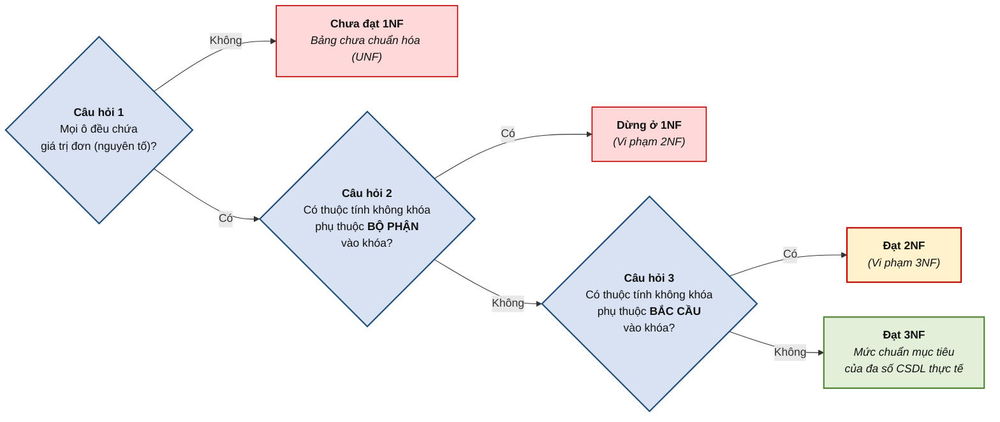

> *(Lưu ý: Các dạng chuẩn cao hơn 3NF như **BCNF** và **4NF** sẽ được định nghĩa và mở rộng tiếp từ nhánh phải của cây này tại mục 5.10).*

Bảng dưới đây — tạm gọi là **"bảng vàng" của chuẩn hóa 1NF–3NF** — nối thẳng Chương 5 về Chương 1 và trả lời câu hỏi *"mỗi bước chuẩn hóa tiêu diệt tận gốc loại dị thường nào"*.

**Bảng 5.21. Bảng vàng tổng hợp ba dạng chuẩn 1NF, 2NF, 3NF — điều kiện, thủ phạm bị diệt và cách sửa**

| Dạng chuẩn | Điều kiện cần đạt thêm | Thủ phạm bị tiêu diệt | Dị thường dữ liệu bị loại bỏ | Quy tắc tách bảng để sửa khi vi phạm |
|:---:|---|---|---|---|
| **1NF** | Mọi ô chỉ chứa **một giá trị đơn** *(nguyên tố)*; không có nhóm cột lặp | Ô đa giá trị, danh sách ngăn cách bằng dấu phẩy | Không tra cứu / kết bảng chuẩn được; không đặt khóa ngoại được | Trải phẳng mỗi giá trị thành 1 dòng *(hoặc tách thuộc tính đa trị ra bảng riêng kèm khóa chính của bảng gốc)* |
| **2NF** | Đạt 1NF + mọi thuộc tính không khóa phụ thuộc **đầy đủ** vào khóa | **Phụ thuộc bộ phận** `K₁ → Y` *(với `K₁ ⊂ K`)* | Dị thường **sửa, thêm, xóa** đối với thông tin chỉ gắn với một nửa khóa *(như tên học viên, tên lớp trong bảng ghi danh)* | Tách `R₁(K₁ ∪ Y)` làm bảng riêng có khóa chính `K₁`; bảng còn lại `R₂(R − Y)` giữ khóa `K` |
| **3NF** | Đạt 2NF + không có thuộc tính không khóa phụ thuộc **bắc cầu** vào khóa | **Phụ thuộc bắc cầu** `K → Z → Y` *(với `Z` không phải siêu khóa)* | Dị thường **sửa, thêm, xóa** đối với thực thể ẩn `Z` nằm ké trong bảng `K` *(như thông tin giáo viên nằm ké trong bảng lớp)* | Tách `R₁(Z ∪ Y)` làm bảng riêng có khóa chính `Z`; bảng còn lại `R₂(R − Y)` giữ cột `Z` làm khóa ngoại |

> **Chú ý.** Ở Chương 1 người học **nhìn thấy** ba dị thường bằng mắt nhưng **không gọi tên được căn nguyên toán học**. Bảng 5.21 chỉ đích danh: dị thường không phải hiện tượng ngẫu nhiên mà là **hệ quả trực tiếp** của phụ thuộc bộ phận và phụ thuộc bắc cầu. Đó là khác biệt giữa *thấy triệu chứng* và *chẩn đoán đúng bệnh*.

> **Tự kiểm tra 5.6–5.7.** *(đáp án ở cuối chương)*
>
> 1. `F = {A → B, B → C, A → C}` — phụ thuộc nào thừa? Chứng minh bằng bao đóng.
> 2. `LOP(MALOP, TENLOP, MAGV, HOTEN_GV)` với khóa `MALOP` và `F` như Bảng 5.5: đạt dạng chuẩn cao nhất nào? Chỉ đích danh thủ phạm.
> 3. `GHIDANH_MORONG(MAHV, MALOP, HOTEN, HOCPHI)` với khóa `(MAHV, MALOP)`: đạt dạng chuẩn nào? Nêu cách sửa.

---

## 5.8. Phép tách lược đồ

*(1,5 tiết)*

{width=85%}

*Ảnh minh họa: Đối chiếu phép tách mất mát thông tin (sinh thêm các bộ giả khi kết tự nhiên trở lại) và phép tách bảo toàn thông tin theo Định lý Heath — Nguồn: Tác giả tự vẽ.*

Ở mục 5.7, mỗi khi phát hiện một bảng vi phạm 2NF *(có phụ thuộc bộ phận)* hoặc vi phạm 3NF *(có phụ thuộc bắc cầu)*, phương thuốc điều trị luôn là **tách bảng** — cắt các thuộc tính gây bệnh ra lập một bảng con mới. Nhưng một câu hỏi sống còn lập tức đặt ra: **Có phải cứ chia các cột của một bảng thành hai bảng nhỏ có giao nhau là xong không?**

Câu trả lời là **Không**. Nếu tách tùy tiện mà không tuân theo quy tắc toán học, việc tách bảng có thể gây ra hai tai họa còn nặng nề hơn cả dữ liệu dư thừa:

1. **Làm hỏng dữ liệu khi ghép lại** *(sinh ra các dòng dữ liệu bịa — gọi là **bộ giả**)*; hoặc
2. **Làm đứt gãy quy tắc nghiệp vụ** *(một phụ thuộc hàm bị xé đôi sang hai bảng, khiến hệ quản trị không thể tự kiểm tra được nữa)*.

Mục 5.8 này trang bị hai tiêu chuẩn toán học để kiểm định mọi phép tách: **bảo toàn thông tin** *(mục 5.8.2)* và **bảo toàn phụ thuộc hàm** *(mục 5.8.3)*, trước khi ta bước vào quy trình chuẩn hóa tổng hợp ở mục 5.9.

### 5.8.1. Tách sai và hiện tượng bộ giả

Hãy xem điều gì xảy ra trên dữ liệu thực tế khi ta tách bảng theo một cột không phải là khóa.

> **Ví dụ 5.15.** Cho quan hệ `R(MAHV, MALOP, MAGV)` ghi nhận *học viên nào học lớp nào và lớp ấy do giáo viên nào dạy*, với phụ thuộc hàm nghiệp vụ `F = {MALOP → MAGV}` *(mỗi lớp do một giáo viên phụ trách; một giáo viên có thể dạy nhiều lớp)*. Giả sử cô Lê Hoa *(GV1)* dạy hai lớp `A1` và `A3`; cô Trần Mai *(GV2)* dạy lớp `A2`.
>
> Một người thiết kế thấy cột `MAGV` có giá trị lặp lại nên quyết định tách `R` thành hai bảng `R1(MAHV, MAGV)` và `R2(MALOP, MAGV)` — tức lấy cột **`MAGV`** làm cầu nối chung. Hãy xem kết quả khi chiếu dữ liệu xuống `R1`, `R2` rồi kết tự nhiên (`R1 ⋈ R2`) trở lại ở Bảng 5.22.

**Bảng 5.22. Tách sai `R` theo `MAGV` — không mất dòng nào, nhưng ghép lại sinh ra hai bộ giả**

| `R` *(bảng gốc — 3 dòng sự thật)* | MAHV | MALOP | MAGV |
|---|---|---|---|
| Dòng 1 | HV01 | A1 | GV1 |
| Dòng 2 | HV02 | A3 | GV1 |
| Dòng 3 | HV02 | A2 | GV2 |

| `R1(MAHV, MAGV)` *(chiếu R lên MAHV, MAGV)* | MAHV | MAGV | | `R2(MALOP, MAGV)` *(chiếu R lên MALOP, MAGV)* | MALOP | MAGV |
|---|---|---|---|---|---|---|
| | HV01 | GV1 | | | A1 | GV1 |
| | HV02 | GV1 | | | A3 | GV1 |
| | HV02 | GV2 | | | A2 | GV2 |

| `R1 ⋈ R2` *(ghép lại theo cột chung `MAGV`)* | MAHV | MALOP | MAGV | Đối chiếu với bảng gốc `R` |
|---|---|---|---|---|
| 1 | HV01 | A1 | GV1 | Có trong `R` *(dòng thật)* |
| 2 | **HV01** | **A3** | **GV1** | **KHÔNG CÓ trong `R` — BỘ GIẢ (dữ liệu bịa!)** |
| 3 | **HV02** | **A1** | **GV1** | **KHÔNG CÓ trong `R` — BỘ GIẢ (dữ liệu bịa!)** |
| 4 | HV02 | A3 | GV1 | Có trong `R` *(dòng thật)* |
| 5 | HV02 | A2 | GV2 | Có trong `R` *(dòng thật)* |

Nhìn riêng từng bảng con `R1` và `R2`, không hề mất dòng nào. Nhưng ngay khi dùng phép kết tự nhiên `R1 ⋈ R2` theo cột chung `MAGV` để trả lời câu hỏi *"Học viên nào đang học lớp nào?"*, giá trị `GV1` ở hai bên bắt chéo với nhau (`2 học viên × 2 lớp = 4 tổ hợp`), đẻ thêm hai dòng **`(HV01, A3, GV1)`** và **`(HV02, A1, GV1)`** chưa từng tồn tại trong thực tế! Lý do: biết `HV01` học với cô `GV1`, và biết cô `GV1` dạy cả lớp `A1` lẫn lớp `A3`, hệ thống **không còn cách nào nhớ được** `HV01` học lớp nào trong hai lớp ấy của cô `GV1`.

> **Định nghĩa 5.15 (Bộ giả — Spurious Tuple).** Khi tách quan hệ `R` thành các quan hệ con `R₁, R₂, …`, những bộ dữ liệu **xuất hiện trong kết quả kết tự nhiên `R₁ ⋈ R₂ ⋈ …` nhưng không hề tồn tại trong quan hệ gốc `R`** được gọi là **bộ giả** *(spurious tuples)*. Phép tách sinh ra bộ giả được gọi là **phép tách mất thông tin** *(lossy decomposition)*.

**Hình 5.9. Nghịch lý bộ giả — không mất dòng nào mà vẫn mất sự thật**


> **Chú ý — vì sao bộ giả còn nguy hiểm hơn cả việc mất dữ liệu?** Nếu một thao tác lỗi làm mất dòng dữ liệu, người dùng thấy thiếu sẽ đi tìm lại từ chứng từ gốc. Ngược lại, bộ giả làm bảng kết quả **đầy đặn hơn**, mọi mã số và tên gọi đều có thật trong hệ thống nên trông hoàn toàn hợp lệ — không ai biết dòng nào là thật, dòng nào là do phép kết tự bịa ra. Đây chính là kiểu **lỗi im lặng** nguy hiểm nhất trong thiết kế cơ sở dữ liệu.

### 5.8.2. Điều kiện bảo toàn thông tin (Lossless-Join Decomposition)

Làm thế nào để biết chắc một phép tách sẽ **không bao giờ** sinh ra bộ giả trên bất kỳ bộ dữ liệu nào, mà không cần phải ngồi thử từng dòng dữ liệu?

> **Định nghĩa 5.16 (Phép tách bảo toàn thông tin).** Phép tách lược đồ `R` thành hai lược đồ con `R₁` và `R₂` *(với `R₁ ∪ R₂ = R`)* được gọi là **bảo toàn thông tin** *(lossless-join decomposition — hay kết nối không mất mát)* đối với tập phụ thuộc hàm `F` nếu với **mọi thể hiện hợp lệ `r` của `R` thỏa mãn `F`**, khi chiếu `r` xuống `R₁`, `R₂` rồi kết tự nhiên lại, ta luôn thu được **đúng nguyên vẹn `r`**:
>
> `π_R₁(r)  ⋈  π_R₂(r)  =  r`

Định lý dưới đây quy việc kiểm tra Định nghĩa 5.16 về **đúng một phép tính bao đóng** của tập thuộc tính chung `R₁ ∩ R₂`:

> **Định lý 5.1 (Điều kiện cần và đủ để phép tách đôi bảo toàn thông tin).** Phép tách lược đồ `R` thành hai lược đồ con `R₁` và `R₂` là **bảo toàn thông tin** đối với tập phụ thuộc hàm `F` **khi và chỉ khi** tập thuộc tính chung **`(R₁ ∩ R₂)` là siêu khóa của ít nhất một trong hai lược đồ con `R₁` hoặc `R₂`**.
>
> Viết bằng ký hiệu bao đóng *(dùng để trình bày trong bài thi)*:
>
> **`R₁ ⊆ (R₁ ∩ R₂)⁺`**   **hoặc**   **`R₂ ⊆ (R₁ ∩ R₂)⁺`**
> *(tức là `(R₁ ∩ R₂) → R₁` thuộc `F⁺`, hoặc `(R₁ ∩ R₂) → R₂` thuộc `F⁺`)*.

Hãy dùng Định lý 5.1 để kiểm tra lại phép tách sai ở Ví dụ 5.15 và đối chiếu với phép tách đúng trên cùng quan hệ `R(MAHV, MALOP, MAGV)` với `F = {MALOP → MAGV}`:

- **Kiểm tra lại phép tách sai `R₁(MAHV, MAGV)` và `R₂(MALOP, MAGV)` của Ví dụ 5.15:**
  - Tập thuộc tính chung: `R₁ ∩ R₂ = {MAGV}`.
  - Tính bao đóng trên `F`: `(MAGV)⁺ = {MAGV}` *(không mở rộng thêm được gì vì trong `F` chỉ có `MALOP → MAGV`)*.
  - Đối chiếu: `R₁ = {MAHV, MAGV} ⊄ {MAGV}` và `R₂ = {MALOP, MAGV} ⊄ {MAGV}`.
  - Cả hai điều kiện đều **sai** ⟹ phép tách **không bảo toàn thông tin** *(chắc chắn sinh bộ giả như Bảng 5.22)*.

> **Ví dụ 5.16 — Tách đúng `R(MAHV, MALOP, MAGV)` theo cột chung `MALOP`.** Vẫn với `R(MAHV, MALOP, MAGV)` và `F = {MALOP → MAGV}`, nay ta tách thành `R₁(MAHV, MALOP)` và `R₂(MALOP, MAGV)`.
>
> - Tập thuộc tính chung: `R₁ ∩ R₂ = {MALOP}`.
> - Tính bao đóng trên `F`: nhờ `MALOP → MAGV`, ta có **`(MALOP)⁺ = {MALOP, MAGV} = R₂`**.
> - Vậy `R₁ ∩ R₂` chính là **siêu khóa (và là khóa) của `R₂`**. Theo Định lý 5.1, phép tách **bảo toàn thông tin tuyệt đối**. Bảng 5.23 kiểm chứng điều đó trên đúng 3 dòng dữ liệu của Ví dụ 5.15.

**Bảng 5.23. Tách đúng `R` theo `MALOP` — ghép lại thu được đúng 3 dòng gốc, không có bộ giả**

| `R₁(MAHV, MALOP)` | MAHV | MALOP | | `R₂(MALOP, MAGV)` *(khóa `MALOP`)* | MALOP *(PK)* | MAGV |
|---|---|---|---|---|---|---|
| | HV01 | A1 | | | A1 | GV1 |
| | HV02 | A3 | | | A3 | GV1 |
| | HV02 | A2 | | | A2 | GV2 |

| `R₁ ⋈ R₂` *(ghép theo cột chung `MALOP`)* | MAHV | MALOP | MAGV | Đối chiếu với bảng gốc `R` |
|---|---|---|---|---|
| 1 | HV01 | A1 | GV1 | Có trong `R` *(khớp duy nhất dòng A1 của `R₂`)* |
| 2 | HV02 | A3 | GV1 | Có trong `R` *(khớp duy nhất dòng A3 của `R₂`)* |
| 3 | HV02 | A2 | GV2 | Có trong `R` *(khớp duy nhất dòng A2 của `R₂`)* |

Vì `MALOP` là khóa của `R₂`, mỗi mã lớp trong `R₁` chỉ bắt cặp với **đúng một dòng duy nhất** bên `R₂` — không có chỗ nào để phép kết nhân chéo đẻ ra dòng thừa.

---

#### Bài tập mẫu 5.7 — Kiểm tra tính bảo toàn thông tin của các phép tách bằng bao đóng `(R₁ ∩ R₂)⁺`

**Đề bài.** Cho lược đồ quan hệ `R(A, B, C, D, E)` và tập phụ thuộc hàm `F = {A → BC, CD → E, B → D, E → A}`. Không cần lập bảng dữ liệu, hãy dùng Định lý 5.1 để kiểm tra xem mỗi phép tách đôi dưới đây có bảo toàn thông tin hay không:

a) Phép tách `ρ₁ = { R₁(A, B, C),  R₂(A, D, E) }`.
b) Phép tách `ρ₂ = { R₁(A, B, C),  R₂(C, D, E) }`.
c) Phép tách `ρ₃ = { R₁(A, B, D),  R₂(B, C, D, E) }`.

**Lời giải chi tiết.**

Với mỗi phép tách `{R₁, R₂}`, ta thực hiện đúng 3 bước: ① tìm giao `X = R₁ ∩ R₂`; ② tính bao đóng `X⁺` trên `F`; ③ kiểm tra xem `R₁ ⊆ X⁺` hay `R₂ ⊆ X⁺` có xảy ra không.

| Phép tách | Bước 1: Tìm thuộc tính chung `R₁ ∩ R₂` | Bước 2: Tính bao đóng `(R₁ ∩ R₂)⁺` theo `F` | Bước 3: Kiểm tra `R₁ ⊆ (R₁ ∩ R₂)⁺` hoặc `R₂ ⊆ (R₁ ∩ R₂)⁺` | Kết luận |
|---|---|---|---|---|
| **a) `ρ₁`**<br/>`R₁(A,B,C)`<br/>`R₂(A,D,E)` | `R₁ ∩ R₂ = {A}` | Khởi tạo `{A}` → áp `A → BC` được `{A, B, C}` → áp `B → D` được `{A, B, C, D}` → áp `CD → E` được `{A, B, C, D, E}` | `(A)⁺ = {A, B, C, D, E}` chứa cả `R₁` lẫn `R₂` *(cầu nối `A` là siêu khóa của cả hai bảng con)* | **Bảo toàn thông tin** |
| **b) `ρ₂`**<br/>`R₁(A,B,C)`<br/>`R₂(C,D,E)` | `R₁ ∩ R₂ = {C}` | Khởi tạo `{C}` → không có phụ thuộc nào trong `F` có vế trái chỉ gồm `C` ⟹ `(C)⁺ = {C}` | `R₁ = {A,B,C} ⊄ {C}` và `R₂ = {C,D,E} ⊄ {C}` *(cầu nối `C` không xác định được bảng nào)* | **KHÔNG bảo toàn** *(sinh bộ giả)* |
| **c) `ρ₃`**<br/>`R₁(A,B,D)`<br/>`R₂(B,C,D,E)` | `R₁ ∩ R₂ = {B, D}` | Khởi tạo `{B, D}` → không có phụ thuộc nào trong `F` có vế trái nằm trong `{B, D}` *(ngoài `B → D` đã có sẵn `D`)* ⟹ `(BD)⁺ = {B, D}` | `R₁ = {A,B,D} ⊄ {B,D}` và `R₂ = {B,C,D,E} ⊄ {B,D}` | **KHÔNG bảo toàn** *(sinh bộ giả)* |

> **Mở rộng — Khi tách một lược đồ thành 3 bảng con trở lên thì kiểm tra thế nào?**
>
> - **Cách 1 *(thực tế và phổ biến nhất khi chuẩn hóa)*:** Trong quy trình chuẩn hóa, ta luôn tách **nhị phân từng bước một** *(từ `R` tách thành `R₁` và `R'`, sau đó lại tách `R'` thành `R₂` và `R₃`…)*. Nếu ở mỗi bước tách đôi, ta đều dùng Định lý 5.1 chứng minh bước đó bảo toàn thông tin, thì kết quả cuối cùng gồm `k` bảng con **tự động bảo toàn thông tin**!
> - **Cách 2 *(thuật toán bảng Chase — dùng khi đề cho sẵn `k` bảng con mà không rõ thứ tự tách)*:** Lập một bảng gồm `n` cột *(ứng với `n` thuộc tính của `R`)* và `k` dòng *(ứng với `R₁, …, Rₖ`)*. Tại dòng `i`, cột `j`: điền ký hiệu **`aⱼ`** nếu thuộc tính `j` thuộc `Rᵢ`, ngược lại điền **`bᵢⱼ`**. Sau đó áp lần lượt các phụ thuộc `X → Y ∈ F`: nếu hai dòng có các ký hiệu giống hệt nhau trên toàn bộ các cột `X`, ta đồng nhất các ký hiệu của chúng trên các cột `Y` *(ưu tiên đổi `b` thành `a`)*. Nếu sau khi áp các phụ thuộc trong `F` mà xuất hiện **một dòng gồm toàn ký hiệu `a₁, a₂, …, aₙ`**, thì phép tách bảo toàn thông tin.

---

### 5.8.3. Điều kiện bảo toàn phụ thuộc hàm (Dependency Preservation)

Không sinh bộ giả mới là điều kiện thứ nhất của một phép tách tốt. Điều kiện thứ hai đòi hỏi: **sau khi tách bảng, không một quy tắc nghiệp vụ nào bị đánh rơi vào khoảng trống giữa các bảng con**.

> **Định nghĩa 5.17 (Bảo toàn phụ thuộc hàm).** Cho lược đồ `R` với tập phụ thuộc hàm `F` được tách thành các lược đồ con `R₁, R₂, …, Rₖ`. Gọi `Fᵢ` là **hình chiếu của `F` lên `Rᵢ`** — tức tập mọi phụ thuộc hàm `X → Y ∈ F⁺` mà cả `X` lẫn `Y` đều nằm trọn trong bảng con `Rᵢ` (`X ∪ Y ⊆ Rᵢ`). Phép tách được gọi là **bảo toàn phụ thuộc hàm** *(dependency-preserving)* nếu hợp của các phụ thuộc cục bộ trên từng bảng con vẫn suy ra lại được toàn bộ `F`:
>
> `(F₁ ∪ F₂ ∪ … ∪ Fₖ)⁺  =  F⁺`

Cách kiểm tra nhanh trong thực hành: Với mỗi phụ thuộc hàm `X → Y` trong `F`:

1. Nếu tồn tại một bảng con `Rᵢ` chứa trọn cả `X` lẫn `Y` (`X ∪ Y ⊆ Rᵢ`), thì phụ thuộc `X → Y` được **kiểm tra trực tiếp ngay trong bảng `Rᵢ`** *(chắc chắn được bảo toàn)*.
2. Nếu `X → Y` không nằm trọn trong một bảng con nào, ta tính bao đóng của `X` nhưng **chỉ được dùng các phụ thuộc nằm trọn trong từng bảng con `Rᵢ`**. Nếu kết quả vẫn chứa `Y` thì `X → Y` được bảo toàn gián tiếp *(nhờ tính bắc cầu qua các bảng)*; ngược lại thì phụ thuộc `X → Y` **bị mất**!

Vì sao mất bảo toàn phụ thuộc hàm lại tai hại trong thực tế? Hãy liên hệ ngay với **Chương 4 (Ràng buộc toàn vẹn)**:

- Khi một phụ thuộc `X → Y` nằm trọn trong một bảng con `Rᵢ` *(và `X` là khóa của `Rᵢ`)*, hệ quản trị kiểm tra nó **miễn phí và tức thì** thông qua ràng buộc khóa chính `PRIMARY KEY (X)` hoặc `UNIQUE (X)`.
- Ngược lại, nếu `X` nằm ở bảng này còn `Y` nằm ở bảng kia mà không có cầu nối bắc cầu, thì mỗi lần `INSERT` hoặc `UPDATE` một dòng, hệ quản trị phải **kết (JOIN) hai bảng lại** mới biết dữ liệu mới có vi phạm `X → Y` hay không — tức biến một ràng buộc nội bộ đơn giản thành **ràng buộc liên bộ – liên quan hệ** *(loại phức tạp nhất trong Bảng 4.6 của Chương 4, bắt buộc phải viết `TRIGGER` tốn kém)*.

> **Ví dụ 5.17 — Một phép tách bảo toàn thông tin nhưng làm đứt phụ thuộc hàm `MAGV → HOTEN_GV`.** Xét bảng `LOP(MALOP, MAGV, HOTEN_GV)` với `F = {f₁: MALOP → MAGV, f₂: MAGV → HOTEN_GV}` *(suy ra `MALOP → HOTEN_GV`)*.
>
> Giả sử một người tách `LOP` thành hai bảng: **`LOP_GV(MALOP, MAGV)`** và **`LOP_TEN(MALOP, HOTEN_GV)`**.
>
> - **Kiểm tra bảo toàn thông tin:** Thuộc tính chung là `MALOP`. Vì `MALOP` là khóa của cả hai bảng con, theo Định lý 5.1 phép tách này **bảo toàn thông tin** *(ghép lại không sinh bộ giả)*.
> - **Kiểm tra bảo toàn phụ thuộc hàm:** Phụ thuộc `f₁: MALOP → MAGV` nằm trọn trong `LOP_GV`. Nhưng phụ thuộc **`f₂: MAGV → HOTEN_GV` không nằm trọn trong bảng nào** (`MAGV` ở bảng một, `HOTEN_GV` ở bảng hai), và từ `MAGV` cũng không suy ra được `MALOP` để bắc cầu sang bảng kia (`(MAGV)⁺` chỉ bằng `{MAGV}`). Vậy **phụ thuộc `MAGV → HOTEN_GV` đã bị đánh mất!** Bảng 5.24 cho thấy hậu quả ngay trên dữ liệu.

**Bảng 5.24. Phép tách bảo toàn thông tin nhưng đánh mất phụ thuộc hàm `MAGV → HOTEN_GV`**

| Bảng `LOP_GV` *(Khóa `MALOP`)* | MALOP | MAGV | | Bảng `LOP_TEN` *(Khóa `MALOP`)* | MALOP | HOTEN_GV |
|---|---|---|---|---|---|---|
| Dòng 1 | A1 | **GV1** | | Dòng 1 | A1 | **Lê Hoa** |
| Dòng 2 | A3 | **GV1** | | Dòng 2 | A3 | **Lê Thị Hoa *(lệch tên!)*** |
| Dòng 3 | A2 | GV2 | | Dòng 3 | A2 | Trần Mai |

| Phụ thuộc hàm trong `F` | Nằm trọn trong bảng con nào? | Hệ quản trị kiểm tra được không? |
|---|---|---|
| `MALOP → MAGV` | Nằm trọn trong `LOP_GV` *(khóa chính `MALOP`)* | **Có** — kiểm tra tự động bằng `PRIMARY KEY` |
| `MAGV → HOTEN_GV` | **Không nằm trong bảng nào** *(bị xé đôi sang 2 bảng)* | **Không!** Nhìn riêng `LOP_GV` hợp lệ, nhìn riêng `LOP_TEN` cũng hợp lệ; phải `JOIN` hai bảng mới phát hiện cùng `GV1` mà mang hai tên `"Lê Hoa"` và `"Lê Thị Hoa"` |

### 5.8.4. Quy tắc vàng khi tách bảng và Định lý tồn tại phép tách 3NF

Từ Định lý 5.1 *(bảo toàn thông tin)* và Định nghĩa 5.17 *(bảo toàn phụ thuộc hàm)*, ta đúc kết được **quy tắc vàng thực hành** giải thích vì sao cách tách khử 2NF và 3NF ở mục 5.7 luôn an toàn:

> **Quy tắc vàng — Luôn tách theo một phụ thuộc hàm `X → Y` có thật trong `F`:**
>
> Khi trong bảng `R` có một phụ thuộc hàm `X → Y` vi phạm dạng chuẩn *(bộ phận hoặc bắc cầu)*, nếu ta tách `R` thành:
> - Bảng mới **`R₁(X ∪ Y)`** *(chứa trọn cả vế trái `X` lẫn vế phải `Y`, nhận `X` làm khóa chính)*, và
> - Bảng còn lại **`R₂(R − Y)`** *(bỏ phần vế phải `Y` đã tách, nhưng **giữ nguyên `X`** làm cầu nối khóa ngoại)*,
>
> thì:
> 1. Tập thuộc tính chung là `R₁ ∩ R₂ = X`. Vì `X → Y` nên `X⁺` chứa toàn bộ `X ∪ Y = R₁`, tức `X` là siêu khóa của `R₁` ⟹ **Định lý 5.1 tự động thỏa mãn (luôn bảo toàn thông tin)**!
> 2. Bản thân phụ thuộc `X → Y` nằm trọn trong bảng mới `R₁(X ∪ Y)` ⟹ **phụ thuộc `X → Y` được bảo toàn trọn vẹn ngay thành khóa chính của `R₁`**!

Hơn thế nữa, lý thuyết cơ sở dữ liệu chứng minh được một định lý nền tảng bảo đảm rằng với mức chuẩn **3NF**, người thiết kế **không bao giờ phải hy sinh bất kỳ tiêu chí nào** trong bốn tiêu chí của Định nghĩa 5.1:

> **Định lý 5.2 (Định lý bảo toàn trọn vẹn của 3NF).** Với **mọi** lược đồ quan hệ `R` và **mọi** tập phụ thuộc hàm `F`, **luôn luôn tồn tại một phép tách `R` thành các lược đồ con đạt dạng chuẩn 3 (3NF)** sao cho thỏa mãn **đồng thời cả hai tính chất**:
>
> 1. **Bảo toàn thông tin** *(không bao giờ sinh bộ giả khi kết nối lại)*; **VÀ**
> 2. **Bảo toàn toàn bộ phụ thuộc hàm** *(mọi quy tắc nghiệp vụ trong `F` đều kiểm tra được trên từng bảng con)*.

Định lý 5.2 chính là lý do vững chắc khiến **3NF trở thành đích đến tiêu chuẩn của quy trình chuẩn hóa trong thực tế** mà ta sẽ thực hiện trọn vẹn ở mục 5.9 ngay sau đây. *(Câu hỏi "Điều gì xảy ra nếu ta đòi hỏi một dạng chuẩn còn nghiêm ngặt hơn cả 3NF?" sẽ được giải đáp trọn vẹn ở mục 5.10.1).*

> **Tự kiểm tra 5.8.** *(đáp án ở cuối chương)*
>
> 1. Tách `GHIDANH(MAHV, MALOP, HOCPHI)` thành `(MAHV, HOCPHI)` và `(MALOP, HOCPHI)`. Có bảo toàn thông tin không? Vì sao?
> 2. Tách `LOP(MALOP, TENLOP, MAGV, HOTEN_GV)` thành `(MALOP, TENLOP, MAGV)` và `(MAGV, HOTEN_GV)`. Kiểm tra cả hai điều kiện bảo toàn.
> 3. Vì sao "tách theo một phụ thuộc hàm có trong `F`" thì điều kiện bảo toàn thông tin tự động thỏa mãn?

---

## 5.9. Quy trình chuẩn hóa hoàn chỉnh

*(1,0 tiết)*

Đến đây, toàn bộ các mảnh ghép lý thuyết đã sẵn sàng: ta đã có công cụ nhận diện phụ thuộc hàm *(mục 5.2–5.3)*, tính bao đóng và tìm khóa *(mục 5.4–5.5)*, rút gọn phủ tối thiểu *(mục 5.6)*, thang đo 1NF–2NF–3NF *(mục 5.7)* và quy tắc tách bảng bảo toàn thông tin lẫn phụ thuộc hàm *(mục 5.8)*.

Mục 5.9 này kết nối tất cả các mảnh ghép ấy thành một **quy trình chuẩn hóa 5 bước hoàn chỉnh**, rồi áp dụng trực tiếp vào **chính bảng phẳng của Trung tâm Anh ngữ ABC ở Chương 1** và thêm một bài tập mẫu tổng hợp trên nghiệp vụ đơn hàng.

**Bảng 5.25. Tổng quan quy trình 5 bước chuẩn hóa một bảng phẳng về 3NF**

| Bước | Tên bước | Công cụ sử dụng (Mục) | Đầu ra cần đạt được |
|:--:|---|---|---|
| **Bước 1** | **Đưa về 1NF & Lập tập phụ thuộc hàm `F`** | Mục 5.2, 5.6, 5.7.2 | Bảng đã khử ô đa trị (đạt 1NF); tập `F` rút từ quy tắc nghiệp vụ (đã tối giản nếu có phần tử thừa) |
| **Bước 2** | **Tìm tất cả các khóa dự tuyển** | Thuật toán `TN – TG – TĐ` & bao đóng `X⁺` (Mục 5.4, 5.5) | Danh sách tất cả các khóa dự tuyển; phân định rõ tập **thuộc tính khóa** và **thuộc tính không khóa** |
| **Bước 3** | **Chẩn đoán dạng chuẩn hiện tại** | Bảng "hai câu hỏi" (Mục 5.7.5) | Chỉ đích danh từng phụ thuộc **bộ phận** *(vi phạm 2NF)* và **bắc cầu** *(vi phạm 3NF)* |
| **Bước 4** | **Tách khử phụ thuộc bộ phận → đạt 2NF** | Quy tắc tách `R₁(K₁ ∪ Y)` và `R₂(R − Y)` (Mục 5.7.3, 5.8.4) | Tập các bảng con đều đạt ít nhất **2NF** |
| **Bước 5** | **Tách khử phụ thuộc bắc cầu → đạt 3NF & Kiểm chứng** | Quy tắc tách `R₁(Z ∪ Y)` và Định lý 5.1 (Mục 5.7.4, 5.8.2–5.8.3) | Tập các bảng con đều đạt **3NF**, kèm bảng kiểm chứng **bảo toàn thông tin** và **bảo toàn phụ thuộc hàm** |

### 5.9.1. Bài toán xuất phát — Bảng phẳng của Trung tâm Anh ngữ ABC

Xuất phát từ bảng phẳng lưu trữ toàn bộ thông tin ghi danh của Trung tâm Anh ngữ ABC đã làm quen từ Chương 1:

`GHIDANH_PHANG(MAHV, HOTEN, MALOP, TENLOP, MAGV, HOTEN_GV, HOCPHI)`

| MAHV | HOTEN | MALOP | TENLOP | MAGV | HOTEN_GV | HOCPHI |
|---|---|---|---|---|---|---|
| HV01 | Trần An | A1 | Anh cơ bản 1 | GV1 | Lê Hoa | 2.000.000 |
| HV01 | Trần An | A2 | Anh giao tiếp | GV2 | Trần Mai | 2.500.000 |
| HV02 | Lê Bình | A1 | Anh cơ bản 1 | GV1 | Lê Hoa | 2.000.000 |

### 5.9.2. Bước 1 — Kiểm tra 1NF và xác định tập phụ thuộc hàm `F`

- **Kiểm tra 1NF:** Mọi ô trong `GHIDANH_PHANG` đều chỉ chứa một giá trị nguyên tố duy nhất ⟹ bảng **đã đạt 1NF**.
- **Xác định tập phụ thuộc hàm `F` từ quy tắc nghiệp vụ:**

**Bảng 5.26. Tập phụ thuộc hàm `F` của `GHIDANH_PHANG` — rút từ quy tắc nghiệp vụ**

| Ký hiệu | Phụ thuộc hàm | Khi tách đơn vế phải | Quy tắc nghiệp vụ tương ứng tại Trung tâm ABC |
|:--:|---|---|---|
| `f₁` | `MAHV → HOTEN` | `MAHV → HOTEN` | Mỗi mã học viên xác định duy nhất **một** họ tên học viên |
| `f₂` | `MALOP → TENLOP, MAGV` | `MALOP → TENLOP`<br/>`MALOP → MAGV` | Mỗi mã lớp xác định duy nhất **một** tên lớp và do **một** giáo viên phụ trách |
| `f₃` | `MAGV → HOTEN_GV` | `MAGV → HOTEN_GV` | Mỗi mã giáo viên xác định duy nhất **một** họ tên giáo viên |
| `f₄` | `(MAHV, MALOP) → HOCPHI` | `(MAHV, MALOP) → HOCPHI` | Mỗi **lượt ghi danh** của một học viên vào một lớp có **một** mức học phí |

*(Tập `F` này đã là phủ tối thiểu vì không có thuộc tính thừa ở vế trái và không có phụ thuộc nào suy ra được từ các phụ thuộc còn lại).*

### 5.9.3. Bước 2 — Tìm tất cả các khóa dự tuyển và phân loại thuộc tính

Áp dụng thuật toán `TN – TG – TĐ` ở mục 5.5 *(đúng như đã phân nhóm ở Bảng 5.15)*:

- **Tập nguồn `TN` *(chỉ ở vế trái)*:** `{MAHV, MALOP}` — bắt buộc phải có mặt trong mọi khóa.
- **Tập trung gian `TG` *(ở cả hai vế)*:** `{MAGV}`.
- **Tập đích `TĐ` *(chỉ ở vế phải)*:** `{HOTEN, TENLOP, HOTEN_GV, HOCPHI}` — không bao giờ nằm trong khóa.

Áp lối tắt ở mục 5.5.2, ta tính bao đóng của tập nguồn `(TN)⁺ = (MAHV, MALOP)⁺` *(đã chạy chi tiết ở Bảng 5.11)*:

- Khởi tạo: `{MAHV, MALOP}`
- Áp `f₁ (MAHV → HOTEN)`: `{MAHV, MALOP, HOTEN}`
- Áp `f₂ (MALOP → TENLOP, MAGV)`: `{MAHV, MALOP, HOTEN, TENLOP, MAGV}`
- Áp `f₃ (MAGV → HOTEN_GV)`: `{MAHV, MALOP, HOTEN, TENLOP, MAGV, HOTEN_GV}`
- Áp `f₄ ((MAHV, MALOP) → HOCPHI)`: `{MAHV, MALOP, HOTEN, TENLOP, MAGV, HOTEN_GV, HOCPHI}` = **toàn bộ 7 thuộc tính của `GHIDANH_PHANG`**.

Vì `(TN)⁺` đã phủ kín toàn bộ lược đồ ngay mà không cần ghép thêm bất kỳ tập con nào của `TG`, ta kết luận:

- **Khóa dự tuyển duy nhất:** **`K = (MAHV, MALOP)`** *(khóa phức hợp gồm 2 thuộc tính)*.
- **Tập thuộc tính khóa:** `{MAHV, MALOP}`.
- **Tập thuộc tính không khóa:** `{HOTEN, TENLOP, MAGV, HOTEN_GV, HOCPHI}`.

> **Chú ý.** Đây là khoảnh khắc **trực giác và toán học gặp nhau**. Ở mục 2.6.4 của Chương 2, ta đã đoán ra thực thể kết hợp `GHIDANH` bằng *phép thử tờ phiếu* — mỗi lượt học viên đăng ký một lớp, trung tâm in một tờ phiếu thu học phí. Nay thuật toán `TN–TG` **tính ra** đúng khóa `(MAHV, MALOP)`, tức đúng định danh của "tờ phiếu" ấy!

### 5.9.4. Bước 3 — Chẩn đoán dạng chuẩn bằng bảng "hai câu hỏi"

Áp dụng quy trình Bước 4 ở mục 5.7.5, ta đi qua từng phụ thuộc hàm của `GHIDANH_PHANG` và đặt hai câu hỏi chuẩn đoán.

**Bảng 5.27. Chẩn đoán từng phụ thuộc hàm của `GHIDANH_PHANG` với khóa duy nhất `K = (MAHV, MALOP)`**

| Phụ thuộc `X → A` | Câu 1: `X` là siêu khóa? | Câu 2: `A` là thuộc tính khóa? | Nếu cả hai "Không": `X` là **một phần** của khóa `K`? | Kết luận cho từng phụ thuộc |
|---|:--:|:--:|:--:|---|
| `MAHV → HOTEN` | Không | Không | **Có** (`MAHV ⊂ K`) | **Phụ thuộc bộ phận** → **Vi phạm 2NF** |
| `MALOP → TENLOP` | Không | Không | **Có** (`MALOP ⊂ K`) | **Phụ thuộc bộ phận** → **Vi phạm 2NF** |
| `MALOP → MAGV` | Không | Không | **Có** (`MALOP ⊂ K`) | **Phụ thuộc bộ phận** → **Vi phạm 2NF** |
| `MAGV → HOTEN_GV` | Không | Không | **Không** (`MAGV` ngoài khóa) | **Phụ thuộc bắc cầu** (`MALOP → MAGV → HOTEN_GV`) → **Vi phạm 3NF** |
| `(MAHV, MALOP) → HOCPHI` | **Có** (`X = K`) | — | — | **Phụ thuộc đầy đủ vào khóa** → **Đạt 3NF** |

**Bảng 5.28. Tổng hợp kết quả chẩn đoán dạng chuẩn của `GHIDANH_PHANG`**

| Dạng chuẩn | Trạng thái | Bằng chứng cụ thể từ Bảng 5.27 |
|:---:|:---:|---|
| **1NF** | **Đạt** | Mọi ô trong bảng đều chứa giá trị đơn |
| **2NF** | **Vi phạm** | Có 3 phụ thuộc **bộ phận** vào nửa khóa: `MAHV → HOTEN` và `MALOP → TENLOP, MAGV` |
| **3NF** | **Vi phạm** | Chưa đạt 2NF; đồng thời chứa chuỗi phụ thuộc **bắc cầu** `MALOP → MAGV → HOTEN_GV` |

**Kết luận Bước 3:** Bảng phẳng `GHIDANH_PHANG` hiện **chỉ đạt 1NF**.

### 5.9.5. Bước 4 và Bước 5 — Tách tuần tự lên 2NF rồi 3NF

Theo đúng Quy tắc vàng ở mục 5.8.4, ta lần lượt tách các thuộc tính vi phạm theo đúng phụ thuộc hàm của chúng:

1. **Bước 4 — Khử các phụ thuộc bộ phận để đưa toàn bộ lược đồ lên 2NF:**
   - Tách theo `f₁ (MAHV → HOTEN)` ra bảng **`HOCVIEN(MAHV, HOTEN)`** với khóa chính `MAHV`.
   - Tách theo `f₂ (MALOP → TENLOP, MAGV)` *(và kéo theo `HOTEN_GV` đang phụ thuộc vào `MAGV`)* ra bảng **`LOP_MORONG(MALOP, TENLOP, MAGV, HOTEN_GV)`** với khóa chính `MALOP`.
   - Phần còn lại của bảng gốc giữ khóa phức hợp `(MAHV, MALOP)` và thuộc tính phụ thuộc đầy đủ `HOCPHI`: **`GHIDANH(MAHV, MALOP, HOCPHI)`**.
   - *Kiểm tra sau Bước 4:* Cả ba bảng `HOCVIEN`, `LOP_MORONG`, `GHIDANH` đều **đã đạt 2NF**. Trong đó `HOCVIEN` và `GHIDANH` cũng đã đạt luôn **3NF**; riêng bảng `LOP_MORONG(MALOP, TENLOP, MAGV, HOTEN_GV)` mới đạt 2NF vì vẫn còn phụ thuộc bắc cầu `MALOP → MAGV → HOTEN_GV`.

2. **Bước 5 — Khử phụ thuộc bắc cầu trong `LOP_MORONG` để đưa toàn bộ lược đồ lên 3NF:**
   - Tách `LOP_MORONG` theo phụ thuộc `f₃ (MAGV → HOTEN_GV)` thành hai bảng:
     - **`GIAOVIEN(MAGV, HOTEN_GV)`** với khóa chính `MAGV`;
     - **`LOP(MALOP, TENLOP, MAGV)`** với khóa chính `MALOP` và khóa ngoại `MAGV` tham chiếu `GIAOVIEN`.

**Hình 5.10. Sơ đồ quy trình chuẩn hóa từng bước từ bảng phẳng `GHIDANH_PHANG` về 4 bảng đạt 3NF**

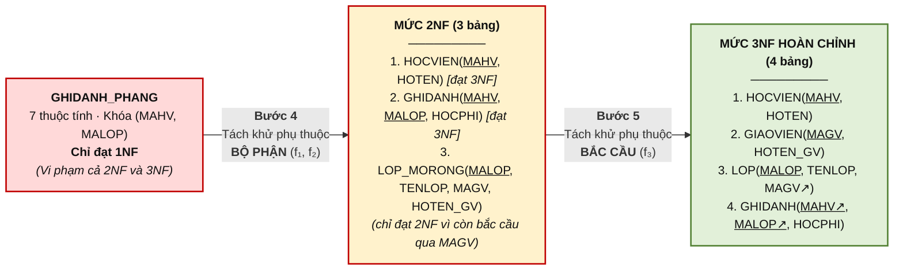

**Kết quả lược đồ cơ sở dữ liệu cuối cùng (đạt 3NF):**

```
HOCVIEN  (MAHV, HOTEN)
GIAOVIEN (MAGV, HOTEN_GV)
LOP      (MALOP, TENLOP, MAGV↗GIAOVIEN)
GHIDANH  (MAHV↗HOCVIEN, MALOP↗LOP, HOCPHI)
```

Đổ đúng ba dòng dữ liệu của bảng phẳng ở mục 5.9.1 vào bốn bảng vừa tách, ta nhìn thấy ngay kết quả trên mặt dữ liệu: **mỗi sự thật chỉ còn lưu ở đúng một nơi duy nhất**.

**Bảng 5.29. Ba dòng của `GHIDANH_PHANG` sau khi chuẩn hóa về 3NF — bốn bảng, không còn bất kỳ giá trị nào bị chép lặp**

| `HOCVIEN` | MAHV *(PK)* | HOTEN | | `GIAOVIEN` | MAGV *(PK)* | HOTEN_GV |
|---|---|---|---|---|---|---|
| | HV01 | Trần An | | | GV1 | Lê Hoa |
| | HV02 | Lê Bình | | | GV2 | Trần Mai |

| `LOP` | MALOP *(PK)* | TENLOP | MAGV↗ | | `GHIDANH` | MAHV↗ *(PK)* | MALOP↗ *(PK)* | HOCPHI |
|---|---|---|---|---|---|---|---|---|
| | A1 | Anh cơ bản 1 | GV1 | | | HV01 | A1 | 2.000.000 |
| | A2 | Anh giao tiếp | GV2 | | | HV01 | A2 | 2.500.000 |
| | | | | | | HV02 | A1 | 2.000.000 |

Những giá trị từng phải chép lặp hai lần trong bảng phẳng — `"Trần An"`, `"Lê Hoa"`, `"Anh cơ bản 1"` — nay xuất hiện **đúng một lần**. Và bốn bảng này trùng khớp 100% với ba bảng mà Chương 1 đã tách bằng trực giác cộng thêm bảng `GHIDANH` mà Chương 2 tìm ra bằng phép thử tờ phiếu!

### 5.9.6. Kiểm chứng tính bảo toàn thông tin và bảo toàn phụ thuộc hàm

Để bài giải chuẩn hóa đạt điểm tuyệt đối, bước cuối cùng là kiểm chứng rằng cả 3 nhát cắt của chúng ta đều thỏa mãn Định lý 5.1 *(bảo toàn thông tin)* và Định nghĩa 5.17 *(bảo toàn phụ thuộc hàm)*.

**Bảng 5.30. Kiểm chứng cả ba phép tách trong quy trình chuẩn hóa `GHIDANH_PHANG`**

| Nhát cắt (Phép tách đôi) | Thuộc tính chung `R₁ ∩ R₂` | Kiểm tra Định lý 5.1 *(Siêu khóa của bảng con)* | Phụ thuộc hàm được giữ trong bảng mới | Kết luận |
|---|---|---|---|---|
| **1.** Tách `HOCVIEN(MAHV, HOTEN)` khỏi `GHIDANH_PHANG` | `{MAHV}` | `(MAHV)⁺` chứa `{MAHV, HOTEN}` ⟹ `MAHV` là **khóa của `HOCVIEN`** | `f₁: MAHV → HOTEN` | **Bảo toàn thông tin & phụ thuộc** |
| **2.** Tách `LOP_MORONG(MALOP, TENLOP, MAGV, HOTEN_GV)` khỏi phần còn lại `GHIDANH(MAHV, MALOP, HOCPHI)` | `{MALOP}` | `(MALOP)⁺` chứa toàn bộ `LOP_MORONG` ⟹ `MALOP` là **khóa của `LOP_MORONG`** | `f₂: MALOP → TENLOP, MAGV` *(và `f₄` ở lại `GHIDANH`)* | **Bảo toàn thông tin & phụ thuộc** |
| **3.** Tách `GIAOVIEN(MAGV, HOTEN_GV)` khỏi `LOP_MORONG` để còn `LOP(MALOP, TENLOP, MAGV)` | `{MAGV}` | `(MAGV)⁺` chứa `{MAGV, HOTEN_GV}` ⟹ `MAGV` là **khóa của `GIAOVIEN`** | `f₃: MAGV → HOTEN_GV` | **Bảo toàn thông tin & phụ thuộc** |

Cả ba phép tách liên tiếp đều bảo toàn thông tin ⟹ khi kết tự nhiên `HOCVIEN ⋈ GHIDANH ⋈ LOP ⋈ GIAOVIEN` ta thu lại đúng bảng phẳng ban đầu, **không bao giờ sinh bộ giả**. Đồng thời cả 4 phụ thuộc `f₁, f₂, f₃, f₄` đều nằm trọn trong 4 bảng con và trở thành các ràng buộc khóa chính `PRIMARY KEY` của 4 bảng ấy!

---

### 5.9.7. Bài tập mẫu tổng hợp — Chuẩn hóa trọn vẹn bảng phẳng Đơn hàng

Để người học tự tin giải bài tập lớn và câu hỏi tự luận cuối kỳ *(như Bài B3 ở cuối chương)*, bài tập mẫu dưới đây trình bày trọn vẹn 5 bước chuẩn hóa cho một bài toán kinh điển khác: **Hóa đơn / Đơn đặt hàng bán lẻ**.

#### Bài tập mẫu 5.8 — Chuẩn hóa bảng phẳng `DONHANG_PHANG` từ 1NF về 3NF

**Đề bài.** Một cửa hàng văn phòng phẩm đang quản lý chi tiết bán hàng trên một bảng phẳng `DONHANG_PHANG` *(đã ở 1NF)* gồm 8 thuộc tính:

`DONHANG_PHANG(MADH, NGAYDAT, MAKH, TENKH, MASP, TENSP, DONGIA, SOLUONG)`

với các quy tắc nghiệp vụ:
- Mỗi mã đơn hàng (`MADH`) có một ngày đặt (`NGAYDAT`) và thuộc về một khách hàng (`MAKH`).
- Mỗi mã khách hàng (`MAKH`) có một tên khách hàng (`TENKH`).
- Mỗi mã sản phẩm (`MASP`) có một tên sản phẩm (`TENSP`) và một đơn giá niêm yết (`DONGIA`).
- Trong một đơn hàng, mỗi sản phẩm xuất hiện tối đa một dòng với một số lượng đặt (`SOLUONG`).

Hãy thực hiện trọn vẹn quy trình 5 bước để chuẩn hóa `DONHANG_PHANG` về **3NF**.

**Lời giải chi tiết theo 5 bước.**

- **Bước 1 — Lập tập phụ thuộc hàm `F`:**
  - `f₁: MADH → NGAYDAT, MAKH` *(biết đơn hàng thì biết ngày đặt và mã khách hàng)*
  - `f₂: MAKH → TENKH` *(biết mã khách hàng thì biết tên khách hàng)*
  - `f₃: MASP → TENSP, DONGIA` *(biết mã sản phẩm thì biết tên sản phẩm và đơn giá)*
  - `f₄: (MADH, MASP) → SOLUONG` *(biết đơn hàng và sản phẩm thì biết số lượng mua)*

- **Bước 2 — Tìm tất cả các khóa dự tuyển:**
  - Phân nhóm thuộc tính:
    - Chỉ xuất hiện ở vế trái: **`TN = {MADH, MASP}`**.
    - Xuất hiện ở cả hai vế: **`TG = {MAKH}`**.
    - Chỉ xuất hiện ở vế phải: **`TĐ = {NGAYDAT, TENKH, TENSP, DONGIA, SOLUONG}`**.
  - Tính bao đóng của tập nguồn `(TN)⁺ = (MADH, MASP)⁺`:
    `{MADH, MASP}` → *(nhờ `f₁`)* `{MADH, MASP, NGAYDAT, MAKH}` → *(nhờ `f₂`)* `{…, TENKH}` → *(nhờ `f₃`)* `{…, TENSP, DONGIA}` → *(nhờ `f₄`)* `{…, SOLUONG}` = **toàn bộ 8 thuộc tính**.
  - Vậy lược đồ có **khóa dự tuyển duy nhất là `K = (MADH, MASP)`**.
  - **Thuộc tính khóa:** `{MADH, MASP}`; **thuộc tính không khóa:** `{NGAYDAT, MAKH, TENKH, TENSP, DONGIA, SOLUONG}`.

- **Bước 3 — Chẩn đoán dạng chuẩn hiện tại:**
  - **Vi phạm 2NF *(phụ thuộc bộ phận)*:**
    - `MADH → NGAYDAT, MAKH` *(vế trái `MADH` chỉ là một nửa của khóa `(MADH, MASP)`)*.
    - `MASP → TENSP, DONGIA` *(vế trái `MASP` chỉ là nửa kia của khóa `(MADH, MASP)`)*.
  - **Vi phạm 3NF *(phụ thuộc bắc cầu)*:**
    - `MADH → MAKH → TENKH` *(thuộc tính không khóa `TENKH` phụ thuộc vào `MAKH` ngoài khóa)*.
  - Kết luận: `DONHANG_PHANG` hiện **chỉ đạt 1NF**.

- **Bước 4 — Tách khử phụ thuộc bộ phận để lên 2NF:**
  - Tách theo `MASP → TENSP, DONGIA` ra bảng **`SANPHAM(MASP, TENSP, DONGIA)`** *(khóa chính `MASP` — đạt 3NF)*.
  - Tách theo `MADH → NGAYDAT, MAKH` *(kèm `TENKH` đi theo `MAKH`)* ra bảng **`DONHANG_2NF(MADH, NGAYDAT, MAKH, TENKH)`** *(khóa chính `MADH` — đạt 2NF, nhưng còn bắc cầu `MADH → MAKH → TENKH`)*.
  - Phần còn lại giữ khóa phức hợp `(MADH, MASP)` và thuộc tính phụ thuộc đầy đủ `SOLUONG`: **`CT_DONHANG(MADH, MASP, SOLUONG)`** *(khóa chính `(MADH, MASP)` — đạt 3NF)*.

- **Bước 5 — Tách khử phụ thuộc bắc cầu để lên 3NF và kiểm chứng:**
  - Tách `DONHANG_2NF` theo `MAKH → TENKH` thành hai bảng:
    - **`KHACHHANG(MAKH, TENKH)`** *(khóa chính `MAKH` — đạt 3NF)*.
    - **`DONHANG(MADH, NGAYDAT, MAKH↗)`** *(khóa chính `MADH`, khóa ngoại `MAKH` — đạt 3NF)*.
  - **Bốn bảng kết quả đạt 3NF:**
    1. `KHACHHANG(MAKH, TENKH)` — giữ `f₂`
    2. `SANPHAM(MASP, TENSP, DONGIA)` — giữ `f₃`
    3. `DONHANG(MADH, NGAYDAT, MAKH↗KHACHHANG)` — giữ `f₁`
    4. `CT_DONHANG(MADH↗DONHANG, MASP↗SANPHAM, SOLUONG)` — giữ `f₄`
  - **Kiểm chứng:** Cả 3 phép tách đều thực hiện theo các phụ thuộc hàm `f₃`, `f₁`, `f₂` có vế trái (`MASP`, `MADH`, `MAKH`) là khóa của bảng mới tách ra ⟹ **bảo toàn thông tin** theo Định lý 5.1; đồng thời cả 4 phụ thuộc `f₁, f₂, f₃, f₄` đều nằm trọn trong 4 bảng con ⟹ **bảo toàn phụ thuộc hàm**.

---

## 5.10. Dạng chuẩn mức cao và phi chuẩn hóa

*(0,5 tiết — xem lưu ý về thời lượng ở đầu chương)*

Với 95% các bài toán quản lý trong thực tế, chuẩn hóa dừng lại ở **3NF** *(mục 5.9)* là đã hoàn tất. Tuy nhiên, có ba câu hỏi nâng cao mà một người thiết kế cơ sở dữ liệu chuyên nghiệp cần biết câu trả lời:

1. **Khi nào một bảng đã đạt 3NF mà vẫn còn dư thừa dữ liệu?** Đó là lúc xuất hiện **Dạng chuẩn Boyce–Codd (BCNF)** — và vì sao đôi khi ta biết bảng chưa đạt BCNF nhưng vẫn **chủ động dừng ở 3NF**? *(mục 5.10.1)*.
2. **Khi nào một bảng không còn bất kỳ phụ thuộc hàm nào vi phạm (đã đạt cả BCNF) mà vẫn bị lặp dữ liệu theo cấp số nhân?** Đó là lúc xuất hiện **Phụ thuộc đa trị** và **Dạng chuẩn 4 (4NF)** *(mục 5.10.2–5.10.3)*.
3. **Khi nào ta đã chuẩn hóa xong xuôi về 3NF, rồi lại cố tình gộp bảng hoặc thêm cột dư thừa trở lại?** Đó là kỹ thuật **Phi chuẩn hóa** *(mục 5.10.4)*.

### 5.10.1. Dạng chuẩn Boyce–Codd (BCNF) và sự đánh đổi với 3NF

Hãy nhìn lại phát biểu chuẩn của **3NF** *(Định nghĩa 5.14b ở mục 5.7.4)*: một lược đồ đạt 3NF nếu với mọi phụ thuộc hàm không tầm thường `X → A`, **hoặc** *(1)* `X` là siêu khóa, **hoặc** *(2)* `A` là thuộc tính khóa.

Điều kiện *(2)* *("hoặc `A` là thuộc tính khóa")* giống như một "cửa hậu" khoan hồng của 3NF: nó cho phép một thuộc tính **không phải siêu khóa** `X` được quyền quyết định một thuộc tính nằm trong khóa `A`. Năm 1974, R. F. Boyce và E. F. Codd nhận ra rằng chính "cửa hậu" này đôi khi vẫn để lọt dư thừa, và đề xuất đóng hẳn cửa hậu ấy lại.

> **Định nghĩa 5.18 (Dạng chuẩn Boyce–Codd — Boyce–Codd Normal Form, BCNF).** Lược đồ quan hệ `R` *(đã ở 1NF)* đạt **dạng chuẩn Boyce–Codd (BCNF)** khi và chỉ khi với **mọi phụ thuộc hàm không tầm thường `X → A`** *(tức `A ∉ X`)* suy ra được từ `F`, vế trái **`X` bắt buộc phải là một siêu khóa của `R`**.

Câu khẩu quyết ngắn nhất của BCNF: **"Trong một bảng BCNF, mọi vế trái của mọi mũi tên đều phải là siêu khóa — không có bất kỳ ngoại lệ nào."**

Vì mọi bảng thỏa mãn điều kiện *"X là siêu khóa"* thì đương nhiên thỏa mãn điều kiện *"X là siêu khóa HOẶC A là thuộc tính khóa"*, nên **mọi lược đồ đạt BCNF đều chắc chắn đạt 3NF** *(BCNF được xem là "dạng chuẩn 3,5")*.

**Bảng 5.31. Đối chiếu trực diện 3NF và BCNF**

| Tiêu chí so sánh | Dạng chuẩn 3 (**3NF**) | Dạng chuẩn Boyce–Codd (**BCNF**) |
|---|---|---|
| **Điều kiện với mọi `X → A` không tầm thường** | `X` là siêu khóa **HOẶC** `A` là thuộc tính khóa | **`X` bắt buộc là siêu khóa** *(bỏ vế "hoặc `A` là thuộc tính khóa")* |
| **Khi nào một bảng đạt 3NF mà vi phạm BCNF?** | Chỉ xảy ra khi tồn tại `X → A` mà **`X` không phải siêu khóa** nhưng **`A` lại là một thuộc tính khóa** *(thường gặp khi lược đồ có **nhiều khóa dự tuyển chồng lấn nhau**)* | |
| **Khi lược đồ chỉ có 1 khóa duy nhất** *(hoặc các khóa không giao nhau)* | **3NF và BCNF hoàn toàn trùng nhau** *(đạt 3NF là tự động đạt BCNF)* | |
| **Bảo toàn thông tin khi tách bảng** | **Luôn đạt được** | **Luôn đạt được** |
| **Bảo toàn phụ thuộc hàm khi tách bảng** | **Luôn đạt được 100%** *(Định lý 5.2)* | **KHÔNG phải lúc nào cũng đạt được!** *(Định lý 5.3 dưới đây)* |

Nếu muốn kiểm tra thêm BCNF sau khi một lược đồ đã đi tới nhánh phải **Đạt 3NF** của Cây quyết định ở Hình 5.8 *(mục 5.7.6)*, ta chỉ cần gắn thêm **đúng một câu hỏi thứ tư** vào sau nút 3NF như sơ đồ dưới đây:

**Hình 5.11. Mở rộng cây quyết định từ 3NF lên BCNF**

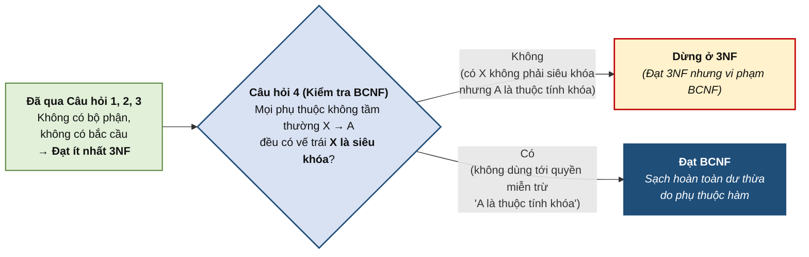

> *(Kiểm tra nhanh trên bốn bảng kết quả của Trung tâm ABC ở mục 5.9.5: `HOCVIEN`, `GIAOVIEN`, `LOP`, `GHIDANH` đều chỉ có **một khóa duy nhất**, và mọi vế trái của các phụ thuộc trong từng bảng đều chính là khóa của bảng đó ⟹ cả bốn bảng của chúng ta ở mục 5.9 **đều đã đạt luôn BCNF**!).*

Vậy khi nào một bảng **đạt 3NF nhưng không đạt BCNF**, và tại sao trong trường hợp đó người ta lại thường khuyên **dừng ở 3NF thay vì cố tách lên BCNF**? Câu trả lời nằm ở định lý và ví dụ thực tế ngay dưới đây.

> **Định lý 5.3 (Sự đánh đổi khi tách về BCNF).** Với mọi lược đồ quan hệ `R`, luôn tồn tại phép tách về **BCNF** đảm bảo **bảo toàn thông tin**; tuy nhiên, **không phải lúc nào cũng tồn tại phép tách về BCNF bảo toàn được toàn bộ các phụ thuộc hàm** của `F`.

> **Ví dụ 5.18 — Một bảng tại Trung tâm ABC đạt 3NF nhưng vi phạm BCNF, và cái giá phải trả nếu cố tách lên BCNF.** Giả sử Trung tâm Anh ngữ ABC mở lớp dạy kèm chuyên đề với hai quy tắc nghiệp vụ:
>
> - Quy tắc 1 (`f₁`): *Mỗi giáo viên chỉ chuyên dạy **một** khóa học duy nhất* (`MAGV → MAKH`) — nhưng một khóa học có nhiều giáo viên cùng dạy.
> - Quy tắc 2 (`f₂`): *Mỗi học viên, khi đăng ký một khóa học, chỉ được xếp học với **một** giáo viên phụ trách* (`(MAHV, MAKH) → MAGV`).
>
> Ta lưu thông tin này trong bảng `HV_KH_GV(MAHV, MAKH, MAGV)` với tập phụ thuộc hàm `F = { f₁: MAGV → MAKH,  f₂: (MAHV, MAKH) → MAGV }`. Hãy phân tích bảng này qua Bảng 5.32.

**Bảng 5.32. Phân tích `HV_KH_GV(MAHV, MAKH, MAGV)` — đạt 3NF, vi phạm BCNF, và hậu quả khi tách lên BCNF**

*a) Dữ liệu trên bảng `HV_KH_GV` (Đạt 3NF nhưng vi phạm BCNF — sự thật "GV1 dạy KH01" bị chép lặp):*

| MAHV | MAKH | MAGV | Giải thích |
|---|---|---|---|
| HV01 | **KH01** | **GV1** | Học viên HV01 học khóa KH01 với cô GV1 |
| HV02 | **KH01** | **GV1** | Học viên HV02 cũng học với cô GV1 → sự thật **"GV1 dạy KH01" bị lặp lại lần 2** |
| HV03 | KH01 | GV3 | Học viên HV03 học khóa KH01 với thầy GV3 |
| HV01 | KH02 | GV2 | Học viên HV01 học khóa KH02 với cô GV2 |

*b) Chẩn đoán toán học trên `HV_KH_GV`:*

| Bước phân tích | Kết quả chi tiết |
|---|---|
| **1. Tìm tất cả khóa** | `TN = {MAHV}`, `TG = {MAKH, MAGV}`, `TĐ = ∅`.<br/>Tính bao đóng: `(MAHV, MAKH)⁺ = {MAHV, MAKH, MAGV}` *(nhờ `f₂`)* và `(MAHV, MAGV)⁺ = {MAHV, MAGV, MAKH}` *(nhờ `f₁`)*.<br/>⟹ Bảng có **2 khóa dự tuyển chồng lấn nhau ở `MAHV`**: **`K₁ = (MAHV, MAKH)`** và **`K₂ = (MAHV, MAGV)`**.<br/>⟹ **Cả 3 thuộc tính `{MAHV, MAKH, MAGV}` đều là thuộc tính khóa!** |
| **2. Kiểm tra 3NF và BCNF** | • Phụ thuộc `f₂: (MAHV, MAKH) → MAGV`: vế trái là khóa `K₁` ⟹ **Đạt cả 3NF lẫn BCNF**.<br/>• Phụ thuộc `f₁: MAGV → MAKH`: vế trái `MAGV` **không phải siêu khóa**, nhưng vế phải `MAKH` **là thuộc tính khóa** *(nằm trong `K₁`)* ⟹ **Thỏa 3NF, nhưng VI PHẠM BCNF!** |
| **3. Tách lên BCNF theo `f₁ (MAGV → MAKH)`** | Để khử vi phạm BCNF của `f₁`, ta tách `HV_KH_GV` theo `MAGV → MAKH` thành hai bảng:<br/>• **`GV_KH(MAGV, MAKH)`** *(khóa `MAGV` — đạt BCNF)*;<br/>• **`HV_GV(MAHV, MAGV)`** *(khóa `(MAHV, MAGV)` — đạt BCNF)*.<br/>Phép tách **bảo toàn thông tin** vì cột chung `MAGV` là khóa của `GV_KH`. |

*c) Hậu quả sau khi tách lên BCNF — Phụ thuộc `f₂: (MAHV, MAKH) → MAGV` bị xé đứt:*

| Bảng `GV_KH` *(Khóa `MAGV`)* | MAGV | MAKH | | Bảng `HV_GV` *(Khóa `(MAHV, MAGV)`)* | MAHV | MAGV |
|---|---|---|---|---|---|---|
| | **GV1** | **KH01** | | | **HV01** | **GV1** |
| | **GV3** | **KH01** | | | HV02 | GV1 |
| | GV2 | KH02 | | | HV03 | GV3 |
| | | | | *(Chèn thêm dòng mới)* | **HV01** | **GV3 *(cùng dạy KH01!)*** |

Hãy nhìn điều vừa xảy ra ở phần (c) của Bảng 5.32:

- Sau khi tách thành `GV_KH(MAGV, MAKH)` và `HV_GV(MAHV, MAGV)`, dư thừa `"GV1 dạy KH01"` đã biến mất.
- **Nhưng quy tắc nghiệp vụ `f₂: (MAHV, MAKH) → MAGV`** *(một học viên trong một khóa học chỉ được học với một giáo viên)* **không còn nằm trọn trong bảng nào nữa** (`MAHV` ở bảng `HV_GV`, còn `MAKH` ở bảng `GV_KH`)!
- Khi nhân viên nhập thêm dòng `(HV01, GV3)` vào bảng `HV_GV`, bản thân bảng `HV_GV` không thấy gì sai *(vì `(HV01, GV3)` không trùng khóa với `(HV01, GV1)`)*. Nhưng khi ghép hai bảng lại, hóa ra cả `GV1` lẫn `GV3` đều dạy khóa `KH01` — nghĩa là học viên `HV01` đang học khóa `KH01` với **hai giáo viên cùng lúc**, vi phạm quy tắc `f₂` mà không một khóa chính nào bắt được! Muốn ngăn chặn, lập trình viên buộc phải viết một `TRIGGER` kết hai bảng mỗi khi thêm dòng vào `HV_GV`.

**Hình 5.12. Sự đánh đổi giữa 3NF và BCNF khi có hai khóa chồng lấn — "Leo cao hơn chưa chắc tốt hơn"**

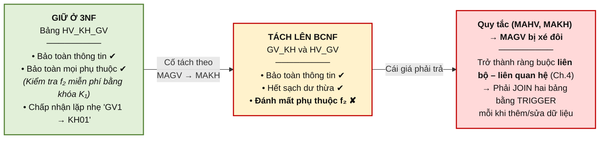

> **Kết luận thực hành.** Trong đa số dự án thực tế:
> 1. Nếu tách lên BCNF mà **không làm mất phụ thuộc hàm nào** *(như 4 bảng của Trung tâm ABC ở mục 5.9)*, ta đương nhiên nhận được cả BCNF.
> 2. Nếu rơi vào tình huống khóa chồng lấn như `HV_KH_GV` mà việc tách lên BCNF làm đứt phụ thuộc hàm, người thiết kế thường **chủ động dừng ở 3NF** *(giữ nguyên bảng `HV_KH_GV` với hai khóa `UNIQUE(MAHV, MAKH)` và `PRIMARY KEY(MAHV, MAGV)`)* để hệ quản trị kiểm tra ràng buộc tự động. Đó là minh chứng sống động cho nguyên tắc: **"Chuẩn cao hơn" không phải lúc nào cũng đồng nghĩa với "thiết kế tốt hơn"**.

### 5.10.2. Phụ thuộc đa trị (Multivalued Dependency)

Có một loại dư thừa kỳ lạ mà **ngay cả BCNF cũng không phát hiện được**, vì nó không sinh ra từ phụ thuộc hàm `X → Y` mà sinh ra từ việc **nhồi hai danh sách độc lập (hai mối quan hệ `1–N` độc lập) của cùng một thực thể vào chung một bảng**.

> **Ví dụ 5.19.** Phòng Nhân sự của Trung tâm ABC muốn lưu hai thông tin về giáo viên: *mỗi giáo viên dạy những lớp nào (`MALOP`)* và *có những chứng chỉ quốc tế nào (`CHUNGCHI`)*. Hai thông tin này **hoàn toàn độc lập với nhau**: chứng chỉ của cô Lê Hoa gắn với cá nhân cô, không liên quan gì tới việc học kỳ này cô dạy lớp `A1` hay `A2`.
>
> Nếu gom cả ba cột vào một bảng `GV_LOP_CC(MAGV, MALOP, CHUNGCHI)` *(đã ở 1NF vì mỗi ô chỉ ghi 1 lớp và 1 chứng chỉ)*, hãy xem dữ liệu buộc phải lưu như thế nào:
>
> | MAGV *(PK)* | MALOP *(PK)* | CHUNGCHI *(PK)* |
> |---|---|---|
> | GV1 | A1 | IELTS 8.0 |
> | GV1 | A1 | TESOL |
> | GV1 | A2 | IELTS 8.0 |
> | GV1 | A2 | TESOL |
>
> Cô `GV1` dạy **2 lớp** (`A1, A2`) và có **2 chứng chỉ** (`IELTS 8.0, TESOL`), nên bảng buộc phải ghi tổ hợp chéo **`2 × 2 = 4 dòng`**! Nếu cô dạy **5 lớp** và có **3 chứng chỉ**, bảng phải chứa **`5 × 3 = 15 dòng`**, trong khi lượng sự thật thực chất chỉ là `5 + 3 = 8` dòng thông tin.
>
> Điều đáng kinh ngạc: bảng `GV_LOP_CC` này **đã đạt BCNF**! Vì khóa duy nhất là cả bộ ba `(MAGV, MALOP, CHUNGCHI)` và trong bảng **không hề có bất kỳ phụ thuộc hàm không tầm thường nào** *(một giáo viên dạy nhiều lớp và có nhiều chứng chỉ)*, nên điều kiện BCNF thỏa mãn một cách hiển nhiên. Vậy mà dư thừa kiểu **"bùng nổ tích Descartes"** vẫn còn nguyên!

Để bắt được thủ phạm này, Ronald Fagin (1977) đưa ra khái niệm **phụ thuộc đa trị**.

> **Định nghĩa 5.19 (Phụ thuộc đa trị — Multivalued Dependency, MVD).** Cho lược đồ quan hệ `R` và ba tập thuộc tính rời nhau `X`, `Y`, `Z` sao cho `Z = R − X − Y`. Ta nói `Y` **phụ thuộc đa trị** vào `X`, ký hiệu **`X ↠ Y`** *(đọc là "`X` xác định đa trị `Y`")*, nếu trong mọi thể hiện hợp lệ của `R`: với mọi cặp bộ `t₁`, `t₂` có cùng giá trị trên `X` (`t₁[X] = t₂[X]`), luôn phải tồn tại bộ `t₃` trong `R` sao cho `t₃[X] = t₁[X]`, `t₃[Y] = t₁[Y]` và `t₃[Z] = t₂[Z]`.

Bỏ qua công thức ký hiệu, ý nghĩa thực tế của **`X ↠ Y`** trên bảng `R(X, Y, Z)` cực kỳ dễ hiểu:

> **`X ↠ Y` nghĩa là: với mỗi giá trị của `X`, tập hợp các giá trị `Y` đi kèm với `X` hoàn toàn độc lập với tập hợp các giá trị `Z` đi kèm với `X`** *(vì độc lập nên khi ghép chung vào một bảng, mọi giá trị `Y` của `X` phải nhân chéo với mọi giá trị `Z` của `X`)*.

**Hình 5.13. Phụ thuộc đa trị `MAGV ↠ MALOP` và `MAGV ↠ CHUNGCHI` — hai nhánh `1–N` độc lập gây bùng nổ tích**

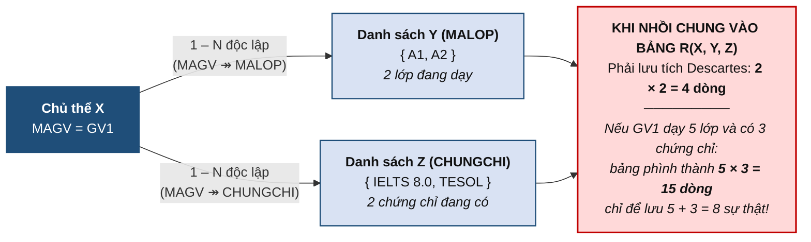

Ba tính chất cần nhớ về phụ thuộc đa trị:

1. **Tính đối xứng phần bù (luôn đi thành cặp):** Trong `R(X, Y, Z)`, nếu `X ↠ Y` thì bắt buộc cũng có **`X ↠ Z`** *(vì "`Y` độc lập với `Z` khi biết `X`" cũng chính là "`Z` độc lập với `Y` khi biết `X`")*. Người ta thường viết gộp là `X ↠ Y | Z`.
2. **Mọi phụ thuộc hàm đều là phụ thuộc đa trị:** Nếu `X → Y` thì `X ↠ Y` *(tập giá trị `Y` ứng với mỗi `X` khi ấy chỉ gồm đúng 1 phần tử)*.
3. **Phụ thuộc đa trị tầm thường:** `X ↠ Y` được gọi là *tầm thường* *(trivial)* nếu `Y ⊆ X` hoặc `X ∪ Y = R` *(tức phần còn lại `Z = ∅`, không có nhánh thứ hai để gây nhân chéo)*.

### 5.10.3. Dạng chuẩn 4 (4NF) và thuật toán tách

> **Định nghĩa 5.20 (Dạng chuẩn 4 — Fourth Normal Form, 4NF).** Lược đồ quan hệ `R` đạt **dạng chuẩn 4 (4NF)** nếu với **mọi phụ thuộc đa trị không tầm thường `X ↠ Y`** thỏa mãn trên `R`, vế trái **`X` luôn là một siêu khóa của `R`**.
> *(Vì mọi phụ thuộc hàm `X → A` cũng là một phụ thuộc đa trị `X ↠ A`, nên một bảng đạt 4NF thì tự động đạt BCNF).*

**Thuật toán tách lược đồ vi phạm về 4NF:**

```
LẶP cho tới khi mọi bảng con đều đạt 4NF:
    TÌM một bảng R có phụ thuộc đa trị không tầm thường  X ↠ Y
        mà X KHÔNG phải là siêu khóa của R.
    NẾU tìm thấy:
        Đặt  Z = R − X − Y
        Tách R thành hai bảng độc lập:
             R₁(X ∪ Y)    và    R₂(X ∪ Z)
```

> **Định lý 5.4 (Định lý Fagin về phép tách 4NF).** Phép tách lược đồ `R(X, Y, Z)` thành hai bảng `R₁(X ∪ Y)` và `R₂(X ∪ Z)` là **bảo toàn thông tin khi và chỉ khi** trong `R` thỏa mãn phụ thuộc đa trị **`X ↠ Y`** *(và `X ↠ Z`)*.

> **Ví dụ 5.20 — Tách bảng `GV_LOP_CC` ở Ví dụ 5.19 về 4NF.**
>
> - Trong `GV_LOP_CC(MAGV, MALOP, CHUNGCHI)`, ta có cặp phụ thuộc đa trị không tầm thường `MAGV ↠ MALOP` và `MAGV ↠ CHUNGCHI`, trong khi `MAGV` **không phải siêu khóa** *(khóa là cả 3 thuộc tính)*. Vậy bảng **vi phạm 4NF**.
> - Áp thuật toán tách với `X = {MAGV}`, `Y = {MALOP}`, `Z = {CHUNGCHI}`, ta tách thành **hai bảng độc lập đều đạt 4NF**:
>   - **`GV_LOP(MAGV, MALOP)`** *(lưu giáo viên dạy lớp nào)*;
>   - **`GV_CC(MAGV, CHUNGCHI)`** *(lưu giáo viên có chứng chỉ nào)*.
>
> | Bảng `GV_LOP` *(Đạt 4NF)* | MAGV *(PK)* | MALOP *(PK)* | | Bảng `GV_CC` *(Đạt 4NF)* | MAGV *(PK)* | CHUNGCHI *(PK)* |
> |---|---|---|---|---|---|---|
> | | GV1 | A1 | | | GV1 | IELTS 8.0 |
> | | GV1 | A2 | | | GV1 | TESOL |
>
> - **Hiệu quả:** Với giáo viên dạy 5 lớp và có 3 chứng chỉ, thay vì lưu `5 × 3 = 15 dòng` lặp chéo, hai bảng 4NF chỉ lưu đúng `5 + 3 = 8 dòng`. Quan trọng hơn: khi cô `GV1` thi thêm chứng chỉ thứ tư, ta chỉ cần `INSERT` **đúng 1 dòng** vào `GV_CC` *(thay vì phải chèn 5 dòng cho 5 lớp đang dạy)*.

Để khép lại phần lý thuyết các dạng chuẩn, bảng dưới đây tổng hợp toàn bộ hệ thống thang đo từ **1NF đến 4NF** trên cùng một mặt phẳng để người học dễ ôn tập.

**Bảng 5.33. Bảng tổng hợp toàn bộ thang đo các dạng chuẩn từ 1NF đến 4NF**

| Dạng chuẩn | Điều kiện cốt lõi | Loại dư thừa / Thủ phạm bị loại bỏ | Trong thực tế thường gặp khi nào? |
|:---:|---|---|---|
| **1NF** | Mọi ô đều chứa **giá trị nguyên tố (đơn trị)** | Thuộc tính đa trị, danh sách, nhóm cột lặp | Chuyển bảng tính Excel / biểu mẫu giấy sang bảng CSDL |
| **2NF** | Đạt 1NF + Không có thuộc tính không khóa **phụ thuộc bộ phận** vào khóa | `K₁ → A` với `K₁ ⊂ K` *(thuộc tính ăn theo một nửa khóa phức hợp)* | Bảng có khóa phức hợp `(A, B)` nhưng nhồi thêm tên của `A` hoặc tên của `B` |
| **3NF** | Đạt 2NF + Không có thuộc tính không khóa **phụ thuộc bắc cầu** vào khóa<br/>*(Mọi `X → A`: `X` là siêu khóa **hoặc** `A` là thuộc tính khóa)* | `K → Z → A` với `Z` ngoài khóa *(thực thể ẩn nằm ké trong bảng)* | Bảng lớp học nhồi thêm tên/trình độ giáo viên; bảng đơn hàng nhồi thêm tên/địa chỉ khách hàng |
| **BCNF** | Mọi phụ thuộc hàm không tầm thường `X → A` đều có **`X` là siêu khóa** | `X → A` mà `X` không phải siêu khóa nhưng `A` là thuộc tính khóa | Lược đồ có **nhiều khóa dự tuyển chồng lấn nhau** *(cân nhắc dừng ở 3NF nếu tách làm mất phụ thuộc)* |
| **4NF** | Đạt BCNF + Mọi phụ thuộc đa trị không tầm thường `X ↠ Y` đều có **`X` là siêu khóa** | **Phụ thuộc đa trị** `X ↠ Y | Z` *(bùng nổ tích Descartes `M × N` dòng)* | Nhồi hai danh sách `1–N` độc lập của cùng một chủ thể *(như Lớp dạy và Chứng chỉ)* vào chung một bảng |

*(Trên 4NF còn có **5NF — Project-Join Normal Form**, xử lý các ràng buộc kết nối phải tách thành 3 bảng trở lên mới không mất thông tin; trường hợp này rất hiếm trong thực tế và nằm ngoài phạm vi học phần).*

### 5.10.4. Phi chuẩn hóa (Denormalization)

Toàn bộ chương này hướng tới việc tách bảng để đạt chuẩn cao. Mục cuối cùng nói về kỹ thuật **cố ý đi ngược lại một cách có kiểm soát**.

> **Định nghĩa 5.21 (Phi chuẩn hóa — Denormalization).** **Phi chuẩn hóa** là kỹ thuật mà người thiết kế — **sau khi đã chuẩn hóa lược đồ về 3NF/BCNF** — chủ động **đưa một phần dư thừa dữ liệu có kiểm soát trở lại** *(bằng cách thêm cột tính sẵn như `SISO`, `TONGTIEN` hoặc gộp bớt bảng)* nhằm giảm số phép kết (`JOIN`) và **tăng tốc độ đọc cho các truy vấn nặng**.

Lý do rất thực tế: chuẩn hóa tách dữ liệu ra nhiều bảng để bảo vệ các thao tác thêm/sửa/xóa (`INSERT/UPDATE/DELETE`), nhưng lại bắt các truy vấn đọc (`SELECT`) phải ghép bảng (`JOIN`) nhiều hơn. Với hệ thống báo cáo phân tích chạy trên hàng chục triệu dòng, chi phí ghép 5–6 bảng mỗi lần xem báo cáo có thể làm nghẽn toàn hệ thống.

**Bảng 5.34. Bốn điều kiện bắt buộc để quyết định phi chuẩn hóa là hợp lý**

| Điều kiện | Vì sao bắt buộc phải có? |
|---|---|
| **1. Tải công việc đọc áp đảo ghi** *(đọc rất nhiều, sửa rất ít)* | Giảm thiểu xác suất xảy ra dị thường cập nhật |
| **2. Ngữ cảnh là kho dữ liệu (Data Warehouse) hoặc bảng báo cáo** | Mục tiêu ưu tiên là tốc độ tổng hợp số liệu, không phải xử lý giao dịch thời gian thực |
| **3. Đã đo đạc thực nghiệm thấy phép `JOIN` là nút thắt cổ chai** | Chỉ phi chuẩn hóa khi có số liệu đo hiệu năng cụ thể, không làm theo cảm tính |
| **4. Có cơ chế tự động giữ cho dữ liệu dư thừa luôn đồng bộ** | Phải cài đặt `TRIGGER`, `GENERATED COLUMN`, `MATERIALIZED VIEW` hoặc tiến trình đồng bộ định kỳ để cột dư thừa không bao giờ lệch với dữ liệu gốc |

> **Chú ý — Ranh giới giữa "phi chuẩn hóa chuyên nghiệp" và "thiết kế cẩu thả chưa chuẩn hóa".**
> Hai việc này nhìn kết quả có vẻ giống nhau *(trong bảng đều có cột dư thừa)*, nhưng bản chất trái ngược nhau hoàn toàn:
> - **Thiết kế cẩu thả** là **không biết chuẩn hóa**, để mặc dữ liệu lặp từ đầu và không biết có những dị thường nào đang rình rập.
> - **Phi chuẩn hóa** chỉ được làm **sau khi đã thiết kế xong lược đồ 3NF**, chỉ mở lại đúng một vài điểm dư thừa đã tính toán kỹ chi phí – lợi ích, có tài liệu ghi rõ lý do và có `TRIGGER` khóa chặt tính nhất quán.

Đến đây, câu hỏi treo suốt từ **mục 2.2.5** của Chương 2 và **mục 4.7.5** của Chương 4 — *thuộc tính dẫn xuất `SISO` trong bảng `LOP` nên lưu hay tính lại?* — đã có câu trả lời trọn vẹn ở cả ba tầng kiến thức:

| Chương | Góc nhìn | Câu trả lời cho cột `SISO` (sĩ số lớp) |
|---|---|---|
| **Chương 2** | Mô hình ý niệm (ER) | *"Nguyên tắc gốc là **không lưu thành cột vật lý**, vì `SISO` đếm được từ `GHIDANH`; lưu lại sẽ sinh dư thừa."* |
| **Chương 4** | Ràng buộc toàn vẹn | *"Nếu lưu `SISO`, bảng tầm ảnh hưởng của ràng buộc R6 có tới **5/6 ô mang dấu (+)** — cờ đỏ thiết kế báo hiệu phải viết 5 trigger, nên bỏ cột `SISO` và thay bằng `VIEW`."* |
| **Chương 5** | Chuẩn hóa & Phi chuẩn hóa | *"Với hệ thống giao dịch hằng ngày (OLTP) ít dòng, bỏ `SISO` để giữ 3NF thuần khiết là đúng. Nhưng nếu bảng `GHIDANH` có hàng chục triệu dòng và màn hình tra cứu lớp học được mở hàng nghìn lần mỗi phút, việc giữ cột `SISO` trong `LOP` kèm `TRIGGER` tự động cộng/trừ khi ghi danh chính là một **quyết định phi chuẩn hóa hợp lý**."* |

---

## 5.11. Khép lại học phần

### 5.11.1. Ba con đường, một đích đến

**Hình 5.14. Trực giác, bản vẽ, toán học — ba con đường cùng hội tụ về một thiết kế đúng**

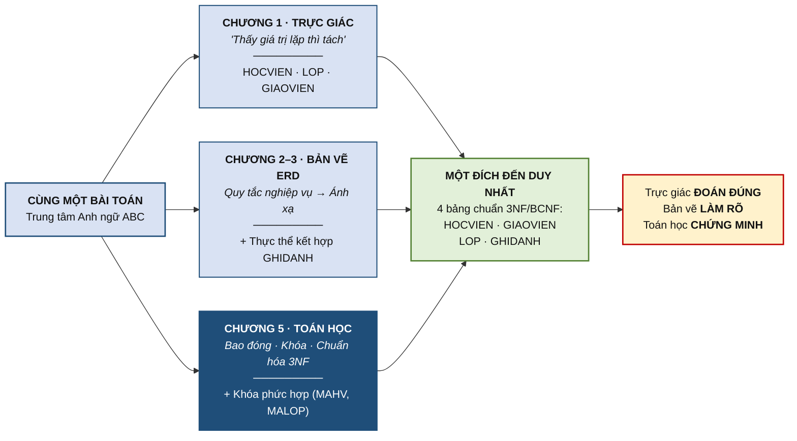

Ba con đường cho **cùng một kết quả** — nhưng khác biệt về đẳng cấp nghề nghiệp là rất lớn.

| | Chương 1 | Chương 5 |
|---|---|---|
| **Cơ sở tin tưởng** | Ta **tin** thiết kế đúng vì *"trông có vẻ ổn"* | Ta **chứng minh được** bằng toán học |
| **Nếu có người phản đối** | Không có gì để bảo vệ — cảm tính chọi cảm tính | Đưa chứng minh ra: đạt 3NF, tách bảo toàn thông tin, đã diệt đúng hai thủ phạm |
| **Khi bài toán lớn lên (40–100 bảng)** | Trực giác **thất bại** | Thuật toán **vẫn chạy chính xác** |

> **Đây chính là bước trưởng thành của một người thiết kế cơ sở dữ liệu: từ *"tôi nghĩ thế này đúng"* sang *"tôi chứng minh được thế này đúng"*.**

### 5.11.2. Ba dị thường của Chương 1 — kiểm chứng lần cuối

**Bảng 5.35. Ba dị thường của Chương 1 khi đặt lên lược đồ 3NF cuối cùng**

| Dị thường *(Chương 1)* | Trên lược đồ 3NF *(Mục 5.9.5)* | Kết quả |
|---|---|:--:|
| **Sửa**: cô Lê Hoa đổi tên hoặc trình độ chuyên môn | Nằm ở **đúng một dòng** trong `GIAOVIEN` → sửa một lần, **không thể** mâu thuẫn | Đã diệt |
| **Thêm**: mở lớp A3 chưa có học viên nào, hoặc tuyển giáo viên GV3 chưa nhận lớp | Thêm thẳng vào `LOP` hoặc `GIAOVIEN`, **không cần** dữ liệu giả | Đã diệt |
| **Xóa**: học viên cuối cùng của lớp nghỉ học | Xóa khỏi `GHIDANH`; thông tin lớp trong `LOP` và giáo viên trong `GIAOVIEN` **nguyên vẹn** | Đã diệt |

Cả ba đã bị loại bỏ — và lần này ta biết **chính xác vì sao**. Không phải mơ hồ *"vì ta tách bảng"* như câu trả lời của Chương 1, mà vì ta đã **diệt đúng hai thủ phạm**: phụ thuộc **bộ phận** *(2NF)* và phụ thuộc **bắc cầu** *(3NF)*.

### 5.11.3. Thu hồi mọi lời hẹn

Học phần đã treo lại nhiều lời hẹn từ Chương 1 đến Chương 4. Đây là chỗ trả hết.

**Bảng 5.36. Mọi lời hẹn suốt học phần và nơi giải quyết tại Chương 5**

| Lời hẹn | Treo ở | Trả tại |
|---|---|---|
| *"Chương 5 sẽ chuẩn hóa lại đúng bảng này bằng toán học, và ra đúng những bảng ta vừa đoán"* | mục 1.7 | **5.9** |
| *"Mỗi ô một giá trị đơn — sẽ được gọi tên chính thức ở Chương 5"* | mục 2.2.4 · 3.1.3 | **5.7.2** *(1NF)* |
| *"Thuộc tính dẫn xuất `SISO` sẽ được bàn lại dưới tên phi chuẩn hóa"* | mục 2.2.5 · 4.7.5 | **5.10.4** |
| *"Phụ thuộc hàm là quy tắc nghiệp vụ, Chương 5 sẽ dùng nó làm công cụ chuẩn hóa"* | mục 3.2.2 | **5.2** |
| *"Ràng buộc quá khó thường tố cáo thiết kế — ý này dẫn vào Chương 5"* | mục 4.7.5 | **5.8.3 · 5.10.1** |
| *"Bốn chương đều dựa vào cảm tính; Chương 5 cho công cụ chứng minh"* | Bảng 4.26 | **5.1 · 5.11** |

### 5.11.4. Hành trình năm chương

**Hình 5.15. Hành trình năm chương của học phần Cơ sở dữ liệu**

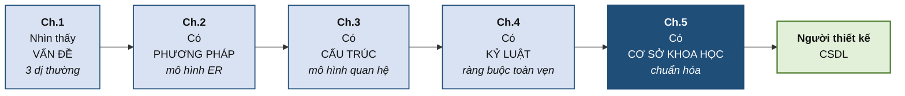

Học phần khép lại ở đây, nhưng công việc thì không. Điều học phần này trao cho người học không phải là một bộ quy tắc để học thuộc, mà là **một cách suy nghĩ**: trước khi lưu bất kỳ dữ liệu nào, hãy hỏi *"sự thật này thuộc về đâu, và nó có đang bị lưu ở hai chỗ không?"*

Bước tiếp theo là học phần **Hệ quản trị cơ sở dữ liệu**, nơi những lược đồ vừa thiết kế sẽ được cài đặt thật bằng SQL, cùng với các vấn đề mà học phần này đã hoãn lại: ngôn ngữ truy vấn nâng cao, an toàn — bảo mật, và quản lý giao dịch.

---

## TÓM TẮT CHƯƠNG

**Một cơ sở dữ liệu "tốt"** được định nghĩa bằng **bốn tiêu chí đo được**: không dư thừa, không dị thường, bảo toàn thông tin, bảo toàn phụ thuộc hàm. Ở mức **3NF**, ta luôn đạt được trọn vẹn cả bốn tiêu chí; khi đòi hỏi lên tới **BCNF**, đôi khi phải đánh đổi giữa tiêu chí 1 và tiêu chí 4.

**Ba loại phụ thuộc hàm**: đầy đủ *(vô hại)*, **bộ phận** *(vi phạm 2NF)*, **bắc cầu** *(vi phạm 3NF)*. Hai loại sau là **hai thủ phạm** gây dị thường. Tập `F` đến từ **quy tắc nghiệp vụ**, không phải từ dữ liệu mẫu.

**Hệ luật Armstrong** gồm ba luật gốc *(phản xạ, tăng trưởng, bắc cầu)* và ba luật dẫn xuất *(hợp, tách, bắc cầu giả)*. Nó **đúng đắn và đầy đủ**.

**Bao đóng `X⁺`** là tập mọi thuộc tính suy ra được từ `X` nhờ `F`, tính bằng thuật toán lăn quả cầu tuyết *(phải quét lặp nhiều vòng cho tới khi không thêm được thuộc tính mới)*. Ba công dụng thực hành: kiểm tra `X → Y` có suy ra được không (`Y ⊆ X⁺`), kiểm tra `X` có phải siêu khóa không (`X⁺ = R`), và kiểm tra hai tập phụ thuộc có tương đương không. **`X⁺` là một túi đựng các chữ cái; `F⁺` là một kho chứa các mũi tên.**

**Thuật toán tìm khóa** chia thuộc tính thành `TN` *(bắt buộc trong khóa)*, `TG` *(phải thử)*, `TĐ` *(không bao giờ trong khóa)*. Tìm **tất cả** khóa bằng cách duyệt `2^|TG|` tập con, với **mẹo rút gọn**: đã là siêu khóa thì mọi tập cha đều không tối thiểu, loại luôn.

**Phủ tối thiểu** thỏa mãn ba điều kiện: vế phải một thuộc tính, không thừa thuộc tính vế trái, không thừa phụ thuộc. **Thứ tự ba bước là bắt buộc.**

**Ba dạng chuẩn cơ bản**: **1NF** *(mọi ô chứa giá trị đơn)*, **2NF** *(đạt 1NF + không có phụ thuộc bộ phận vào khóa)*, **3NF** *(đạt 2NF + không có phụ thuộc bắc cầu — tức với mọi `X → A`, hoặc `X` là siêu khóa hoặc `A` là thuộc tính khóa)* — tóm tắt bằng câu *"the key, the whole key, and nothing but the key"*.

**Phép tách lược đồ** phải thỏa hai tiêu chuẩn: ① **Bảo toàn thông tin** *(không sinh **bộ giả** — điều kiện cần và đủ cho phép tách đôi là `(R₁ ∩ R₂)` phải là siêu khóa của `R₁` hoặc `R₂`)*; ② **Bảo toàn phụ thuộc hàm** *(mọi quy tắc nghiệp vụ vẫn kiểm tra được mà không cần `JOIN` bảng)*. **Quy tắc vàng:** luôn tách bảng theo một phụ thuộc hàm `X → Y` có trong `F`.

**Quy trình chuẩn hóa 5 bước** từ bảng phẳng về 3NF: ① Đưa về 1NF & lập tập `F` → ② Tìm tất cả khóa (`TN–TG`) & phân loại thuộc tính khóa/không khóa → ③ Chẩn đoán bằng bảng hai câu hỏi → ④ Tách khử phụ thuộc bộ phận lên 2NF → ⑤ Tách khử phụ thuộc bắc cầu lên 3NF và kiểm chứng bảo toàn.

**Các dạng chuẩn mức cao và phi chuẩn hóa**: **BCNF** đòi hỏi mọi vế trái `X` đều phải là siêu khóa *(bỏ quyền miễn trừ "`A` là thuộc tính khóa" của 3NF)*, nhưng khi có nhiều khóa chồng lấn thì việc tách lên BCNF có thể làm đứt phụ thuộc hàm — nên thực tế thường dừng ở 3NF. **Phụ thuộc đa trị `X ↠ Y`** gây bùng nổ tích ngay cả khi bảng đã đạt BCNF; **4NF** loại bỏ nó bằng phép tách luôn bảo toàn thông tin *(định lý Fagin)*. **Phi chuẩn hóa** là cố ý đưa dư thừa có kiểm soát trở lại để đổi lấy tốc độ đọc — chỉ làm **sau khi đã chuẩn hóa** và phải có cơ chế đồng bộ dữ liệu.

---

## ĐÁP ÁN TỰ KIỂM TRA

**Tự kiểm tra 5.2.** *(1)* `TENLOP` phụ thuộc vào `MALOP` — nửa khóa còn lại — nên cũng là **bộ phận**; "Anh cơ bản 1" chép lặp ở mọi dòng có `MALOP = A1` *(HV01 và HV02)*. *(2)* **Không có hại**: `CCCD` là khóa dự tuyển của `HOCVIEN` *(mỗi công dân một số)*, nên vi phạm điều kiện "`Z` không phải khóa"; không cần tách. *(3)* **Không**. `F` phải rút từ nghiệp vụ: hai lượt ghi danh hoàn toàn có thể cùng mức học phí, chỉ tình cờ dữ liệu hiện tại chưa có.

**Tự kiểm tra 5.3.** *(1)* Bước (2): **luật tăng trưởng** *(áp cho bước 1 với `C`)*; bước (4): **luật bắc cầu** *(giữa bước 2 và bước 3)*; bước (6): **luật bắc cầu** *(giữa bước 4 và bước 5)*. Các bước (1)–(4) có thể gộp ngay thành một bước bằng **luật bắc cầu giả** *(từ `A → B` và `BC → D` suy ra `AC → D` với `W = C`)*. *(2)* Bảng 8 bước: *(1)* `A → BC` (giả thiết); *(2)* `A → B` (tách 1); *(3)* `A → C` (tách 1); *(4)* `B → D` (giả thiết); *(5)* `A → D` (bắc cầu 2, 4); *(6)* `A → CD` (hợp 3, 5); *(7)* `CD → E` (giả thiết); *(8)* `A → E` (bắc cầu 6, 7). *(3)* Với `X → YZ`, ta có `YZ → Y` theo **luật phản xạ** *(vì `Y ⊆ YZ`)*, nên bắc cầu `X → YZ → Y` cho `X → Y`. Ngược lại, với `XY → Z`, muốn bắc cầu từ `X` sang `XY` thì phải có `X → XY`, mà `XY` không phải tập con của `X` nên luật phản xạ không áp dụng được. Trên `GHIDANH(MAHV, MALOP, HOCPHI)`, cả cặp `(MAHV, MALOP) → HOCPHI` là đúng, nhưng một mình `MAHV → HOCPHI` là sai vì một học viên `HV01` đăng ký hai lớp `A1`, `A2` có hai mức học phí khác nhau.

**Tự kiểm tra 5.4.** *(1)* `(CD)⁺`: khởi tạo `{C, D}` → `CD → A` thêm `A` → `A → B` thêm `B` → `B → C` không đổi → vòng 2 không đổi → `{A, B, C, D}`. `C⁺`: `A → B` không áp *(A ∉)*, `B → C` không áp, `CD → A` không áp *(thiếu D)* → `{C}`. *(2)* `C → B` suy ra được khi và chỉ khi `B ∈ C⁺ = {C}` → **không**. *(3)* Không sai về lý thuyết nhưng **không khả thi**: `F⁺` cỡ hàm mũ; câu hỏi chỉ cần một bao đóng `C⁺` gồm một thuộc tính.

**Tự kiểm tra 5.5.** *(1)* Vế trái: `A, B, C, D`; vế phải: `B, D, E` → `TN = {A, C}`, `TG = {B, D}`, `TĐ = {E}`. *(2)* `(AC)⁺`: `A → B` → `{A, C, B}`; `BC → D` → `{A, B, C, D}`; `D → E` → toàn bộ. `(TN)⁺` phủ hết ⟹ **`AC` là khóa duy nhất**, không cần thử tập con nào của `TG`. *(3)* `E` thuộc `TĐ` — chỉ ở vế phải — luôn suy ra được từ `D`; đưa `E` vào chỉ làm khóa thừa, vi phạm tính tối thiểu.

**Tự kiểm tra 5.6–5.7.** *(1)* `A → C` thừa: tạm bỏ nó, `A⁺ = {A, B, C}` *(nhờ `A → B` rồi `B → C`)* vẫn chứa `C`. *(2)* Đạt **2NF** *(khóa đơn nên không có bộ phận)* nhưng **vi phạm 3NF**: thủ phạm `MALOP → MAGV → HOTEN_GV`, `MAGV` không phải khóa. Dạng chuẩn cao nhất: 2NF. *(3)* Chỉ đạt **1NF**: `MAHV → HOTEN` là phụ thuộc **bộ phận**. Sửa: tách `HOCVIEN(MAHV, HOTEN)` ra, còn lại `GHIDANH(MAHV, MALOP, HOCPHI)` đạt 3NF.

**Tự kiểm tra 5.8.** *(1)* **Không**. Thuộc tính chung `HOCPHI` không phải khóa của bảng con nào *(nhiều học viên cùng mức phí, nhiều lớp cùng mức phí)*; hai học viên cùng đóng 2.000.000 cho hai lớp khác nhau sẽ ghép ra bộ giả. *(2)* Thuộc tính chung `MAGV` là khóa của `(MAGV, HOTEN_GV)` → **bảo toàn thông tin**; `MALOP → TENLOP, MAGV` nằm trọn trong bảng một, `MAGV → HOTEN_GV` nằm trọn trong bảng hai → **bảo toàn phụ thuộc hàm**. Đây chính là phép tách ở mục 5.9.5. *(3)* Tách `R` theo `X → Y` thành `R1(X ∪ Y)` và `R2(R − Y)` thì thuộc tính chung là `X`, mà `X → Y` nghĩa là `X` xác định mọi thuộc tính của `R1` → `X` là siêu khóa của `R1` → Định lý 5.1 thỏa.

---

## CÂU HỎI ÔN TẬP

1. Nêu **bốn tiêu chí** của một cơ sở dữ liệu "tốt". Hai tiêu chí nào đôi khi **không thể đạt cùng lúc** khi đòi hỏi chuẩn hóa lên tới BCNF?
2. Vì sao nói *"chuẩn hóa không phải để tiết kiệm dung lượng"*? Vậy mục đích thật sự là gì?
3. Phân biệt phụ thuộc **đầy đủ**, **bộ phận**, **bắc cầu**. Vì sao hai loại sau gây hại?
4. Trong định nghĩa phụ thuộc bắc cầu `K → Z → Y`, vì sao điều kiện *"`Z` không phải khóa"* là **bắt buộc**?
5. Nêu ba luật gốc và ba luật dẫn xuất của Armstrong. Vì sao luật phản xạ tuy hiển nhiên nhưng vẫn cần thiết? Trình bày cách chứng minh luật hợp, luật tách và luật bắc cầu giả từ ba luật gốc.
6. Trình bày thuật toán tính `X⁺` và ba công dụng thực hành của nó. Điểm dễ sai nhất khi tính `X⁺` bằng tay là gì?
7. Phân biệt `F⁺` và `X⁺` cả về bản chất phần tử lẫn kích thước. Vì sao toàn bộ lý thuyết chuẩn hóa được xây trên `X⁺` chứ không phải `F⁺`?
8. Giải thích vì sao thuộc tính thuộc `TN` **bắt buộc** có trong mọi khóa, còn thuộc tính thuộc `TĐ` thì **không bao giờ**.
9. Vì sao phải tìm **tất cả** khóa dự tuyển chứ không chỉ tìm một khóa trước khi xét 2NF và 3NF?
10. Trình bày **mẹo rút gọn** khi tìm tất cả khóa. Mẹo này dựa trên tính chất nào của bao đóng?
11. Nêu ba điều kiện của phủ tối thiểu. Vì sao **thứ tự ba bước** trong thuật toán là bắt buộc?
12. Phát biểu 1NF, 2NF, 3NF và trình bày quy trình 4 bước xác định dạng chuẩn cao nhất của một lược đồ. Giải thích câu *"the key, the whole key, and nothing but the key"*.
13. **Bộ giả** là gì? Vì sao nó **nguy hiểm hơn** việc mất dữ liệu?
14. Phát biểu điều kiện bảo toàn thông tin (Định lý 5.1). Vì sao *"luôn tách theo phụ thuộc hàm"* thì điều kiện tự động thỏa mãn?
15. Vì sao **mất bảo toàn phụ thuộc hàm** lại là điều đáng lo? Liên hệ với Chương 4.
16. So sánh **3NF** và **BCNF**. Vì sao thực hành thường **dừng ở 3NF** khi lược đồ có hai khóa chồng lấn như `HV_KH_GV`?
17. Cho một bảng **đã đạt BCNF** nhưng vẫn dư thừa. Nguyên nhân là gì và khắc phục thế nào?
18. Khi nào **phi chuẩn hóa** là hợp lý? Vì sao nó khác với thiết kế cẩu thả?

**Gợi ý trả lời một số câu**

*Câu 7.* `F⁺` là tập **mọi phụ thuộc hàm (mũi tên)** suy ra được từ `F` — kích thước **hàm mũ** (chỉ 3 thuộc tính đã có thể lên tới 35 phụ thuộc), thực tế không tính nổi. `X⁺` là tập **mọi thuộc tính (chữ cái)** suy ra được từ `X` — kích thước không quá số thuộc tính của `R`, tính rất nhanh sau vài vòng quét. Mọi câu hỏi tưởng như cần `F⁺` đều quy được về việc tính vài bao đóng `X⁺`; đó là đóng góp thực dụng lớn nhất của khái niệm bao đóng.

*Câu 10.* Mẹo: duyệt các tập con của `TG` theo **kích thước tăng dần**; nếu `TN ∪ Xᵢ` đã là siêu khóa thì **mọi tập cha** của `Xᵢ` chắc chắn không tối thiểu, loại luôn không cần tính bao đóng. Mẹo dựa trên **tính đơn điệu** của bao đóng: thêm thuộc tính vào `X` thì `X⁺` chỉ có thể lớn lên.

*Câu 13.* **Bộ giả** là bộ xuất hiện khi ghép các bảng con nhưng **không có trong quan hệ gốc**. Nguy hiểm hơn mất dữ liệu vì: mất dữ liệu thì người dùng **biết mình thiếu** và đi tìm; còn bộ giả khiến hệ thống trả về **nhiều hơn sự thật**, mọi dòng đều trông hợp lệ, và **không ai biết dòng nào bịa**.

*Câu 15.* Nếu một phụ thuộc hàm bị xé ra hai bảng, thì để kiểm tra nó hệ quản trị phải **ghép hai bảng mỗi lần có thao tác** — tức ràng buộc ấy trở thành loại **liên bộ liên quan hệ**, loại khó nhất trong Bảng 4.6 của Chương 4, phải viết trigger. Nói gọn: **mất bảo toàn phụ thuộc hàm nghĩa là biến một ràng buộc dễ thành một ràng buộc khó.**

*Câu 17.* Nguyên nhân là **phụ thuộc đa trị**: bảng chứa **hai danh sách độc lập** gắn với cùng một chủ thể, gây **bùng nổ tích**. BCNF không phát hiện được vì bảng có thể không có phụ thuộc hàm không tầm thường nào. Khắc phục: tách về **4NF** — tách `R` thành `X ∪ Y` và `X ∪ Z`; theo định lý Fagin phép tách này luôn bảo toàn thông tin.

---

## BÀI TẬP CHƯƠNG

### Mức A — Nhận biết và tái hiện

**Bài A1.** Cho `R(A,B,C,D,E)` và `F = {A → B, BC → D, D → E}`. Tính `(AC)⁺` và `(BD)⁺`, ghi rõ từng vòng lặp.

**Bài A2.** Với mỗi phát biểu, cho biết đúng hay sai và giải thích: (a) mọi quan hệ đạt 3NF đều đạt 2NF; (b) mọi quan hệ đạt BCNF đều đạt 3NF; (c) nếu khóa chỉ gồm một thuộc tính thì quan hệ luôn đạt 2NF; (d) nếu mọi thuộc tính đều là thuộc tính khóa thì quan hệ luôn đạt 3NF; (e) mọi quan hệ đạt BCNF đều đạt 4NF.

**Bài A3.** Cho `F = {AB → C, A → D, D → B}`. Xác định `TN`, `TG`, `TĐ` cho `R(A,B,C,D)`.

**Bài A4.** Cho lược đồ `R(A, B, C, D, E)` và tập phụ thuộc hàm `F = {A → B, B → C, CD → E}`.
a) Dùng hệ luật dẫn Armstrong *(được dùng cả sáu luật)* để chứng minh `A → AC` và `AD → E`.
b) Chứng minh lại `AD → E` nhưng **chỉ dùng ba luật gốc** *(phản xạ, tăng trưởng, bắc cầu)*.
c) Một bạn viết: *"Từ `CD → E`, áp dụng luật tách ta suy ra `C → E` và `D → E`"*. Bạn ấy đúng hay sai? Giải thích.

### Mức B — Vận dụng

**Bài B1.** Cho `R(A,B,C,D,E)` và `F = {AB → C, C → D, D → A, B → E}`.
a) Xác định `TN`, `TG`, `TĐ`.
b) Tìm **tất cả** khóa, trình bày bảng duyệt đầy đủ và chỉ rõ chỗ áp **mẹo rút gọn**.
c) Xác định thuộc tính khóa và thuộc tính không khóa.
d) Xác định **dạng chuẩn cao nhất** mà `R` đạt được, có chứng minh.

**Bài B2.** Cho `F = {A → BC, CD → E, B → D, E → A}`. Tìm **phủ tối thiểu**, trình bày đủ ba bước.

**Bài B3.** Cho bảng phẳng của một **hiệu sách**:

`DONHANG(MADH, NGAYDAT, MAKH, TENKH, SDT_KH, MASP, TENSP, DONGIA, SOLUONG)`

với các quy tắc nghiệp vụ: mỗi đơn hàng có một ngày đặt và một khách hàng; mỗi khách hàng có một tên và một số điện thoại; mỗi sản phẩm có một tên và một đơn giá; mỗi dòng đơn hàng ghi số lượng của một sản phẩm trong một đơn.

a) Viết tập phụ thuộc hàm `F`.
b) Tìm tất cả khóa.
c) Chẩn đoán dạng chuẩn, chỉ đích danh các phụ thuộc **bộ phận** và **bắc cầu**.
d) Chuẩn hóa về **3NF**, trình bày từng bước.
e) **Chứng minh** mọi phép tách đều bảo toàn thông tin.

**Bài B4.** Dùng lược đồ **thư viện** đã làm ở các chương trước:
a) Viết tập phụ thuộc hàm `F` từ các quy tắc nghiệp vụ.
b) Kiểm tra từng bảng xem đã đạt 3NF chưa.
c) Nếu có bảng chưa đạt, chuẩn hóa và giải thích.

**Bài B5.** Cho lược đồ `R(A, B, C, D, E, G, H)` và tập phụ thuộc hàm `F = {AB → C, B → D, CD → E, CE → GH, G → A}`. Bằng hệ luật dẫn Armstrong, hãy lập bảng suy diễn từng bước để chứng minh:
a) `B → E` *(gợi ý: dùng `B → D` để rút gọn vế trái của `CD → E`, hoặc dùng bắc cầu giả — từ đó chứng minh `BC → E` rồi suy tiếp — hãy kiểm tra xem một mình `B → E` hay `BC → E` mới đúng!)*.
b) `AB → E` và `AB → G`.
c) `BC → H` và `BC → A`.
*(Hướng dẫn câu a: `B⁺ = {B, D}` không chứa `E`, nên một mình `B → E` **không** suy ra được vì thiếu `C`; phụ thuộc suy ra được từ `B → D` và `CD → E` bằng luật bắc cầu giả là **`BC → E`**).*

### Mức C — Nâng cao

**Bài C1.** Cho `R(A,B,C)` và `F = {AB → C, C → B}`.
a) Tìm tất cả khóa.
b) Chứng minh `R` đạt **3NF** nhưng **không đạt BCNF**.
c) Tách về BCNF và chỉ ra **phụ thuộc hàm nào bị mất**.
d) Liên hệ với Định lý 5.3 và giải thích vì sao trường hợp này nên **dừng ở 3NF**.

**Bài C2.** Cho quan hệ `NHANVIEN_KYNANG_NGOAINGU(MANV, KYNANG, NGOAINGU)` trong đó kỹ năng và ngoại ngữ của một nhân viên **độc lập với nhau**.
a) Với một nhân viên có 4 kỹ năng và 3 ngoại ngữ, bảng phải chứa bao nhiêu dòng?
b) Bảng này có đạt BCNF không? Giải thích.
c) Chỉ ra các phụ thuộc đa trị và **tách về 4NF**.
d) Sau khi tách, cần bao nhiêu dòng? Tính tỷ lệ tiết kiệm.

**Bài C3.** Một hệ thống thương mại điện tử lưu bảng `DONHANG` đã chuẩn hóa 3NF. Bộ phận báo cáo phàn nàn rằng truy vấn *"doanh thu theo tháng theo danh mục sản phẩm"* phải ghép 5 bảng và chạy mất 40 giây.
a) Đề xuất một phương án **phi chuẩn hóa** cụ thể.
b) Chỉ ra **dư thừa** mà phương án ấy tạo ra và **dị thường** có thể phát sinh.
c) Đề xuất **cơ chế bảo đảm** dữ liệu dư thừa luôn khớp.
d) Nêu **điều kiện** để phương án này chấp nhận được, đối chiếu Bảng 5.34.

**Bài C4** *(tự chọn).* Tìm hiểu về **dạng chuẩn 5 (5NF)** hay *dạng chuẩn nối*. Cho một ví dụ về quan hệ phải tách thành **ba bảng** mới bảo toàn thông tin, và giải thích vì sao tách thành hai bảng là không đủ.

---

## TÀI LIỆU THAM KHẢO CỦA CHƯƠNG

**[1]** Tô Văn Nam (2005). *Giáo trình cơ sở dữ liệu*. NXB Giáo dục — chương về lý thuyết thiết kế cơ sở dữ liệu quan hệ; phụ thuộc hàm, bao đóng, thuật toán tìm khóa, các dạng chuẩn.

**[2]** Vũ Đức Thi (1997). *Cơ sở dữ liệu — kiến thức và thực hành*. NXB Thống kê — hệ luật dẫn Armstrong, phủ tối thiểu, phép tách lược đồ và các thuật toán.

**[3]** Coronel, C. & Morris, S. *Database Systems: Design, Implementation & Management*. Cengage Learning — **Chapter 6** (*Normalization of Database Tables*): quy trình chuẩn hóa 1NF–3NF, BCNF, 4NF, phụ thuộc đa trị, phi chuẩn hóa và các điều kiện áp dụng, danh mục kiểm tra mô hình hóa dữ liệu.

**Hướng dẫn tự học.** Chương này **chỉ nắm được qua luyện tập** — đọc suông không đủ. Trình tự khuyến nghị: làm hết Bài A4 *(luật Armstrong)* và Bài A1 *(bao đóng)* trước khi đọc mục 5.5; làm Bài B1 *(tìm tất cả khóa và xét dạng chuẩn)* sau khi đọc mục 5.7; làm Bài B3 *(chuẩn hóa hiệu sách theo mẫu Bài tập mẫu 5.8)* sau khi đọc xong mục 5.9. Hai tiểu mục **5.10.2–5.10.3** *(phụ thuộc đa trị và 4NF)* được viết đủ chi tiết để tự đọc nếu lớp không kịp giảng; kèm Bài C2 để tự kiểm tra.

---

## PHỤ LỤC 5A. GỢI Ý TỔ CHỨC DẠY HỌC

*Phần này dành cho giảng viên, không thuộc nội dung bắt buộc của người học.*

### 5A.1. Hoạt động nhóm — *"Bệnh viện lược đồ"*

*(nhóm 4–5 người, 40 phút — thu thập minh chứng CLO1 và CLO3)*

Tổ chức theo ba vai: **chẩn đoán → điều trị → tái khám**.

Phát cho mỗi nhóm một lược đồ "bệnh" — một bảng phẳng kèm tập phụ thuộc hàm, có cài sẵn cả phụ thuộc bộ phận lẫn bắc cầu. Nhóm phải: ① **chẩn đoán** — tìm khóa, xác định dạng chuẩn, chỉ đích danh thủ phạm; ② **điều trị** — tách về 3NF; ③ **tái khám** — chứng minh phép tách bảo toàn thông tin và kiểm tra lại dạng chuẩn của từng bảng con.

Sau đó **đổi bài chéo**: mỗi nhóm nhận bài của nhóm khác và đóng vai *bác sĩ hội chẩn* — kiểm tra xem chẩn đoán có đúng không, có bỏ sót thủ phạm nào không.

Cách tổ chức này rèn đúng ba tiêu chí đầu của Rubric 3, và ẩn dụ y học giúp người học nhớ trình tự làm bài.

### 5A.2. Hoạt động cá nhân — chạy tay thuật toán

*(20 phút)*

Chia làm hai lượt. **Lượt một** *(10 phút)*: mỗi người tính một bao đóng `X⁺` với `F` cho sẵn, **bắt buộc ghi từng vòng lặp** — không được ghi kết quả suông. **Lượt hai** *(10 phút)*: tìm tất cả khóa của một lược đồ có `|TG| = 3`, lập bảng duyệt 8 dòng.

Điểm cần dẫn dắt ở lượt một là những người **chỉ quét `F` một lượt** và bỏ sót thuộc tính dính vào ở vòng sau. Điểm cần dẫn dắt ở lượt hai là những người **quên bước lọc tính tối thiểu** và báo cả siêu khóa thừa là khóa.

### 5A.3. Thảo luận cả lớp — *"Chuẩn hơn có tốt hơn không?"*

*(15 phút)*

Sau khi giảng xong mục 5.10.1, đặt câu hỏi: *"Nếu BCNF chặt hơn 3NF, vì sao trong thực tế người ta lại thường dừng ở 3NF?"*

Dẫn dắt để cả lớp nhận ra sự đánh đổi: leo lên BCNF có thể **xé một phụ thuộc hàm ra hai bảng**, biến một ràng buộc dễ thành ràng buộc **liên bộ liên quan hệ** phải viết trigger — đúng loại khó nhất đã học ở Chương 4.

Câu hỏi chốt, mở rộng ra ngoài môn học: *"Còn ở đâu trong nghề nghiệp mà 'chuẩn hơn' lại không đồng nghĩa với 'tốt hơn'?"*

### 5A.4. Ứng dụng thực tế

Với mỗi hệ thống dưới đây, đặt câu hỏi *"hệ thống này nên chuẩn hóa tới đâu, và vì sao?"*: hệ thống ngân hàng lõi *(giao dịch, đọc ghi liên tục)*; kho dữ liệu báo cáo bán hàng *(đọc nhiều, nạp lại hàng đêm)*; ứng dụng ghi nhật ký cảm biến *(ghi rất nhiều, gần như không sửa)*; hệ thống quản lý đào tạo của trường.

Cặp **ngân hàng lõi** và **kho dữ liệu báo cáo** đáng dùng nhất vì chúng nằm ở hai đầu đối lập: một bên bắt buộc chuẩn hóa cao vì tính đúng đắn là tối thượng, một bên phi chuẩn hóa là hợp lý vì mục đích là tổng hợp nhanh trên dữ liệu chỉ đọc.

### 5A.5. Phiếu phản hồi một phút

*(cuối buổi, ẩn danh)*

1. Trong buổi học hôm nay, khái niệm nào bạn thấy **khó hiểu nhất**?
2. Nêu **một câu** tóm tắt điều bạn nhớ nhất.

Kinh nghiệm cho thấy ba chỗ hay được nêu nhất là **phân biệt `F⁺` với `X⁺`**, **bước lọc tính tối thiểu khi tìm tất cả khóa**, và **phụ thuộc đa trị**. Với chỗ thứ nhất, câu *"`F⁺` là tập các mũi tên, `X⁺` là tập các chữ cái"* kèm Ví dụ 5.7 đếm thử 35 mũi tên so với 3 chữ cái thường đủ để gỡ. Với chỗ thứ ba, nên đi thẳng vào **bảng dữ liệu bùng nổ tích** ở Ví dụ 5.19 — nhìn thấy 15 dòng cho 8 sự kiện là hiểu ngay.

---

## DANH MỤC HÌNH (Chương 5)

| Hình | Tên hình | Mục |
|---|---|---|
| Hình 5.1 | Bốn chương hội tụ về Chương 5 | 5.1.1 |
| Hình 5.2 | Phụ thuộc bộ phận — phép loại suy ổ khóa hai chìa | 5.2.3 |
| Hình 5.3 | Phụ thuộc bắc cầu — phải đi hai chặng | 5.2.4 |
| Hình 5.4 | Thuật toán tính bao đóng `X⁺` — phép loại suy lăn quả cầu tuyết trên lược đồ Trung tâm ABC | 5.4.2 |
| Hình 5.5 | Ba nhóm thuộc tính — và vì sao phân nhóm | 5.5.1 |
| Hình 5.6 | Lưới tám tập con của `TG = {A, B, C}` — ba siêu khóa ở tầng 1 chặn toàn bộ các tầng trên | 5.5.5 |
| Hình 5.7 | Thuật toán tìm phủ tối thiểu — phải làm đúng thứ tự | 5.6.3 |
| Hình 5.8 | Cây quyết định xác định dạng chuẩn trong phạm vi 1NF – 2NF – 3NF | 5.7.6 |
| Hình 5.9 | Nghịch lý bộ giả — không mất dòng nào mà vẫn mất sự thật | 5.8.1 |
| Hình 5.10 | Sơ đồ quy trình chuẩn hóa từng bước từ bảng phẳng `GHIDANH_PHANG` về 4 bảng đạt 3NF | 5.9.5 |
| Hình 5.11 | Mở rộng cây quyết định từ 3NF lên BCNF | 5.10.1 |
| Hình 5.12 | Sự đánh đổi giữa 3NF và BCNF khi có hai khóa chồng lấn — "Leo cao hơn chưa chắc tốt hơn" | 5.10.1 |
| Hình 5.13 | Phụ thuộc đa trị `MAGV ↠ MALOP` và `MAGV ↠ CHUNGCHI` — hai nhánh `1–N` độc lập gây bùng nổ tích | 5.10.2 |
| Hình 5.14 | Trực giác, bản vẽ, toán học — ba con đường cùng hội tụ về một thiết kế đúng | 5.11.1 |
| Hình 5.15 | Hành trình năm chương của học phần Cơ sở dữ liệu | 5.11.4 |

## DANH MỤC BẢNG (Chương 5)

| Bảng | Tên bảng | Mục |
|---|---|---|
| Bảng 5.1 | Bốn chương — căn cứ ra quyết định | 5.1.1 |
| Bảng 5.2 | Bốn tiêu chí — công cụ kiểm tra tương ứng | 5.1.2 |
| Bảng 5.3 | Ba loại phụ thuộc hàm | 5.2.1 |
| Bảng 5.4 | Phụ thuộc bộ phận nhìn trên dữ liệu — `GHIDANH_MORONG` với khóa `(MAHV, MALOP)` | 5.2.3 |
| Bảng 5.5 | Phụ thuộc bắc cầu nhìn trên dữ liệu — `LOP` với khóa `MALOP` | 5.2.4 |
| Bảng 5.6 | Ba luật gốc và ba luật dẫn xuất | 5.3.2 |
| Bảng 5.7 | Chứng minh ba luật dẫn xuất từ ba luật gốc của Armstrong | 5.3.2 |
| Bảng 5.8 | Sáu luật, mỗi luật một ví dụ tại ABC | 5.3.2 |
| Bảng 5.9 | Ba ngụy biện thường gặp khi suy diễn bằng luật Armstrong | 5.3.4 |
| Bảng 5.10 | Dữ liệu `GHIDANH_MORONG` bác bỏ cả ba ngụy biện suy diễn | 5.3.4 |
| Bảng 5.11 | Bảng vết từng bước tính `(MAHV, MALOP)⁺` khớp với Hình 5.4 | 5.4.2 |
| Bảng 5.12 | Tính `A⁺` với `F = {B → C, A → B}` trên `R(A, B, C)` — quét một lượt thì sót, hai vòng mới đủ | 5.4.2 |
| Bảng 5.13 | Tóm tắt ba câu hỏi lớn quy về phép tính bao đóng — minh họa trên `R(A, B, C, D)`, `F = {A → B, B → C, CD → A}` | 5.4.4 |
| Bảng 5.14 | Đối chiếu trực diện `X⁺` và `F⁺` | 5.4.5 |
| Bảng 5.15 | Phân nhóm bảy thuộc tính của `GHIDANH_PHANG` — gạch vế trái, gạch vế phải | 5.5.1 |
| Bảng 5.16 | Tổng hợp cách phân loại thuộc tính khóa và không khóa của Ví dụ 5.10 | 5.7.1 |
| Bảng 5.17 | Minh họa Dạng chuẩn 1 (1NF) — Trước và Sau khi khử ô đa giá trị | 5.7.2 |
| Bảng 5.18 | Minh họa Dạng chuẩn 2 (2NF) — Trước và Sau khi khử phụ thuộc bộ phận | 5.7.3 |
| Bảng 5.19 | Minh họa Dạng chuẩn 3 (3NF) — Trước và Sau khi khử phụ thuộc bắc cầu | 5.7.4 |
| Bảng 5.20 | Bảng chẩn đoán bằng "hai câu hỏi" cho ba lược đồ của Ví dụ 5.14 | 5.7.5 |
| Bảng 5.21 | Bảng vàng tổng hợp ba dạng chuẩn 1NF, 2NF, 3NF — điều kiện, thủ phạm bị diệt và cách sửa | 5.7.6 |
| Bảng 5.22 | Tách sai `R` theo `MAGV` — không mất dòng nào, nhưng ghép lại sinh ra hai bộ giả | 5.8.1 |
| Bảng 5.23 | Tách đúng `R` theo `MALOP` — ghép lại thu được đúng 3 dòng gốc, không có bộ giả | 5.8.2 |
| Bảng 5.24 | Phép tách bảo toàn thông tin nhưng đánh mất phụ thuộc hàm `MAGV → HOTEN_GV` | 5.8.3 |
| Bảng 5.25 | Tổng quan quy trình 5 bước chuẩn hóa một bảng phẳng về 3NF | 5.9 |
| Bảng 5.26 | Tập phụ thuộc hàm `F` của `GHIDANH_PHANG` — rút từ quy tắc nghiệp vụ | 5.9.2 |
| Bảng 5.27 | Chẩn đoán từng phụ thuộc hàm của `GHIDANH_PHANG` với khóa duy nhất `K = (MAHV, MALOP)` | 5.9.4 |
| Bảng 5.28 | Tổng hợp kết quả chẩn đoán dạng chuẩn của `GHIDANH_PHANG` | 5.9.4 |
| Bảng 5.29 | Ba dòng của `GHIDANH_PHANG` sau khi chuẩn hóa về 3NF — bốn bảng, không còn bất kỳ giá trị nào bị chép lặp | 5.9.5 |
| Bảng 5.30 | Kiểm chứng cả ba phép tách trong quy trình chuẩn hóa `GHIDANH_PHANG` | 5.9.6 |
| Bảng 5.31 | Đối chiếu trực diện 3NF và BCNF | 5.10.1 |
| Bảng 5.32 | Phân tích `HV_KH_GV(MAHV, MAKH, MAGV)` — đạt 3NF, vi phạm BCNF, và hậu quả khi tách lên BCNF | 5.10.1 |
| Bảng 5.33 | Bảng tổng hợp toàn bộ thang đo các dạng chuẩn từ 1NF đến 4NF | 5.10.3 |
| Bảng 5.34 | Bốn điều kiện bắt buộc để quyết định phi chuẩn hóa là hợp lý | 5.10.4 |
| Bảng 5.35 | Ba dị thường của Chương 1 khi đặt lên lược đồ 3NF cuối cùng | 5.11.2 |
| Bảng 5.36 | Mọi lời hẹn suốt học phần và nơi giải quyết tại Chương 5 | 5.11.3 |

## DANH MỤC TỪ VIẾT TẮT

| Viết tắt | Tiếng Anh | Tiếng Việt |
|---|---|---|
| **1NF · 2NF · 3NF** | First / Second / Third Normal Form | Dạng chuẩn 1 · 2 · 3 |
| **4NF · 5NF** | Fourth / Fifth Normal Form | Dạng chuẩn 4 · 5 |
| **BCNF** | Boyce–Codd Normal Form | Dạng chuẩn Boyce–Codd |
| **CSDL** | — | Cơ sở dữ liệu |
| **F** | set of functional dependencies | Tập phụ thuộc hàm |
| **F⁺** | closure of F | Bao đóng của tập phụ thuộc hàm |
| **PTH** | functional dependency | Phụ thuộc hàm |
| **RBTV** | — | Ràng buộc toàn vẹn |
| **TN · TG · TĐ** | — | Tập nguồn · tập trung gian · tập đích |
| **UNF** | Unnormalized Form | Dạng chưa chuẩn hóa *(chưa đạt 1NF)* |
| **X⁺** | closure of attribute set X | Bao đóng của tập thuộc tính `X` |
| **→** | functional dependency | Phụ thuộc hàm |
| **↠** | multivalued dependency | Phụ thuộc đa trị |
| **⋈** | natural join | Phép kết tự nhiên |
